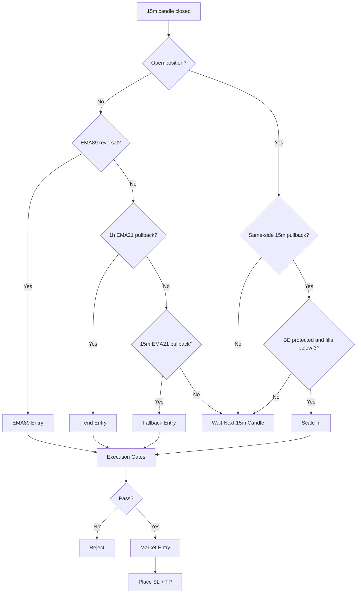
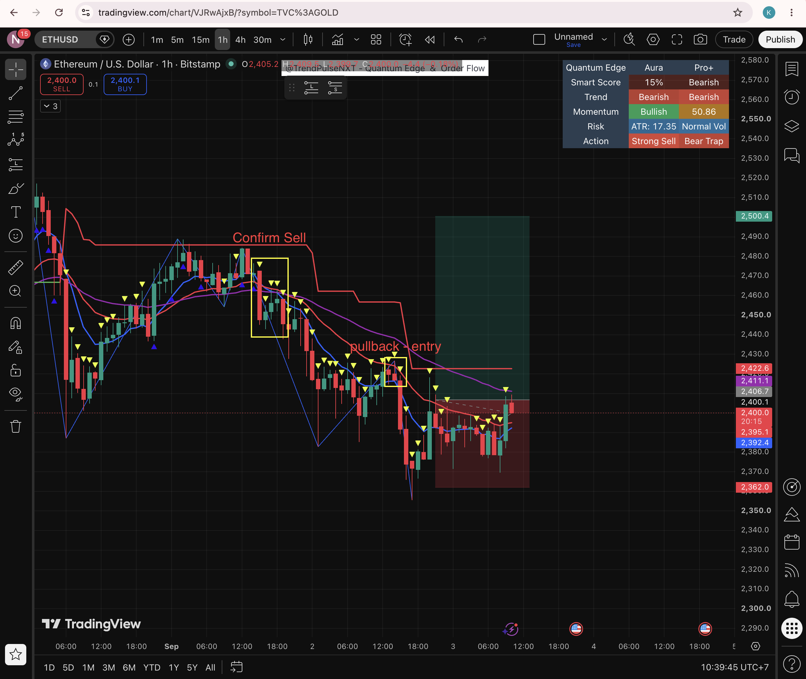
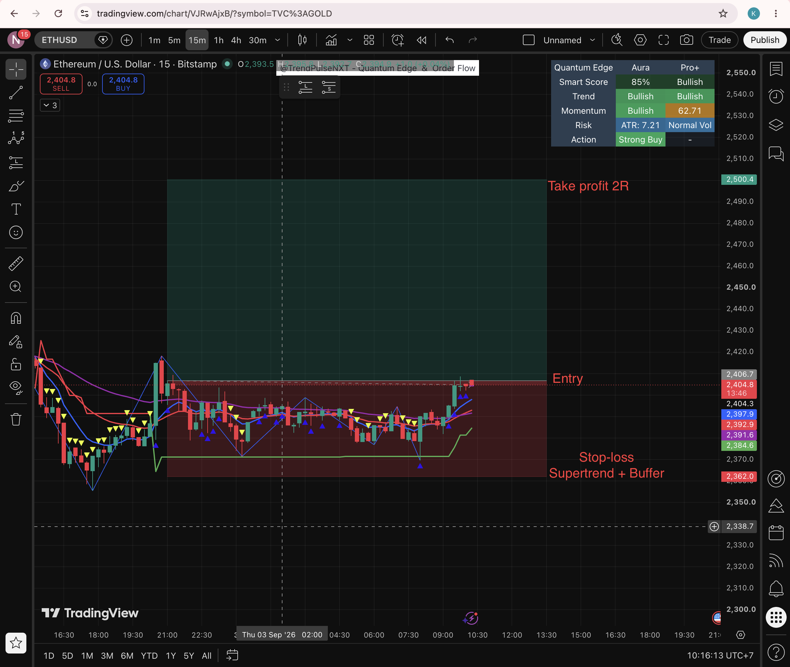
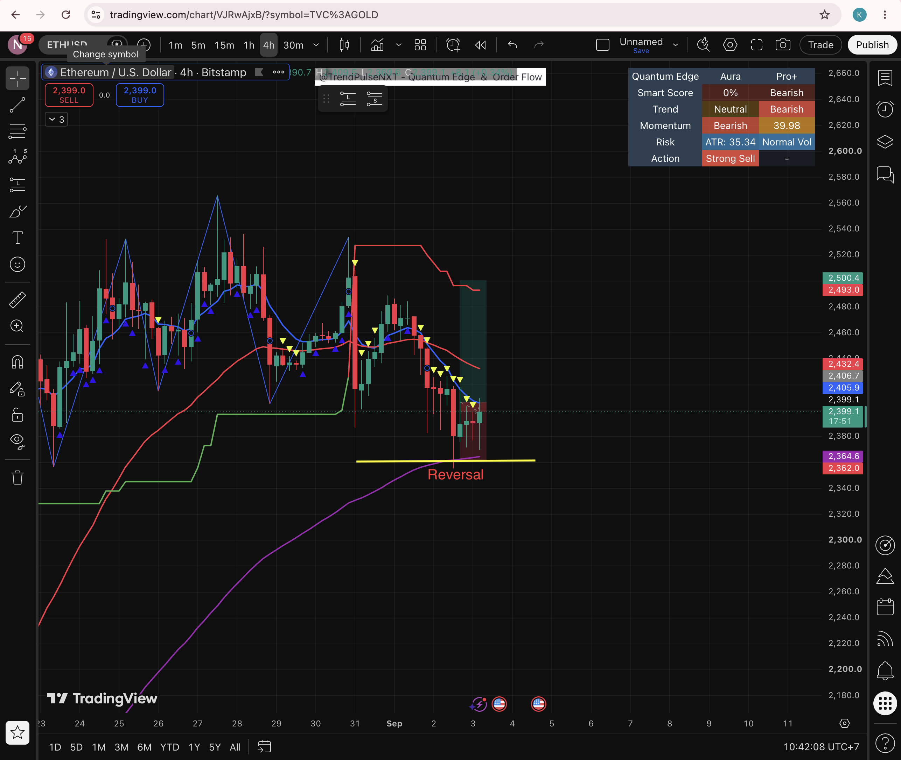
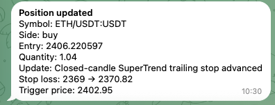
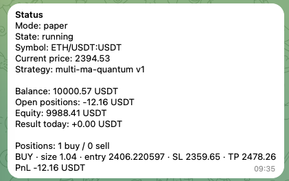
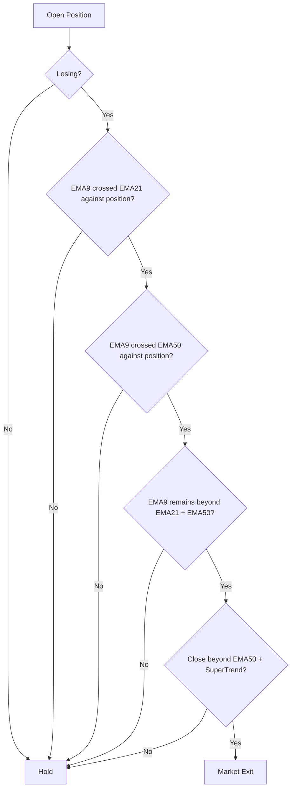
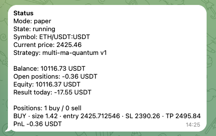
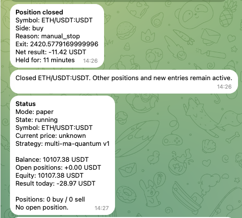
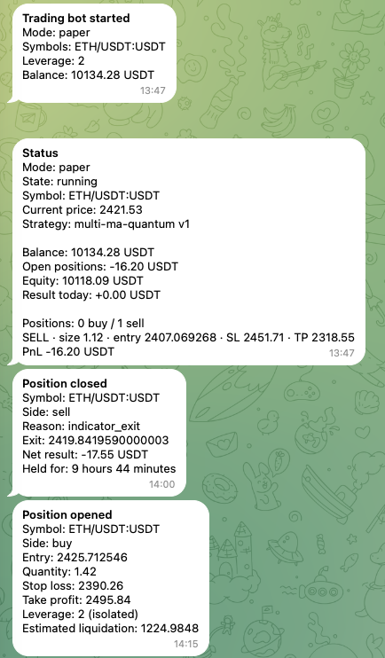

# Multi-MA Quantum V1

Timeframe review (2026-09-16): the [timeframe extension plan](plan-multi-ma-quantum-timeframes.md)
documents current code restrictions and required changes. This report's config
and results remain specific to the original profile; the extension is pending.

## Active Config

| Key | Value |
| --- | --- |
| Symbol | `ETH/USDT:USDT` |
| Entry TF | `15m` |
| Trend TF | `1h + 4h` |
| Trend | Close vs `EMA50` |
| EMA | `9 / 21 / 50` |
| SuperTrend | `10 / 3` |
| Touch tolerance | `0.15%` |
| SL buffer | `0.50%` |
| Normal TP | `1.5R` |
| EMA89 TP | `1.2R` |
| Break-even | `0.5R` |
| BE buffer | `0.05%` |
| Entry risk | `0.50%` |
| Leverage | `2x isolated` |
| Max fills | `3` |
| Time exit | `48 x 15m = 12h` |

> `EMA34 / EMA89` are used only by the EMA89 reversal setup. Normal `1h / 4h` trend uses close vs `EMA50`.

---

## 1. Open Position

### Main Flow



### Required Gates

Open a position only when all gates pass.

| Gate | Condition |
| --- | --- |
| Data | `15m / 1h / 4h` data ready |
| Bot | Running; circuit breaker clear |
| Trend | `1h / 4h` aligned, or valid EMA89 reversal |
| Leverage | `2x isolated`; SL, margin and liquidation valid |
| Portfolio | Maximum `3` open positions |

### Entry Setups

| Rule | Entry A - 1H EMA21 Pullback | Entry B - 15M EMA21 Fallback | Entry C - EMA89 4H Reversal |
| --- | --- | --- | --- |
| Priority | `2` | `3` | `1` |
| BUY | `1h + 4h close > EMA50; 15m touches 1h EMA21 and closes above` | `1h + 4h bullish; SuperTrend bullish; EMA9 > EMA21; touch and close above EMA21` | `Previous close above EMA89; bullish rejection; 4h EMA34 and 1h EMA50 above EMA89` |
| SELL | `1h + 4h close < EMA50; 15m touches 1h EMA21 and closes below` | `1h + 4h bearish; SuperTrend bearish; EMA9 < EMA21; touch and close below EMA21` | `Previous close below EMA89; bearish rejection; 4h EMA34 and 1h EMA50 below EMA89` |
| BUY SL | `1h EMA50 - 0.50%` | `15m SuperTrend - 0.50%` | `EMA89 - [0.5 x ATR(14) 4h + 0.50% x EMA89]` |
| SELL SL | `1h EMA50 + 0.50%` | `15m SuperTrend + 0.50%` | `EMA89 + [0.5 x ATR(14) 4h + 0.50% x EMA89]` |
| TP | `1.5R` | `1.5R` | `1.2R` |

#### Entry A - 1H EMA21 Pullback Example



#### Entry B - 15M EMA21 Fallback Example



#### Entry C - EMA89 4H Reversal Example



### Position Size and Scale-in

`Entry 1 Risk = Starting Balance x 0.50%`  
`Entry 1 Quantity (Q) = Risk / abs(Entry - SL)`

Example: `Q = 1.00`

| Entry | Quantity | % of Entry 1 | Condition |
| --- | ---: | ---: | --- |
| Entry 1 | `Q = 1.00` | `100%` | Valid entry setup |
| Entry 2 | `0.50Q = 0.50` | `50%` | Same-side 15m pullback; SL at break-even |
| Entry 3 | `0.25Q = 0.25` | `25%` | Same-side 15m pullback; SL at break-even |
| Total | `1.75Q = 1.75` | `175%` | All three entries filled |

After fill: update average entry, quantity and break-even; keep current SL and TP.

---

## 2. Move SL to Break-even


| Stop Update | Position Status |
| --- | --- |
|  |  |

---

## 3. Automatic Exit Before Break-even



### Exit Order

```text
Liquidation
  -> Protective SL
  -> Take Profit
  -> Structure / Opposite Signal Exit
  -> 12h Time Exit
```

---

## 4. Testing Results

| Open Position | Closed Position |
| --- | --- |
|  |  |

### Entry / Exit Flow



---

## Not Supported

Supply and Demand zone scanning is not supported yet.
