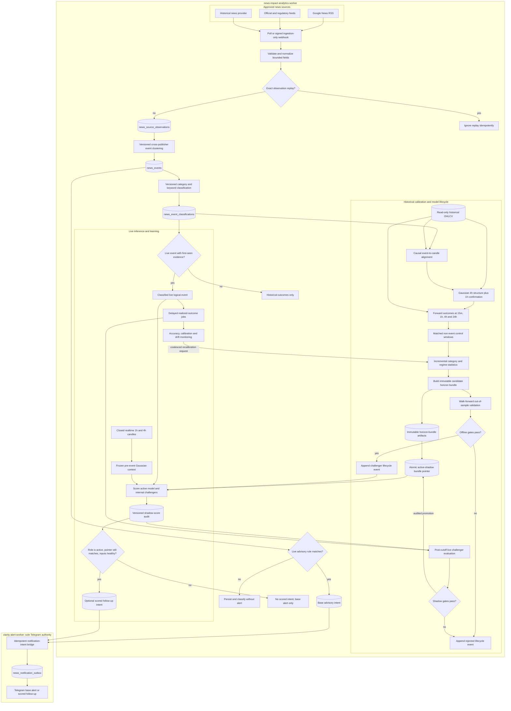

# Plan - CLARITY Act news monitoring, Telegram alerts, and market-impact analytics

> **Status: SOP-aligned RSS implementation.** Production runtime uses Google News RSS ingestion,
> durable Telegram delivery, and optional causal market-impact research. It does not fetch any
> Senate endpoint, classify an official result, or authorize news-derived automated trading.

## 1. Active objective and scope

Build two isolated workers, independent of the trading process:

```text
news-impact-analytics-worker
  -> Google News RSS every 30 seconds
  -> normalize, deduplicate, and persist a news event
  -> create one live-only advisory intent for a matching keyword
  -> persist historical rows for later causal market analysis

clarity-alert-worker
  -> bridge durable advisory intents into event_notification_outbox
  -> send Telegram with retry, idempotent dedupe, and delivery audit
```

The active keyword rule is the SOP rule: `CLARITY Act`, `cloture`, `senate vote`, or `crypto bill`.
Every RSS alert is explicitly unconfirmed news. It is not a `PASSED` or `FAILED` Senate result.

The analytics track may align immutable news timing evidence with closed candles and the existing
Gaussian `1h`/`4h` regime, then calculate approved forward outcomes. It remains informational and
does not influence orders, positions, strategy selection, or execution.

## 2. Explicit non-goals

The active release does not include:

- Fetching, scraping, probing, or requiring `www.senate.gov` or Senate Daily Press endpoints.
- Official vote-result confirmation, vote-menu/detail comparison, schedule detection, or arming
  baseline management.
- Automated position opening, closing, resizing, or news-derived trading decisions.
- A generic political-news platform, LLM vote-result classification, or exactly-once Telegram delivery.

### Retired official-Senate design

The official Senate source, state-machine, schedule, and `PASSED`/`FAILED` material in later
sections is retained as historical design evidence only. It is not active runtime scope and must not
override Sections 1 and 2. Reintroducing that lane requires a separate approved spec and a new
implementation decision; it must never block RSS-to-Telegram delivery.

## 4. Safety boundary

The alert worker and news-impact analytics worker must be separate processes from the trading bot.

```text
+---------------------------+  +------------------------------+  +------------------------------+
| trading-bot               |  | clarity-alert-worker         |  | news-impact-analytics-worker |
| engine and position risk  |  | official sources + Telegram  |  | news ingest, candles, models |
| exchange credentials      |  | no exchange credentials      |  | no exchange credentials      |
+-------------+-------------+  +---------------+--------------+  +---------------+--------------+
              |                                |                                 |
              v                                v                                 v
      operational trading tables       event alert tables          read-only candles + analytics
```

The alert worker must not import:

- `EngineModule`
- `ExecutionModule`
- Exchange factories or exchange executors
- Order or position repositories

The worker's Docker service must not receive:

```text
EXCHANGE_API_KEY
EXCHANGE_API_SECRET
EXCHANGE_API_PASSPHRASE
```

This is a route-level safety property. It must not depend on developers remembering not to call an
execution service.

Worker ownership is explicit:

- `news-impact-analytics-worker` owns Google News/official advisory polling, signed webhook intake,
  normalization, clustering, classification, market alignment, outcomes, statistics, model builds,
  challenger evaluation, and shadow scoring. It writes immutable advisory-notification intents; it
  never calls Telegram.
- `clarity-alert-worker` owns official Senate result polling and is the sole process allowed to
  create or claim Telegram outbox rows and call Telegram. It bridges durable advisory intents into
  the news outbox idempotently. It never waits for analytics before polling or delivering an
  official result.
- `trading-bot` owns execution and receives no news score or analytics database credential under
  this plan.

The analytics worker may read historical OHLCV needed for event studies. It may write only
news-impact evidence, jobs, outcomes, aggregates, immutable model artifacts, candidate/evaluation
audit, notification intents, health, and shadow-score tables. It must not receive exchange credentials,
import execution modules, mutate orders or positions, write to strategy/backtest result tables, or
write a Telegram outbox row. `NEWS_IMPACT_TRADING_ENABLED` remains `false` and is rejected by
configuration validation.

## 5. Source hierarchy

### 5.1 Primary result source - Senate roll-call votes

Use the official Senate roll-call list for the 119th Congress, second session:

```text
https://www.senate.gov/legislative/LIS/roll_call_lists/vote_menu_119_2.htm
```

The page exposes an XML representation. Prefer the XML representation as the primary machine
contract. Keep the HTML table parser as a production-capable fallback after its structure has
fixture coverage. Phase 0 must probe the exact XML and HTML endpoints from the intended production
host because Senate infrastructure may treat browser and server-to-server traffic differently. The
implementation must not assume XML availability until that probe succeeds.

Planning evidence on September 10, 2026 found the vote-menu HTML reachable in a browser while a
direct HTTP-client request to the linked XML endpoint returned `403`. This does not predict the
production host result, but it makes the production-host connectivity probe and HTML fallback
mandatory rather than optional hardening.

The source flow is:

1. Poll the session vote-menu XML, or the vote-menu HTML fallback.
2. Identify a candidate by Congress, session, vote number, issue, question, result, and vote date.
3. Fetch the candidate's individual vote-detail XML, or its HTML fallback.
4. Require the menu and detail records to agree on Congress, session, vote number, measure,
   cloture-on-motion-to-proceed wording, official terminal result, and tally.
5. Fail closed and emit `NEEDS_REVIEW` when the two official representations disagree.

The vote menu and vote-detail page may not become available at exactly the same time. An exact menu
candidate is therefore persisted as evidence with an internal `awaiting_detail` confirmation status,
but it does not change the event to `PASSED` or `FAILED` and does not create a result outbox row. The
worker targets detail attempts at offsets `0`, `2`, `5`, and `10` seconds from
`pending_confirmation_started_at` while normal five-second menu polling continues. At most one
detail request is in flight; when a prior five-second request overlaps a target offset, the missed
attempt starts immediately after the prior request completes. Escalation cannot fire until all four
attempts have completed or timed out and the configured confirmation deadline has elapsed. A
missing, `404`, or transiently unavailable detail page during that interval is publication lag, not
a menu/detail disagreement.

The initial confirmed-only release never promotes a menu-only candidate to a terminal result. If the
detail record is still unavailable after `CLARITY_ALERT_DETAIL_CONFIRMATION_TIMEOUT_MS`, the worker
remains non-terminal, becomes unready, emits one deduplicated operator `NEEDS_REVIEW` alert, and keeps
retrying both representations. A syntactically available detail record that contradicts the menu
fails immediately rather than waiting for the timeout. Record menu-candidate-to-confirmation delay
as a separate upstream publication-lag metric; the confirmed-delivery latency clock starts only when
both required official representations first agree. This makes the latency contract honest without
weakening result classification.

A result is accepted only when all of the following match after normalization:

```text
issue == "H.R. 3633"
question contains "cloture"
question contains "motion to proceed"
result is "Agreed to" or "Rejected"
```

The vote-menu result field is expected to normalize to `Agreed to` or `Rejected`. A vote-detail
result may contain the motion prefix, for example `Cloture on the Motion to Proceed Agreed to`; the
adapter extracts the terminal outcome only from the dedicated result field after the issue and
question have already matched. It must never search an arbitrary page body for the words
`Agreed to` or `Rejected`.

Mapping:

| Official result | Domain result |
|---|---|
| `Agreed to` | `PASSED` |
| `Rejected` | `FAILED` |

Do not derive the result by comparing the yea count with a hard-coded threshold. Senate rules and
the number of Senators duly chosen and sworn determine the threshold. The official result is the
source of truth; the tally is supporting evidence.

The following must not match:

- Final passage of H.R. 3633.
- An amendment to H.R. 3633.
- A motion to proceed without the cloture question.
- A cloture vote for another bill.
- A headline or schedule entry that predicts an outcome.
- A row with missing or unknown result wording.
- A matching historical row at or below the persisted baseline vote number.
- A candidate whose menu and detail records disagree.

### 5.2 Schedule source - Senate Daily Press

Use the Senate Daily Press homepage as the discovery page for the latest dated schedule post:

```text
https://www.dailypress.senate.gov/
```

The `/on-the-floor/` page is supplementary navigation and next-vote context; it is not sufficient as
the sole schedule source because it may not contain the full future-event wording. The discovery
adapter must inspect the latest relevant Daily Press posts, resolve their dated URLs, and search for
the exact H.R. 3633 cloture wording.

The dated Daily Press page below is the initial evidence for the expected time:

```text
https://www.dailypress.senate.gov/tuesday-september-8-2026/
```

It states that the cloture motion with respect to H.R. 3633 ripens on September 15, 2026 at 2:15
p.m. Eastern Time. The adapter retains every resolved dated source URL with its observation and
continues discovering newer posts rather than polling only the initial article. Closer to the event,
it also observes the official Senate legislative schedule for same-day confirmation:

```text
https://www.senate.gov/legislative/legislative_home.htm
```

Configuration supports an operator-provided official schedule URL and scheduled-time override when
the Senate changes its publishing route or announces a change that the adapter cannot yet parse. An
override is audited, must identify its operator and reason, and does not create an official vote
result.

All configured and discovered schedule URLs must use HTTPS and resolve to an allowlisted Senate
host. Every redirect target is checked against the same allowlist before it is followed.

The schedule source may produce:

- `SCHEDULED`
- `RESCHEDULED`
- `POSTPONED`
- `CANCELLED`
- `UNKNOWN`

The schedule source must never overwrite an official roll-call result.
The absence of H.R. 3633 from a summary, navigation page, or newer post is not evidence of
postponement or cancellation. The worker continues polling both the last relevant dated article
and the discovery sources until explicit official wording changes the schedule state.

### 5.3 Option A advisory source - Google News RSS or low-code webhook

The initial advisory path supports the SOP RSS URL:

```text
https://news.google.com/rss/search?q=CLARITY+Act+Senate+when:1d
```

The RSS client may follow at most five redirects. The initial URL and every redirect target must
remain HTTPS on the exact `news.google.com` host. One timeout covers the complete redirect chain,
and the final RSS response remains subject to the configured response-size limit.

RSS alerts are advisory and must use this label:

```text
FLASH - UNCONFIRMED
```

An RSS observation cannot transition the official state to `PASSED` or `FAILED`. The feature remains
disabled by default and may be enabled after its own deduplication, false-positive, Telegram, and
data-retention acceptance tests pass; it does not need to weaken or replace the official result path.

The analytics worker's live ingestion adapter may be either:

1. a repository-owned RSS poller running every 30 seconds; or
2. a signed webhook receiving the normalized item from Make.com or Zapier.

Both routes must produce the same immutable normalized event contract and idempotency key. The
Make.com/Zapier route is ingestion-only; the repository outbox is the sole Telegram delivery
authority. Allowing both the low-code workflow and the repository to send would create races,
duplicates, and alerts with no durable analytics evidence.

Version 1 accepts only bounded feed or webhook fields: source record ID, canonical URL, publisher,
title, bounded summary, source publication timestamp, and ingestion metadata. It does not fetch or
execute arbitrary publisher pages. A live item is accepted for persistence when its source/schema,
URL, timestamp shape, and content bounds pass validation. Detection keywords may determine whether
an advisory notification is created, but they must not prevent storage of an otherwise valid item
from an approved feed because that would bias keyword-candidate discovery and historical analysis.

The webhook uses explicit headers `X-News-Signature-Version`, `X-News-Timestamp`, `X-News-Nonce`, and
`X-News-Signature`. Version 1 signs this exact payload:

```text
v1 + "\n" + timestamp + "\n" + nonce + "\n" + lowercase_hex_sha256(raw_body_bytes)
```

`timestamp` is a base-10 Unix epoch millisecond string and `nonce` is a canonical UUID or at least
128 bits of URL-safe randomness. `X-News-Signature` is the lowercase hexadecimal HMAC-SHA256 of that
UTF-8 payload and is compared in constant time. Binding version,
timestamp, nonce, and exact raw-body bytes prevents an unsigned nonce/header change from bypassing
replay protection. The database enforces nonce uniqueness per upstream identity for at least the
replay window. A legitimately re-signed duplicate with a new nonce is still suppressed by the
source/content idempotency key. The webhook also enforces a strict body-size limit, per-source rate
limit, and allowlisted event schema. An invalid or replayed request is rejected before enqueue.

Google News is a discovery source, not a complete historical archive. Historical collection may use
bounded `after:`/`before:` query windows, but every such row is marked as backfilled and cannot claim
that its publication timestamp was the time the live system first observed it. Direct official
sources or a historical news provider should supplement Google News when coverage or timing matters.

## 6. Domain model

### 6.1 Event identity

```ts
interface MonitoredLegislativeEvent {
  readonly eventKey: string;
  readonly chamber: "us_senate";
  readonly congress: 119;
  readonly session: 2;
  readonly billId: "H.R. 3633";
  readonly motionType: "cloture_on_motion_to_proceed";
  readonly initialScheduledAt: number;
}
```

The event identity is code-owned for the first release. Do not add a generic event administration
API or database-driven provider configuration before another event actually requires it.

### 6.2 Monitoring boundary and official vote identity

Before the worker is armed, it records the highest official vote number already present in the
119th Congress, second-session menu:

```ts
interface MonitoringArmState {
  readonly eventKey: string;
  readonly armedAt: number;
  readonly baselineVoteNumber: number;
  readonly armedBy: string;
}
```

Normal monitoring accepts only a matching vote whose number is greater than
`baselineVoteNumber`. This prevents first startup, database restore, or parser changes from
replaying a historical vote. The baseline is durable and is not recalculated on an ordinary
restart.

If the worker is first deployed after the target vote has already been published, an operator may
authorize catch-up explicitly. The authorization records operator, timestamp, reason, and the
expected vote number or vote date. Catch-up is fail-closed and cannot scan the entire session and
select a result silently.

Once confirmed, the official vote identity is:

```text
119:2:<vote_number>
```

The vote number, rather than page position or response order, is the stable external identifier.

Arming is an explicit fail-closed lifecycle boundary. Before a durable arm record exists, the worker
may run dependency checks and read-only source probes, but it must not persist event observations,
change event state, or create notification outbox rows. It publishes durable health with
`readiness_status = unready` and reason `event_not_armed`.

The `arm` command fetches and validates the current vote menu, then acquires a transaction-scoped
event arming lock and creates the initial event row, baseline, and operator-action audit record in
one database transaction. This arming lock is distinct from the worker's session leadership lock.
Failure to fetch a trustworthy baseline leaves the event unarmed. A vote published after the
baseline fetch has a greater vote number and is detected normally; a target vote already present in
the baseline requires the explicit catch-up procedure. Ordinary worker startup can never recalculate
or silently replace the baseline.

### 6.3 Event state

```text
SCHEDULED
MONITORING
POSTPONED
CANCELLED
PASSED
FAILED
NEEDS_REVIEW
```

Allowed transitions:

```text
SCHEDULED  -> MONITORING | POSTPONED | CANCELLED | PASSED | FAILED | NEEDS_REVIEW
MONITORING -> SCHEDULED | PASSED | FAILED | POSTPONED | CANCELLED | NEEDS_REVIEW
POSTPONED  -> SCHEDULED | MONITORING | CANCELLED | PASSED | FAILED | NEEDS_REVIEW
CANCELLED  -> SCHEDULED | PASSED | FAILED | NEEDS_REVIEW
PASSED     -> NEEDS_REVIEW
FAILED     -> NEEDS_REVIEW
NEEDS_REVIEW -> PASSED | FAILED
```

An exact official result may move any non-terminal schedule state to `PASSED` or `FAILED`; the
schedule source is never allowed to block an authoritative vote result.

`RESCHEDULED` and `UNKNOWN` are schedule-observation outcomes, not persistent event states:

- `RESCHEDULED` updates `scheduled_at`, increments the event version, and emits a schedule-change
  outbox record. It becomes `SCHEDULED` when the new active window has not begun and remains or
  becomes `MONITORING` when the new time is already inside the active window.
- `UNKNOWN` never clears a known schedule. It retains the previous state when the response is
  merely incomplete. Contradictory or newly unsupported schedule wording retains the lifecycle
  state but emits a `NEEDS_REVIEW` operator alert. Persistent `NEEDS_REVIEW` is reserved for an
  ambiguous official result or a post-terminal official correction.
- A schedule observation cannot move `PASSED` or `FAILED` back to a non-terminal state.

An alert-worthy decision may increment `version` and append a history snapshot even when the
lifecycle status string does not change. This gives schedule contradictions, overdue detail
confirmation, and other review messages an immutable state version without inventing a terminal
transition.

An official source changing after a terminal result does not silently replace the result. It moves
the event to `NEEDS_REVIEW` and creates a correction alert containing both the previous and new
observations.

### 6.4 Observation

Every source adapter returns normalized data and performs no side effects:

```ts
interface EventObservation {
  readonly eventKey: string;
  readonly sourceName: string;
  readonly sourceUrl: string;
  readonly sourceRecordId: string;
  readonly sourcePublishedAt: number | null;
  readonly latencyReferenceAt: number;
  readonly latencyReferenceKind:
    | "official_published_at"
    | "trusted_last_modified"
    | "trusted_http_date"
    | "first_observed_at";
  readonly observedAt: number;
  readonly payloadHash: string;
  readonly kind: "schedule" | "official_result" | "unconfirmed_report";
  readonly parsedState: Readonly<Record<string, unknown>>;
  readonly rawExcerpt: string;
}
```

`rawExcerpt` is bounded and redacted. Do not store an unlimited source response in the operational
database. `payloadHash` is calculated from a canonical serialization of the normalized relevant
fields, not from raw XML, HTML, attribute order, whitespace, unrelated page content, or response
headers.

Use stable logical source names: `senate_vote_menu`, `senate_vote_detail`,
`senate_daily_press`, `senate_floor_schedule`, and advisory `google_news_rss`. XML and HTML fallbacks
for the same logical source share a name and canonical hash so representation changes deduplicate;
menu and detail remain distinct source names so confirmation always retains two independent evidence
records.

## 7. Persistence design

Add two additive operational migrations, keeping official-alert and analytics relations separable:

```text
migrations/operational/0059_clarity_act_alert_pipeline.sql
migrations/operational/0060_news_impact_analytics.sql
```

### 7.1 `external_event_states`

One current row per event:

```text
event_key                 TEXT PRIMARY KEY
chamber                   TEXT NOT NULL
congress                  INTEGER NOT NULL
session                   INTEGER NOT NULL
bill_id                   TEXT NOT NULL
motion_type               TEXT NOT NULL
status                    TEXT NOT NULL
scheduled_at              TIMESTAMPTZ
armed_at                  TIMESTAMPTZ NOT NULL
armed_by                  TEXT NOT NULL
baseline_vote_number      INTEGER NOT NULL
catch_up_authorized_at    TIMESTAMPTZ
catch_up_authorized_by    TEXT
catch_up_reason           TEXT
catch_up_vote_number      INTEGER
catch_up_vote_date        DATE
pending_vote_number       INTEGER
pending_menu_observation_id BIGINT
pending_confirmation_started_at TIMESTAMPTZ
pending_confirmation_alerted_at TIMESTAMPTZ
vote_number               INTEGER
official_vote_at          TIMESTAMPTZ
official_result           TEXT
yea_count                 INTEGER
nay_count                 INTEGER
present_count             INTEGER
not_voting_count          INTEGER
source_url                TEXT
source_published_at       TIMESTAMPTZ
first_observed_at         TIMESTAMPTZ
updated_at                TIMESTAMPTZ NOT NULL
version                   INTEGER NOT NULL
```

Use text columns with check constraints for the event-specific states. Avoid adding PostgreSQL enum
types for a single event because removing or changing enum values complicates rollback.

The pending-confirmation fields are either all absent or identify one exact menu candidate. They
survive restart so the detail timeout and deduplicated escalation cannot reset when the process does.
Confirming or rejecting that candidate clears them in the same transaction that records the
corresponding evidence and state decision.

### 7.2 `external_event_observations`

Append-only audit evidence:

```text
id                        BIGSERIAL PRIMARY KEY
event_key                 TEXT NOT NULL
source_name               TEXT NOT NULL
source_url                TEXT NOT NULL
source_record_id          TEXT NOT NULL
source_published_at       TIMESTAMPTZ
latency_reference_at      TIMESTAMPTZ NOT NULL
latency_reference_kind    TEXT NOT NULL
observed_at               TIMESTAMPTZ NOT NULL
payload_hash              TEXT NOT NULL
raw_excerpt               TEXT NOT NULL
parsed_payload            JSONB NOT NULL
```

Unique constraint:

```text
(event_key, source_name, payload_hash)
```

Index `source_record_id` and `(event_key, observed_at)` for evidence lookup without scanning the
append-only table.

`EventObservation` and this table are reserved for external-source evidence. Operator commands are
not represented as fake source observations and do not require a synthetic `source_url`.

### 7.3 `external_event_state_history`

Keep an immutable snapshot for every committed event version:

```text
id                        BIGSERIAL PRIMARY KEY
event_key                 TEXT NOT NULL
version                   INTEGER NOT NULL
status                    TEXT NOT NULL
state_snapshot            JSONB NOT NULL
trigger_kind              TEXT NOT NULL
trigger_observation_id    BIGINT
trigger_operator_action_id BIGINT
system_reason             TEXT
created_at                TIMESTAMPTZ NOT NULL
UNIQUE (event_key, version)
```

`trigger_kind` is `source`, `operator`, or `system`, with a check constraint requiring exactly the
matching observation ID, operator-action ID, or bounded system reason. `state_snapshot` contains the
normalized schedule, arming baseline, pending confirmation, official vote identity/result, tally,
and relevant timestamps for that version. The current-state update and history insert occur in one
transaction. An outbox row's `(event_key, event_state_version)` references this history, so later
reschedules or corrections cannot erase the exact state that produced an earlier alert.

### 7.4 `event_operator_actions`

Phase 0 operator-to-login mappings are deployed as read-only authorization data:

```text
event_operator_principals
event_key                 TEXT NOT NULL
operator_id               TEXT NOT NULL
database_session_user     TEXT NOT NULL
valid_from                TIMESTAMPTZ NOT NULL
valid_until               TIMESTAMPTZ NOT NULL
PRIMARY KEY (event_key, operator_id)
UNIQUE (event_key, database_session_user)
```

Only the deploy role can create this mapping. The worker and operator roles receive read access only,
and the validity window must cover the event plus correction grace and an approved postponement
buffer. A reschedule beyond that window is `NO-GO` until the deploy role extends it. Replacing an
operator requires an explicit deploy change and preserves the previous mapping in
migration/deployment audit history.

Append-only audit records for exceptional local actions:

```text
id                        BIGSERIAL PRIMARY KEY
event_key                 TEXT NOT NULL
action_kind               TEXT NOT NULL
requested_operator_id     TEXT NOT NULL
authenticated_principal   TEXT NOT NULL
database_role             TEXT NOT NULL
host_name                 TEXT NOT NULL
request_id                UUID NOT NULL UNIQUE
target_type               TEXT
target_id                 TEXT
reason                    TEXT
before_state              JSONB
after_state               JSONB
created_at                TIMESTAMPTZ NOT NULL
```

The database denies runtime `UPDATE` and `DELETE` access to this table. `--operator <id>` is a human
label, not authentication. `authenticated_principal` is populated server-side from PostgreSQL
`session_user`; host name and local OS/SSH identity are additional audit context, not the authority.
The function rejects a supplied operator ID that is not mapped to `session_user` by the approved
event runbook. Mutating commands require a dedicated operator database credential obtained
through the approved secret process. Each named operator uses an individual PostgreSQL login role;
sharing one operator login is prohibited. The worker credential cannot authorize arm, catch-up,
manual resolution, or stop actions. Status remains read-only.

Expose mutations through narrowly scoped `SECURITY DEFINER` PostgreSQL functions owned by the deploy
role. Each function uses a fixed trusted `search_path`, validates current state and authenticated
role, writes the operator-action record and target mutation atomically, and is revoked from `PUBLIC`.
The operator group role receives `EXECUTE` only; named login roles inherit it and receive no direct
`INSERT`, `UPDATE`, or `DELETE` grant on event state, evidence, outbox, or audit tables. Functions
compare `session_user` with the approved operator mapping, so `--operator` cannot substitute another
person's identity.

### 7.5 `event_notification_outbox`

Durable delivery state:

```text
id                        BIGSERIAL PRIMARY KEY
event_key                 TEXT NOT NULL
message_kind              TEXT NOT NULL
dedupe_key                TEXT NOT NULL UNIQUE
message_text              TEXT NOT NULL
event_state_version       INTEGER NOT NULL
trigger_observation_id    BIGINT
trigger_operator_action_id BIGINT
confirmation_ready_at     TIMESTAMPTZ
status                    TEXT NOT NULL
attempt_count             INTEGER NOT NULL DEFAULT 0
next_attempt_at           TIMESTAMPTZ NOT NULL
last_attempt_at           TIMESTAMPTZ
claim_owner               TEXT
claim_token               UUID
claim_version             BIGINT NOT NULL DEFAULT 0
claimed_at                TIMESTAMPTZ
lease_until               TIMESTAMPTZ
last_error                TEXT
telegram_message_id       BIGINT
created_at                TIMESTAMPTZ NOT NULL
delivered_at              TIMESTAMPTZ
expires_at                TIMESTAMPTZ
resolved_at               TIMESTAMPTZ
resolved_by               TEXT
resolution_note           TEXT
resolution_external_reference TEXT
resolution_operator_action_id BIGINT
```

Exactly one of `trigger_observation_id` and `trigger_operator_action_id` must be populated. Result,
correction, and schedule messages are triggered by source evidence; canaries and other explicit
operator messages are triggered by an audited operator action. Foreign keys prevent deletion of the
trigger evidence.

`FOREIGN KEY (event_key, event_state_version)` references the immutable state-history snapshot. The
outbox trigger identifies why the message was requested, while the state-history reference records
the exact committed domain state rendered into it.

`confirmation_ready_at` is required for confirmed results and corrections and absent for messages
that do not require menu/detail agreement. It is written in the result transaction and is the start
of the worker-controlled delivery SLA.

Because a confirmed result depends on both vote-menu and vote-detail evidence, add an evidence join
table:

```text
event_notification_evidence
outbox_id                 BIGINT NOT NULL
observation_id            BIGINT NOT NULL
evidence_role             TEXT NOT NULL
PRIMARY KEY (outbox_id, observation_id)
```

For a result, `evidence_role` distinguishes `vote_menu` and `vote_detail`. This makes every alert and
latency measurement traceable to the exact source records that authorized it rather than relying on
timestamps or event-key heuristics.

`expires_at` is nullable. It must be `NULL` for confirmed `PASSED`/`FAILED` alerts and official
correction alerts. Those records remain pending or retryable until Telegram accepts them or an
operator explicitly marks them resolved with an audit note. Canary, schedule-change, and optional
unconfirmed flash messages may have a finite expiry.

Outbox states:

```text
pending
sending
retry_wait
delivered
expired
resolved
```

Database check constraints enforce valid status and message-kind values, non-negative attempt
counts, terminal timestamps that match terminal statuses, and `expires_at IS NULL` for confirmed
results and official corrections. They also enforce the trigger XOR, require claim fields only while
`sending`, require `confirmation_ready_at` for confirmed results/corrections, and require terminal
rows to have no active lease. Foreign keys preserve event ownership and evidence provenance. Runtime
code must not be the only enforcement layer for critical outbox invariants.

A `resolved` critical row requires `resolution_external_reference` and a foreign key to the
operator-action record created in the same transaction. A free-form note alone is insufficient proof
that the alert was delivered through the manual fallback. A database trigger rejects transition to
`resolved` unless `session_user` matches the active operator mapping and the referenced action is a
resolution for that exact outbox row; the worker login cannot manufacture manual resolution.

Recording a new observation, changing the event state, and inserting the corresponding outbox row
must occur in one database transaction. A committed result must always have a committed delivery
record.

### 7.6 `event_alert_worker_health`

The worker publishes a durable health snapshot that can be read by a separate Docker healthcheck
process:

```text
worker_key                TEXT NOT NULL
instance_id               TEXT NOT NULL
process_started_at        TIMESTAMPTZ NOT NULL
loop_sequence             BIGINT NOT NULL
last_loop_completed_at    TIMESTAMPTZ NOT NULL
source_health             JSONB NOT NULL
last_database_success_at  TIMESTAMPTZ NOT NULL
last_successful_delivery_at TIMESTAMPTZ
oldest_pending_outbox_age_ms BIGINT
oldest_pending_news_outbox_age_ms BIGINT
last_advisory_intent_bridge_at TIMESTAMPTZ
last_telegram_validation_at TIMESTAMPTZ
last_heartbeat_success_at TIMESTAMPTZ
clock_skew_ms             INTEGER
official_lane_enabled     BOOLEAN NOT NULL
current_event_status      TEXT NOT NULL
armed_status              TEXT NOT NULL
leadership_status         TEXT NOT NULL
readiness_status          TEXT NOT NULL
readiness_reasons         JSONB NOT NULL
news_delivery_lane_enabled BOOLEAN NOT NULL
news_delivery_leadership_status TEXT NOT NULL
news_delivery_readiness_status TEXT NOT NULL
news_delivery_readiness_reasons JSONB NOT NULL
updated_at                TIMESTAMPTZ NOT NULL
PRIMARY KEY (worker_key, instance_id)
```

Each process owns only its instance-specific row, so a nonleader cannot overwrite the leader's
health. Stale instance rows are retained for the event audit window and excluded from current-health
selection by freshness and `instance_id`. At startup the process generates a UUID instance ID and
atomically writes it to a container-local health identity file; the Docker health command reads that
file and queries only the matching row. The file contains no credential or event payload.

The row is updated atomically after a complete orchestration cycle, not by an unrelated heartbeat
timer. `loop_sequence` must increase while the process is healthy. The Docker health command reads
this row, validates freshness and readiness, and fails when the database is unreachable. No HTTP
server or public health port is required for the first release.

The health row may exist before the event-state row. In that condition `current_event_status` uses
the explicit non-domain sentinel `UNARMED`, `armed_status = unarmed`, and official-lane readiness
must fail when that lane is enabled. The independent news-delivery lane may still be ready. Only the
process holding the event leadership lock may publish `leadership_status = leader` or send a
successful external heartbeat.

## 7A. Queue-driven news-impact analytics

### 7A.1 Design decision

Every accepted crawl or webhook item enters a durable queue. Keyword/category evidence and
incremental statistics may be updated as jobs complete, but the `active_shadow` model must not be
retrained or replaced after each crawl.

A newly ingested article has no completed `15m`, `1h`, `4h`, or `24h` market outcome. Updating an
active weight immediately would therefore learn from text frequency rather than measured market
response. It would also make duplicate syndication, spam, and one unusual article capable of moving
live behavior before validation.

The approved ownership and model lifecycle is:



Alert delivery is a high-priority path. Outcome collection, aggregate updates, model training, and
reporting are lower-priority consumers and must never delay Telegram or official-result polling.
The base advisory intent is committed with a notification-eligible live logical event and does not
wait for market scoring. A later scored intent is a separate deduplicated follow-up.

Each classified crawl may update raw keyword frequency, co-occurrence evidence, and
`news_keyword_candidates`. Only a matured, valid market outcome may update impact sufficient
statistics. Neither path may mutate the active taxonomy, an immutable model artifact, or the
`active_shadow` pointer.

### 7A.2 Normalized news-event contract

Keep immutable source evidence, logical event clustering, and versioned classification separate.
Reclassifying an old article under a new taxonomy must not rewrite what the source originally
published:

```ts
interface NormalizedNewsSourceObservation {
  readonly id: number;
  readonly sourceName: string;
  readonly sourceRecordId: string;
  readonly canonicalUrl: string;
  readonly sourcePublishedAt: number | null;
  readonly firstSeenAt: number | null;
  readonly ingestedAt: number;
  readonly backfilledAt: number | null;
  readonly timingQuality: "live_first_seen" | "source_published_proxy" | "unknown";
  readonly isHistoricalBackfill: boolean;
  readonly title: string;
  readonly boundedExcerpt: string;
  readonly contentHash: string;
  readonly language: string | null;
}

interface LogicalNewsEvent {
  readonly id: number;
  readonly eventClusterKey: string;
  readonly stableLiveAlertEventId: string | null;
  readonly earliestSourcePublishedAt: number | null;
  readonly firstSeenAt: number | null;
  readonly primaryObservationId: number;
  readonly clusteringVersion: string;
}

interface NewsEventClassification {
  readonly newsEventId: number;
  readonly taxonomyVersion: string;
  readonly classifierVersion: string;
  readonly keywords: readonly string[];
  readonly keywordConfidences: Readonly<Record<string, number>>;
  readonly keywordCategoryAssignments: Readonly<Record<string, readonly string[]>>;
  readonly categories: readonly string[];
  readonly categoryConfidences: Readonly<Record<string, number>>;
  readonly sentiment: "positive" | "neutral" | "negative" | "mixed" | "unknown";
  readonly significanceScore: number;
  readonly classificationConfidence: number;
  readonly sourceReliability: number;
  readonly noveltyScore: number;
  readonly classifiedAt: number;
}
```

Every canonical keyword in `keywords` has exactly one confidence entry and at least one category
assignment; every canonical category in `categories` has exactly one confidence entry. Unknown or
duplicate IDs fail classification validation rather than receiving an implicit default weight.

Exact replay deduplication uses `{sourceName, sourceRecordId, contentHash}`. Cross-publisher copies
remain separate source observations but join one logical event through a versioned clustering rule
using canonical links, normalized titles, bounded text similarity, source timestamps, and approved
entity/category evidence. Membership is immutable within one clustering version. Each source
observation belongs to exactly one logical event in that version, but a later version may produce a
different grouping without rewriting the earlier snapshot.

Re-clustering writes new `news_events`/membership rows plus append-only `news_event_lineage` edges
(`unchanged`, `merged`, or `split`) from prior-version events. The canonical analysis identity is
`{clusteringVersion, eventClusterKey}`. A training/evaluation run freezes exactly one clustering
version and one lineage-resolution policy, so one observation cannot contribute twice inside that
dataset. A live event also receives one immutable `stableLiveAlertEventId`; later re-clustering never
changes that ID and can never create another Telegram intent for the historical live event. One
logical event in the selected clustering version contributes at most one training sample per
`{venue, symbol, horizon, outcome version}`.

`firstSeenAt` is populated only when this system or an approved upstream webhook actually observed
the item live. A historical backfill must never copy `sourcePublishedAt` into `firstSeenAt`.
Backfilled rows use `source_published_proxy` and are excluded from ingestion-latency claims. Google
News backfills with no independently verifiable availability timestamp are research-only by default
and cannot train an active-shadow-eligible model. Phase 0 may approve another historical provider's
timestamp for active-shadow calibration only after its timing semantics and maximum uncertainty are
documented and sensitivity-tested.

One article may produce several categories. Exact phrases such as `CLARITY Act`, `cloture`, and
`Senate vote` are detection features; statistical weights are learned primarily on reusable event
categories such as:

```text
legislative_progress
regulatory_approval
vote_scheduled
vote_delayed
proposal_rejected
enforcement_action
exchange_restriction
```

An automatically discovered phrase is written to `news_keyword_candidates`. It cannot enter the
active taxonomy merely because it appeared frequently. Promotion requires sufficient labeled
examples or an audited reviewer approval.

### 7A.3 Causal market alignment

For a live observation, the event time used by analysis is `firstSeenAt`; if unavailable, use
`ingestedAt`. For historical backfill, `sourcePublishedAt` is a lower-quality proxy and the record
must retain that limitation.

For each `{event, venue, symbol}` tuple:

1. Freeze the latest Gaussian `1h` and `4h` observations whose candles were closed by the event
   timestamp. Never recompute this context with candles that closed later.
2. Use the latest closed candle before the event as the pre-event price baseline. Prefer `1m`
   history when available and record the actual alignment resolution.
3. Measure outcomes at `15m`, `1h`, `4h`, and `24h` after the event timestamp.
4. If the required candle is missing, leave the outcome pending or mark it unavailable; never
   synthesize a candle or shift silently to a later timestamp.
5. Store the Gaussian model version, configuration, direction, volatility, confidence, and exact
   source-candle timestamps with the context.

The pre-event regime is an input. A regime observed after the event is an outcome and must never be
used to train the prediction for that same event.

### 7A.4 Forward outcomes and matched controls

Each matured horizon records:

```text
signed_forward_return
absolute_forward_return
pre_event_realized_volatility
post_event_realized_volatility
volatility_lift
maximum_favourable_excursion
maximum_adverse_excursion
resulting_market_direction
resulting_volatility_level
did_regime_transition
matched_control_return
abnormal_return
```

Raw return is not enough to infer news impact. Match each event to non-event control windows with the
same symbol, Gaussian direction, volatility level, time-of-day/session, day type, and similar recent
realized volatility. Where relevant, include the contemporaneous BTC or broad-market move as a
benchmark. `abnormal_return` is the event-window return minus the configured matched-control
estimate.

This design measures historical association under controlled market context. Reports must not call
the result causal proof.

### 7A.5 Durable analytics queues

The initial implementation should use PostgreSQL-backed queues with `FOR UPDATE SKIP LOCKED`, leased
claims, retry backoff, and idempotent completion. No Redis or additional queue service is required
for the first version.

| Queue/job kind | Trigger | Responsibility | Priority |
|---|---|---|---|
| `news_ingestion` | Every poll/webhook item | Normalize, hash and persist evidence | High |
| `news_classification` | New unique event | Keywords, categories, sentiment, significance and confidence | High |
| `news_live_scoring` | Classified live event plus one frozen bundle assignment | Score exactly one active or challenger bundle for one venue/symbol context | High |
| `news_outcome` | One due job per event/venue/symbol/horizon | Measure forward response after the horizon matures | Normal |
| `news_statistics_update` | New valid outcome | Update incremental sufficient statistics | Normal |
| `news_recalibration_request` | Threshold or schedule | Coalesce requests and build one candidate model | Low |
| `news_model_validation` | Candidate created | Produce walk-forward eligibility evidence for operator review | Low |
| `news_challenger_evaluation` | New post-cutoff outcome | Update immutable challenger evidence against active and baseline models | Low |

`dead_letter` is a terminal status of the original job, not another job kind or a row copied into an
unrelated queue.

Required idempotency keys include:

```text
ingestion: source_name + source_record_id + content_hash
base advisory intent: news_event_id + message_contract_version
classification: news_event_id + taxonomy_version + classifier_version
live score: news_event_id + venue + symbol + model_bundle_version + model_role + score_version
outcome: news_event_id + venue + symbol + horizon + outcome_version
statistics: outcome_id + statistics_version
recalibration: model_scope + data_cutoff + configuration_hash
scored follow-up intent: news_event_id + symbol_scope + active_model_bundle_version + message_contract_version
replay physical identity: job_kind + logical_dedupe_key + generation
```

`model_role` is frozen as `active_shadow` or `challenger` when the score job is created. It is audit
context, not recomputed from mutable current state; only a final active-pointer equality check can
authorize a scored notification intent.

A crawl may enqueue many duplicate observations. Duplicate evidence may update source coverage and
novelty calculations, but it must not create another logical event, Telegram alert, outcome, or
training sample.

Every job snapshots the advisory rule, message contract, taxonomy, classifier, clustering,
lineage-resolution, alignment, outcome, Gaussian regime, statistics, score, and impact-model
versions it needs when it is created. A retry must execute those frozen versions or fail for
operator review; it must not silently adopt a newer version deployed while the job was waiting.

Queue fan-out is transactional:

1. Accepting a new logical event commits its source/event membership and one classification job
   together. If a live item also matches the frozen deterministic advisory rule, the same
   transaction inserts one base advisory intent. Historical backfill creates no advisory intent.
2. Completing classification commits the immutable classification and one due outcome job for every
   configured `{venue, symbol, horizon}` together. For a live event it also snapshots the current
   active/challenger bundle assignments and creates exactly one live-score job per
   `{venue, symbol, bundle version, model role}`; zero score jobs is valid when no model is available.
   The four default horizons are `15m`, `1h`, `4h`, and `24h`.
3. Completing an outcome commits the immutable outcome and exactly one statistics-update job
   together when the outcome satisfies the frozen valid-sample rules.
4. Completing a statistics update applies its sufficient-statistics delta exactly once. It may
   create or coalesce a recalibration request, but it cannot promote a model.

Job leases and attempt budgets are configured per job kind. Short ingestion and classification jobs
must not inherit the same lease as a long recalibration or validation job. A long-running job renews
its lease with the current claim token/version before expiry; failure to renew stops its completion
write. Every kind has a bounded attempt budget, retry classification, and dead-letter policy. A
single global `NEWS_IMPACT_JOB_LEASE_MS` or unbounded retry loop is prohibited.

High-priority ingestion, classification, live scoring, and Telegram work use a reserved concurrency
budget. Low-priority recalibration pauses under queue pressure. Queue rows carry an explicit
priority, enqueue time, maximum attempt count, and bounded payload reference rather than an
unbounded article body.

### 7A.6 Analytics persistence

Add these tables through additive migrations:

```text
news_source_observations
news_events
news_event_observations
news_event_lineage
news_category_taxonomies
news_event_classifications
news_keyword_candidates
news_advisory_notification_intents
news_notification_outbox
news_market_contexts
news_market_outcomes
news_analysis_jobs
news_keyword_statistics
news_impact_models
news_impact_model_evaluations
news_model_status_history
news_active_model_pointers
news_live_score_audit
news_analytics_operator_actions
news_analysis_worker_health
```

`news_source_observations` is append-only source evidence. `news_events` is a versioned logical
event. `news_event_observations` is unique by `{clustering_version, observation_id}` and records
exactly one membership in that clustering snapshot. `news_event_lineage` records append-only
cross-version split/merge/unchanged relationships; it cannot emit notification intents.
`news_event_classifications` is unique by event, taxonomy version, and classifier version; a newer
classification never overwrites an earlier one.

`news_market_contexts` is immutable for a given event, venue, symbol, alignment version, and regime
model version. `news_market_outcomes` is unique by event, venue, symbol, horizon, and outcome version.

`news_advisory_notification_intents` is append-only and contains either a base live-event intent or
a scored follow-up intent. A base intent is inserted in the same transaction as its accepted,
notification-eligible live logical event; a scored intent references the exact
`news_live_score_audit` row. Every intent stores its advisory-rule and message-contract versions.
The analytics role may create intents but cannot write `news_notification_outbox`. The
`clarity-alert-worker` reads a
narrow intent view and idempotently inserts the corresponding outbox row by the intent's stable
dedupe key. Re-reading an intent after restart creates no duplicate logical message.

`news_notification_outbox` is owned and delivered only by `clarity-alert-worker`. It uses the same
leased-claim, token/version fencing, PostgreSQL-clock, retry, delivery-receipt, and non-secret logging
rules as `event_notification_outbox`. It references the immutable intent and logical event rather
than an official event-state version. Historical/backfill events are rejected by a database
constraint or trusted insertion function and can never create a live notification intent or outbox
row.

`news_analysis_jobs` stores `job_kind`, `logical_dedupe_key`, `generation`, `parent_job_id`,
`priority`, `due_at`, `status`, `attempt_count`, frozen version identifiers, `claim_owner`,
`claim_token`, `claim_version`, `lease_until`, `last_error`, and terminal timestamps. Valid statuses
are `pending`, `running`, `retry_wait`, `completed`, `dead_letter`, and `cancelled`. The same fencing
and database-clock rules used by the Telegram outbox apply to analytics jobs.

Normal enqueue functions may create only `generation = 0` and use a unique constraint on
`(job_kind, logical_dedupe_key, generation)` so duplicate crawls/fan-out coalesce. Exhausted jobs
transition in place to terminal `dead_letter` with their last error, frozen versions, and evidence
references intact. The audited replay function locks the lineage, creates
`generation = max(generation) + 1`, sets `parent_job_id` to the failed generation, and copies the
same logical key and frozen dependency versions unless the operator explicitly requests a separately
named research rebuild. It never resets or rewrites the failed row. Runtime enqueue code cannot
choose a nonzero generation, so replay support does not weaken normal idempotency.

Readiness fails for overdue high-priority dead letters, while a low-priority research dead letter
degrades analytics health without blocking confirmed Telegram delivery. Health and runbook tooling
may expose a dead-letter view, but there is no ambiguous `news_dead_letter` job kind.

`news_keyword_statistics` stores sufficient statistics rather than only the latest weight: sample
count, weighted sample count, sum and variance inputs, positive/negative counts, horizon, category,
regime, symbol scope, source scope, data cutoff, and statistics version. Keeping the evidence permits
a weight to be reproduced and audited.

`news_impact_models` stores immutable model artifacts only:

```text
model_version
model_family
symbol_scope
horizons
training_from
training_to
data_cutoff
feature_configuration
category_taxonomy_version
classifier_version
source_reliability_version
clustering_version
lineage_resolution_version
alignment_version
regime_model_version
outcome_version
statistics_version
score_version
market_data_contract_version
training_dataset_manifest_hash
weight_payload
source_code_revision
created_at
```

Lifecycle state is not stored as a mutable column on the artifact. Append-only
`news_model_status_history` records `candidate`, `challenger`, `active_shadow`, `retired`, and
`rejected` events with the triggering evaluation, authenticated operator action, reason, and
timestamp. Normal transitions are `candidate -> challenger -> active_shadow -> retired`; a
candidate or challenger may instead become `rejected`. An audited rollback may append a new
`active_shadow` event for a previously retired complete artifact.

One `news_impact_models` artifact is a horizon bundle: its ordered `horizons` contract and
`weight_payload` contain the estimates and evidence for all configured `15m`, `1h`, `4h`, and `24h`
cells in that symbol scope. A bundle is eligible only when every exposed cell passes its own sample
and validation gates; a missing/failed horizon is explicitly unavailable rather than filled from a
different model version.

`news_active_model_pointers` contains at most one row per `{symbol scope, model family}` and
references one immutable horizon-bundle artifact whose latest eligible lifecycle event is
`active_shadow`. Absence of a row is the explicit no-model/unscored state.

Promotion or rollback runs in one transaction that appends the new model event, retires the prior
active version when present, updates the pointer with optimistic `pointer_version` fencing, and
writes `news_analytics_operator_actions`. Live readers therefore see either the complete old pointer
or the complete new pointer, never a partially promoted model.

Promotion and rollback compare the bundle's full dependency vector, ordered horizons, venue/symbol
scope, and numeric feature contract with the currently deployed runtime contracts. A bundle with an
unavailable or incompatible classifier, source-reliability, clustering, lineage-resolution,
alignment, regime, outcome, statistics, score, or market-data version remains research evidence and
cannot become active.

Each `news_live_score_audit` row references one active or challenger bundle version and stores the
ordered per-horizon expected return, volatility lift, transition probability, evidence tier, and
input/context versions. A combined Telegram follow-up is rendered only from one complete
`active_shadow` bundle whose frozen job role is `active_shadow`; challenger jobs can never create a
notification intent. Before inserting the intent, completion rechecks that the current fenced active
pointer still references the frozen bundle; a superseded active job remains audit-only. The follow-up
never mixes horizon estimates from different model versions.

`news_analytics_operator_actions` is append-only and uses the same authenticated PostgreSQL
`session_user`, per-person login, fixed-`search_path` security-definer, and no-direct-table-write
principles as official alert operator actions. It audits research rebuilds, dead-letter replay,
candidate rejection, challenger activation, `active_shadow` promotion, rollback, and pause/resume
of low-priority work. Queue consumers cannot create a promotion action.

`news_analysis_worker_health` stores one instance-specific durable health row with queue depth/age,
dead-letter counts, current frozen component versions, active pointer versions, challenger age,
last candle read, last completed statistics update, last validation, drift state, and readiness
reasons. It does not affect confirmed-result readiness.

### 7A.7 Weight calculation and sparse samples

Classification is multi-label, so score aggregation must be deterministic. For every horizon and
estimate family (signed abnormal return, volatility lift, or transition probability), calculate:

```text
keyword_beta(k, c)
  = keyword_confidence(k) * keyword_sample_reliability(k, c)

keyword_residual(c)
  = clip(sum(keyword_beta(k, c) * shrunken_keyword_residual(k, c))
         / sum(keyword_beta(k, c)), configured metric bound)

category_component(c)
  = category_regime_weight(c) + keyword_residual(c)

category_alpha(c)
  = category_confidence(c) * sample_reliability(c)
    / sum(category_confidence * sample_reliability across eligible categories)

combined_estimate
  = sum(category_alpha(c) * category_component(c))

evidence_multiplier
  = classification_confidence
  * source_reliability
  * novelty_score

impact_estimate
  = neutral_baseline
  + evidence_multiplier * (combined_estimate - neutral_baseline)
```

Category and keyword confidences are frozen classifier outputs in `[0,1]`. Ineligible or unavailable
components are excluded before normalization. If no eligible category remains or the denominator is
zero, the horizon is unscored. The keyword residual is zero when no keyword has enough evidence and
is clipped by a Phase 0 bound stored in the model feature configuration. Adding more labels or
keywords therefore cannot increase magnitude merely by count. Version 1 has no unvalidated
cross-category interaction term; a future interaction feature requires a new feature/model version
and the same evidence gates. Implementations deduplicate and sort canonical category/keyword IDs
before aggregation and use the numeric precision/rounding contract stored in the model bundle, so
input ordering cannot change the result.

The neutral baseline is `0` for signed abnormal return and volatility lift, and the matched-control
transition rate for regime-transition probability. Category components and residuals use the
metric's versioned model scale; probability values are inverse-transformed and bounded to `[0,1]`
before presentation. This shrinks weak evidence toward a meaningful baseline instead of incorrectly
turning low confidence into a near-zero transition probability.

The stored bundle retains separate per-horizon estimates for expected signed abnormal return,
expected volatility lift, and probability of a regime transition, plus every category/keyword
component and normalization coefficient used to reproduce them. One scalar display score is a
presentation convenience; it must not discard the underlying estimates.

Weights are conditional on event category and pre-event regime. Symbol- and source-specific
modifiers are learned only when their sample counts are sufficient. Otherwise they shrink toward
the broader category/regime estimate. Exact keyword weights shrink toward their event-category
weight so a rare phrase cannot receive an extreme score.

Default evidence thresholds are:

```text
fewer than 30 valid samples: research only, weight unavailable to live scoring
30-99 valid samples: provisional and visible in reports/shadow mode
100 or more valid samples: eligible for active-shadow model validation
```

Counts apply independently to one exact `{category, pre-event direction, pre-event volatility,
symbol scope, horizon}` model cell after logical-event deduplication. The same event observed on
four horizons or several symbols does not inflate the sample count of another cell. Broader pooled
estimates may support shrinkage, but they do not make an under-sampled cell active-shadow-eligible.
`symbol scope` always includes the market venue, contract type, and settlement asset so KuCoin
Futures USDT-M evidence cannot be mixed silently with spot or another exchange.

These are eligibility floors, not proof of predictive power. Confidence intervals, stability across
walk-forward folds, source concentration, duplicate concentration, and recent-distribution drift
remain mandatory checks.

### 7A.8 Recalibration and model promotion

Statistics update after each valid outcome matures. Candidate recalibration is requested only when:

```text
at least 50 new valid outcomes exist for the model scope
OR the monthly recalibration schedule is due
OR an operator explicitly requests a research rebuild
```

Requests for the same scope and data cutoff are coalesced. The worker builds one immutable
`candidate` artifact and evaluates it through:

1. chronological train/validation splits with no future samples;
2. embargo around overlapping event windows to reduce leakage;
3. minimum sample and source-diversity checks;
4. comparison against the current `active_shadow` model, when present, and a zero-impact baseline;
5. directional, volatility, calibration, stability, and false-positive metrics;
6. an audited owner decision to append `challenger` after the offline gates pass;
7. internal challenger scoring on events strictly after the training cutoff; and
8. an atomic, audited owner decision to update the `active_shadow` pointer after the live-shadow
   gates pass.

Before the first model exists, advisory alerts remain unscored and the system records data for
calibration. A challenger may produce internal audit predictions but is not shown as the current
Telegram score. The first `active_shadow` model requires at least 100 valid samples in each exposed
model cell, all Phase 0 numerical validation gates, the complete post-cutoff shadow evidence window,
and an audited promotion by the named analytics owner. It must not bootstrap itself from one
successful research run.

Phase 0 must lock the exact minimum walk-forward folds, improvement over the zero-impact baseline,
maximum calibration error, maximum source concentration, stability tolerance, and shadow observation
window. Recommended initial shadow evidence is at least 30 calendar days and 30 unique live logical
events after the training cutoff, whichever finishes later.

Failed candidates and challengers remain immutable with their evaluation results and append-only
rejection event. The current `active_shadow` stays selected while a challenger is evaluated. A
rollback atomically repoints the scope to a previously complete version and appends lifecycle/audit
events; existing historical and live scores continue to reference the exact model version that
produced them.

No queue consumer may mutate a model artifact, append an operator-gated lifecycle transition, or
update the active pointer. Model-build work may create a new artifact and initial `candidate` event;
validation work may append evaluation evidence only. There is no online active-weight update after
an individual article.

### 7A.9 Live behavior and trading boundary

For each classified live event, the scoring worker loads the frozen pre-event Gaussian regime and
the model referenced by the scope's atomic `active_shadow` pointer. Eligible challengers are scored
in parallel only into internal audit rows. If the active model, event timestamp, candle coverage,
regime state, or source evidence is stale or unavailable, the base unconfirmed article alert still
flows through the alert worker, but the impact score is marked unavailable and no trading consumer
receives it.

The initial live output contains:

```text
event categories and detected keywords
source and publication/first-seen timestamps
pre-event Gaussian direction and volatility
expected return by configured horizon
expected volatility lift
regime-transition probability
confidence and evidence tier
active-shadow bundle version
FLASH - UNCONFIRMED label when the source is advisory
```

Rollout is fixed:

```text
historical calibration
  -> walk-forward validation
  -> audited challenger activation
  -> post-cutoff live challenger evaluation
  -> audited active-shadow promotion
  -> monitored active shadow
```

This plan ends at live shadow scoring. Later use as a technical-signal confirmation or risk-control
input requires a separate execution-policy specification, an independent feature flag, and explicit
limits covering `paper -> minimum-notional canary -> capital gates`. A news score alone must never
create an entry, close a position, remove a protective stop, or override a hard safety control.

## 8. Delivery guarantees

Use at-least-once delivery for both official and advisory news outboxes.

Telegram `sendMessage` has no caller-provided idempotency key. A process can stop after Telegram
accepts a message but before PostgreSQL records `delivered`. Retrying that row may send a duplicate.
The system must prefer a rare duplicate over a missed result.

Every message includes a stable alert identifier:

```text
Alert ID: clarity-hr3633-cloture-119-2-vote-<vote_number>-result-v1
```

The outbox worker must:

1. Claim one due row atomically with `FOR UPDATE SKIP LOCKED` and a bounded lease.
2. Generate a new `claim_token`, increment `claim_version`, and set `claim_owner`, `claimed_at`, and
   `lease_until` before the network call.
3. Send the message to the dedicated Telegram destination.
4. Store Telegram's returned `message_id` on success only with a fenced update matching the current
   `claim_token` and `claim_version`, then clear the active claim fields.
5. Move the row to `retry_wait` with `next_attempt_at` on retryable failure using the same fence.
   Clear the active claim fields while retaining `claim_version` as audit history.
6. Move only an expirable row to `expired` after its configured delivery deadline.
7. Never expire a confirmed result or correction; keep retrying until delivered or explicitly
   resolved by an operator.
8. Reclaim a `sending` row after its lease expires with a new token/version so a crash cannot strand
   it permanently and a stale sender cannot complete the reclaimed attempt.
9. Calculate claim, lease, retry, expiry, delivery, and resolution timestamps with PostgreSQL
   `clock_timestamp()` rather than a worker host clock.

Every success or failure completion is conditional on `status = 'sending'`, the claim owner, token,
and version. An update affecting zero rows means ownership was lost; it is logged without changing
the row. This fencing is required even in the single-active-worker deployment because a timed-out
network request may finish after its lease has been reclaimed.

State changes for the event use a row lock or an optimistic `version` predicate in the same
transaction. Concurrent schedule and result polls may not overwrite a newer state.

The result transaction verifies that the durable menu observation still identifies the pending
candidate, inserts the detail observation if new, then writes the new event version, result outbox
row, and menu/detail evidence links atomically. A delivered timestamp can therefore be joined to the
exact evidence and confirmation-ready timestamp used for classification.

Retry policy:

```text
Attempt 1: immediately
Attempt 2: after 2 seconds
Attempt 3: after 5 seconds
Attempt 4: after 15 seconds
Attempt 5: after 30 seconds
Later attempts for critical messages: every 60 seconds until delivery or audited resolution
Later attempts for noncritical messages: every 60 seconds until expiry
```

Telegram response policy:

| Response | Action |
|---|---|
| `2xx` | Require valid JSON with `ok=true` and `message_id`, then mark delivered |
| `400` | Retain critical rows, mark unready, avoid a hot retry loop, and require operator action unless explicitly classified as transient |
| `401` or `403` | Mark worker unready; retain critical rows and require operator action |
| `429` | Use Telegram `retry_after` |
| `5xx` | Retry with backoff |
| Timeout or connection error | Retry with backoff |

Do not use the existing best-effort `MessageQueueService` for this pipeline. Its current contract
removes a message before confirming successful delivery and does not provide a durable receipt.

Deterministic keys use normalized domain identity:

```text
Observation hash: canonical normalized source record
Result dedupe key: <event_key>:result:<congress>:<session>:<vote_number>:v1
Schedule dedupe key: <event_key>:schedule:<event_version>
Correction dedupe key: <event_key>:correction:<vote_number>:<revision>
News base dedupe key: news:<news_event_id>:base:<message_contract_version>
News score dedupe key: news:<news_event_id>:<symbol_scope>:<active_model_bundle_version>:<message_contract_version>
```

Formatting, whitespace, response ordering, and HTML/XML representation changes must not change the
logical result dedupe key.

Index `(status, next_attempt_at)` for due delivery and `lease_until` for stale-claim recovery.

## 9. Telegram destination

Use a dedicated bot and destination, separate from the trading-control bots.

Required configuration:

```env
CLARITY_ALERT_TELEGRAM_BOT_TOKEN=
CLARITY_ALERT_TELEGRAM_CHAT_ID=
```

Provisioning checklist:

1. Message `@BotFather`, run `/newbot`, and record the token in the approved secret store.
2. Create the dedicated private group or channel.
3. Add the bot as an administrator with permission to post messages, but no trading permissions.
4. Obtain and validate the signed numeric chat ID or public `@channelname`.
5. Send a real canary through the production worker path and verify it on the operator phone.

The chat identifier validator must accept:

- Signed numeric identifiers, including private group and channel identifiers such as `-100...`.
- Public channel usernames such as `@channelname`.

The worker is outbound only. It must not call `getUpdates`, start a Telegram command loop, or receive
trading permissions.

All interpolated source text must pass through HTML escaping before it is placed in a Telegram HTML
message. All outgoing messages must pass through the existing secret-redaction helper. Every
`sendMessage` request must set `disable_notification: false` explicitly.

## 10. Message contracts

### 10.1 Monitoring armed

```text
CLARITY ACT MONITOR ARMED

Bill: H.R. 3633
Event: Cloture on motion to proceed
Scheduled: Sep 15, 2026 2:15 PM ET / Sep 16, 2026 1:15 AM ICT
Mode: Official confirmation only
Status: MONITORING
Alert ID: clarity-hr3633-cloture-canary-<run_id>
```

This message is sent only by an explicit canary or operator action, not automatically after every
container restart.

### 10.2 Confirmed result

```text
CONFIRMED: CLARITY ACT CLOTURE PASSED

Bill: H.R. 3633
Motion: Cloture on motion to proceed
Vote number: 119th Congress, 2nd session, vote <vote_number>
Official vote time: <official_vote_time_et>
Official result: Agreed to
Yea: 62
Nay: 32
Present: 0
Not voting: 6
Important: This is not final bill passage.
Observed: 2026-09-15 14:17:08 ET / 2026-09-16 01:17:08 ICT
Alert ID: clarity-hr3633-cloture-119-2-vote-<vote_number>-result-v1
Source: <official_vote_detail_url>
```

The failed message uses the same structure with `FAILED` and `Rejected`.

Templates must not assume that yea plus nay equals 100. They render every available official count
explicitly. Telegram text is capped below 3,500 characters so correction evidence and escaped source
text cannot exceed the Bot API message limit.

### 10.3 Schedule change

```text
CLARITY ACT VOTE RESCHEDULED

Previous: ...
New: ...
Status: SCHEDULED
Source: U.S. Senate Daily Press
Alert ID: clarity-hr3633-cloture-schedule-<event_version>
```

### 10.4 Needs review

```text
CLARITY ACT ALERT NEEDS REVIEW

An official result changed after a terminal result, returned an unknown result value, an exact menu
candidate exceeded its detail-confirmation timeout, or an official schedule source contradicted the
last known schedule.
Previous observation: ...
New observation: ...
No automated action is authorized.
Alert ID: clarity-hr3633-cloture-review-<event_version>
```

### 10.5 Advisory news and shadow impact

```text
FLASH - UNCONFIRMED

Headline: <normalized title>
Source: <publisher>
Published: <source time or unknown>
First seen: <system time>
Timing quality: <live_first_seen|source_published_proxy|unknown>
Detected terms: <bounded deterministic matches or none>
Impact analysis: pending or unavailable
No automated trading action is authorized.
News Event ID: <stable logical event id>
Alert ID: news-<stable logical event id>-base-v<message contract version>
```

When a valid `active_shadow` result is ready, send a separate follow-up rather than delaying or
editing the base alert:

```text
SHADOW CONTEXT - UNCONFIRMED NEWS

News Event ID: <stable logical event id>
Categories: <multi-label categories>
Market context: <symbol> <uptrend|sideways|downtrend>/<normal|high|extreme>
Expected return: 15m <value>, 1h <value>, 4h <value>, 24h <value>
Expected volatility lift: <values by configured horizon>
Regime-transition probability: <values by configured horizon>
Evidence: <provisional|active-shadow-eligible|unavailable>, confidence <value>
Model bundle: <active-shadow bundle version and ordered horizons>
Informational shadow output only; no automated trading action is authorized.
Alert ID: news-<stable logical event id>-shadow-<bundle version>-v<message contract version>
```

The base advisory intent is committed before scoring and must not wait for market analytics. The
scored follow-up is sent at most once per logical event, symbol scope, active bundle version, and
message contract version. If scoring never becomes valid, the base message remains complete as an unscored
advisory and no misleading estimate is substituted. Historical backfills never produce live
Telegram alerts. All external title, publisher, URL, category, and keyword fields are bounded,
HTML-escaped, and secret-redacted before delivery.

## 11. Polling and HTTP policy

### 11.1 Polling intervals

```text
Outside active window: 60 seconds
T-30 minutes until terminal result, official postponement/cancellation, or operator stop:
  5 seconds for official roll-call data
Schedule source: 60 seconds
Option A advisory RSS source: 30 seconds
Outbox delivery loop: 1 second when pending, bounded idle wait otherwise
```

The active window begins `CLARITY_ALERT_ACTIVE_LEAD_MS` before the current `scheduled_at` value and
moves automatically when the official schedule changes. Reaching a fixed time such as T+4
hours must not silently reduce the official polling rate while the event remains unresolved. After
a terminal result, continue official polling for a configurable correction grace window. An
operator stop is explicit and audited, normally by disabling the worker after confirming the event
state and pending outbox.

### 11.2 HTTP rules

- Five-second request timeout by default.
- At most one in-flight request per source.
- Conditional requests with `ETag` or `Last-Modified` when supported.
- Bounded response size.
- A descriptive User-Agent.
- HTTPS only for every source and override URL.
- Official adapters use an allowlist of Senate hosts and validate redirect targets before following
  redirects. The advisory RSS adapter, when separately enabled, uses an exact Google News host
  allowlist and cannot broaden the official-source allowlist.
- Jitter outside the active event window.
- Sanitized error logging without response-body dumps.
- Never log a full Telegram or heartbeat URL because it may contain a secret in its path or query.
- No unbounded retry inside a single poll cycle.
- A failed source request must not stop later poll cycles.
- A Phase 0 production-host probe for the exact vote-menu XML, vote-menu HTML, representative vote
  detail, Daily Press homepage, and official floor-schedule endpoints.

Latency must use an explicit reference and must not combine unlike measurements:

1. Prefer the official result's published timestamp when the source provides one.
2. Otherwise use a trusted `Last-Modified` header, then a trusted HTTP `Date` header.
3. Otherwise use `firstObservedAt` and classify the value as detection-to-delivery latency.

Record `latency_reference_kind` with every measurement. Emit exactly one of these separately named
metrics; never aggregate them into one latency series:

```text
official_published_to_telegram_acceptance_ms
trusted_last_modified_to_telegram_acceptance_ms
trusted_http_date_to_telegram_acceptance_ms
first_observed_to_telegram_acceptance_ms
```

For the confirmed result path, also record:

```text
menu_candidate_to_confirmation_ready_ms
confirmation_ready_to_telegram_acceptance_ms
```

`confirmation_ready_at` is the first time the normalized menu and detail records are both available
and agree. The first metric exposes Senate detail-publication lag; the second measures latency the
worker controls. Do not hide upstream publication lag by folding the two values together, and do not
start the actionable confirmed-result SLA while one of the mandatory representations is absent.

The system cannot measure from the end of voting unless an official source provides that
timestamp.

The production host must use synchronized system time. Deployment checks fail when NTP is unhealthy
or measured clock skew exceeds two seconds. P95 acceptance is calculated from at least 100
fixture-injection or canary observations under healthy dependency conditions. The single live vote
is evaluated against a per-event maximum rather than treated as a statistical sample.

Parse and render Senate times with the IANA zone `America/New_York` and operator times with
`Asia/Ho_Chi_Minh`. Do not hard-code an Eastern UTC offset; daylight-saving rules determine the UTC
conversion. Preserve the original official time text alongside the normalized timestamp.

## 12. Health model

Track at least:

```text
worker_started_at
last_poll_started_at per source
last_poll_completed_at per source
last_successful_poll_at per source
last_source_http_status per source
consecutive_source_failure_count
last_database_success_at
oldest_pending_outbox_age
last_successful_delivery_at
current_event_status
last_heartbeat_success_at
```

Liveness means the process loop is progressing.

Readiness requires:

- PostgreSQL is reachable.
- A durable arm record exists and its baseline is valid.
- This instance holds the event-specific PostgreSQL leadership lock.
- The primary Senate source succeeded within two expected poll intervals.
- No poll has remained in flight beyond its timeout plus a small grace period.
- No critical outbox row has remained pending for more than 30 seconds.
- Telegram identity and destination permissions succeeded at startup and within the last ten
  minutes without sending a message.

The Docker health check must evaluate this state. A plain HTTP `200` from a process that has stopped
polling is not healthy.

Here `critical outbox` means confirmed official results, corrections, and required operator review
messages. News-advisory backlog has its own advisory-readiness signal and must not make the official
result path unready, although a shared Telegram credential/permission failure affects both delivery
paths.

The alert process maintains two independent leadership/readiness lanes:

- The official lane requires durable event arming and holds the event-specific advisory lock before
  polling official sources, claiming official outbox rows, or sending the external official-health
  heartbeat.
- The news-delivery lane is enabled independently, holds a separate advisory-delivery lock, bridges
  notification intents, and claims only `news_notification_outbox`. It can operate while the official
  event is unarmed or disabled.

Loss or unready state in one lane stops only that lane's side effects. A shared database or Telegram
credential failure may degrade both, but analytics failure cannot stop official polling and official
arming failure cannot block an otherwise healthy Option A advisory lane.

Use one session-level PostgreSQL advisory lock keyed to the event. The worker holds it on a dedicated
database connection for its entire active lifetime after durable arming. An unarmed worker does not
acquire leadership. Loss of the leadership connection immediately removes
leadership: the instance stops source side effects and outbox claims, marks itself unready, and
re-enters bounded lock acquisition. A second or accidentally started worker remains live but
unready, does not poll as the active monitor, and does not send the external heartbeat. This lock is
also the handoff primitive if Phase 0 later requires a separately hosted standby; it is not itself a
standby or high-availability design.

Docker health alone cannot detect the host, container runtime, or network disappearing. After a
complete cycle updates the durable health row and passes readiness, the worker sends a periodic
outbound heartbeat to an external watchdog running on separate infrastructure. A separate timer
must not continue reporting success while polling or delivery is stuck. The watchdog alerts the
primary and backup operators when the heartbeat exceeds its grace period, with a maximum host-failure
detection target of 60 seconds. The worker does not declare itself healthy merely because it
attempted a heartbeat. The heartbeat URL is a secret, must be redacted, and must contain no exchange
credentials or vote payloads. Watchdog alert delivery and its manual fallback are verified before
the event window. At least one watchdog escalation path must be independent of the monitored
Telegram bot, destination, and Telegram service, such as SMS, telephone, email, or an approved
on-call provider. Reusing only the same bot/channel is not an acceptable watchdog configuration.
The watchdog remains in a documented maintenance state during initial unarmed deployment and is
activated immediately after arming, leadership acquisition, readiness, and the real canary succeed.
Later maintenance suppression requires an audited operator stop/maintenance record and a named end
time; an indefinite silent suppression is prohibited.

News-impact analytics publishes a separate durable health record and must not change
confirmed-alert readiness. Track ingestion, classification, and live-score queue depth and oldest
age; due-outcome lag; dead-letter counts by priority; last successful candle read; active taxonomy,
classifier, clustering, lineage-resolution, alignment, regime, outcome, and model versions; last
statistics update; last candidate build; last validation result; shadow-model age; and
source/category distribution drift.

Analytics readiness for a scored advisory requires fresh source evidence, an observable event
timestamp, complete pre-event candle coverage, a ready Gaussian `1h`/`4h` regime, and one complete
model referenced by the requested scope's `active_shadow` pointer. Failure of any condition degrades
that message to an unscored advisory. It must not suppress the base alert or mark the
confirmed-result worker unready. An overdue high-priority ingestion or scoring dead letter is
operationally critical for Option A; outcome or recalibration backlog is analytics-degraded and
pauses low-priority work without consuming reserved alert capacity.

## 13. Configuration contract

Add a dedicated environment schema for the worker:

```env
CLARITY_ALERT_ENABLED=false
CLARITY_ALERT_OFFICIAL_MONITOR_ENABLED=false
CLARITY_ALERT_DATABASE_URL=
CLARITY_ALERT_TELEGRAM_BOT_TOKEN=
CLARITY_ALERT_TELEGRAM_CHAT_ID=
CLARITY_ALERT_HEARTBEAT_URL=
CLARITY_ALERT_DAILY_PRESS_HOME_URL=https://www.dailypress.senate.gov/
CLARITY_ALERT_SENATE_FLOOR_URL=https://www.senate.gov/legislative/legislative_home.htm
CLARITY_ALERT_SCHEDULE_URL_OVERRIDE=
CLARITY_ALERT_SCHEDULED_AT_OVERRIDE=
CLARITY_ALERT_SCHEDULE_OVERRIDE_APPROVAL_ID=
CLARITY_ALERT_NEWS_ADVISORY_DELIVERY_ENABLED=false
CLARITY_ALERT_NEWS_SHADOW_FOLLOWUP_ENABLED=false
CLARITY_ALERT_ACTIVE_LEAD_MS=1800000
CLARITY_ALERT_ACTIVE_POLL_MS=5000
CLARITY_ALERT_IDLE_POLL_MS=60000
CLARITY_ALERT_HTTP_TIMEOUT_MS=5000
CLARITY_ALERT_DETAIL_RETRY_OFFSETS_MS=0,2000,5000,10000
CLARITY_ALERT_DETAIL_CONFIRMATION_GRACE_MS=5000
CLARITY_ALERT_DETAIL_CONFIRMATION_TIMEOUT_MS=25000
CLARITY_ALERT_MAX_RESPONSE_BYTES=2000000
CLARITY_ALERT_OUTBOX_LEASE_MS=10000
CLARITY_ALERT_NONCRITICAL_DELIVERY_TTL_MS=1800000
CLARITY_ALERT_CORRECTION_GRACE_MS=3600000
CLARITY_ALERT_HEARTBEAT_INTERVAL_MS=15000
CLARITY_ALERT_HEARTBEAT_GRACE_MS=45000
```

Add a separate analytics-worker schema so historical access is never granted to the alert-delivery
credential:

```env
NEWS_IMPACT_ANALYTICS_ENABLED=false
NEWS_IMPACT_DATABASE_URL=
NEWS_IMPACT_CANDLE_DATABASE_URL=
NEWS_IMPACT_INGESTION_ENABLED=false
NEWS_IMPACT_RSS_ENABLED=false
NEWS_IMPACT_WEBHOOK_ENABLED=false
NEWS_IMPACT_GOOGLE_NEWS_RSS_URL=https://news.google.com/rss/search?q=CLARITY+Act+Senate+when:1d
NEWS_IMPACT_RSS_POLL_MS=30000
NEWS_IMPACT_WEBHOOK_SECRET=
NEWS_IMPACT_WEBHOOK_REPLAY_WINDOW_MS=300000
NEWS_IMPACT_WEBHOOK_MAX_BODY_BYTES=65536
NEWS_IMPACT_WEBHOOK_RATE_LIMIT_PER_MINUTE=120
NEWS_IMPACT_LIVE_SHADOW_ENABLED=false
NEWS_IMPACT_TRADING_ENABLED=false
NEWS_IMPACT_VENUE=kucoin-futures-usdt-m
NEWS_IMPACT_SYMBOLS=BTC/USDT:USDT,ETH/USDT:USDT
NEWS_IMPACT_HORIZONS_MINUTES=15,60,240,1440
NEWS_IMPACT_RECALIBRATION_MIN_NEW_OUTCOMES=50
NEWS_IMPACT_PROVISIONAL_SAMPLE_COUNT=30
NEWS_IMPACT_ACTIVE_SHADOW_SAMPLE_COUNT=100
NEWS_IMPACT_RECALIBRATION_CRON=0 0 1 * *
NEWS_IMPACT_MIN_WALK_FORWARD_FOLDS=
NEWS_IMPACT_MIN_BASELINE_IMPROVEMENT=
NEWS_IMPACT_MAX_CALIBRATION_ERROR=
NEWS_IMPACT_MAX_SOURCE_CONCENTRATION=
NEWS_IMPACT_MAX_FOLD_INSTABILITY=
NEWS_IMPACT_KEYWORD_RESIDUAL_BOUNDS_JSON=
NEWS_IMPACT_SHADOW_MIN_DAYS=30
NEWS_IMPACT_SHADOW_MIN_LIVE_EVENTS=30
NEWS_IMPACT_HIGH_PRIORITY_RESERVED_CONCURRENCY=2
NEWS_IMPACT_LOW_PRIORITY_CONCURRENCY=1
NEWS_IMPACT_LOW_PRIORITY_PAUSE_QUEUE_DEPTH=1000
NEWS_IMPACT_HIGH_PRIORITY_MAX_AGE_MS=60000
NEWS_IMPACT_INGESTION_MAX_ATTEMPTS=5
NEWS_IMPACT_MAX_CLASSIFICATION_ATTEMPTS=5
NEWS_IMPACT_MAX_LIVE_SCORE_ATTEMPTS=5
NEWS_IMPACT_MAX_OUTCOME_ATTEMPTS=10
NEWS_IMPACT_MAX_STATISTICS_ATTEMPTS=5
NEWS_IMPACT_MAX_RECALIBRATION_ATTEMPTS=3
NEWS_IMPACT_MAX_VALIDATION_ATTEMPTS=3
NEWS_IMPACT_MAX_CHALLENGER_EVALUATION_ATTEMPTS=5
NEWS_IMPACT_INGESTION_LEASE_MS=10000
NEWS_IMPACT_CLASSIFICATION_LEASE_MS=30000
NEWS_IMPACT_LIVE_SCORE_LEASE_MS=30000
NEWS_IMPACT_OUTCOME_LEASE_MS=60000
NEWS_IMPACT_STATISTICS_LEASE_MS=60000
NEWS_IMPACT_RECALIBRATION_LEASE_MS=300000
NEWS_IMPACT_VALIDATION_LEASE_MS=300000
NEWS_IMPACT_CHALLENGER_EVALUATION_LEASE_MS=60000
NEWS_IMPACT_LEASE_RENEWAL_MS=5000
```

Validation rules:

- Enabling the alert worker requires database URL, Telegram token, chat ID, and at least one of the
  official-monitor or news-advisory delivery lanes. The external heartbeat is mandatory when the
  official-monitor lane is enabled.
- Enabling the analytics worker requires its restricted database URL. Historical outcomes or live
  scoring additionally require the read-only candle URL, configured venue/symbols, and supported
  horizon coverage.
- Enabling RSS requires the exact allowlisted Google News URL and positive poll interval. Enabling
  webhook intake requires its secret, replay/body/rate bounds, and approved TLS ingress route.
- Poll intervals and timeouts must be positive and bounded.
- Active lead time is positive and is applied to the latest durable schedule, not to a fixed startup
  timestamp.
- Detail retry offsets must begin at zero, be unique/increasing, and be bounded. The confirmation
  timeout must be at least the greater of `(last offset + HTTP timeout)` and
  `(attempt count * HTTP timeout)`, plus the approved scheduling grace; the default 25 seconds
  permits all four attempts with a five-second request timeout. It must remain within the
  operator-escalation target.
- Source and override URLs must use HTTPS and an approved Senate hostname.
- A scheduled-time override must be a valid absolute timestamp and must have a pre-recorded operator
  approval before use.
- Setting either schedule override requires `SCHEDULE_OVERRIDE_APPROVAL_ID`; the approval action must
  contain the exact normalized URL/timestamp hash, operator, authenticated principal, and reason.
  An approval ID without an override is rejected to avoid ambiguous deployment state.
- The outbox lease must exceed the Telegram request timeout and remain short enough for restart
  recovery to meet its acceptance target.
- Heartbeat grace must exceed at least two heartbeat intervals and must preserve the 60-second
  host-failure detection target.
- The noncritical delivery TTL must exceed the longest retry interval.
- Confirmed result and correction messages must not receive a TTL.
- Secrets must not be included in validation error output.
- Analytics horizons must be positive, unique, increasing, and limited to supported candle history.
- The provisional sample floor must be below the active-shadow eligibility floor.
- Recalibration requires either the configured number of new valid outcomes, the monthly schedule,
  or an audited operator research request.
- Ingestion, advisory delivery, scored follow-up delivery, and live-shadow scoring are independent
  switches across the two worker schemas. Historical collection may run with delivery disabled;
  enabling base delivery must not enable scoring; enabling scoring must not enable its Telegram
  follow-up or trading.
- `CLARITY_ALERT_NEWS_SHADOW_FOLLOWUP_ENABLED` requires
  `CLARITY_ALERT_NEWS_ADVISORY_DELIVERY_ENABLED`; both affect only the alert worker's intent bridge.
- `NEWS_IMPACT_RSS_ENABLED` and `NEWS_IMPACT_WEBHOOK_ENABLED` each require ingestion to be enabled.
  At least one must be selected for live collection, and running both must preserve shared
  event-level deduplication.
- `NEWS_IMPACT_TRADING_ENABLED=true` is rejected in this release even when an `active_shadow` model
  is selected.
- A signed Make.com/Zapier webhook must authenticate before it can enqueue an event and must use the
  same payload-size, URL, timestamp, and idempotency validation as the internal RSS adapter.
- RSS and webhook URLs must be HTTPS and exact-host allowlisted. Webhook signatures outside the
  replay window, reused nonces, oversized bodies, and rate-limit excess are rejected before enqueue.
- `NEWS_IMPACT_SYMBOLS` must resolve to stored candle symbols and each configured horizon must have
  enough history at the selected outcome resolution.
- Walk-forward fold, baseline-improvement, calibration-error, source-concentration, instability,
  keyword-residual bounds, and shadow-window values are mandatory Phase 0 inputs; an empty value
  prevents model promotion while still permitting event collection and research reports.
- Every job kind must have a positive bounded lease and attempt budget. Lease renewal must occur
  before expiry, use the current claim token/version, and stop the completion write after ownership
  is lost.
- Reserved high-priority concurrency must be positive. Low-priority work pauses when the configured
  queue-pressure threshold is reached and cannot borrow the final alert-delivery capacity.

The alert worker should load only its own configuration. It should not require backtest, strategy,
or exchange settings merely because the trading bot uses them.

The analytics worker loads only the news-impact configuration plus read-only candle access. It must
not inherit the alert worker's Telegram token, the trading process's exchange credentials, or a
database role capable of mutating strategy, order, position, or backtest-run records.

`CLARITY_ALERT_DATABASE_URL` must authenticate with a dedicated PostgreSQL role. That role receives
only the minimum `CONNECT`, schema usage, table, and sequence permissions needed by the event alert
repository. It must not be able to read or mutate trading, order, position, strategy, credential, or
backtest data. Migration ownership may use a separate deploy-time role; the runtime worker role must
not own the schema or receive broad database privileges.

The operator CLI uses a separately supplied, per-person `CLARITY_ALERT_OPERATOR_DATABASE_URL` only in
the interactive operator environment. That value is not placed in the worker env file or worker
container. The corresponding named login role inherits only `EXECUTE` on the audited operator
functions and read-only status access; direct arbitrary updates to evidence, terminal result fields,
or trading tables remain denied.

### 13.1 Operator action contract

Use a narrow CLI for auditable exceptional actions rather than a dashboard, Telegram command, or
ad hoc SQL:

```text
npm run clarity-alert:operator -- status
npm run clarity-alert:operator -- arm --operator <id>
npm run clarity-alert:operator -- authorize-catch-up --vote-number <n> --operator <id> --reason <text>
npm run clarity-alert:operator -- record-schedule-override --operator <id> --reason <text> [--url <https-url>] [--scheduled-at <timestamp>]
npm run clarity-alert:operator -- resolve-outbox --id <n> --operator <id> --reason <text> --external-reference <id>
npm run clarity-alert:operator -- record-stop --operator <id> --reason <text> [--emergency --incident-reference <id>]
```

The CLI uses the restricted repository and writes an append-only `event_operator_actions` row for
every mutation. Mutating commands require the dedicated per-person database identity; PostgreSQL
`session_user` is the authenticated principal, while host/SSH details are captured as supporting
context. A caller-supplied label alone is not an authorization mechanism. The CLI cannot edit vote
evidence, manufacture `PASSED` or `FAILED`, send trading commands, or change the Telegram
destination. Schedule URL/time overrides remain deployment
configuration, but the exact URL/timestamp hash must be pre-recorded with
`record-schedule-override`. Worker startup rejects an override that has no matching approved audit
record; the runtime role never creates that approval itself.

The approval ID is the operator action's `request_id`. Its `target_id` is SHA-256 over canonical JSON
containing `{ scheduleUrlOverride, scheduledAtOverride }`, using explicit `null` for the unused value
and a normalized UTC timestamp. The worker recomputes this hash from configuration before accepting
the approval, preventing an approval for one override from authorizing another.

`status` reports arming, leadership, source freshness, pending critical count, oldest pending age,
active claim owner/version, and destination identity without exposing secrets. `record-stop` rejects
a normal stop while any critical row is unresolved, while a detail confirmation is pending, or while
the event is unresolved. Normal stop is permitted only after a terminal result completes its
correction grace window or an official cancellation is acknowledged. `--emergency` requires an
incident reference and records that sole reliance is `NO-GO`; it does not mark pending outbox rows
resolved.

### 13.2 Analytics operator action contract

Use a separate restricted CLI and per-person `NEWS_IMPACT_OPERATOR_DATABASE_URL` for analytics
actions:

```text
npm run news-impact:operator -- status
npm run news-impact:operator -- request-rebuild --scope <scope> --reason <text>
npm run news-impact:operator -- replay-dead-letter --job-id <id> --reason <text>
npm run news-impact:operator -- activate-challenger --model <version> --evaluation <id> --reason <text>
npm run news-impact:operator -- reject-model --model <version> --reason <text>
npm run news-impact:operator -- promote-active-shadow --model <version> --evaluation <id> --reason <text>
npm run news-impact:operator -- rollback-active-shadow --scope <scope> --model <version> --reason <text>
npm run news-impact:operator -- pause-low-priority --reason <text>
npm run news-impact:operator -- resume-low-priority --reason <text>
```

The analytics operator credential is available only in the interactive operator environment and is
never mounted into either worker. Mutations execute through fixed-`search_path`, security-definer
functions that verify `session_user`, the approved analytics-owner mapping, expected current model
state, evaluation identity, data cutoff, and pointer version. The CLI writes one append-only
`news_analytics_operator_actions` record in the same transaction as the requested lifecycle,
dead-letter generation, or pause-state change.

`activate-challenger` is rejected unless the recorded offline evaluation passes every Phase 0 gate.
`promote-active-shadow` is rejected unless the same challenger has completed the configured
post-cutoff shadow window and every required evaluation is passing. `rollback-active-shadow` may
select only a complete previously active artifact whose full dependency vector, ordered horizons,
numeric feature contract, venue, and symbol scope are compatible with the deployed runtime. None of
these commands can edit model payloads, create source evidence, send Telegram directly, or reach
trading execution.

## 14. Planned source changes

### 14.1 Domain and classification

Create:

```text
src/event-alert/event-alert.types.ts
src/event-alert/clarity-act-event.ts
src/event-alert/vote-result-classifier.ts
src/event-alert/event-state-machine.ts
src/news-impact/news-event.types.ts
src/news-impact/news-event-classifier.ts
src/news-impact/news-event-normalizer.ts
src/news-impact/news-event-clustering.service.ts
src/news-impact/news-keyword-candidate.service.ts
src/news-impact/news-impact-score.ts
src/news-impact/news-impact-model.ts
```

### 14.2 Source adapters

Create:

```text
src/event-alert/sources/senate-roll-call.source.ts
src/event-alert/sources/senate-daily-press.source.ts
src/news-impact/sources/google-news-rss.source.ts
src/news-impact/sources/news-event-webhook.source.ts
src/news-impact/sources/official-news-feed.source.ts
src/news-impact/sources/historical-news-provider.source.ts
```

The Google News and signed low-code webhook adapters are the two supported Option A ingestion
routes and are composed only into `news-impact-analytics-worker`. Either may be enabled after the
advisory-path acceptance tests pass. They remain incapable of producing an official terminal
result or sending Telegram directly.

Use a maintained XML parser for Senate XML and a maintained HTML parser for the HTML and Daily Press
fallbacks. The current repository has neither capability, so Phase 1 must make the dependency choice
explicit, pin it through `package-lock.json`, and keep parsing behind the source-adapter boundary.
The default recommendation is `fast-xml-parser` for XML and `cheerio` for HTML, subject to the normal
license, vulnerability, bundle-size, and Node 22 compatibility check before installation. Do not
implement either parser with regular expressions.

### 14.3 Persistence

Create:

```text
src/database/schema/event-alert.schema.ts
src/database/schema/news-impact.schema.ts
src/database/event-alert-database.token.ts
src/database/event-alert-database.module.ts
src/database/news-impact-database.token.ts
src/database/news-impact-database.module.ts
src/database/repositories/event-alert.repository.ts
src/database/repositories/news-impact.repository.ts
src/database/repositories/news-notification-outbox.repository.ts
migrations/operational/0059_clarity_act_alert_pipeline.sql
migrations/operational/0060_news_impact_analytics.sql
```

Update:

```text
src/database/schema/index.ts
```

### 14.4 Telegram delivery

Create:

```text
src/event-alert/event-alert-telegram.client.ts
src/event-alert/event-alert-delivery.service.ts
src/event-alert/event-alert-message-template.ts
src/event-alert/news-impact-message-template.ts
src/event-alert/news-advisory-intent-bridge.service.ts
```

The intent bridge reads the narrow analytics intent view, creates one `news_notification_outbox`
row per stable intent key, and is composed only into `clarity-alert-worker`. Reuse the existing
HTML-escaping, secret-redaction, and logger conventions. Do not change the existing trading
notification queue unless a separate defect fix is approved.

### 14.5 Orchestration and executable

Create:

```text
src/event-alert/event-alert-monitor.service.ts
src/event-alert/event-alert-health.service.ts
src/event-alert/event-alert.module.ts
src/news-impact/news-impact-job.service.ts
src/news-impact/news-impact-outcome.service.ts
src/news-impact/news-impact-statistics.service.ts
src/news-impact/news-impact-calibration.service.ts
src/news-impact/news-impact-validation.service.ts
src/news-impact/news-impact-live-score.service.ts
src/news-impact/news-impact-health.service.ts
src/news-impact/news-impact-operator.service.ts
src/news-impact/news-impact.module.ts
scripts/run-clarity-alert-worker.ts
scripts/run-news-impact-worker.ts
scripts/backfill-news-events.ts
scripts/rebuild-news-impact-model.ts
scripts/check-clarity-alert-health.ts
scripts/check-news-impact-health.ts
scripts/manage-clarity-alert.ts
scripts/manage-news-impact.ts
scripts/probe-clarity-alert-sources.ts
scripts/probe-news-impact-sources.ts
scripts/test-clarity-alert.ts
scripts/test-news-impact.ts
```

Update:

```text
package.json
docker-compose.yml
.gitignore
.env.example
.env.clarity-alert.example
.env.news-impact.example
README.md
```

Because the repository ignores `.env.*`, add the narrow negation
for both `!.env.clarity-alert.example` and `!.env.news-impact.example`. The production
`.env.clarity-alert` and `.env.news-impact` files remain ignored and must never be committed.

Keep the original SOP as input evidence. Record implementation decisions and operational details in
this plan and the README rather than silently rewriting the source requirement.

Do not update `src/main.ts` or `src/app.module.ts`; the trading process and alert process remain
separate.

## 15. Implementation phases

### Phase 0 - Requirement lock

Decisions to record before code changes:

- Alert-only; no automated execution.
- Official Senate result is the sole authority for `PASSED` or `FAILED`.
- At-least-once delivery is accepted.
- The destination is a dedicated Telegram channel or private group.
- The official-result path remains confirmed-only. The advisory Option A path is independently
  enabled, visibly labeled `FLASH - UNCONFIRMED`, and cannot change official state.
- Choose the initial Option A transport: internal Google News RSS polling or a signed Make.com /
  Zapier webhook. Both must use the same normalized event and idempotency contract.
- Approve the explicit worker ownership from Section 4: analytics owns news ingestion and
  computation, while the alert worker alone owns every Telegram outbox and send.
- Approve the initial source list, KuCoin Futures USDT-M venue/symbol scope, event-category taxonomy,
  and the `15m`, `1h`, `4h`, and `24h` analytics horizons.
- Lock the exact event-price and horizon-price candle selection, maximum timestamp/candle-gap
  tolerance, MFE/MAE interval boundaries, matched-control algorithm, benchmark choice, overlapping
  event policy, and complete valid-outcome definition. These rules are versioned and may not be
  inferred differently by backfill and live consumers.
- Accept that Google News historical backfill is best-effort and approve at least one official or
  historical provider for coverage validation.
- Approve the default sample tiers of 30 provisional and 100 active-shadow-eligible outcomes, plus the
  50-new-outcome or monthly recalibration trigger.
- Approve per-category confidence calibration and the per-metric keyword-residual bounds used by the
  normalized multi-label aggregation formula in Section 7A.7.
- Confirm that this plan ends at live shadow scoring and that the `active_shadow` pointer never
  changes after one crawl or one outcome.
- Menu-only terminal classification is prohibited; detail publication lag uses bounded retry,
  unready escalation, and a separate upstream-lag metric.
- The event remains active after postponement instead of expiring on the original date.
- Confirmed results and official corrections never expire from the outbox.
- Name a primary operator and backup operator for the event window and external-watchdog escalation.
- Map each named operator to an authenticated host/deployment principal and approve the dedicated
  operator database credential process.
- Require a watchdog escalation channel independent of the monitored Telegram path.
- Approve the initial schedule evidence, current schedule URL, and controlled override procedure.
- Run the exact source-connectivity probe from the intended production host and record whether XML
  and HTML are available.
- Record the current maximum Senate vote number as the durable arming baseline.
- Approve the maximum acceptable host-outage recovery time. The initial architecture is one active
  worker plus external detection and manual fallback; if that RTO is unacceptable, a standby design
  becomes required scope before implementation begins.
- Approve the maximum acceptable alert-data loss, expressed as RPO. Document PostgreSQL volume,
  backup/restore, or replication controls that meet it; zero or near-zero RPO requires storage or a
  standby outside the current host failure domain.

Exit gate: the event identity, source hierarchy, result mapping, and operator destination are
approved; the primary and backup operators are named; source connectivity, baseline vote number,
host-outage RTO, data-loss RPO, authenticated operator mapping, and independent watchdog channel are
recorded. The Option A transport, source coverage policy, symbols, horizons, taxonomy, sample tiers,
recalibration policy, and shadow-only trading boundary are also recorded.

### Phase 1 - Fixtures and pure classification

1. Capture vote-menu and vote-detail XML and HTML fixtures from completed roll-call votes.
2. Capture Daily Press homepage, dated-post, and official floor-schedule fixtures.
3. Select and lock maintained XML and HTML parser dependencies.
4. Implement source parsing against fixtures.
5. Implement exact event matching, baseline enforcement, and menu/detail confirmation.
6. Implement durable `awaiting_detail` handling, the bounded confirmation retry schedule, and the
   separate menu-to-confirmation latency metric.
7. Implement canonical payload hashing and deterministic source record identifiers.
8. Implement the state machine as pure functions.
9. Prove that same-bill final passage, amendments, old vote numbers, and disagreeing official
   records do not match.
10. Prove `RESCHEDULED` maps to the correct `SCHEDULED` or `MONITORING` state and `UNKNOWN`
   preserves known state while emitting the required operator alert.

Exit gate: classifier tests pass without network or database access.

### Phase 2 - Durable state and outbox

1. Add the migration and Drizzle schema.
2. Add repository transactions.
3. Insert observations idempotently by payload hash.
4. Apply allowed state transitions.
5. Insert an immutable state-history snapshot for every committed version.
6. Add the dedicated append-only operator-action audit table and authenticated-principal capture.
7. Insert a unique outbox row, state-history reference, trigger, and all supporting evidence links in
   the same transaction.
8. Make confirmed-result and correction outbox rows non-expiring.
9. Add explicit, audited operator resolution for an undeliverable critical row.
10. Add leased outbox claims, token/version fencing, database-clock timestamps, and stale-lease
   recovery.
11. Lock or version-check the event row during state changes.
12. Add the narrow operator CLI for arm, schedule-override approval, catch-up authorization,
    critical-row resolution, status, and normal/emergency stop audit.
13. Add restart, stale-claim, stale-completion, concurrent state/outbox, provenance, and
    operator-authentication tests.

Exit gate: a committed terminal state always has exactly one logical outbox record.

### Phase 3 - Reliable Telegram delivery

1. Add the outbound-only Telegram client.
2. Parse Telegram success and error responses.
3. Implement retry scheduling, noncritical expiry, and non-expiring critical delivery.
4. Store Telegram `message_id` on success.
5. Fence every send completion by claim token/version and treat lost ownership as a no-op.
6. Escape source text and redact secrets.
7. Bound message length and ensure request URLs containing secrets are never logged.
8. Add failure-path tests for timeout, `400`, `429`, `5xx`, invalid credentials, malformed text,
   malformed success JSON, and missing `message_id`.

Exit gate: simulated transient failures cannot lose the result message.

### Phase 4 - Worker orchestration and health

1. Add the separate Nest application context or narrow worker composition root.
2. Add source polling with active-window intervals.
3. Add delivery polling.
4. Add signal-aware shutdown that stops new polls/claims, stops heartbeat success, waits up to the
   bounded request timeout for the current fenced delivery, updates durable health, and then releases
   leadership. An unfinished send is recovered only after its lease expires.
5. Persist the durable worker-health row after complete orchestration cycles.
6. Make the Docker health command evaluate the durable row and database reachability.
7. Add periodic Telegram identity and destination-permission validation.
8. Add independent PostgreSQL leadership locks and readiness for the official lane and the
   news-intent delivery lane, with fail-closed loss handling scoped to the affected lane.
9. Add readiness-coupled outbound heartbeat integration with a separately hosted watchdog and an
   independently delivered escalation path.
10. Verify system clock synchronization and clock-skew reporting.
11. Ensure no exchange or execution module is reachable.

Exit gate: killing and restarting the worker recovers state and pending delivery within 15 seconds.

### Phase 5 - Container and operational rollout

1. Add the Docker Compose service.
2. Add the dedicated `.env.clarity-alert` contract, tracked example exception, and verify exchange
   secrets are absent.
3. Create the restricted PostgreSQL runtime role and prove it cannot access trading tables.
4. Create the operator group and per-person login roles; prove operator IDs map to `session_user` and
   cannot be impersonated by changing CLI arguments.
5. Create the dedicated Telegram bot and channel permissions through BotFather.
6. Configure the external watchdog, independent escalation channel, and primary/backup contacts.
7. Apply worker resource isolation and define the event-window backtest freeze.
8. Run the production-host source probe and fixture-based end-to-end tests.
9. Arm and verify the persisted vote-number baseline.
10. Exercise operator status, catch-up-denial, and stop-audit commands without changing the official
   result state.
11. Prove the accepted PostgreSQL RPO with a backup/restore or replication drill appropriate to the
    Phase 0 decision.
12. Send a real canary message.
13. Run a minimum 24-hour soak before the event window.

Exit gate: the operator sees the canary on the target phone and the worker remains ready throughout
the soak.

### Phase 6 - Option A advisory ingestion and Telegram alerts

This phase may proceed independently of the official-result rollout after its own Phase 0 inputs are
approved:

1. Add the analytics migration/schema, PostgreSQL queues, durable health, restricted writer/read-only
   candle roles, analytics operator functions, and separate Compose service.
2. Add the advisory-intent view, news notification outbox, and idempotent bridge owned by
   `clarity-alert-worker`.
3. Implement the selected Google News RSS poller and/or signed Make.com/Zapier webhook adapter.
4. Normalize publication, first-seen, ingestion, source, URL, title, excerpt, and payload hash.
5. Deduplicate syndication and repeated observations before creating a logical event.
6. Classify exact keywords into the approved multi-label event taxonomy with sentiment,
   significance, confidence, source reliability, and novelty metadata.
7. Persist every accepted event and classification job transactionally; for a live event matching
   the frozen advisory rule, insert its base advisory intent in the same transaction. Enqueue
   live-score/outcome fan-out idempotently after classification.
8. Have `clarity-alert-worker` bridge the intent into its news outbox and send advisory messages
   labeled `FLASH - UNCONFIRMED` with their stable event identifier. The analytics worker never sends
   Telegram.
9. Prove that advisory observations cannot mutate official terminal state or reach execution.
10. Measure false-positive, duplicate, classification-coverage, and end-to-end alert-latency rates.

Exit gate: Option A produces durable, deduplicated advisory Telegram alerts and normalized events,
while remaining incapable of producing a confirmed result or trading action.

### Phase 7 - Historical news backfill and market outcomes

1. Backfill Google News with bounded date windows and preserve its incomplete-archive limitation.
2. Ingest approved official and historical-provider records through the same normalization contract.
3. Mark every backfilled record with `timing_quality` and leave `first_seen_at` unknown.
4. Build immutable pre-event Gaussian contexts from closed `1h` and `4h` candles.
5. Schedule idempotent outcome jobs for every approved symbol and horizon.
6. Calculate return, absolute return, volatility lift, MFE, MAE, and resulting regime transitions.
7. Build matched non-event control windows and calculate abnormal return.
8. Report missing candle coverage, timestamp resolution, duplicate concentration, and source
   concentration rather than silently dropping weak samples.

Exit gate: every valid historical event is reproducibly linked to its pre-event regime, exact market
data version, matured outcomes, and matched-control evidence without future-data leakage.

### Phase 8 - Weight calibration and model registry

1. Update sufficient statistics only after an outcome horizon matures.
2. Learn category/regime weights with shrinkage for sparse exact keywords, symbols, and sources.
3. Coalesce recalibration requests until 50 new valid outcomes exist or the monthly schedule is due.
4. Create an immutable `candidate` horizon-bundle artifact with data cutoff, full classifier/source/
   clustering/lineage/alignment/regime/outcome/statistics/score/market-data dependency vector, feature
   configuration, ordered horizons, training-manifest hash, and source-code revision.
5. Run chronological walk-forward validation with an embargo around overlapping event windows.
6. Compare the candidate against the current `active_shadow` model, when present, and a zero-impact
   baseline.
7. Persist all evaluation evidence and use an authenticated operator action to append `challenger`
   only after every offline gate passes.
8. Score the challenger internally on post-cutoff live events while the current `active_shadow`
   pointer remains unchanged.
9. After the shadow evidence window and numerical gates pass, atomically append lifecycle events and
   update the one `active_shadow` pointer through an authenticated operator action.

Exit gate: the same ordered data and configuration reproduce the candidate weights and evaluation,
and no candidate or challenger below the evidence or validation gates can become the
`active_shadow` model.

### Phase 9 - Live shadow scoring and monitoring

1. Score each unique live event with its frozen pre-event Gaussian regime and current
   `active_shadow` model; score challengers only into internal audit rows.
2. Include underlying return, volatility-lift, and regime-transition estimates in the audit record.
3. Create a deduplicated scored follow-up intent without delaying the base Telegram alert; only the
   alert worker may deliver it.
4. Record delayed realized outcomes using the same outcome jobs as historical analysis.
5. Track calibration error, directional accuracy, volatility accuracy, false-positive rate, missing
   context, source drift, category drift, and model drift.
6. Fall back to an unscored informational alert whenever timestamps, candle coverage, regime state,
   source evidence, or the active pointer/model is stale.
7. Complete the approved live shadow observation window before any paper-trading proposal.

Exit gate: shadow predictions are causal, versioned, auditable, non-blocking, and reconciled against
their realized outcomes without affecting strategy execution.

### Phase 10 - Future trading context (not authorized by this plan)

A later specification may propose using an `active_shadow` artifact as the starting point for a new
execution-specific model validation and technical-signal/risk-control proposal. That proposal must
define paper, minimum-notional canary, capital gates,
fail-safe behavior, and rollback independently. This phase cannot begin under the authority of this
document.

## 16. Test matrix

### 16.1 Source and classifier tests

- H.R.3633 cloture on motion to proceed with `Agreed to` becomes `PASSED`.
- H.R.3633 cloture on motion to proceed with `Rejected` becomes `FAILED`.
- H.R.3633 final passage is ignored.
- H.R.3633 amendment vote is ignored.
- A different H.R.3633 motion is ignored.
- Another bill's cloture vote is ignored.
- Missing result stays non-terminal.
- Unknown official wording becomes `NEEDS_REVIEW`.
- Malformed XML or HTML is a source failure, not a result.
- Reordered fields and harmless whitespace do not change event identity.
- Vote-menu and vote-detail records must agree before a terminal result is accepted.
- A menu candidate whose detail page is temporarily unavailable remains `awaiting_detail`, retries
  on the bounded schedule, and cannot create a result outbox row.
- Detail confirmation within the timeout creates one result; exceeding the timeout creates one
  deduplicated review alert, marks readiness failed, and continues confirmation polling only after
  every configured attempt has completed or timed out. Five-second responses cannot cause the final
  target-offset attempt to be skipped.
- Restart during `awaiting_detail` preserves its original timeout start and does not duplicate the
  overdue review alert.
- A later contradictory detail record fails immediately and never emits a menu-only terminal result.
- A vote at or below `baselineVoteNumber` is ignored during normal monitoring.
- Authorized catch-up accepts only the explicitly approved vote number or date boundary.
- Daily Press homepage discovery resolves the latest dated schedule article containing H.R. 3633.
- A `/on-the-floor/` response without H.R. 3633 does not clear or replace the known schedule.
- A newer dated post can reschedule, postpone, or cancel the known event.
- Off-domain, non-HTTPS, and off-domain redirect URLs are rejected.
- Canonically equivalent XML and HTML records produce the same payload hash and source record ID.
- Senate vote-detail result wording with a motion prefix still extracts only the dedicated terminal
  `Agreed to` or `Rejected` outcome.
- Eastern timestamps use `America/New_York`, Vietnam display uses `Asia/Ho_Chi_Minh`, and daylight
  saving conversion is fixture tested.

### 16.2 State and persistence tests

- `SCHEDULED -> MONITORING -> PASSED`.
- `SCHEDULED -> MONITORING -> FAILED`.
- `SCHEDULED -> POSTPONED -> SCHEDULED`.
- A future `RESCHEDULED` observation changes `scheduled_at`, increments version, and persists
  `SCHEDULED`.
- A `RESCHEDULED` observation inside its active window remains or becomes `MONITORING`.
- An incomplete `UNKNOWN` schedule response retains the last known state and time.
- Contradictory unknown schedule wording retains lifecycle state and creates a needs-review message.
- Duplicate observation does not create duplicate state transitions.
- Duplicate poll does not create another logical outbox row.
- RSS cannot override official state.
- A changed official terminal result creates `NEEDS_REVIEW` and a correction message.
- Process restart reads existing state without replaying old alerts.
- Before arm, official source probes remain read-only, the event stays `UNARMED`, and no official
  observation, state transition, or result notification is written; this does not disable an
  independently configured news-delivery lane.
- Arming failure leaves no partial baseline, event row, or operator-action record.
- Transaction rollback leaves neither a terminal state nor a partial outbox row.
- Confirmed result and correction outbox rows have `expires_at = NULL` and survive past 30 minutes.
- Noncritical expired rows do not cause a critical result row to expire.
- Explicit operator resolution records the operator, time, and reason.
- The worker database login cannot transition a critical row to `resolved`, even when it can update
  normal delivery state.
- The runtime database role can access alert tables and sequences but cannot access trading tables.
- A crash after claim leaves a lease that another worker reclaims after `lease_until`.
- A non-expired `sending` lease cannot be claimed concurrently.
- A stale sender completing after reclaim cannot update the row because its claim token/version no
  longer matches.
- Lease and retry timestamps are derived from PostgreSQL time even when worker clocks disagree.
- Concurrent schedule and result transactions cannot overwrite the higher event version.
- Every committed version has exactly one immutable state-history snapshot; rollback leaves neither
  the current-state update nor a partial history row.
- A later reschedule or correction preserves the prior version snapshot referenced by its original
  outbox row.
- The baseline vote number and catch-up authorization survive process restart.
- Catch-up authorization without an expected vote number or vote date is rejected.
- Database constraints reject an expiring confirmed result or correction row.
- Every result outbox row links to the exact menu and detail observations and committed state version.
- Operator CLI actions use the dedicated append-only audit table, capture the authenticated
  principal and database role, and cannot directly create `PASSED` or `FAILED`.
- A mismatched or unmapped `--operator` identity is rejected before mutation.
- Operator login roles cannot mutate tables directly; operator functions are revoked from `PUBLIC`,
  use a fixed trusted `search_path`, and reject callers outside the mapped operator group.
- Normal stop is rejected for an unresolved event, pending detail confirmation, or unresolved
  critical outbox; emergency stop records an incident without falsely resolving delivery.
- Schedule override configuration is rejected without a matching pre-recorded approval ID and exact
  normalized URL/timestamp hash.

### 16.3 Telegram tests

- `2xx` with `ok=true` and a numeric `message_id` stores the delivery receipt.
- `2xx` with malformed JSON, `ok=false`, or missing `message_id` does not mark delivery complete.
- A deterministic `400` retains a critical row, avoids hot looping, and makes readiness fail.
- `429` honors `retry_after`.
- `5xx`, timeout, DNS failure, and connection reset remain retryable.
- `401` and `403` make readiness fail.
- HTML special characters remain valid Telegram markup.
- Secrets appearing in errors are redacted.
- Worker restart resumes a pending row.
- Crash after send but before receipt persistence produces the same stable alert ID.
- A send completion that has lost its fenced claim is a no-op and cannot overwrite a newer attempt.
- Every Telegram send explicitly uses `disable_notification: false`.
- Every result, schedule, review, and canary message contains its stable alert ID.
- Result, correction, and schedule messages remain below the configured Telegram length limit.
- Fetch errors cannot place the bot token or full Telegram URL in logs.

### 16.4 Health tests

- Healthy while polling progresses and sources respond.
- Live but unready with reason `event_not_armed` before durable arming.
- Exactly one instance acquires leadership; a second instance remains unready and sends no active
  heartbeat.
- Loss of the advisory-lock connection stops source side effects and outbox claims before
  leadership can be reacquired.
- Unready after two missed primary-source intervals.
- Unready when a poll remains stuck beyond timeout plus grace.
- Unready when the oldest critical outbox row exceeds 30 seconds.
- Live but unready when Telegram credentials are invalid.
- Healthy state returns after source and delivery recovery.
- Missing external heartbeats cause the separate watchdog to alert the primary and backup operator.
- A simulated Telegram outage does not prevent the independent watchdog channel from alerting.
- Killing the host is detected externally even though the Docker health check can no longer run.
- The Docker health command reads the durable health row rather than process-local memory.
- A frozen orchestration loop stops advancing `loop_sequence`, fails Docker health, and stops
  successful external heartbeats.
- Graceful shutdown stops new work and heartbeat success before releasing leadership; an unfinished
  delivery remains fenced and recoverable after lease expiry.
- An independently running heartbeat timer cannot mask stale source or delivery health.
- Revoked bot identity or destination permissions become unhealthy within ten minutes.
- Clock skew greater than two seconds fails the deployment readiness check.
- An enabled news-delivery lane can bridge and deliver an advisory while the official event is
  disabled or unarmed; official readiness remains explicitly unready without blocking that lane.
- Exactly one instance owns the news-delivery lock and claims the news outbox; loss of that lock
  stops news side effects without stopping a healthy official leader.
- Analytics/source/model degradation changes analytics or advisory readiness only and cannot make a
  healthy official-result lane unready.

### 16.5 End-to-end fixtures

Support operator commands:

```text
npm run clarity-alert:test -- --fixture passed
npm run clarity-alert:test -- --fixture failed
npm run clarity-alert:test -- --fixture postponed
npm run clarity-alert:test -- --fixture correction
npm run clarity-alert:test -- --send-canary
npm run clarity-alert:probe-sources
npm run news-impact:test -- --fixture live-advisory
npm run news-impact:test -- --fixture historical-outcomes
npm run news-impact:test -- --fixture model-lifecycle
npm run news-impact:probe-sources
```

Fixture modes must exercise the same classifier, repository, template, and delivery services as the
production worker. Only the source transport is replaced.

### 16.6 Option A and news-impact analytics tests

- A valid RSS item and a valid signed webhook item normalize to the same event contract.
- Tampered signature version, timestamp, nonce, or raw body; stale timestamp; replayed nonce;
  oversized body; off-schema payload; rate-limit excess; non-HTTPS URL; and off-allowlist source are
  rejected before enqueue. A valid re-sign with a new nonce still deduplicates the same content.
- The version-1 RSS adapter reads bounded feed fields and never fetches an arbitrary publisher page.
- Exact `{source, record, content}` replay creates no new observation; separate publishers covering
  the same story retain separate observations but form one versioned logical event.
- A clustering-version change writes a complete new snapshot plus split/merge/unchanged lineage,
  never rewrites prior membership, maps each observation once within the version, and cannot re-alert
  an existing `stableLiveAlertEventId`.
- Reclassification under a new taxonomy/classifier version preserves every earlier classification.
- A newly accepted logical event commits one classification job atomically; a notification-eligible
  live event also commits one base intent in that transaction, while a backfill or nonmatching item
  commits none.
- One logical event produces one base Telegram message even when many publishers syndicate it or
  both RSS and webhook observe it.
- A historical/backfill event cannot create a notification intent or news outbox row at either the
  application or database layer.
- Classification completion transactionally creates exactly one live-score job for each frozen
  `{venue, symbol, active-or-challenger bundle, model role}` assignment on a live event, and exactly
  one outcome job for each configured `{venue, symbol, 15m|1h|4h|24h}` cell. No model means zero
  score jobs and an unscored base advisory.
- Event/candle alignment uses only `1h` and `4h` candles closed at or before the event timestamp;
  exact candle-boundary cases and delayed candle ingestion do not leak future data.
- Missing or stale baseline, horizon, Gaussian, or benchmark candles leave context/outcome
  unavailable under the frozen tolerance rather than shifting timestamps or synthesizing data.
- `source_published_proxy` and `unknown` timing rows remain excluded from active-shadow-eligible
  training unless the exact Phase 0 historical-timing exception is enabled and audited.
- Outcome completion creates one statistics job; duplicate completion or retry applies the
  sufficient-statistics delta exactly once.
- Retry executes the advisory-rule, message, taxonomy, classifier, clustering, lineage-resolution,
  alignment, outcome, regime, statistics, score, and model versions frozen on the original job, or
  dead-letters instead of silently upgrading.
- Every job kind respects its own attempt/lease settings. Long jobs renew with fencing; a reclaimed
  job rejects completion by its stale owner.
- High-priority ingestion, scoring, notification bridging, and Telegram delivery remain within their
  latency budget while backfill/recalibration queues are saturated; low-priority work pauses at the
  configured pressure threshold.
- Exhausted work ends in the original job's `dead_letter` status. Normal enqueue can create only
  generation zero; audited replay creates the next unique generation with `parent_job_id`, and
  duplicate enqueue cannot use replay generations to bypass idempotency.
- Sample counts are isolated by exact `{category, pre-event direction, pre-event volatility, symbol
  scope, horizon}` cell after logical-event deduplication.
- Multi-label scoring uses the frozen confidence/sample-reliability normalization and bounded
  keyword residuals; label order or duplicate labels cannot change the result, label count cannot
  inflate magnitude, and zero eligible categories produces an unscored horizon. Missing keyword or
  category confidence/assignment entries fail validation instead of receiving defaults.
- The same ordered evidence, data cutoff, and versioned configuration reproduce identical sufficient
  statistics, candidate payload, and evaluation results.
- A candidate below an offline gate cannot become `challenger`; a challenger below a live-shadow
  gate cannot update the active pointer; both retain immutable rejection evidence.
- With no active pointer, the base advisory is delivered as unscored. Challenger predictions remain
  internal and cannot appear as the current Telegram score.
- Active-shadow promotion and rollback are atomic under concurrent readers and expected pointer
  version checks; readers observe only the complete old or complete new artifact.
- Promotion/rollback rejects a bundle when any stored classifier, source-reliability, clustering,
  lineage-resolution, alignment, regime, outcome, statistics, score, market-data, horizon, venue, or
  feature contract is unavailable or incompatible with the runtime.
- A late valid score creates one follow-up per event/scope/model/message version; restart, replay, or
  rescoring does not duplicate it.
- A score job whose frozen active bundle is superseded before completion writes audit only; pointer
  recheck prevents a stale active or any challenger job from creating a Telegram follow-up.
- Only `clarity-alert-worker` can write or claim a Telegram outbox and call Telegram. The analytics
  role is denied that write, has no Telegram token, and cannot reach trading tables or execution.
- Shadow scoring, candidate rebuild, promotion, rollback, queue replay, and malformed news inputs
  cannot open/close/resize a position, change a strategy, or remove a protective stop.

## 17. Acceptance criteria

Acceptance is divided into independent release gates. Failing an analytics gate must not block the
confirmed-result release, and failing the live-shadow gate must not block durable unscored Option A
advisories. No gate in this section authorizes trading.

### 17.1 Confirmed official-result gate

All conditions in this subsection are mandatory for operational reliance on the official alert:

1. The worker matches only H.R.3633 cloture on the motion to proceed.
2. Final passage, amendments, and other motions cannot generate the result alert.
3. `Agreed to` maps to `PASSED`; `Rejected` maps to `FAILED`.
4. Every confirmed result includes the motion, Congress/session vote number, official vote time,
   complete available tally, official detail URL, observed time, stable alert ID, and the statement
   that this is not final passage.
5. Across at least 100 healthy fixture-injection or canary samples, P95
   `confirmation_ready_to_telegram_acceptance_ms` is at most 10 seconds and the live event is at most
   15 seconds under healthy Telegram and network conditions. Per-source publication/detection
   metrics and `menu_candidate_to_confirmation_ready_ms` are reported separately and never combined
   with worker-controlled delivery latency.
6. A transient HTTP or Telegram failure cannot delete the pending result.
7. Worker restart recovery is at most 15 seconds.
8. Duplicate source observations create no duplicate logical outbox rows.
9. The rare Telegram crash-window duplicate carries the same alert ID.
10. The worker becomes unready when it is unarmed, lacks leadership, the primary source is stale,
    detail confirmation exceeds its timeout, or critical delivery is delayed.
11. The dedicated bot can post to the real channel or group.
12. The worker container has no exchange credentials, imports no execution code, and uses a
    database role that cannot access trading data.
13. Unit, database integration, typecheck, lint, and fixture end-to-end tests pass.
14. A real canary is visible and audible on the operator's phone.
15. The worker completes a 24-hour soak without a stuck poll, duplicate logical alert, or lost
    outbox row.
16. Active polling remains at five seconds until a terminal result, official
    postponement/cancellation, or explicit operator stop; no fixed elapsed-time cutoff reduces it.
17. A separately hosted watchdog alerts on a missing worker heartbeat or host outage within 60
    seconds through at least one channel independent of the monitored Telegram path.
18. The schedule adapter follows the current official schedule and supports an audited URL/time
    override without creating a vote result.
19. Confirmed result and correction messages remain pending until delivered or explicitly resolved.
20. The real canary request has notifications enabled, and the primary operator completes the
    locked-phone, custom-sound, and DND/Focus verification checklist.
21. The production host can reach at least one fixture-tested official vote-menu representation and
    its corresponding vote-detail representation before rollout.
22. Normal monitoring cannot alert on a vote at or below the durable arming baseline; catch-up
    requires explicit audited authorization.
23. A stale `sending` outbox lease is recovered automatically; claim fencing prevents its previous
    owner from overwriting the reclaimed attempt.
24. Docker health and the external heartbeat reflect durable orchestration progress rather than an
    independent timer or process-local state.
25. Schedule discovery follows the Daily Press homepage to newer dated posts and does not treat
    `/on-the-floor/` as the only detailed event source.
26. All official source and override URLs are HTTPS, Senate-host allowlisted, and redirect checked.
27. System clock skew is at most two seconds during the readiness check and event window.
28. Event-window resource policy prevents backtest or reporting workloads from starving the alert
    worker.
29. Arm, catch-up authorization, outbox resolution, and operator stop are available only through
    the audited operator contract, require a mapped authenticated principal, and cannot manufacture
    an official result.
30. Before durable arming, official probes are read-only and no official event observation, state
    transition, or result notification can be created; the separately enabled news lane is governed
    by Section 17.2.
31. A menu-only candidate remains non-terminal; bounded detail retries and escalation are proven,
    and only agreeing menu/detail evidence can create `PASSED` or `FAILED`.
32. Every result and correction outbox row is linked to its immutable committed state-history
    snapshot and exact supporting observations; operator-triggered messages link to an
    operator-action audit row.
33. Exactly one worker holds the event leadership lock and only that worker polls official sources,
    claims official outbox rows, updates official leader health, and sends successful heartbeats.
34. All outbox lease and retry decisions use PostgreSQL time, and stale completion updates affect
    zero rows after ownership changes.
35. Normal rollback cannot stop an unresolved event, pending detail confirmation, or unresolved
    critical delivery; emergency rollback requires manual escalation and an audited incident record,
    plus audited resolution when a result was manually relayed.
36. The Phase 0 RPO is documented and proven by the selected volume, backup/restore, replication, or
    standby control before sole operational reliance.
37. `.env.clarity-alert.example` is tracked while `.env.clarity-alert` and all real secrets remain
    ignored.

### 17.2 Option A advisory gate

All conditions in this subsection are mandatory before live advisory delivery is enabled:

1. A valid Google News RSS item or signed Make.com/Zapier webhook creates durable normalized source
   evidence, one logical event, and one classification job; a notification-eligible live item also
   creates one base intent in the same transaction.
2. The HMAC binds signature version, timestamp, nonce, and exact raw-body hash; tamper/replay,
   body-size, schema, HTTPS, host-allowlist, and rate-limit controls reject bad webhook input before
   enqueue.
3. Exact replay and cross-publisher syndication create one logical advisory alert while preserving
   all immutable source observations and clustering-version evidence.
4. The base advisory is visibly labeled `FLASH - UNCONFIRMED`, includes source/timing quality and a
   stable event/alert ID, and never claims an official vote result.
5. Historical or backfilled events cannot create live intents or Telegram outbox rows.
6. The base alert is not delayed by scoring; unavailable analytics produces an explicit unscored
   advisory rather than suppressing the message.
7. `clarity-alert-worker` is the sole Telegram authority. The analytics role cannot write/claim a
   Telegram outbox, has no Telegram credential, and the Make.com/Zapier workflow never sends the
   repository-owned alert directly.
8. One intent creates one logical outbox row and at most one scored follow-up for each
   `{event, symbol scope, active model, message version}` key, including after restart.
9. Keyword/category coverage, duplicate rate, false-positive rate, source concentration, ingestion
   latency, and Telegram latency are reported. Thirty-second polling is treated as poll frequency,
   not a guarantee that Google indexed breaking news within 30 seconds.
10. High-priority ingestion, intent bridging, and delivery meet their approved latency budget while
    low-priority analytics is saturated; queue pressure cannot starve official polling or Telegram.
11. `.env.news-impact.example` is tracked, real analytics env/secrets remain ignored, and the worker
    contains no exchange or Telegram credential.
12. Exactly one alert-worker instance owns the news-delivery lock and claims the news outbox. The
    lane works while the official event is disabled/unarmed, and its failure does not change healthy
    official-lane readiness.

### 17.3 Historical analytics gate

All conditions in this subsection are mandatory before evidence is marked
`active-shadow-eligible`:

1. Phase 0 has approved venue/symbol scope, event/horizon price selection, candle tolerance,
   MFE/MAE boundaries, benchmark, control matching, overlapping-event policy, and valid-outcome
   definition.
2. Every context uses only closed `1h`/`4h` Gaussian inputs available by the event timestamp and
   stores exact candle timestamps plus taxonomy, clustering, lineage-resolution, alignment, outcome,
   and regime versions.
3. Every matured `15m`, `1h`, `4h`, and `24h` outcome is reproducible from the referenced market
   data/version; missing coverage is reported and never silently shifted or synthesized.
4. Matched controls and abnormal return are stored alongside raw return, volatility lift, MFE, MAE,
   and regime transition. Reports describe association rather than causal proof.
5. Backfill never fabricates `firstSeenAt`; unverifiable Google News timing remains research-only by
   default and is excluded from active-shadow eligibility.
6. Each training/evaluation run freezes one clustering version and lineage policy; logical-event
   deduplication limits one sample per
   `{event, venue, symbol, horizon, outcome version}`, and sample tiers are counted independently for
   each exact model cell.
7. Outcome and statistics fan-out is transactional and idempotent; retries cannot apply an aggregate
   delta twice.
8. Every retry uses its frozen component versions or dead-letters. `dead_letter` is a terminal job
   status; audited replay creates the next `(logical key, generation)` with parent lineage without
   rewriting the failure or weakening generation-zero enqueue idempotency.
9. The same ordered evidence, data cutoff, and configuration reproduce the same statistics,
   multi-label category/keyword aggregation, candidate artifact, and evaluation.
10. Walk-forward splits, embargo, zero-impact comparison, source diversity/concentration,
    calibration, stability, and drift checks pass the numerical Phase 0 gates before any candidate
    can become a challenger.

### 17.4 Live-shadow model gate

All conditions in this subsection are mandatory before a model is selected as `active_shadow`:

1. Immutable artifacts and append-only lifecycle evidence implement
   `candidate -> challenger -> active_shadow -> retired`, with audited rejection and rollback paths.
2. A challenger has at least 100 valid samples in every exposed exact model cell and passes all
   offline numerical gates before its activation is approved.
3. The challenger completes at least the approved post-cutoff window; the recommended initial floor
   is 30 calendar days and 30 unique live logical events, whichever finishes later.
4. Challenger predictions are internal only. The current active pointer and Telegram score remain
   unchanged during challenger evaluation.
5. Promotion and rollback authenticate the named analytics owner and atomically append audit/lifecycle
   events plus update one fenced horizon-bundle pointer per `{symbol scope, model family}`; the full
   stored dependency vector must match the deployed runtime contract.
6. Every combined Telegram score and audit references one complete bundle containing all displayed
   horizons; no message mixes estimates from different model versions, and intent creation rechecks
   that the frozen bundle is still the current active pointer.
7. With no healthy active pointer or causal input context, advisory delivery falls back to unscored;
   it never substitutes a challenger or stale model silently.
8. Active and challenger predictions are reconciled with realized outcomes, and calibration,
   direction, volatility, false positives, missing context, and source/category/model drift are
   monitored.
9. Analytics queue/DLQ degradation is visible, pauses low-priority work when required, and never
   changes official-alert readiness.
10. `NEWS_IMPACT_TRADING_ENABLED=true` is rejected, no score is exposed to the trading bot, and no
   model/lifecycle/operator action can affect orders, positions, stops, or strategy state.

## 18. Deployment plan

Add a `clarity-alert-worker` service using the existing image and a separate command:

```yaml
clarity-alert-worker:
  build:
    context: .
    dockerfile: Dockerfile
  restart: unless-stopped
  command:
    - node
    - --enable-source-maps
    - dist/scripts/run-clarity-alert-worker.js
  stop_grace_period: 20s
  env_file:
    - .env.clarity-alert
  depends_on:
    postgres:
      condition: service_healthy
  healthcheck:
    test:
      - CMD
      - node
      - dist/scripts/check-clarity-alert-health.js
    interval: 15s
    timeout: 5s
    retries: 3
    start_period: 20s
```

Add a separately configurable analytics service:

```yaml
news-impact-analytics-worker:
  build:
    context: .
    dockerfile: Dockerfile
  restart: unless-stopped
  command:
    - node
    - --enable-source-maps
    - dist/scripts/run-news-impact-worker.js
  stop_grace_period: 60s
  env_file:
    - .env.news-impact
  depends_on:
    postgres:
      condition: service_healthy
  healthcheck:
    test:
      - CMD
      - node
      - dist/scripts/check-news-impact-health.js
    interval: 30s
    timeout: 5s
    retries: 3
    start_period: 30s
```

`.env.clarity-alert` must contain only the documented `CLARITY_ALERT_*` variables and the restricted
runtime database URL. It must not inherit or duplicate exchange, order-execution, backtest, or
trading-bot secrets. The deployed container environment is inspected before rollout to prove the
forbidden variables are absent. The file is excluded from version control and limited to the
deployment account with restrictive filesystem permissions.

`.env.news-impact` contains only the documented `NEWS_IMPACT_*` variables, its restricted analytics
database URL, and a read-only candle database URL. It contains no Telegram or exchange credential.
The two production env files are mounted only into their corresponding worker and are inspected
independently before rollout.

For the first version, `CLARITY_ALERT_DATABASE_URL` and `NEWS_IMPACT_DATABASE_URL` use different
roles against the same operational PostgreSQL database so the immutable intent-to-outbox handoff is
durable without a new broker. `NEWS_IMPACT_CANDLE_DATABASE_URL` may point to the market-data database
or a read replica. Splitting news evidence and Telegram outbox across independent databases later
requires a separately specified transactional relay/CDC design and is not silently substituted here.

The database deployment uses separate privilege classes:

- The existing migration/deploy role applies the additive migration and grants narrow privileges.
- The `clarity-alert-worker` runtime role receives only the required alert-table and sequence
  permissions, read access to the narrow advisory-intent view, and write/claim access to
  `news_notification_outbox`. It cannot mutate news evidence, outcomes, statistics, or models.
- The `news-impact-analytics-worker` writer role may mutate only news evidence, intent, job, outcome,
  statistics, model-artifact, evaluation, score-audit, and analytics-health tables. It may register
  an initial `candidate` only through a narrow trusted function; it cannot append operator-gated
  lifecycle events, update the active pointer, write analytics operator actions, write either
  Telegram outbox, or touch any trading/backtest table.
- `NEWS_IMPACT_CANDLE_DATABASE_URL` authenticates as a separate read-only role limited to the exact
  OHLCV/regime relations required for configured venue/symbols; it owns no candle relation and
  cannot read exchange credentials, orders, positions, or strategy configuration.
- A non-login `clarity-alert-operator` group role can invoke only the audited arm, schedule-override,
  catch-up, resolution, and stop functions. Each named operator receives an individual login role
  inheriting that group; no operator credential is mounted into the worker container.
- A separate non-login `news-impact-operator` group role can invoke only audited rebuild, replay,
  lifecycle, pointer, and low-priority pause/resume functions. Named analytics operators use
  individual logins; those credentials are not mounted into either worker.

If the signed Make.com/Zapier webhook is selected, expose only its exact route through the existing
TLS reverse proxy or approved ingress. Do not publish the raw worker port directly. The ingress
enforces body-size/rate limits before application parsing; the application still verifies raw-body
HMAC, timestamp, nonce, replay window, and schema. If RSS polling alone is selected, no inbound
analytics port is exposed.

The external watchdog is not placed in the same Compose stack or on the same host. It expects the
configured heartbeat and sends its own alert when the worker becomes overdue. At least one of its
alert routes must not depend on the CLARITY Telegram bot, its destination, or Telegram availability.

The alert worker, analytics worker, trading bot, backtest worker, and PostgreSQL currently share one
host and therefore one failure domain. The final Compose deployment must reserve enough CPU, memory,
database connections, and I/O for official polling, intent bridging, and Telegram before allocating
analytics capacity. Backfill, model build, validation, and reporting use capped low-priority
concurrency and pause automatically under queue/resource pressure. Backtest and heavy report
workloads are stopped during the event window. This baseline is not high availability: Phase 0 must
explicitly accept its host-outage RTO or revise the scope to include a separately hosted standby
before implementation starts.

The local named PostgreSQL volume protects container replacement, not host or disk loss. Phase 0
must separately approve an RPO and select a matching control: a tested remote backup/restore path,
replicated PostgreSQL, or a separately hosted standby. If the accepted RPO cannot tolerate loss of a
newly committed result/outbox row, periodic backup alone is insufficient and the database must leave
the single-host failure domain.

Normal rollback is allowed only after the operator command confirms the event is terminal and past
its correction grace window, or officially cancelled and acknowledged; no detail confirmation is
pending; and no critical outbox row is in `pending`, `sending`, or `retry_wait`:

```text
Run clarity-alert:operator status and verify critical_pending_count = 0.
Run clarity-alert:operator record-stop with operator and reason.
Set CLARITY_ALERT_OFFICIAL_MONITOR_ENABLED=false.
Stop clarity-alert-worker only when the news-delivery lane is also disabled.
Close or maintenance-suppress the watchdog using the same approved stop reference.
Leave the additive audit tables in place.
Do not restart or modify trading-bot.
```

If an emergency requires stopping while a critical row is unresolved, activate the independent
manual escalation channel first, relay the confirmed result with its stable Alert ID, record the
external message reference through `resolve-outbox`, and then record the emergency stop. If relay or
resolution is impossible, the incident remains open and sole reliance on the pipeline is `NO-GO`;
stopping the process must not be documented as a successful rollback.

## 19. Operational runbook

### T-48 hours

- Verify the official schedule and event wording.
- Record the primary operator, backup operator, and manual escalation channel.
- Verify each operator ID maps to an authenticated host/deployment principal and that the operator
  database credential is absent from the worker container.
- Run the production-host source probe against vote-menu XML and HTML, a representative vote-detail
  page, the Daily Press homepage, and the official floor schedule.
- Confirm Daily Press discovery resolves the latest relevant dated article; document any URL/time
  override with operator and reason, then place the returned approval ID in worker configuration.
- Deploy the official worker with confirmed-result monitoring enabled; configure the independent
  Option A ingestion/delivery switches separately.
- Before arming, confirm the official lane is live but unready with `event_not_armed` and has created
  no official event observation, state, or result-notification row; record the independently
  configured news-delivery lane status separately.
- Arm the event through the operator CLI and record the persisted baseline vote number, operator,
  and arming time.
- Confirm leadership/readiness, then activate the external watchdog out of maintenance with a named
  operator and timestamp.
- Run passed, failed, postponed, and correction fixtures.
- Run historical-vote rejection, detail-publication-lag, menu/detail disagreement, stale-lease,
  stale-completion fencing, provenance, and concurrent state-update fixtures.
- Send a real canary.
- Verify Eastern, UTC, and Vietnam time rendering.
- Verify container readiness and source freshness.
- Verify the durable health row advances and the Docker health command reads it successfully.
- Verify NTP is healthy and clock skew is at most two seconds.
- Start a second worker and verify it cannot obtain leadership, poll actively, claim outbox rows, or
  send a successful heartbeat.
- Stop the worker or host in a controlled test and verify the external watchdog alerts through its
  independent route even when Telegram delivery is simulated unavailable.
- Verify the runtime database role is denied access to representative trading tables.
- Complete the backup/restore, replication, or standby drill that proves the accepted RPO.

### T-4 hours

- Verify the primary Senate source is reachable from the production container.
- Verify the outbox is empty.
- Run the operator status command and confirm the baseline, schedule, event state, durable health,
  leadership owner, and destination are the approved values.
- Have both primary and backup operators authenticate with their own database login and run the
  read-only status path; confirm mappings remain valid through the correction/postponement buffer.
- Verify the last automated Telegram identity and destination-permission check is fresh.
- Verify Telegram channel notifications are enabled and the channel is not muted.
- Verify a custom high-priority sound is selected and audible with the phone locked.
- Test the canary with the operator's actual Focus/DND configuration and document the outcome.
- Keep a separate manual escalation path because OS-level DND bypass cannot be guaranteed.
- Stop `backtest-worker`, batch backtests, report generation, and other resource-heavy jobs on the
  shared host.
- Verify alert-worker CPU, memory, database, DNS, and outbound-network headroom.
- Avoid unrelated alert-worker deployments after this checkpoint.

### T-30 minutes

- Confirm the worker has entered active polling.
- Confirm exactly one worker owns leadership and no standby/nonleader is emitting active heartbeat.
- Confirm `last_successful_poll_at` remains within the five-second interval budget.
- Confirm durable `loop_sequence` is advancing and the current schedule-derived active window is in
  effect.
- Keep the official Senate page open as the manual fallback.
- Confirm no critical outbox row is pending.
- Confirm the external watchdog has received a recent heartbeat.
- Confirm clock skew remains within two seconds and no heavy shared-host workload has restarted.

### Go/no-go gate

The alert pipeline is `NO-GO` for sole operational reliance if any of the following is true:

- The exact event wording or schedule cannot be confirmed from an official source.
- Neither the fixture-tested vote-menu XML nor HTML path is reachable from production, or vote
  detail cannot be fetched.
- The primary roll-call source is stale or the active five-second polling loop is not progressing.
- The event is unarmed, leadership is absent/ambiguous, or a menu candidate has exceeded the detail
  confirmation timeout without operator escalation.
- The baseline vote number is missing, changed unexpectedly, or not tied to the named operator.
- Primary/backup operator mappings are expired, unmapped, shared, or cannot execute the audited
  status path with their own login identities.
- The real Telegram canary is not visible and audible on the primary operator phone.
- The bot lacks post permission, the external watchdog is not armed, its independent alert route is
  unproven, or the backup operator cannot be reached.
- A critical outbox row is already delayed or the runtime database role has broader-than-approved
  access.
- Durable health is stale, clock skew exceeds two seconds, or shared-host resource headroom is below
  the soak-tested threshold.
- The accepted RPO has not been proven by the selected database durability control.

In `NO-GO`, keep the worker running if it is safe, but operations must use the official Senate page
and the agreed manual escalation path. Do not treat the pipeline as the only alert channel.

### Result received

- Compare the Telegram message with the official roll-call entry.
- Confirm the message says that the vote is not final passage.
- Keep the worker running through the configured correction grace window to detect an official
  correction.
- Preserve event state, observation, and delivery records.
- The primary operator acknowledges receipt through the agreed manual operations channel; inbound
  Telegram acknowledgement automation is not required for the first release.

### Vote postponed or cancelled

- Keep the worker running.
- Send the schedule-state alert.
- Move the active polling window to the new official time.
- Do not emit `PASSED` or `FAILED` without a matching roll-call result.

### Result not yet published

- Keep five-second official polling active regardless of elapsed time after the scheduled vote.
- Continue until an official terminal result, official postponement/cancellation, or an explicit
  operator stop.
- Escalate to the backup operator if the official source remains unresolved beyond the expected
  operational window; do not silently downgrade polling.

### Source or Telegram delivery degradation

- Keep polling after transient source errors; never convert a source failure or news headline into
  `PASSED` or `FAILED`.
- If the menu exposes an exact candidate while detail is unavailable, retain `awaiting_detail`, run
  the bounded confirmation retries, and escalate after the configured timeout. Do not relay it as a
  confirmed pass/fail result unless the operator independently verifies both official records.
- If the official source is unavailable, the primary operator monitors the official Senate page and
  activates the manual escalation path while the worker continues retrying.
- If a critical outbox row is delayed, inspect the sanitized Telegram status and distinguish rate
  limit, credential/permission, malformed payload, and network failure.
- Restore bot permission or rotate the token through the approved secret process, then let the same
  pending row retry with its original alert ID.
- If the operator manually relays the confirmed result, record the external message reference and
  use the audited `resolve-outbox` command. Do not delete or directly update the outbox row.
- Keep the worker unready and external escalation active until automated delivery succeeds or the
  critical row is explicitly resolved.

### Worker or host outage

- The external watchdog alerts the primary and backup operators within the accepted RTO.
- Switch immediately to the official roll-call page and the agreed manual escalation path.
- Restart the worker without recalculating the baseline vote number.
- Verify leadership ownership, the durable health row, pending outbox leases, claim fences, and
  Telegram permissions after recovery.
- If database storage was affected, execute the approved restore/failover procedure and verify the
  baseline, current event version, immutable state history, evidence links, and critical outbox
  before re-enabling sole reliance.
- If the host-outage RTO was not accepted in Phase 0, production reliance is `NO-GO` until a
  separately hosted standby plan is approved and proven.

### Option A and analytics operations

- Run `news-impact:operator status` and verify source freshness, high/normal/low queue depth and
  oldest age, dead letters by priority, last candle read, frozen component versions, active pointer
  per scope, challenger state, last outcome/statistics completion, and drift status.
- Verify `clarity-alert-worker` is consuming advisory intents and that only its news outbox contains
  Telegram delivery claims. An analytics process with a Telegram token or outbox write privilege is
  an incident.
- Under queue pressure, preserve ingestion, classification, live scoring, intent bridging, and
  Telegram capacity. Pause backfill, recalibration, validation, and reporting through the audited
  low-priority action instead of stopping the official alert worker.
- Inspect high-priority dead letters immediately. Replay only after the cause and frozen dependency
  versions are understood; the replay command creates a new audited generation.
- Treat an unscored base advisory as the required safe fallback when no healthy active model or
  causal candle/regime context exists. Do not substitute a challenger, stale score, or manual number.
- Keep delayed outcome processing active through the last configured `24h` horizon even after the
  related Telegram alert was delivered. A missing outcome degrades analytics evidence but never
  changes the historical alert text.
- Review keyword candidates, source/category concentration, and false positives periodically.
  Frequency/co-occurrence updates may continue after every classified crawl, but taxonomy changes
  require versioning and the approved review path.

### Analytics data or model incident

- Freeze all candidate activation and `active_shadow` promotion during candle gaps, timing-quality
  incidents, source/clustering drift, unexplained sample-count changes, queue backlog, or failed
  reproducibility checks.
- Leave base advisory delivery enabled when its own source and delivery gates are healthy; disable
  only scored follow-ups if analytics evidence is unreliable.
- If the active model degrades, use the audited rollback command to atomically select the last
  compatible complete artifact, or clear/disable live shadow so messages fall back to unscored.
  Never edit weights or the pointer with ad hoc SQL.
- After recovery, reconcile all live score audits with matured outcomes, rebuild from the frozen
  cutoff if needed, rerun walk-forward and shadow gates, and document the incident before any new
  promotion.
- Analytics health recovery does not automatically resume paused low-priority work or promote a
  challenger; both require their explicit audited paths.

## 20. Proposed delivery sequence

Given the September 10, 2026 planning date:

| Date | Target |
|---|---|
| September 10 | Approve requirement lock, source policy, operator mapping, RTO/RPO, and watchdog route |
| September 11 | Complete menu/detail lag and schedule fixtures, parsers, classifier, and state machine |
| September 12 | Complete provenance schema, transactions, fenced outbox, and authenticated operator CLI |
| September 13 | Complete Telegram delivery, leadership, durable health, heartbeat, and worker process |
| September 14 | Complete Docker/data isolation, recovery/failure tests, source probe, and real canary |
| September 15 | Complete the 24-hour soak, recheck schedule, and freeze heavy/unrelated workloads |
| September 16 ICT | Operate the expected 01:15 event window |

If the official schedule changes, operational readiness follows the revised schedule rather than
the original calendar date.

Do not compress or skip an exit gate to preserve these dates. A missed source probe, failure
simulation, real canary, or 24-hour soak changes operational reliance to `NO-GO`; the manual fallback
remains mandatory.

Option A and news-impact analytics use a separate sequence and are not prerequisites for the
September official-result path:

| Stage | Target | Exit condition |
|---|---|---|
| A0 | Lock sources, worker ownership, taxonomy, venue/symbols, outcome semantics, numerical gates, and analytics operators | Every Phase 0 analytics input has an owner and approved value |
| A1 | Implement secure RSS/webhook ingestion, durable logical events, base intents, intent bridge, and unscored Telegram alerts | Section 17.2 passes independently |
| A2 | Backfill approved sources and compute frozen Gaussian contexts, four horizons, controls, and abnormal returns | Section 17.3 evidence is reproducible; incomplete Google history remains labeled |
| A3 | Build deterministic candidate artifacts and walk-forward evaluations | Eligible candidate passes offline gates without changing live output |
| A4 | Activate a challenger and collect post-cutoff internal predictions/outcomes | Approved shadow duration and unique-event floor both pass |
| A5 | Atomically select `active_shadow` and monitor live scored follow-ups | Section 17.4 passes and rollback/unscored fallback are proven |

The `24h` outcome cannot mature earlier than 24 hours after an event, and the initial challenger is
expected to require at least 30 calendar days and 30 unique live events. Historical calibration or
model promotion must not be compressed to fit the scheduled vote date. Paper/canary trading work is
outside this delivery sequence.

## 21. Risks and mitigations

| Risk | Mitigation |
|---|---|
| Senate publishes result later than the vote ends | Keep active polling until resolution, measure with an explicit latency reference, and keep a manual source open |
| Vote menu appears before vote detail | Persist `awaiting_detail`, retry on a bounded schedule, measure upstream lag, remain non-terminal, and escalate when overdue |
| Senate XML is blocked or its contract changes | Probe from production early and keep a fixture-tested HTML fallback |
| Wrong H.R.3633 vote selected | Baseline vote number, exact match, stable vote identity, and menu/detail agreement |
| News headline reports a false result | RSS cannot create official state |
| Telegram transient failure | Durable outbox and retry based on response type |
| Telegram permission revoked | Startup validation and readiness failure |
| Telegram or heartbeat URL leaks a token | Never log full secret-bearing URLs; redact structured errors |
| Critical alert exceeds an arbitrary TTL | Confirmed results and corrections have no expiry and require delivery or audited resolution |
| Worker restarts during result | PostgreSQL state and pending outbox recovery |
| Worker dies while an outbox row is `sending` | Bounded lease, stale-claim recovery, and claim-token/version fencing |
| Stale sender completes after its lease was reclaimed | Conditional completion using the current owner, token, and version with PostgreSQL time |
| Multiple workers start accidentally | Event-specific PostgreSQL advisory leadership lock and fail-closed nonleaders |
| Host or Docker daemon stops | Separately hosted watchdog alerts on missing heartbeat through an independent route |
| Host or database disk is lost | Phase 0 RPO plus tested remote backup/restore, replication, or standby control |
| External heartbeat masks a stuck poll | Send heartbeat only after a complete healthy orchestration cycle |
| Duplicate after crash window | Stable alert ID and at-least-once policy |
| Trading deployment stops alerts | Separate process and separate Compose service |
| Backtest or reporting load starves alerts | Soak-tested resource isolation and event-window workload freeze |
| Alert worker reads trading data or secrets | Dedicated env file and restricted runtime database role |
| Operator identity is spoofed with a CLI label | Map the label to `session_user` and use per-person login roles inheriting the restricted operator group |
| Rollback abandons a critical result | Block normal stop while critical delivery is unresolved; require manual relay and audited resolution for emergency stop |
| Alert env example is silently ignored | Track only `.env.clarity-alert.example` with a narrow `.gitignore` negation |
| Parser error affects trading | No engine or execution imports in the worker |
| Vote is postponed | Schedule state and movable active window |
| Daily Press dated URL becomes stale | Discover newer posts from the homepage, confirm same-day floor schedule, and allow an audited override |
| Schedule override causes SSRF | HTTPS Senate-host allowlist and redirect validation |
| Host clock skews latency or polling windows | NTP readiness check and two-second maximum skew |
| Official result is corrected | `NEEDS_REVIEW` transition and correction alert |
| Mobile device suppresses sound | Operator verification and manual fallback; no false DND guarantee |
| Google News indexes late or exposes incomplete history | Treat 30 seconds as poll cadence only, retain timing quality, supplement with direct official/historical providers, and report coverage gaps |
| Backfill fabricates live first-seen timing | Never copy publication time into `firstSeenAt`; exclude unverifiable proxy timing from active-shadow eligibility |
| Syndicated copies inflate evidence | Preserve source observations but cluster one logical event and allow one sample per event/venue/symbol/horizon/version |
| Re-clustering duplicates old alerts or samples | Keep immutable version snapshots, append split/merge lineage, freeze one clustering version per dataset, and preserve the original live alert ID |
| One publisher or category dominates weights | Enforce source/category concentration gates, shrink sparse modifiers, and monitor distribution drift |
| Rare keyword overfits an extreme historical move | Learn category/regime weights first, shrink exact keyword effects, and require independent sample floors |
| Many tested keywords create spurious significance | Version the hypothesis set, apply multiple-testing controls approved in Phase 0, validate walk-forward, and report association rather than causality |
| Coordinated spam or source manipulation shifts online behavior | Approved source allowlist, novelty/dedup controls, no per-article model update, batched validation, and audited promotion |
| A queued retry silently changes algorithm version | Freeze every dependency version on the job and dead-letter if the exact implementation is unavailable |
| Long validation loses its lease and writes stale output | Per-kind leases, fenced renewal, and completion conditional on the current token/version |
| Backfill/training starves alerts | Reserved high-priority concurrency, low-priority pause threshold, resource limits, and separate health/readiness |
| Dead-letter growth hides missing outcomes | Priority-specific health alarms, immutable failure evidence, audited replay generation, and promotion freeze during gaps |
| Webhook is spoofed or replayed | TLS ingress plus raw-body HMAC, timestamp, nonce, replay window, schema, size, and rate validation before enqueue |
| Make/Zapier and repository both send Telegram | Make/Zapier is ingestion-only; only `clarity-alert-worker` owns the durable Telegram outbox and credential |
| Candle or Gaussian regime data is missing/misaligned | Freeze exact timestamps and versions, enforce gap tolerance, mark unavailable, and fall back to unscored advisory |
| Active model changes partially or mixes horizon versions | Immutable horizon bundles, append-only lifecycle audit, one fenced active pointer, and a single atomic promotion/rollback transaction |
| A validated news score is accidentally wired to execution | Separate process/roles/config, no score consumer in trading, and hard rejection of `NEWS_IMPACT_TRADING_ENABLED=true` |

## 22. Requirement traceability and remaining inputs

| Customer/SOP requirement | Planned coverage | Proof before release |
|---|---|---|
| Create bot with BotFather and store token | Section 9 and Phase 5 | Token is in the approved secret store |
| Dedicated channel/group and posting permission | Sections 9 and 19 | Production-path canary succeeds |
| Numeric chat ID or `@channelname` | Sections 9 and 13 | Startup validation and real send pass |
| Fast event detection | Official roll-call polling in Sections 5 and 11 | Active-window latency acceptance passes |
| Filter for CLARITY Act cloture vote | Exact H.R. 3633 motion classifier in Sections 5 and 16 | Positive and negative fixtures pass |
| Notifications enabled | `disable_notification: false` and mobile checklist | Locked-phone canary is audible |
| 24/7 operation through event | Restart recovery, leadership, health, independent watchdog, soak, and explicit RTO/RPO decisions | Host-stop test, independent alert proof, accepted RTO/RPO control, and 24-hour soak pass |
| Mobile priority/DND handling | Section 19 checklist and manual fallback | Real device result is documented |
| Pass/fail alert for operational response | Confirmed message contract and durable outbox | Passed and failed end-to-end fixtures pass |
| Option A RSS/watch-feed ingestion | Google News poller or signed Make.com/Zapier webhook in Sections 5.3 and 7A | Secure ingestion and normalized-event fixtures pass |
| Keyword filtering with lower false positives | Deterministic detection plus versioned multi-label category classification | Coverage/false-positive report and immutable reclassification tests pass |
| Telegram action module | Repository-owned intent bridge and news outbox; low-code workflow is ingestion-only | One alert per logical event and sole-authority permission test pass |
| Poll every 30 seconds | Configured RSS cadence with explicit Google indexing-latency caveat | Poll cadence and source-to-ingestion latency are measured separately |
| Historical news/market correlation | Frozen event studies at `15m`, `1h`, `4h`, `24h`, matched controls, and abnormal return | Section 17.3 passes without look-ahead |
| Existing trend detection as context | Gaussian `4h` structure plus `1h` confirmation frozen before each event | Candle-boundary causal-alignment fixtures pass |
| Update evidence after each crawl | Queue updates frequency/co-occurrence/candidates per classification and impact statistics only after outcomes mature | Transactional fan-out and idempotent statistics tests pass |
| Versioned category weights | Immutable artifacts, walk-forward/embargo validation, challenger evaluation, and atomic active pointer | Reproducibility, promotion, rejection, and rollback tests pass |
| Live use without trading risk | Informational `active_shadow` scoring with unscored fallback and no trading consumer | Section 17.4 isolation tests pass |

The plan intentionally replaces the SOP's news-first Python example with a repository-native
TypeScript worker and an official Senate result source. Google News is an approved, independently
gated Option A advisory source, but it remains unconfirmed because a headline cannot safely
determine the official outcome. The release remains alert-only; any position action is a manual
trading-operations decision outside this plan.

The following are deployment inputs, not unresolved architecture:

- Primary and backup operator identities, authenticated-principal mappings, and manual escalation
  channel.
- Dedicated Telegram bot token and destination identifier.
- External watchdog provider, heartbeat URL, and at least one independent delivery route.
- Restricted PostgreSQL runtime role credential.
- Per-person PostgreSQL operator login credentials and approved access/revocation process.
- Accepted host-outage RTO and decision on whether a separately hosted standby is required.
- Accepted alert-data RPO and the tested backup/restore, replication, or standby control that meets
  it.
- Soak-tested CPU, memory, and shared-host resource budget.
- An operator-approved schedule override and matching approval ID only if the official current
  schedule cannot be parsed correctly.
- Approved Google/official/historical news-source list and the initial RSS versus signed-webhook
  transport decision.
- KuCoin Futures USDT-M symbol scope, historical candle coverage, event/horizon price selection,
  gap tolerance, MFE/MAE boundaries, matched-control algorithm, and benchmark.
- Approved event-category taxonomy/classifier owner and production-timing eligibility policy for
  historical providers.
- Named analytics primary/backup owners, authenticated PostgreSQL mappings, and the analytics
  operator credential process.
- Numerical walk-forward, baseline-improvement, calibration, concentration, instability, drift, and
  live-shadow gates required before challenger activation or active-pointer promotion.
- Restricted analytics writer and read-only candle credentials, plus TLS ingress and webhook secret
  when Make.com/Zapier intake is selected.

Implementation of each independent track must not begin until its Phase 0 owners approve the
relevant inputs or assign a dated owner for each one. The official production rollout and the Option
A/analytics gates cannot pass until their own proofs in the table are complete.

## 23. Stop condition

Completion is evaluated separately so one track cannot hide or unnecessarily block another.

### 23.1 Confirmed official-result track complete

Stop official-path implementation when Section 17.1 passes, including the real Telegram canary,
restart/transient-failure recovery, 24-hour soak, assigned primary/backup operators, independent
watchdog/manual fallback, restricted runtime permissions, production source probe, durable arming
baseline, menu/detail confirmation, fenced leases, leadership, clock/resource checks, immutable
evidence traceability, safe rollback, and proven database RPO.

### 23.2 Option A advisory track complete

Stop advisory-path implementation when Section 17.2 passes: the selected RSS/webhook route produces
durable deduplicated live events and base intents; the alert worker alone delivers one visibly
unconfirmed Telegram alert per logical event; historical rows cannot alert; invalid webhooks fail
before enqueue; unscored fallback works; and queue/resource isolation prevents advisory work from
delaying official polling or delivery.

### 23.3 Historical analytics and live-shadow track complete

Stop analytics implementation when Sections 17.3 and 17.4 pass: causal Gaussian context and all four
outcomes are reproducible; timing limitations, controls, gaps, and sample counts are auditable;
statistics/model builds are deterministic; every job uses frozen versions; candidate/challenger
lifecycle evidence is append-only; the active pointer promotes and rolls back atomically; the
approved post-cutoff shadow window completes; and degraded inputs reliably produce unscored alerts.

The overall plan is complete when every enabled track reaches its own stop condition. Do not expand
this document's authority into automated trading, position/risk actions, a generic event platform,
additional Telegram destinations, or unapproved source providers. Any use of a news score by the
trading bot requires a separate execution-policy specification and rollout approval.
