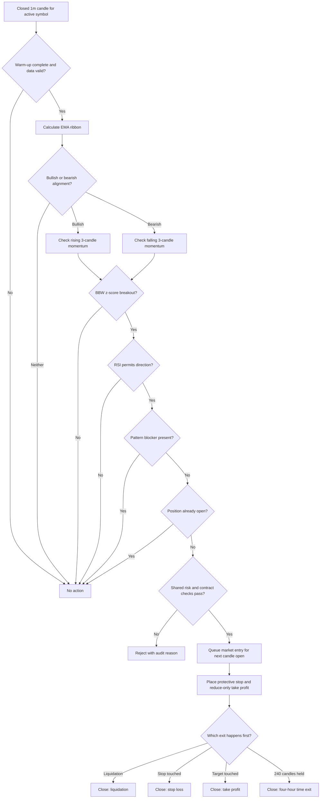

# Plan - Five-Gate Directional Strategy

## Timeframe portability review (2026-09-16)

Apply the [shared timeframe contract](strategy-timeframe-support.md). Existing
`1m` descriptions below remain baseline examples; general support is pending.

Review: both the parameter literal and `strategy.ts` dependency array lock
this strategy to `1m`. The five gates consume the configured trigger series.

Goal: Evaluate all five gates on any valid trigger `T`.
Out of scope: Changing gate thresholds, indicator formulas or risk defaults.
Steps:

1. In `src/strategies/five-gate-directional/parameters.ts`, accept the shared
   enum and derive `[T]` through parameter-aware dependency resolution.
2. In the strategy's signal/warm-up path, keep EMA, RSI, volatility and gate
   windows measured in `T` bars. Preserve the 240-bar holding default: that
   means four hours at `1m`, but 240 hours at `1h`; an alternative four-hour
   hourly profile must explicitly set a four-bar holding limit.
3. Test the same five-gate conditions and boundary cases at `1m`, `1h` and
   `1d`, plus an enum-wide validation check and baseline result regression.

Verification: Static trace a passing hourly close followed by next-open entry;
one failing gate must suppress entry at every `T`. Verify actual engine time
exit boundary/holding-counter behavior rather than assuming the count equals
an exact elapsed exit time.

## Original baseline specification

> **Status: draft for review; no strategy implementation is authorized yet.**
>
> Origin: https://www.botcamp.xyz/strategies/cohort-11-directional-strategy-on-wld-usdt-perp

## 1. Objective

Add a candle-driven perpetual-futures strategy named
`five-gate-directional` that preserves the public reference rule shape while
fitting the repository's existing signal, sizing, risk and execution lifecycle.

The implementation must:

- trade the active runtime symbol instead of a symbol embedded in strategy code;
- evaluate closed one-minute candles only;
- require all five directional gates before opening a position;
- open no second position while the active symbol already has one;
- use fixed quote-notional sizing so the same parameter set can be converted by
  each symbol's contract multiplier, minimum quantity and quantity step;
- use a 3 percent protective stop, a 3 percent take-profit target and a four-hour
  maximum holding time in the reference profile;
- produce identical decisions in backtest, paper and live paths;
- remain disabled by default until cross-symbol backtests and paper verification
  pass.

WLD-USDT is the reference market used by the source author. It is not a runtime
restriction and must not appear in a strategy decision branch.

## 2. Verified source evidence

The public Botcamp page and linked presentation establish these facts:

1. The strategy follows strong directional momentum on perpetual futures.
2. The reference market is Binance WLD-USDT Perpetual on a one-minute interval.
3. Entry is built from five combined filters:
   - EMA ribbon for trend direction;
   - a three-candle momentum streak;
   - Bollinger Band Width z-score for a volatility breakout regime;
   - RSI gating to avoid extreme entries;
   - optional triple-top/triple-bottom filtering to avoid horizontal resistance
     or support.
4. The presentation describes a 3 percent stop, a 3 percent profit barrier and a
   four-hour time limit.
5. The optimized Config 1 performed well in the training period but was close to
   flat in the first test period, which the author explicitly identified as
   possible overfitting.
6. Config 2 performed poorly in the earlier backtest but happened to perform well
   during a short live period. The author concluded that reproducible parameter
   pipelines matter more than one attractive result.

The Botcamp Code and Resources tab requires sign-in. The exact Config 1 and
Config 2 parameter files are therefore not independently verified. The build
must not claim numeric parity with either configuration unless those files are
provided or accessed by the user.

## 3. Proposed entry model

Every entry gate is evaluated on the same latest closed one-minute candle. A
partial match is not a signal.

### Long entry

All conditions must be true:

1. EMA ribbon is bullish: short EMA > medium EMA > long EMA.
2. The latest configured momentum window, three candles in the reference
   profile, has consecutively rising closes.
3. Bollinger Band Width z-score is at or above the configured breakout
   threshold.
4. RSI is below the overbought ceiling.
5. The pattern filter does not detect a blocking triple top when enabled.
6. There is no open position on the active symbol.
7. Shared margin, leverage, exposure, circuit-breaker and order-minimum checks
   pass.

### Short entry

All conditions are symmetric:

1. EMA ribbon is bearish: short EMA < medium EMA < long EMA.
2. The latest momentum window has consecutively falling closes.
3. Bollinger Band Width z-score is at or above the breakout threshold.
4. RSI is above the oversold floor.
5. The pattern filter does not detect a blocking triple bottom when enabled.
6. There is no open position on the active symbol.
7. Shared risk and exchange checks pass.

### No entry

Return no signal when data is still warming up, any gate is unavailable, any
gate fails, candle volume is invalid, a position is already open, or a shared
risk check rejects the order.

## 4. Position and barrier flow



### Barrier formulas

The version 1 plan follows the existing signal-engine convention: barrier
prices are calculated from the closed signal candle and normalized to the
active symbol's tick size before placement.

```text
Long stop   = signalClose * (1 - 0.03)
Long target = signalClose * (1 + 0.03)

Short stop   = signalClose * (1 + 0.03)
Short target = signalClose * (1 - 0.03)

Time exit = 240 closed candles on a 1m trigger timeframe
```

The market entry fills at the next candle open in backtests. Therefore the
realized percentage from fill can differ from exactly 3 percent when the next
open gaps or simulated execution cost moves the fill. Re-basing barriers to the
confirmed fill would be a separate shared execution change, not hidden inside
this strategy.

Exit precedence remains the repository default:

```text
liquidation -> stop loss -> take profit -> indicator exit -> time exit
```

Version 1 has no indicator exit and no reversal while a position is open. The
position is managed by its stop, target, time limit or an operator action.

## 5. Trailing-stop decision

The repository's current generic trailing stop is ATR-based: it activates and
trails by ATR multiples. That is not equivalent to a percentage trailing-profit
rule.

For version 1:

- use the verified fixed 3 percent take-profit barrier;
- set the existing ATR trailing stop to disabled in the strategy profile;
- do not label the ATR mechanism as reference parity;
- add a percentage trailing-profit phase only if the original authenticated
  configuration proves that it is required and supplies its activation and
  trailing-distance values.

This keeps the first build narrow and prevents two different exit models from
being presented as the same strategy.

## 6. Parameter plan

The strategy parameter snapshot should contain:

| Parameter group | Planned fields | Review default |
|---|---|---:|
| Runtime | `triggerTimeframe`, optional `defaultSymbol`, `defaultLeverage` | `1m`, unset, `2` |
| Sizing | `orderAmountUsd`, `maximumMarginUsageRate` | `200`, `0.10` |
| EMA ribbon | `shortEmaPeriod`, `mediumEmaPeriod`, `longEmaPeriod` | pending source or baseline backtest |
| Momentum | `momentumCandleCount` | `3` |
| Bollinger width | `bollingerPeriod`, `bollingerStandardDeviation`, `bandWidthZScoreLookback`, `bandWidthZScoreThreshold` | pending source or baseline backtest |
| RSI | `relativeStrengthIndexPeriod`, `oversoldLevel`, `overboughtLevel` | `14`, `30`, `70` |
| Pattern filter | `patternFilterEnabled`, `patternLookback`, `patternToleranceRate`, `minimumPatternSpacing` | disabled until parity tests exist |
| Barriers | `stopLossRate`, `takeProfitRate`, `maximumHoldingCandleCount` | `0.03`, `0.03`, `240` |
| Shared switches | `trailingStopEnabled`, `breakEvenStopEnabled`, `volatilityFilterEnabled` | all `false` |

Cross-field validation must enforce short EMA < medium EMA < long EMA, RSI
oversold < overbought, sufficient z-score lookback, positive order amount, and
rates inside safe bounds.

No optimized numeric values should be invented from the video screenshot. The
first approved profile must be either:

1. an authenticated reference configuration supplied by the user; or
2. an explicitly named baseline configuration whose values are selected and
   validated by this repository's backtest process.

## 7. Repository placement

### New strategy-owned folder

```text
src/strategies/five-gate-directional/
|-- parameters.ts
|-- signal.ts
|-- pattern-filter.ts
|-- strategy.ts
|-- index.ts
|-- parameters.test.ts
|-- signal.test.ts
|-- pattern-filter.test.ts
`-- strategy.test.ts
```

- `parameters.ts`: strict schema, defaults and cross-field validation.
- `signal.ts`: pure five-gate evaluation and auditable gate readings.
- `pattern-filter.ts`: non-repainting triple-top/triple-bottom detection.
- `strategy.ts`: adapt the shared context into entry signals only.
- tests: lock warm-up, long/short symmetry, every gate, no-position behavior and
  barrier prices.

### New shared indicator module

```text
src/indicators/bollinger-band-width.ts
src/indicators/bollinger-band-width.test.ts
```

This module owns Bollinger bands, normalized band width and rolling z-score as
symbol-neutral calculations. Existing moving-average and RSI modules should be
reused without copying their formulas into the strategy folder.

### Existing integration points

Only these structural integration points should change:

- `src/strategies/strategy.registry.ts`: register the name, parser and default
  parameter snapshot.
- `src/strategies/strategy.registry.test.ts`: prove registration and validation.
- `src/strategies/initial-position-sizing.ts`: reuse unchanged for fixed quote
  notional conversion.
- `src/engine/trading-engine.service.ts`: reuse the existing protected-entry,
  fixed-target and time-exit lifecycle; no five-gate calculations belong here.
- `src/backtest/backtest-runner.service.ts`: reuse the existing deterministic
  fill and exit ordering; no strategy-specific branch is planned.
- `src/control/active-run.configuration.ts`: reuse active symbol selection and
  the parameter-owned timeframe.
- `migrations/operational/0053_seed_five_gate_directional_v1.sql`: add a
  non-default template and account-owned copies after plan approval.

No database schema migration is expected. No exchange adapter change is
expected.

## 8. Multi-symbol contract

The symbol-agnostic requirement is accepted only if all of these are true:

- the strategy reads the symbol from the shared evaluation context;
- the template does not require `WLD/USDT:USDT` as a fallback;
- the selected active symbol supplies its own price tick, contract multiplier,
  quantity step, minimum quantity, leverage limit and maintenance margin;
- quote notional is converted and rounded by the shared sizing layer;
- an order that rounds below the symbol minimum is rejected clearly;
- tests evaluate at least two symbols with different prices and contract
  multipliers;
- backtest and paper verification include WLD plus at least two other active
  perpetual symbols;
- no parameter lookup silently falls back to another symbol's profile.

Version 1 uses one normalized rule set across symbols. It must be described as
portable code, not as proof that one parameter set has edge on every market.
Per-symbol optimized profiles may be added only after out-of-sample evidence
shows that shared parameters are inadequate.

## 9. Verification before build approval

### Plan verification completed

- Public Botcamp description reviewed.
- Linked presentation transcript reviewed.
- Current registry, active-run, fixed-notional sizing, protective-order, time
  exit, exit precedence and backtest seams inspected.
- Existing focused architecture tests pass: 44 tests across registry,
  active-run configuration, initial sizing and live/backtest exit parity.
- No source code or migration was changed while preparing this plan.

### Required approval decisions

1. Approve the strategy name `five-gate-directional`.
2. Approve version 1 as fixed SL 3 percent, fixed TP 3 percent and four-hour
   time exit, with ATR trailing disabled.
3. Supply authenticated Config 1/Config 2 files, or approve creation of a clearly
   labeled baseline parameter set.
4. Approve whether the triple-pattern filter starts disabled or is required for
   the first build.

### Build verification gates

Implementation is complete only when:

- parameter and indicator unit tests pass;
- a fixture exists where each individual failed gate prevents entry;
- long and short fixtures prove symmetric barrier calculation;
- warm-up and no-lookahead tests pass;
- the same candle stream produces the same trades in direct strategy tests and
  the backtest runner;
- WLD and at least two non-WLD symbols pass contract-size and minimum-order
  checks;
- train/test periods are separated and reported independently;
- fee, spread, slippage and funding assumptions are included in reports;
- paper trading runs with the strategy disabled from live mode until the user
  reviews the results.

## 10. Explicit non-goals for version 1

- No automatic parameter optimization.
- No claim that WLD results transfer to every symbol.
- No scaling into an open position.
- No close-and-reverse behavior.
- No percentage trailing-profit implementation without authenticated source
  evidence.
- No strategy-specific exchange calls, persistence or Telegram flow.
- No enabling the strategy as the repository default.

