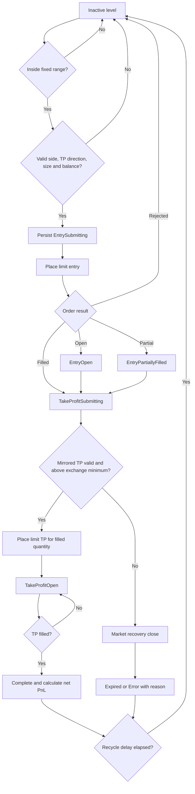

# Plan - Grid Amount Scaler Strategy

## Timeframe portability review (2026-09-16)

Apply the [shared timeframe contract](strategy-timeframe-support.md). Original
grid geometry, accounting and deployed defaults below remain unchanged.
Broader replay selection is pending end-to-end verification.

Review: registry defaults use `1m`; the dedicated runner already consumes the
configured candle interval. The strategy is a fixed price grid with inventory,
not a directional candle model. Its runner explicitly requires spot-style 1x.

Goal: Support any data-valid replay interval `E` for `grid-amount-scaler`.
Out of scope: Replacing inventory accounting with leveraged shorts, changing
the amount ladder or silently treating each grid order as $100 margin.
Steps:

1. Expose the runtime-owned `E` through the existing run selection/snapshot
   and enum validation, consistently across CLI, worker and coverage loading.
2. In `src/backtest/grid-amount-scaler-backtest-runner.ts`, preserve pre-existing
   order eligibility, mirrored TP ownership, inventory and final mark/close
   accounting. Use the selected interval for replay timestamps throughout.
3. Add runner cases at `1m`, `1h`, `4h`, `1d` and aligned `1w`, including both
   sides touched in one bar, missing data, insufficient inventory and restart.

Verification: Static trace a close-created mirrored target: the earlier range
of that same candle cannot fill it. Compare inventory plus quote equity to
recorded PnL under the runner's existing end-of-data policy at each resolution.

Reports must identify coarse OHLC replay, the actual modeled cost coverage and
1x inventory requirements. A futures candle source does not turn the simulator
into a 10x futures strategy. Increasing candle duration must not create extra
entry/TP cycles inside an unobserved path.

## Original baseline and implementation record

> **Status: implemented and deployed in Paper mode; this document is the living v1 specification.**
>
> Origin: https://www.botcamp.xyz/strategies/cohort-11-grid-amount-scaler
>
> The strategy keeps the Botcamp fixed-range, two-sided amount-scaling and mirrored-target
> behavior. The repository-specific adaptation is fixed initial contract sizing:
> `base quantity = initialOrderContractCount * contractMultiplier`.

## 1. Objective

Provide a stateful strategy named `grid-amount-scaler` that:

- builds one fixed price grid between `start_price` and `end_price` for a run;
- places BUY entries below the current mid-price and SELL entries above it;
- increases order quantity as a level moves farther from the center;
- assigns every entry a target at the mirrored grid level;
- places a dedicated take-profit after an entry fills;
- limits concurrent entry/TP cycles with `max_open_orders`;
- preserves open-order and fill state across process restarts;
- uses exchange contract multiplier, quantity step, minimum quantity and minimum notional;
- charges exchange-specific Paper maker/taker fees on new fills;
- runs independently for each Telegram account, strategy version and symbol;
- supports Paper and a dedicated deterministic backtest replay path.

The strategy is price-grid driven. It does not use RSI, ATR, moving averages, candle signals or
trend prediction to decide entries.

## 2. Evidence and fidelity decisions

The Botcamp strategy description and the original conversion specification establish these core
behaviors:

1. The grid range is bounded and fixed for the run.
2. BUY orders live below the mid-price and SELL orders above it.
3. Size is smallest near the center and increases toward the range edges.
4. BUY and SELL quantity ladders mirror one another.
5. An entry exits at the price of its mirrored level.
6. The center level is skipped because it has no profitable target distance.
7. Only a configured number of cycles may be active at once.
8. Filled quantity, not requested quantity, determines the TP quantity.
9. Entry and TP state must survive restart and reconciliation.
10. The grid is not dynamically recentered when market price moves.

### Repository-specific sizing adaptation

The reference amount scaler starts from a total quote budget. This repository instead uses the
shared Fixed Initial Quantity mechanism required by Telegram:

```text
baseContractCount = initialOrderContractCount
baseQuantity      = baseContractCount * contractMultiplier
```

The original ladder shape is preserved. For `n` levels, the ratio between the quantity increment
and the base quantity is:

```text
difference / base = 2 / (3 * (n - 1))
```

The level quantities are therefore:

```text
buyQuantity[i]  = base + (n - 1 - i) * difference
sellQuantity[i] = base + i * difference
```

This is an intentional sizing substitution, not a new trading signal. The price grid, mirrored
targets, side selection, level ordering and lifecycle remain unchanged.

## 3. Repository placement and boundaries

### Strategy module

```text
src/strategies/grid-amount-scaler/
├── parameters.ts
├── calculations.ts
├── models.ts
├── exchange-adapter.ts
├── state-store.ts
├── database-state-store.ts
├── strategy.ts
├── parameters.test.ts
├── calculations.test.ts
└── strategy.test.ts
```

Responsibilities:

- `parameters.ts`: strict validation, fixed symbol profiles, fingerprinting and sizing ownership.
- `calculations.ts`: mid-price, grid construction, quantity ladder, order validation and net PnL.
- `models.ts`: level states, persisted strategy state and status contracts.
- `exchange-adapter.ts`: minimal exchange boundary used by the strategy.
- `state-store.ts`: persistence contract and in-memory implementation for tests/backtests.
- `database-state-store.ts`: PostgreSQL persistence for Telegram Paper runs.
- `strategy.ts`: serialized lifecycle, reconciliation, entry, TP, timeout and recovery behavior.

### Shared integration

- `src/strategies/initial-position-sizing.ts`: contract count to base quantity conversion.
- `src/strategies/strategy.registry.ts`: defaults, parser and stateful strategy registration.
- `src/strategies/stateful-strategy-runtime-router.ts`: routes the active stateful strategy.
- `src/notification/telegram-grid-amount-scaler-runtime.ts`: account-scoped Paper runtime.
- `src/backtest/grid-amount-scaler-backtest-runner.ts`: dedicated stateful replay adapter.
- `src/strategies/trailing-geometric-grid/persistent-paper-exchange.ts`: persisted Paper order book.
- `src/risk/execution-cost.ts`: exchange-specific Paper fee assumptions.

The signal engine must not own grid math or level lifecycle decisions. The dedicated stateful
runtime owns those behaviors and exposes account status/positions to the shared Telegram layer.

## 4. Runtime model

### 4.1 Market input

Paper execution uses the active exchange's public futures market source for:

- current ticker price;
- exchange symbol metadata;
- price tick size;
- contract quantity step;
- minimum contract quantity;
- contract multiplier.

The core strategy consumes a market snapshot with best bid, best ask and timestamp:

```text
midPrice = (bestBid + bestAsk) / 2
```

Candles are not an entry signal. In backtest mode, one-minute candles are only a deterministic
transport for testing whether historical high/low prices touched resting grid orders.

### 4.2 Fixed grid geometry

Validation requires:

```text
0 < start_price < end_price
0 < min_spread_pct < 1
```

Grid interval calculation:

```text
rangeRate    = (end_price - start_price) / end_price
intervalCount = floor(rangeRate / min_spread_pct)
levelCount    = intervalCount + 1
rawPriceStep  = (end_price - start_price) / intervalCount
```

Every level price is rounded down to the exchange tick size. Adjacent duplicates created by tick
rounding are removed. At least two distinct prices must remain.

The range is fixed after startup. Market movement does not modify `start_price`, `end_price`, the
number of levels or the mirrored target mapping.

### 4.3 Fixed initial quantity and amount ladder

The configured contract count may be decimal. It must:

- be finite and greater than zero;
- be an exact multiple of the selected exchange's `quantityStepSize`;
- be at least the exchange's `minimumQuantity`.

Conversion:

```text
baseQuantity = initialOrderContractCount * contractMultiplier
```

For example:

```text
KuCoin ETH: 1 contract * 0.01 ETH = 0.01 ETH base quantity
KuCoin BTC: 1 contract * 0.001 BTC = 0.001 BTC base quantity
Decimal-step market: 0.001 contract * 1 base/contract = 0.001 base quantity
```

Each level's BUY and SELL quantities are derived once from this base quantity and rounded down to
the effective base-quantity step. Active entry and TP quantities are never resized because market
price changed.

### 4.4 Mirrored targets and center level

For level index `i` in a grid of `n` levels:

```text
targetIndex = n - 1 - i
targetPrice = prices[targetIndex]
```

If `targetPrice === price`, the level becomes `center_skipped` and never submits an entry.

The intended TP direction must be valid before an entry is eligible:

```text
BUY entry  -> targetPrice > entry level price
SELL entry -> targetPrice < entry level price
```

This prevents an entry whose mirrored TP would immediately violate exchange TP direction rules.

### 4.5 Side selection and candidate priority

At each tick:

```text
level price < mid-price -> BUY candidate
level price > mid-price -> SELL candidate
level price = mid-price -> no entry
```

Only inactive levels are candidates. They are sorted by absolute distance from the current
mid-price, nearest first. The runtime activates candidates until:

```text
active level count == max_open_orders
```

An active level is one of: submitting/open/partially-filled entry, submitting/open/partially-filled
TP, or recovery closing.

### 4.6 Entry and TP lifecycle



The strategy persists the submitting state before calling the exchange adapter. Client order IDs
are deterministic for strategy instance, level, cycle and order role, making retries idempotent.

### 4.7 Partial fills

- Entry fill state stores cumulative filled base, quote, average price and fee.
- TP quantity equals remaining filled exposure:

```text
remaining = entryFilledBase - takeProfitFilledBase
```

- A cancelled entry with zero fill returns to a terminal/recyclable state.
- A cancelled entry with non-zero fill continues to TP protection.
- A TP partial fill keeps only the remaining exposure open.
- Manual or timeout close uses a market recovery order for the exact remaining amount.

### 4.8 Timeout and manual close

`time_limit_ms` starts when the level cycle begins.

- Unfilled timed-out entry: cancel the entry and expire the level without creating a trade.
- Filled or partially filled timed-out cycle: cancel resting orders and market-close remaining
  exposure.
- Manual stop: cancel pending entries, cancel TPs and market-close each filled level separately.
- End of backtest: close every remaining exposure with reason `END_OF_DATA`.

The strategy does not add a stop-loss or trailing stop that is absent from the original logic.
Timeout and manual recovery are lifecycle safety actions, not predictive exits.

### 4.9 Fee accounting

Paper and backtest use exchange-specific standard fee assumptions:

| Exchange | Maker | Taker |
|---|---:|---:|
| KuCoin Futures | 0.020% | 0.060% |
| Binance USD-M | 0.020% | 0.050% |

Fee calculation:

```text
feeQuote = filledBase * fillPrice * feeRate
```

- Limit entry fill: maker fee.
- Limit mirrored TP fill: maker fee.
- Timeout/manual/recovery market close: taker fee.
- Fees are subtracted from Paper quote balance when the fill occurs.
- `feeQuoteEquivalent` accumulates entry and exit fees for the level cycle.
- Realized PnL is net of all accumulated fees:

```text
BUY gross  = exitQuote - entryQuote
SELL gross = entryQuote - exitQuote
net PnL    = gross - feeQuoteEquivalent
```

`fee_buffer_pct` is a pre-entry balance reservation buffer. It is not itself charged as a fee.

These rates represent the standard public tier. Account-specific VIP tiers, rebates or token-based
discounts require authenticated fee data and are outside v1 Paper assumptions.

## 5. Multi-symbol behavior

The same strategy version resolves a fixed geometry profile for the selected unified symbol.
There is no dynamic recentering and no fallback from an unsupported symbol to another symbol's
range.

Current KuCoin Paper profiles:

| Symbol | Start | End | Minimum spread | Minimum notional |
|---|---:|---:|---:|---:|
| `AVAX/USDT:USDT` | 4 | 12 | 0.5% | 0.5 USDT |
| `BTC/USDT:USDT` | 50,000 | 120,000 | 2.0% | 5 USDT |
| `ETH/USDT:USDT` | 1,500 | 3,500 | 0.5% | 5 USDT |
| `SOL/USDT:USDT` | 60 | 180 | 0.5% | 5 USDT |

Resolution rules:

1. If the selected symbol matches top-level `trading_pair`, retain the top-level values and any
   account edits.
2. Otherwise load the exact `symbol_profiles[unifiedSymbol]` entry.
3. Stored profile values override code defaults.
4. Missing or malformed exact profiles fail clearly.
5. Geometry remains fixed for the lifetime of the resulting strategy instance.

BTC uses wider spacing to keep seeded SELL inventory below the current 5,000 USDT Paper balance.
AVAX uses a lower minimum notional because one KuCoin contract represents only `0.1 AVAX`.

## 6. Parameter plan

| Parameter | Meaning | v1 default |
|---|---|---:|
| `connector_name` | Exchange adapter identity | `kucoinfutures` |
| `trading_pair` | Adapter pair without settlement suffix | `ETH/USDT` |
| `start_price` | Fixed lower grid boundary | `1500` |
| `end_price` | Fixed upper grid boundary | `3500` |
| `min_spread_pct` | Minimum interval rate | `0.005` |
| `initialOrderContractCount` | Base contract count for the quantity ladder | `1` |
| `max_open_orders` | Maximum concurrent level cycles | `5` |
| `grid_refresh_interval_ms` | Reserved grid refresh/status cadence | `60000` |
| `time_limit_ms` | Maximum cycle age | `172800000` |
| `recycle_delay_ms` | Delay before terminal level reuse | `1000` |
| `fee_buffer_pct` | BUY balance reservation buffer | `0.002` |
| `minimum_notional` | Per-profile order notional floor | `5` |
| `symbol_profiles` | Exact fixed geometry by unified symbol | four profiles above |

`initialOrderContractCount` and `minimum_notional` are excluded from the geometry fingerprint.
Operational size/minimum changes therefore do not orphan otherwise compatible grid geometry.
Price range, spread, pair, connector and lifecycle parameters remain fingerprinted.

## 7. Persistence, restart and isolation

The runtime stores:

- strategy instance ID;
- account ID, strategy name/version and symbol;
- parameter snapshot;
- lifecycle state and configuration fingerprint;
- fixed base contract count and effective base quantity;
- every level's cycle, side, order IDs, fill quantities, fees and PnL;
- simulated Paper exchange balances, orders and client-order mapping.

Isolation key conceptually includes:

```text
Telegram account + strategy + version + unified symbol + geometry fingerprint
```

Startup sequence:

1. Resolve parameters for the selected symbol.
2. Load current symbol specification and ticker.
3. Validate fixed contract quantity.
4. Build exchange trading rules and seed inventory requirement.
5. Load or create the account/symbol ledger.
6. Restore the Paper exchange order book and balances.
7. Reconcile known entry and TP orders.
8. Mark the strategy ready and resume ticks.

Existing state with another schema version or incompatible geometry fails closed. The runtime does
not silently discard persisted orders.

## 8. Telegram behavior

The account control flow supports:

- selecting `grid-amount-scaler` for Paper or Backtest;
- selecting any supported symbol profile;
- editing leverage and initial contract count;
- accepting decimal contract counts when the exchange step permits them;
- resetting account-owned parameters to strategy defaults;
- showing Filled positions separately from Pending entries;
- showing entry, TP and remaining quantity without internal database/ledger IDs;
- showing mid-price, fixed initial size, range, active cycles, realized PnL and equity;
- closing all filled level exposure safely.

Open Paper cycles block switching the active Paper symbol or strategy. They do not block selecting a
different symbol for an independent Backtest.

## 9. Backtest model

The dedicated backtest runner uses the same strategy class and level state machine with an in-memory
state store and deterministic Paper exchange.

Replay rules:

- Candle low touching a BUY limit fills the entry.
- Candle high touching a SELL limit fills the entry.
- Entry and its TP are not assumed to fill in unknown order inside the same candle.
- Resting limit fills pay maker fees.
- Market recovery/end-of-data closes pay taker fees.
- Equity includes quote balance plus marked base inventory.
- Unfilled timed-out entries do not become zero-quantity trades.

The runner records trades, equity, fees, net PnL, drawdown and standard repository metrics.

Current evidence:

- Synthetic startup/replay fixtures pass for all four KuCoin symbol specifications with a 5,000
  USDT starting balance.
- ETH has approximately three months of stored one-minute history and completed a 128,152-candle
  replay from 2026-06-07 through 2026-09-05.
- That run completed 96 trades, ended near 6,039.41 USDT from 5,000 USDT, reported profit factor
  2.87 and maximum drawdown about 7.40%.
- The generic acceptance gate marked the run failed only because it requires 600 completed trades.
  The strategy logic was not modified to manufacture additional trades.
- AVAX, BTC and SOL require one-minute history download before a real three-month historical replay.

Backtest results are evidence about the supplied period and cost assumptions, not permission to
alter the original strategy rules for a higher metric.

## 10. Migration and rollout

Operational migrations:

- `0049_grid_amount_scaler_state.sql`: durable account/symbol strategy and exchange state.
- `0050_seed_grid_amount_scaler_v1.sql`: version-1 template and account configuration.
- `0052_grid_amount_scaler_symbol_profiles.sql`: four fixed symbol profiles and minimum notionals.

Migration requirements:

- preserve existing account edits;
- update active runtime snapshots without deleting ledgers;
- remain idempotent when retried;
- provide metadata-only rollback guidance;
- avoid destructive contraction of old state.

Rollout sequence:

1. Apply additive migration.
2. Run migration again to prove retry safety.
3. Verify template, account configuration and active runtime snapshots.
4. Run typecheck, formatter, build, focused tests and full test suite.
5. Rebuild and restart bot plus backtest worker.
6. Confirm health endpoint and Telegram account startup logs.
7. Verify pending/fill/TP state survives restart.

## 11. Acceptance criteria

### Strategy fidelity

- Grid boundaries stay fixed for the complete run.
- No indicator or candle signal changes entry eligibility.
- BUY size decreases toward the upper edge; SELL size increases toward it.
- BUY and SELL quantity ladders mirror one another after permitted rounding.
- Every eligible non-center level maps to its fixed mirrored target.
- A level is never activated when its planned TP direction is invalid.
- No more than `max_open_orders` cycles are active.
- Filled quantity is the only quantity protected by TP or recovery close.
- Terminal levels recycle only after `recycle_delay_ms`.

### Quantity and exchange rules

- Contract count converts through the selected symbol's contract multiplier.
- Decimal contract counts are accepted only when exactly aligned to exchange step.
- Quantity is never rounded upward beyond configured risk.
- Quantity and notional meet exchange minimums before submission.
- A quantity fixed at cycle creation does not change while that cycle is active.

### Fees and accounting

- Limit entry and TP fills charge maker fee.
- Market recovery/timeout/manual closes charge taker fee.
- Fees reduce Paper quote balance at fill time.
- Entry plus exit fee is accumulated exactly once in the level ledger.
- Realized and reported PnL is net of fee.
- Restart does not duplicate or lose previously recorded fee.
- Menu/backtest cost assumptions match the selected exchange profile.

### Recovery and safety

- Submitting state is persisted before an exchange mutation.
- Duplicate client order IDs return the existing order.
- Restart restores balances, pending orders, filled exposure and cycle IDs.
- Open Paper exposure blocks unsafe Paper configuration switches.
- Pause prevents new entries while allowing filled exposure to remain protected.
- Manual stop cancels pending entries and closes every remaining filled level.
- Unknown order state fails closed with an explicit error code.

### Multi-symbol and account isolation

- Each supported symbol resolves its exact fixed profile.
- Unsupported or malformed profiles fail without cross-symbol fallback.
- Symbol rules come from the selected account's exchange.
- Separate Telegram accounts never share ledger, orders, balances or active symbol state.
- Internal account, fingerprint and level identifiers are not displayed in Telegram messages.

## 12. Verification matrix

| Area | Required proof |
|---|---|
| Grid math | Price count, tick deduplication, mirror mapping and ladder monotonicity tests |
| Fixed sizing | Integer and decimal contract conversion, step/minimum rejection |
| Entry selection | Below-mid BUY, above-mid SELL, nearest-first and slot limit |
| TP safety | Correct direction, filled quantity and minimum-notional recovery |
| Lifecycle | Open, partial fill, TP, timeout, manual close and recycle transitions |
| Fees | KuCoin/Binance profiles; maker entry/TP and taker market close |
| Accounting | Fee-adjusted Paper balance, cycle PnL and aggregate realized PnL |
| Persistence | Restart restores order identity, balances, fills and fees |
| Multi-symbol | AVAX, BTC, ETH and SOL profile resolution/startup |
| Telegram | Filled/Pending separation and no internal ID leakage |
| Backtest | Separate-candle ordering, end-of-data close and no zero-quantity trades |
| Control safety | Paper switch blocked with exposure; Backtest selection remains available |
| Regression | Typecheck, build and complete repository test suite pass |

## 13. Current implementation status

As of 2026-09-07:

- Grid Amount Scaler v1 is enabled for account-owned configuration.
- Telegram account `6501031754` runs the strategy on KuCoin Futures Paper with leverage 1.
- Four fixed KuCoin symbol profiles are stored in the active runtime configuration.
- Filled and Pending entries are exposed separately through the positions view.
- Invalid mirrored TP direction is filtered before entry and recovered safely if encountered later.
- Paper fills now charge the selected exchange's standard maker/taker fees.
- Bot and backtest worker are healthy after deployment.
- Full repository verification passes: 720 tests passed and 14 database-dependent tests skipped.

## 14. Decisions still requiring explicit approval

1. Whether Paper fees should remain the public standard tier or become account-specific through
   authenticated fee lookup.
2. Whether AVAX, BTC and SOL one-minute history should be downloaded for three-month historical
   acceptance runs.
3. Whether the generic 600-trade acceptance threshold should have a documented strategy-specific
   replacement; strategy behavior must not be changed merely to satisfy that generic threshold.
4. Whether Binance USD-M should be approved for Grid Amount Scaler after per-symbol contract sizing
   and seeded inventory are validated with the intended Paper balance.

## 15. Explicit non-goals for version 1

- Dynamic grid recentering.
- Indicator-driven entry filtering.
- Trend prediction or machine learning.
- Automatic range optimization based on recent candles.
- Increasing leverage above 1.
- Adding a fixed stop-loss or trailing stop not present in the source strategy.
- Combining all filled levels into one average-price basket TP.
- Silently changing profile geometry while persisted orders exist.
- Treating fee buffer as an actual exchange fee.
- Claiming account-specific fee accuracy without authenticated fee-tier data.
- Enabling unsupported symbols through a generic fallback range.
- Modifying strategy logic only to improve a backtest acceptance score.

## 16. Definition of done

Grid Amount Scaler v1 is complete when:

- its fixed-range, amount-scaling and mirrored-target behavior matches this specification;
- fixed contract quantity is validated against each selected symbol specification;
- Paper entry, TP and recovery fills charge the correct configured venue fee;
- state and fee accounting survive restart without duplication;
- all supported symbols pass deterministic startup/replay tests;
- every symbol claimed as historically verified has the required stored candle coverage;
- Telegram control remains safe with open exposure and exposes actionable status without internal
  identifiers;
- migrations are retry-safe and preserve account-owned settings;
- typecheck, formatting, build, focused tests and the full repository suite pass;
- deployment health and Telegram runtime startup are verified.
