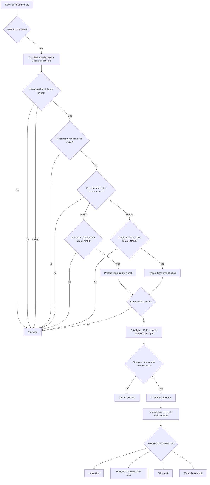

# Plan - ICT Suspension Block Retest Strategy

## Timeframe portability review (2026-09-16)

Apply the [shared timeframe contract](strategy-timeframe-support.md). Earlier
`15m/4h` restrictions and the 836-bar baseline below do not define support for
other profiles; parameterized runtime support is pending.

Review: `ict-suspension-block-retest/parameters.ts` and `strategy.ts` fix the
trigger/context pair. Existing diagnostic timeframe ideas are not executable
support while those restrictions remain.

Goal: Support suspension-block detection and retest on valid `T < C` profiles.
Out of scope: Changing block construction, merging zones or changing exits.
Steps:

1. In `src/strategies/ict-suspension-block-retest/parameters.ts`, replace fixed
   timeframe validation with the enum and `C > T`; resolve `[T, C]`.
2. In `signal.ts`, derive pre-roll from the selected trigger lifecycle and
   context EMA requirements. Preserve pivot confirmation and block creation
   timestamps. Age, lookback and holding fields remain `T` bars; fixed-clock
   diagnostics require explicit alternative profiles under the shared contract.
3. Test `15m/4h`, `1h/4h` and `4h/1d` across first retest, invalidation,
   maximum age, causal HTF confirmation and prepared/incremental parity.

Verification: Static trace an hourly block whose pivot is confirmed later:
its zone cannot become tradable at the pivot's historical timestamp. Test a
retest at the age limit and one bar beyond it with the same inclusion rule.

## Original baseline specification

> Status: draft for review. This plan does not authorize changes to the existing
> ICT Suspension Blocks indicator implementation.
>
> Source: https://www.tradingview.com/script/H9Lwcsx1-ICT-Suspension-Blocks-Flux-Charts/

## 1. Objective

Add a candle-driven strategy named `ict-suspension-block-retest` that consumes
the existing `calculateIctSuspensionBlocks` result and runs through the
repository's current signal, risk, execution and backtest lifecycle.

Version 1 must:

- use closed `15m` candles to build and maintain ICT Suspension Blocks;
- treat new blocks as zones to monitor, not immediate entry signals;
- enter only on the first valid retest of one active block;
- use the latest fully closed `4h` candle and EMA50 to confirm overall trend;
- map a bullish block retest to Long and a bearish block retest to Short;
- reject stale, invalidated, ambiguous or distant retest signals;
- fill market entries at the next `15m` candle open;
- hold at most one position for the active symbol;
- use shared fixed-notional sizing, contract conversion, margin checks, fees,
  funding, spread, slippage and position management;
- protect every position with a stop beyond the zone and a reward-to-risk
  target;
- produce identical decisions from identical closed candles in backtest, paper
  and live evaluation paths;
- remain backtest-only until research and paper acceptance gates pass.

The existing indicator files are inputs and are not restructured in this build:

```text
src/indicators/ict-suspension-blocks.ts
src/indicators/ict-suspension-blocks.test.ts
```

## 2. Verified indicator behavior

The source describes a Suspension Block as a price area framed by two
body-to-body volume imbalances in the same direction. Wick overlap is allowed;
the gap between consecutive candle bodies is what matters.

### Bullish block pattern

Three consecutive bullish candles must satisfy:

```text
first close > first open
second close > second open
third close > third open

second open > first close
third open > second close
```

The two gaps must not be caused by a new UTC day or week. The zone is:

```text
top    = max(first close, third open)
bottom = min(first close, third open)
```

### Bearish block pattern

The rules are symmetric:

```text
first close < first open
second close < second open
third close < third open

second open < first close
third open < second close
```

The zone uses the same first-close and third-open boundaries.

### Confirmation timing

The local implementation confirms a new zone one candle after the three-candle
pattern. It records:

- `startTimestamp`: the first pattern candle;
- `createdTimestamp`: the later candle on which the pattern becomes knowable;
- `createdCandleIndex`: the confirmation candle index;
- immutable top, bottom and midpoint prices.

### Strict retest

A bullish retest requires the retest candle to approach from above:

```text
open > zone top
close > zone top
low <= zone top
low >= zone bottom
```

A bearish retest approaches from below:

```text
open < zone bottom
close < zone bottom
high >= zone bottom
high <= zone top
```

This is a wick rejection, not a simple intersection. The candle must open and
close on the original side of the block and may not cross the far boundary.

The indicator confirms that retest on the following candle and exposes both:

```text
timestamp         = retest candle timestamp
detectedTimestamp = following confirmation candle timestamp
```

### Invalidation and display behavior

With the default Wick invalidation:

```text
bullish block invalidated when low < zone bottom
bearish block invalidated when high > zone top
```

Close invalidation instead waits for a close beyond the far boundary. The
indicator can combine overlapping zones and select the nearest zones for
display, but `activeZones` remains the raw trading-state collection.

Version 1 reads raw `activeZones` and raw events. It does not use
`visibleActiveZones`, display limits, labels, colors, midlines or combined
display zones for decisions.

The existing indicator suite passes 6 tests and must remain unchanged during
strategy implementation.

## 3. Pine and local defaults

The strategy adapter starts from the tested local defaults:

```text
invalidation method:          Wick
combine overlapping zones:   false
hide invalidated zones:       true
show nearest per direction:  3
minimum size in ATR:          0
ATR period:                   14
maximum zones kept:           300
maximum retests per zone:     400
show midline:                 true, dotted
show zone labels:             true
show retest labels:           true
all four alerts:              true
```

Only calculation and lifecycle fields may enter the strategy parameter schema.
Visual and alert fields remain indicator defaults and never affect trades.

## 4. Strategy interpretation

Version 1 trades reaction from a block, not the initial displacement that
created it.

```text
New bullish block  -> monitor as potential support
New bearish block  -> monitor as potential resistance
Bullish first retest + bullish 4h trend -> LONG candidate
Bearish first retest + bearish 4h trend -> SHORT candidate
```

The strategy ignores:

- new-zone events without a retest;
- second and later retests;
- invalidated or expired zones;
- display-only combined zones;
- retests that occurred too far from the current entry price;
- an evaluation containing more than one eligible retest zone.

Trading only the first retest is a strategy-owned baseline decision. The Pine
indicator records every retest but does not define which one should become an
order.

## 5. Exact entry trigger

### Long candidate

After the latest closed `15m` candle, all conditions must be true:

```text
exactly one eligible latest Retest event exists
event direction == bullish
event detectedTimestamp == latest 15m candle timestamp
matching zone remains in activeZones
matching zone has exactly one stored retest
zone age <= maximumZoneAgeCandleCount
latest close > zone top
distance from latest close to zone top
  <= ATR * maximumEntryDistanceAverageTrueRange

latest fully closed 4h close > current EMA50
current EMA50 > previous EMA50

no open position exists
```

### Short candidate

The symmetric conditions must be true:

```text
exactly one eligible latest Retest event exists
event direction == bearish
event detectedTimestamp == latest 15m candle timestamp
matching zone remains in activeZones
matching zone has exactly one stored retest
zone age <= maximumZoneAgeCandleCount
latest close < zone bottom
distance from zone bottom to latest close
  <= ATR * maximumEntryDistanceAverageTrueRange

latest fully closed 4h close < current EMA50
current EMA50 < previous EMA50

no open position exists
```

Baseline values:

```text
maximumZoneAgeCandleCount:                  192
maximumEntryDistanceAverageTrueRange:       1.0
```

On `15m`, 192 candles represent 48 hours. This lets an intraday block survive
through two full trading days without keeping stale structure indefinitely. The
distance gate prevents entry after the confirmation candle has already moved
too far away from the retested block.

Calculate age at the Retest detection candle:

```text
zoneAgeCandleCount =
  (latest candle timestamp - zone createdTimestamp) / 15m duration
```

The boundary is inclusive: age exactly 192 is eligible; 193 is stale.

If multiple zones produce an eligible retest on the same detection candle, no
trade is created. Version 1 does not hide a discretionary zone-selection rule
inside the strategy.

## 6. Entry timeline and causality

Use this timeline:

```text
P1, P2, P3 = three-candle Suspension Block pattern
C          = candle on which the indicator confirms and creates the block
R          = later candle that strictly retests the block
D          = following candle on which the local indicator confirms the retest
E          = next candle whose open receives the market fill
```

The strategy evaluates after candle `D` is fully closed. It uses the Retest
event whose `timestamp` is `R` and whose `detectedTimestamp` is `D`, applies the
latest trend, distance and risk gates, then emits a market signal for the open
of candle `E`.

This deliberately preserves the local indicator's confirmation delay. The
strategy must not duplicate retest detection against candle `R` to enter one
bar earlier.

A rejected retest expires immediately. It is not held as a pending setup and is
never reused on a later candle.

## 7. Baseline decisions

| Decision | Version 1 baseline | Reason |
|---|---:|---|
| Strategy name | `ict-suspension-block-retest` | Makes retest ownership explicit |
| Trigger timeframe | `15m` | Reduces microstructure noise while preserving intraday retests |
| Trend timeframe | `4h` | Filters entries by the broader directional regime |
| Trend rule | Close versus rising/falling EMA50 | Requires location and slope agreement |
| Entry event | First confirmed retest only | Tests the freshest zone reaction |
| Long trigger | Bullish block retest + bullish trend | Treats bullish block as support |
| Short trigger | Bearish block retest + bearish trend | Treats bearish block as resistance |
| Invalidation | Wick | Matches the Pine/local default |
| Maximum zone age | `192` trigger candles | Rejects blocks older than 48 hours |
| Maximum entry distance | `1.0 * ATR(14)` | Avoids chasing after delayed confirmation |
| Initial size | `200 USDT` fixed notional | Reuses cross-symbol contract sizing |
| Leverage | `2x` | Conservative research baseline |
| Minimum ATR stop distance | `1.5 * ATR(14)` | Preserves the shared protective baseline |
| Zone stop buffer | `0.1 * ATR(14)` | Places protection beyond the block boundary |
| Target | `2R` from effective stop distance | Positive payoff asymmetry |
| Maximum hold | `20` trigger candles | Five hours on `15m` |
| Opposite event while open | Ignore | Keeps entry and exit experiments separate |
| Break-even stop | Enabled | Reuses shared fee-aware protection |
| Trailing stop | Disabled | Keeps the initial exit study controlled |
| Shared volatility filter | Disabled | Avoids stacking an unrelated filter initially |

These are frozen research defaults, not a profitability claim.

### Recommended `15m` to `4h` indicator profiles

Treat `15m–4h` as a research range for the timeframe that owns block creation
and retest detection, not as permission to aggregate zones from several
timeframes into one strategy run.

Version 1 uses one fixed pair:

```text
block and retest timeframe: 15m
trend confirmation:         4h EMA50
```

This pair prioritizes executable intraday retests while using `4h` only as a
regime filter. Separate research profiles should later evaluate blocks formed
on `1h` and `4h`. Their zones, event counts and performance must be reported
independently. A `4h` block strategy also needs its own higher confirmation
profile, likely `1d`; it must not reuse `4h` simultaneously as both trigger and
higher-timeframe confirmation.

The expected trade-off is lower signal frequency and slower trend-state changes
than the former `5m + 15m` profile, in exchange for fewer small, short-lived
blocks. The acceptance study must therefore report event scarcity and regime
concentration explicitly.

## 8. Stop-loss and take-profit contract

The block boundary is the structural invalidation level, while ATR prevents a
very narrow stop when a small zone forms.

```text
atrStopDistance = ATR(14) * minimumStopLossAverageTrueRangeMultiplier
zoneBuffer      = ATR(14) * zoneStopBufferAverageTrueRangeMultiplier
```

Long:

```text
atrStop        = signal close - atrStopDistance
structuralStop = zone bottom - zoneBuffer
stopLoss       = min(atrStop, structuralStop)
riskDistance   = signal close - stopLoss
takeProfit     = signal close + riskDistance * rewardToRiskRatio
```

Short:

```text
atrStop        = signal close + atrStopDistance
structuralStop = zone top + zoneBuffer
stopLoss       = max(atrStop, structuralStop)
riskDistance   = stopLoss - signal close
takeProfit     = signal close - riskDistance * rewardToRiskRatio
```

The engine normalizes prices to the symbol tick. Entry fills at the next candle
open, so realized R can differ after a gap, spread or slippage. The strategy
does not rebase barriers after the fill because that would diverge from the
shared execution contract.

Set `isCounterTrend: false` because every accepted entry agrees with the closed
`4h` EMA trend.

## 9. Runtime flow



No Suspension Block signal logic belongs in the engine or backtest runner.

## 10. Strategy parameter contract

Use a strict flat Zod schema consistent with the current directional strategy
folders:

```text
triggerTimeframe: "15m"
trendTimeframe: "4h"
defaultSymbol?: string
defaultLeverage: 2

orderAmountUsd: 200
maximumMarginUsageRate: 0.10

invalidationMethod: "wick" | "close"
minimumSizeAverageTrueRange: 0
averageTrueRangePeriod: 14
maximumZoneAgeCandleCount: 192
maximumEntryDistanceAverageTrueRange: 1.0
firstRetestOnly: true

trendExponentialMovingAveragePeriod: 50
minimumStopLossAverageTrueRangeMultiplier: 1.5
zoneStopBufferAverageTrueRangeMultiplier: 0.1
rewardToRiskRatio: 2
maximumHoldingCandleCount: 20

trailingStopEnabled: false
breakEvenStopEnabled: true
volatilityFilterEnabled: false
```

Validation must enforce:

- trigger timeframe is exactly `15m`;
- trend timeframe is exactly `4h`;
- invalidation method is a supported Wick or Close value, with Wick as the
  frozen version 1 default;
- minimum zone size is nonnegative;
- ATR, EMA, maximum zone age and maximum holding periods are positive;
- entry distance, stop multiplier and zone buffer are nonnegative and bounded;
- reward-to-risk is positive and bounded;
- `firstRetestOnly` is exactly true;
- order notional and maximum margin-use rate are valid;
- unknown fields fail.

The adapter builds `IctSuspensionBlockParameters` by spreading
`defaultIctSuspensionBlockParameters` and overriding only invalidation, minimum
size and ATR period. Combining, nearest-zone selection, history visibility,
drawing and alert fields retain defaults and cannot influence entry.

## 11. Repository placement

Add one strategy-owned folder:

```text
src/strategies/ict-suspension-block-retest/
|-- index.ts
|-- parameters.ts
|-- parameters.test.ts
|-- signal.ts
|-- signal.test.ts
|-- strategy.ts
`-- strategy.test.ts
```

Responsibilities:

- `parameters.ts`: strict schema, defaults and indicator adapter;
- `signal.ts`: bounded zone lifecycle, latest first-retest selection, zone age,
  entry distance, ATR and closed-`4h` EMA confirmation;
- `strategy.ts`: open-position guard, fixed-notional margin check, structural
  barrier calculation and standard `Signal` construction;
- tests: Pine/local lifecycle preservation, bounded-state parity, causal retest
  timing, trend alignment and barrier math.

Only these existing integration points should change:

```text
src/strategies/strategy.registry.ts
src/strategies/strategy.registry.test.ts
```

The registry adds the strategy, defaults, parser and fixed-notional sizing
owner.

No changes are planned for:

```text
src/indicators/ict-suspension-blocks.ts
src/backtest/backtest-runner.service.ts
src/engine/trading-engine.service.ts
src/strategies/strategy.interface.ts
src/common/types/signal.type.ts
database schemas
exchange adapters
```

No migration is required for command-line backtests. Add an operational seed
only after research passes and the strategy is approved for paper use.

## 12. Bounded zone history

Suspension Blocks can otherwise remain active indefinitely. Replaying the full
growing candle history for every signal would be expensive, while truncating it
without an age rule would silently remove valid zones.

Version 1 therefore makes maximum zone age part of the strategy contract.

Wilder ATR receives a ten-period stabilization prefix, following the existing
bounded-calculation convention:

```text
ATR stabilization candles = averageTrueRangePeriod * 10
zone-state window = maximumZoneAgeCandleCount
                  + max(4, ATR stabilization candles)

default = 192 + max(4, 14 * 10)
        = 332 closed 15m candles
```

The prefix is enough to reconstruct the three-candle pattern and settle ATR for
the earliest eligible zone. Zones whose detection age is greater than 192
candles are intentionally excluded in both bounded and full-history decisions.

Parity tests compare:

- eligible active raw zones by id and timestamps;
- top, bottom, midpoint, direction and first-retest state;
- latest Retest and Invalidated events;
- final selected direction and rejection reason.

Raw `createdCandleIndex` and `lastTouchCandleIndex` values are slice-relative
and are not compared directly between bounded and full-history calculations.

The default minimum-size filter is zero, so ATR initialization cannot change
zone creation in the frozen profile. Nonzero minimum-size research profiles
must include boundary fixtures because Wilder ATR from a bounded prefix is
asymptotically, not bit-for-bit, identical to an infinite history.

## 13. Warm-up and MTF causality

Reuse `calculateWarmUpCandleCount` from `src/strategies/warm-up.ts`.

```text
15m bounded zone lifecycle: 332 candles
15m latest ATR:             14 candles
4h EMA50 slope:             51 candles

calculateWarmUpCandleCount([
  { candleCount: 332, timeframe: "15m" },
  { candleCount: 14, timeframe: "15m" },
  { candleCount: 51, timeframe: "4h" }
], "15m")
```

The `4h` EMA slope requirement converts to `51 * 16 = 816` trigger candles and
dominates the 332-candle zone window. With the shared 20-candle margin, the
default warm-up is therefore `836` closed `15m` candles, or roughly 8.7 days.
Keeping the old 288-bar zone age would increase the zone window to 428 candles
but would not change the 836-candle warm-up because the `4h` EMA still dominates.

Causality rules:

- all input candles are closed and ordered oldest to newest;
- retest selection requires `detectedTimestamp` to equal the latest trigger
  candle timestamp;
- observation time is latest `15m` open timestamp plus 15 minutes;
- use `findLastClosedHigherTimeframeIndex` or `readHigherTimeframeValue`;
- never read a forming `4h` candle;
- a missing current or previous EMA50 closes the entry gate;
- the zone must still be active after processing the detection candle;
- appending future candles must not alter an earlier decision.

## 14. Auditable evaluation contract

`signal.ts` should return one evaluation object containing at least:

```text
direction: "LONG" | "SHORT" | "NONE"
signalCandleTimestamp
retestCandleTimestamp
zoneId
zoneDirection
zoneCreatedTimestamp
zoneAgeCandleCount
zoneTopPrice
zoneBottomPrice
zoneMidpointPrice
zoneSizeAverageTrueRange
entryDistanceAverageTrueRange
firstRetest
zoneStillActive
averageTrueRange
trendClosePrice
currentTrendExponentialMovingAverage
previousTrendExponentialMovingAverage
bullishTrend
bearishTrend
```

The reason string records these values plus invalidation mode, stop candidates,
effective stop and target. The strategy wrapper consumes the evaluation but
does not recalculate the indicator or higher-timeframe state.

## 15. Cost and position accounting

The strategy does not calculate exchange fees itself. It reuses the shared
backtest and execution layers.

```text
net PnL = gross PnL
        - entry fee
        - exit fee
        - funding
        - slippage cost
```

Entry simulation includes taker fee, half-spread and configured slippage. The
`200 USDT` parameter is target notional before fees. Exit execution includes its
own fee and friction.

Break-even remains fee- and funding-aware through the existing engine.
`breakEvenStopEnabled` is true and `trailingStopEnabled` is false. The strategy
must not duplicate either lifecycle.

## 16. Test plan

### Phase A - Preserve indicator contract

- Keep all six existing indicator tests green.
- Lock Pine defaults and bullish/bearish three-candle detection.
- Preserve UTC day/week opening-gap rejection.
- Preserve one-candle confirmation for New and Retest events.
- Preserve strict approach-side retest rules.
- Preserve Wick and Close invalidation behavior.
- Handle any Pine/local defect as a separate regression patch.

### Phase B - Parameter tests

Prove:

- defaults parse and unknown fields fail;
- non-`15m` trigger and non-`4h` trend timeframes fail;
- unsupported invalidation values or `firstRetestOnly = false` fail;
- negative minimum size, invalid periods, zone age, entry distance, stop,
  buffer, R:R, holding, notional and margin values fail;
- conversion preserves strategy-relevant indicator fields;
- visual, display and alert fields remain unchanged.

### Phase C - Bounded-state parity

Prove bounded and full-history decisions match after excluding zones older than
the configured age. Include:

- bullish and bearish active zones;
- overlapping raw zones;
- first and repeated retests;
- invalidation on the detection candle;
- a zone exactly at the age boundary and one candle beyond it;
- ATR-size filtering profiles away from and at the threshold.

### Phase D - Signal and causality tests

Prove:

- a New event alone produces NONE;
- bullish first retest plus bullish closed `4h` trend produces LONG;
- bearish first retest plus bearish closed `4h` trend produces SHORT;
- second and later retests produce NONE;
- stale, missing or invalidated zones produce NONE;
- a zone invalidated on the retest-detection candle produces NONE;
- latest close on the wrong side of the zone produces NONE;
- entry distance exactly at one ATR is accepted and above it is rejected;
- multiple eligible zones or opposite directions on one candle produce NONE;
- retest cannot trigger on its own candle and becomes visible only at the local
  indicator's detected timestamp;
- a forming `4h` candle cannot confirm entry;
- equality to EMA or a flat EMA is neutral;
- future candles do not change past decisions;
- all audit values match indicator and ATR output.

### Phase E - Strategy tests

Prove:

- LONG maps to `EnterLong` and SHORT maps to `EnterShort`;
- signal uses market order, correct symbol, timestamp and reference close;
- Long stop is below both the buffered zone bottom and minimum ATR stop;
- Short stop is above both the buffered zone top and minimum ATR stop;
- take-profit is symmetric at 2R;
- `isCounterTrend` is false;
- open positions and excessive margin suppress entry;
- fixed-notional metadata points to `orderAmountUsd`;
- break-even is enabled and trailing is disabled;
- reason text contains zone, retest, distance, trend and barrier readings.

### Phase F - Registry and backtest parity

Prove:

- registry resolves `ict-suspension-block-retest`, defaults and parser;
- required timeframes equal `["15m", "4h"]`;
- default warm-up equals 836 trigger candles;
- market entry fills at the next `15m` open after detection;
- direct evaluation and runner replay create identical barriers;
- configured entry/exit costs appear in net PnL;
- existing registry, causality, engine and exit-parity suites remain green.

## 17. Backtest research plan

Do not tune block quality, entry timing and exits in the same stage.

### Stage 1 - Frozen baseline

Run exact defaults on:

- `BTC/USDT:USDT`;
- `ETH/USDT:USDT`;
- `SOL/USDT:USDT`;
- `AVAX/USDT:USDT`.

Use at least 12 months of verified `15m` and `4h` candles, preferably 24 months.
Both timeframes must cover the same period without gaps. Include fees, funding,
spread and slippage.

Report:

- combined and per-symbol performance;
- LONG and SHORT separately;
- new block, first retest, repeated retest, stale and invalidation counts;
- block age, size, entry-distance and holding-time distributions;
- gross profit versus execution friction;
- stop, target, break-even and time-exit distribution;
- performance by month and volatility regime;
- random-entry and doubled-cost benchmarks.

### Stage 2 - Exit sensitivity

Keep entry and block parameters frozen:

```text
minimum ATR stop: 1.0, 1.5, 2.0
zone ATR buffer:  0.0, 0.1, 0.25
reward-to-risk:   1.0, 1.5, 2.0, 3.0
maximum hold:     10, 20, 32, 48
break-even:       enabled and frozen
trailing stop:    disabled and frozen
```

Compare the hybrid stop with ATR-only and zone-buffer-only diagnostics. Select
a stable neighboring region, not only the highest-return cell.

### Stage 3 - Block-quality sensitivity

Freeze the chosen exit profile:

```text
minimum block size in ATR: 0.0, 0.1, 0.25, 0.5
maximum zone age bars:     96, 192, 288
maximum entry distance:    0.5, 1.0, 1.5 ATR
```

Keep first-retest-only and raw uncombined zones frozen. Report frequency loss
for each filter.

### Stage 4 - Invalidation diagnostic

Compare Wick and Close invalidation as separately named research profiles.
Wick remains the version 1 candidate unless Close clearly improves robust
out-of-sample expectancy without increasing tail loss.

### Stage 5 - Block-timeframe diagnostics

Keep the version 1 entry, risk and exit rules frozen and compare separately:

```text
15m blocks: baseline runtime candidate with 4h confirmation
1h blocks:  diagnostic profile with 4h confirmation
4h blocks:  diagnostic profile with 1d confirmation
```

Do not merge zones from these profiles and do not select the best timeframe by
in-sample net profit alone. Compare trade count, zone lifetime, regime coverage,
cost sensitivity and out-of-sample stability. Rescale zone age and maximum hold
to comparable clock-time horizons for each block timeframe; do not reuse the
15m bar counts unchanged.

### Stage 6 - EMA confirmation ablation

Run one diagnostic without the `4h` EMA gate. The disabled variant measures
the contribution of higher-timeframe confirmation and is not a runtime
candidate in version 1.

### Stage 7 - One-way out-of-sample validation

Use a chronological 70/30 split. Tune only on the first 70 percent, freeze the
profile, then inspect the final 30 percent once. Retuning afterward invalidates
the out-of-sample claim.

## 18. Acceptance gates

Use the repository's directional acceptance thresholds for the `15m` to `4h`
profile:

- profit factor greater than `1.5`;
- Sharpe ratio greater than `1.5`;
- maximum drawdown below `12%`;
- at least `250` completed trades;
- positive expectancy after all costs;
- zero liquidations;
- positive result at doubled execution cost;
- above the 90th percentile of random-entry runs;
- out-of-sample decay below `20%`.

Additional strategy gates:

- at least three of four symbols have positive out-of-sample expectancy;
- no one symbol supplies more than 60 percent of aggregate net profit;
- friction consumes less than 50 percent of gross profit;
- LONG and SHORT results are disclosed separately;
- first retests outperform repeated-retest diagnostics;
- no single zone-age or block-size bucket supplies most aggregate profit;
- bounded and full-history eligible-zone decisions agree;
- nearby parameter values remain directionally consistent;
- EMA confirmation improves expectancy or drawdown;
- the strategy remains positive with doubled costs.

If first retests cannot beat random entry or doubled costs, stop before adding
RSI, volume, FVG, order-book or another discretionary ICT filter.

## 19. Implementation phases and stop conditions

### Phase 1 - Backtest-capable strategy

1. Add the strict parameter schema and indicator adapter.
2. Add bounded zone-state reconstruction and age filtering.
3. Add latest first-retest selection and ambiguity rejection.
4. Add entry-distance and closed-`4h` EMA confirmation.
5. Add hybrid zone/ATR stop, 2R target and standard strategy wrapper.
6. Register defaults, parser and fixed-notional sizing.
7. Run focused tests and a database-backed smoke replay.

Stop when this command resolves and replays the strategy without engine or
runner changes:

```bash
npm run backtest -- \
  --strategy ict-suspension-block-retest \
  --symbol "ETH/USDT:USDT" \
  --timeframe 15m \
  --sample all \
  --benchmark false
```

### Phase 2 - Research

Run the staged matrix and write a report containing periods, costs, per-symbol
metrics, direction splits, block lifecycle distributions, sensitivity and
acceptance results.

Stop and reject version 1 if first-retest entry does not beat random entry or
becomes negative at doubled cost. Do not silently rescue it with new filters.

### Phase 3 - Paper promotion, only after approval

If research passes:

1. Add the next operational seed as a non-default strategy template.
2. Expose it to Telegram paper accounts only.
3. Run at least 30 days or 100 closed paper trades.
4. Compare block creation, retest frequency, fills, costs and drawdown against
   backtest assumptions.

Live enablement is outside this plan.

## 20. Explicit non-goals

- No edit or refactor of the ICT Suspension Blocks indicator.
- No entry on a New block event.
- No entry before the indicator confirms a Retest event.
- No second or later retest in version 1.
- No use of combined or nearest display zones for trading.
- No unbounded lifetime for active zones.
- No scale-in, DCA, hedge or simultaneous Long/Short positions.
- No opposite-block exit or automatic reversal.
- No trailing stop in the baseline.
- No RSI, volume, FVG, order-book, news or funding-rate entry filter.
- No limit-order or resting-order experiment.
- No aggregation or conflict resolution across `15m`, `1h` and `4h` block zones
  in one version 1 strategy run.
- No automatic optimizer.
- No migration, Telegram exposure or live enablement before acceptance.

## 21. Review decisions

Recommended version 1 assumptions:

1. strategy name `ict-suspension-block-retest`;
2. closed `15m` candles own block detection and retest events;
3. a block is monitored at creation and traded only on its first confirmed
   retest;
4. bullish retest means Long candidate and bearish retest means Short candidate;
5. the zone must remain active, be no older than 192 bars and be within one ATR
   of the latest close;
6. ambiguous multiple-zone retests produce no trade;
7. closed `4h` EMA50 location and slope confirm trend;
8. default Wick invalidation and raw uncombined active zones;
9. hybrid stop beyond the block with at least 1.5 ATR distance and target 2R;
10. maximum hold 20 bars, break-even enabled and trailing disabled;
11. fixed notional 200 USDT and leverage 2;
12. default warm-up 836 closed `15m` candles;
13. fees, funding, spread and slippage remain shared engine responsibilities;
14. backtest-only registry integration first, with no migration;
15. existing indicator, engine and runner remain structurally unchanged.

Once approved, Phase 1 is narrow enough to implement without changing the core
strategy or backtest architecture.
