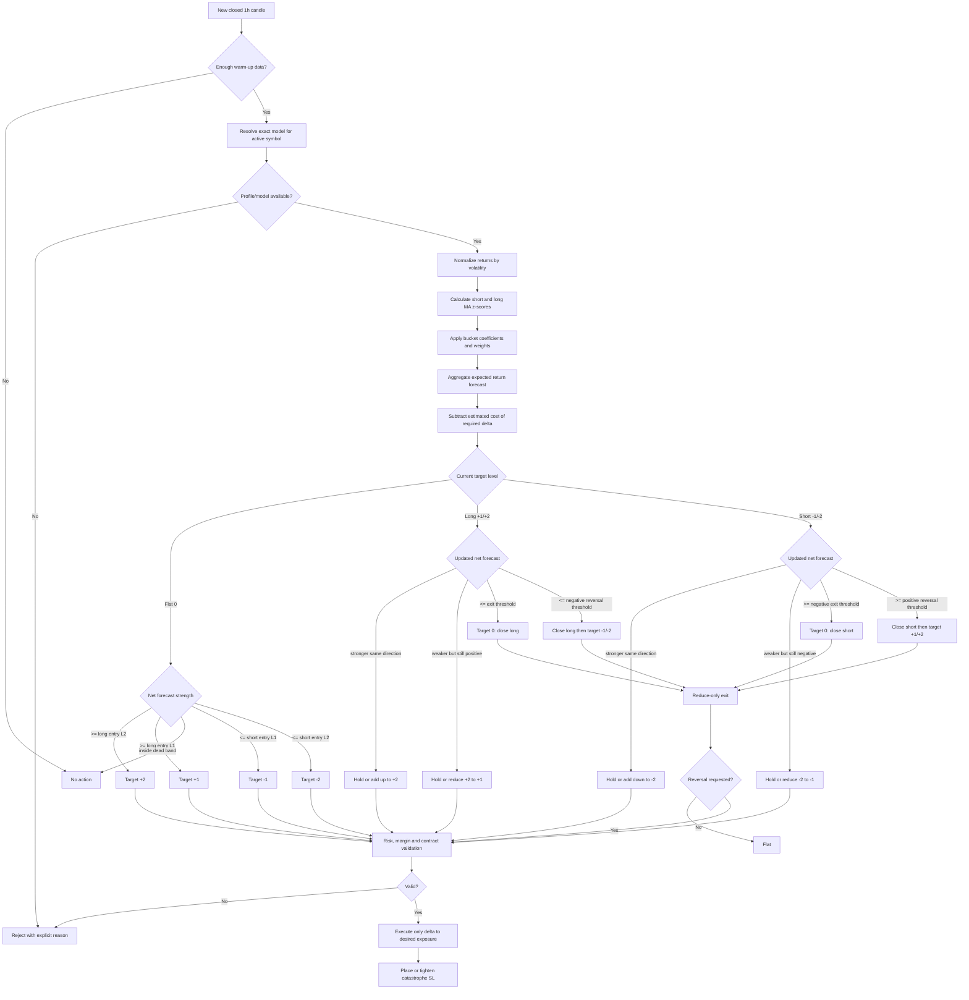
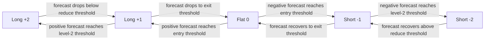

# Plan - Multi-Indicator Directional Strategy

## Timeframe portability review (2026-09-16)

Apply the [shared timeframe contract](strategy-timeframe-support.md). The
hourly model and results below remain the baseline; other horizons are pending.

Review: `parameters.ts` and `strategy.ts` fix `1h`. `training.ts` targets the
next candle's log return, while `scripts/research-multi-indicator-directional.ts`
loads hourly data and uses an hourly warm-up duration. Changing the schema
alone would relabel the forecast horizon without validating the model.

Goal: Support a specified trigger `T` with correctly identified model horizon.
Out of scope: Claiming hourly coefficients transfer, adding partial reduction,
or promoting the strategy to paper/live.
Steps:

1. In `src/strategies/multi-indicator-directional/parameters.ts` and
   `strategy.ts`, accept the shared enum and resolve `[T]`. Keep moving-average,
   volatility, z-score and history periods as bars; 336 bars are two weeks only
   at `1h`.
2. In the existing research runner, load `T`, compute pre-roll using its
   duration and preserve a chronological train/test split. In `training.ts`,
   admit a training row only when its entire next-bar target is inside the
   training partition. Snapshot symbol, `T`, horizon, training bounds and
   coefficients together; refit using training data only.
3. Test missing model/profile matches, threshold hysteresis, chronology and
   costs at `15m`, `1h`, `4h` and `1d`, with unchanged hourly baseline results.

Verification: Static trace a signal after the 10:00-11:00 bar closes; its
next-bar target is 11:00-12:00 and cannot be used to fit a model frozen at
11:00. Use an untouched OOS window for every declared horizon.

Sizing note: the supported field is `positionUnitNotionalUsd`, not
`orderAmountUsd`. One unit can become two units under the existing target-level
rules, so $1,000 per unit does not guarantee $1,000 per position. Record the
level transitions and existing close/reopen reduction accounting in reports.

## Original hourly baseline specification

> **Status: version-1 prototype implemented and backtested; keep disabled.**
>
> Origin: https://www.botcamp.xyz/strategies/cohort-7-multi-indicator-directional-strategy
>
> The public Botcamp description is sufficient to define the architecture and
> verification gates, but not the author's trained coefficients or exact signal
> thresholds. The Code & Resources tab requires a Botcamp login. Those values
> must therefore be supplied or re-estimated before an implementation can claim
> parity with the reference strategy.

## 1. Objective

Add a candle-driven strategy named `multi-indicator-directional` that:

- evaluates whichever unified symbol is supplied by the active runtime session,
  without a symbol name hard-coded in strategy code;
- reads approximately two weeks of closed hourly candles;
- normalizes price returns by recent volatility;
- converts short- and long-horizon moving-average z-scores into an expected
  return forecast;
- maps forecast strength into a target position level in
  `{-2, -1, 0, +1, +2}`;
- uses transaction-cost-aware hysteresis so small forecast changes do not cause
  unnecessary trading;
- exits or reverses exposure when the forecast no longer supports the current
  position;
- runs the same deterministic logic in backtest, paper and live modes.

This is a new, standalone strategy. Its calculations, parameters and execution
rules must be implemented inside its own module without importing business
logic from another strategy module.

## 2. Evidence from the origin

The public strategy page states the following behavior:

1. The model was estimated on roughly 600 trading days of SOL-USD data.
2. Runtime input is the latest two weeks of hourly candles.
3. Price moves are normalized for volatility.
4. A short-term and a long-term moving average are converted to z-scores.
5. Regression coefficients map each z-score to a return forecast; response
   coefficients differ for small, medium and large moves.
6. The short- and long-term forecasts are combined.
7. The target position can be `-2`, `-1`, `0`, `+1` or `+2` units.
8. The previous position and estimated transaction costs are inputs to a
   hysteresis rule that decides whether changing position is worthwhile.
9. Executors whose direction has negative expected gain are stopped.

The public page does not disclose the precise return definition, volatility
estimator, moving-average periods, z-score windows, bucket boundaries,
coefficients, forecast horizon, or hysteresis formula.

The reference training market, SOL-USD, is evidence about the published model
only. It is not a restriction on the implementation. Coefficients estimated for
one market must not be silently applied to another market without an approved
shared-model validation or a dedicated symbol profile.

## 3. Repository placement and boundaries

Use the repository's file and folder organization only. Do not copy, import or
adapt calculation, signal, sizing, entry, exit or risk rules from another
strategy.

### New strategy module

```text
src/strategies/multi-indicator-directional/
├── parameters.ts
├── forecast.ts
├── position-target.ts
├── strategy.ts
├── index.ts
├── parameters.test.ts
├── forecast.test.ts
├── position-target.test.ts
└── strategy.test.ts
```

Responsibilities:

- `parameters.ts`: strict schema, cross-field validation, types and defaults.
- `forecast.ts`: standalone normalization, indicators, z-scores and forecast.
- `position-target.ts`: standalone cost-aware target-level transition logic.
- `strategy.ts`: adapt repository context into this strategy's pure pipeline and
  return the strategy decision.
- `index.ts`: exports for the module.
- test files: verify only this strategy's rules and public contract.

### Shared integration files

Only the minimum structural integration points may be updated:

- `src/strategies/strategy.interface.ts`: add a generic target-position output
  contract if the current action shape cannot represent all five target levels.
- `src/strategies/strategy.registry.ts`: register the new name, parser and
  default parameter snapshot.
- `src/common/types/signal.type.ts`: add an execution-neutral intent type only
  if it belongs at the shared contract boundary.
- `src/engine/trading-engine.service.ts`: execute a target-position delta in
  realtime without containing forecast or transition rules.
- `src/backtest/backtest-runner.service.ts`: simulate the identical delta
  contract without containing forecast or transition rules.
- `migrations/operational/<next>_seed_multi_indicator_directional_v1.sql`:
  create the disabled template and account-owned copies.

### Required capability gap

The shared action contract currently does not directly express "set final
signed exposure to one of five levels". The plan therefore requires an explicit
target-position intent. This conclusion comes from the new strategy's required
output versus the shared interface, not from the implementation behavior of any
other strategy.

Repeated entry/exit actions must not be used as an implicit substitute because
they do not state the intended final exposure and can diverge across retries,
restart, backtest and live execution.

## 4. Proposed model

### 4.1 Strategy output

Extend the signal model with an optional target-position intent owned by the
engine:

```ts
interface TargetPositionIntent {
  readonly targetLevel: -2 | -1 | 0 | 1 | 2;
  readonly unitNotionalUsd: number;
  readonly expectedReturnRate: number;
  readonly estimatedRoundTripCostRate: number;
  readonly reason: string;
}
```

The intent states the desired final exposure, not an order delta. The execution
layer derives the delta from the current signed quantity, normalizes it to the
symbol contract rules, and sends only the required increase, partial reduce,
close or reversal orders.

This should be an additive strategy capability, not a reinterpretation of the
existing `Signal` fields. Existing strategies must keep their current behavior.

### 4.2 Position levels

- `+1`: long one configured unit.
- `+2`: long two configured units.
- `0`: flat.
- `-1`: short one configured unit.
- `-2`: short two configured units.

One unit is a fixed quote notional from strategy parameters. The final base
quantity is calculated by the shared initial-position sizing logic and rounded
once according to exchange contract multiplier, quantity step and minimum.

### 4.3 Forecast pipeline

For each newly closed 1h candle:

1. Compute log returns from close prices.
2. Estimate rolling volatility using only data available at that candle.
3. Normalize returns by volatility, with a positive volatility floor.
4. Build short and long moving-average series over normalized returns.
5. Calculate rolling z-scores for each series.
6. Select the configured small/medium/large bucket by absolute z-score.
7. Apply the configured coefficient for the indicator, bucket and sign.
8. Combine both forecasts with configured weights.
9. Clamp the aggregate forecast to a configured safety bound.
10. Map the forecast and previous target level through the hysteresis state
    transition table.

No coefficient is embedded as an unexplained constant. All trained model values
belong in the versioned strategy parameter snapshot and identify the symbol or
approved shared symbol universe on which they were trained and validated.

### 4.4 Hysteresis and costs

The transition decision must compare incremental expected gain with incremental
execution cost:

```text
incremental edge
  = abs(targetLevel - currentLevel) * abs(expectedReturnRate)
    - estimated cost of the required position delta
```

The exact formula remains a review decision because the public source does not
provide it. The implementation must use an explicit transition table or pure
function with these properties:

- no transition inside a neutral/dead-band zone;
- a stronger threshold to add a second unit than to open the first;
- a weaker exit threshold than entry threshold, preventing boundary churn;
- immediate reduction or close when the held direction has negative expected
  net gain;
- direct reversal is represented as close plus open and includes both costs;
- identical candles, parameters and current position always produce the same
  target.

The initial plan should use configured maker/taker fee, spread and slippage
assumptions from the shared cost model where available. A strategy-specific
additional cost buffer may be configured, but must not replace the engine cost
model.

### 4.5 Multi-symbol behavior

The strategy is symbol-agnostic at code level:

- the active symbol comes from `StrategyContext.symbol` and runtime settings;
- candle lookup uses the active session's symbol and required timeframe;
- no strategy source file contains a production symbol constant;
- exchange quantity, price tick, contract multiplier, minimum quantity,
  leverage and margin validation come from the active symbol specification;
- forecast and transition state are isolated by account, strategy version and
  symbol;
- an unavailable or invalid symbol profile causes a clear rejection and never
  falls back to another symbol's coefficients;
- adding support for a new symbol requires configuration and training evidence,
  not a source-code branch for that symbol.

Two parameter modes are possible, but version 1 must select exactly one:

1. `per_symbol_profiles` (recommended): each unified symbol has its own trained
   coefficients, thresholds and optional sizing/risk overrides.
2. `shared_normalized_model`: one coefficient set is used for all symbols only
   after out-of-sample evidence demonstrates transferability across the
   approved symbol universe.

The runtime must fail validation if the selected symbol has no applicable
model. It must not reuse the first profile, a default profile or the most
recently active symbol.

### 4.6 Open-position, SL and TP flow

The thresholds below are symbolic until the original model values are available
or new values are trained and approved:

```text
0 <= exitThreshold < entryLevel1Threshold < entryLevel2Threshold
reversalThreshold >= entryLevel1Threshold
```

All forecast comparisons use expected return after estimated execution costs,
not the raw forecast.



#### Open and add conditions

- From flat to `+1`: net forecast is at or above the level-1 long-entry
  threshold and the expected gain exceeds the full entry cost.
- From flat to `-1`: symmetric negative condition.
- From flat directly to `+2` or `-2`: allowed only when forecast exceeds the
  stronger level-2 threshold and two units pass every margin/exposure check.
- Add from one unit to two units: use the level-2 threshold and charge only the
  incremental execution cost of the added unit.
- Duplicate evaluation of the same closed candle produces no second order.

#### Protective stop loss

The stop loss is a catastrophe boundary, not the normal strategy exit. The
recommended version-1 formula is volatility based:

```text
stopDistance = max(ATR * catastropheAtrMultiplier,
                   averageEntryPrice * minimumStopDistanceRate)

long candidate SL  = averageEntryPrice - stopDistance
short candidate SL = averageEntryPrice + stopDistance
```

- Initial entry: place the stop immediately after the fill.
- Add a second unit: recalculate from the new average entry and current closed
  candle volatility, but apply a tighten-only rule.
- Long stop may stay unchanged or move upward; it must never move downward.
- Short stop may stay unchanged or move downward; it must never move upward.
- Partial reduction keeps the current protective stop unless a newly calculated
  value tightens it.
- A stop hit closes the complete remaining position with reduce-only execution.
- If the stop cannot be placed or confirmed, close the position and block new
  exposure.

#### Take profit and normal exit

The origin describes forecast-driven position adjustment and does not specify a
fixed take-profit price. Version 1 should therefore use dynamic target reduction
instead of inventing a fixed percentage TP:



- `takeProfitPrice` remains unset for version 1 unless the private reference
  source proves that a fixed TP exists.
- Profit is realized partially when level `+2/-2` reduces to `+1/-1`, and fully
  when the target becomes `0` or reverses.
- A profitable position is not closed merely because it reaches an arbitrary
  percentage; it closes when expected net forward return no longer justifies
  holding it.
- Maximum holding time may remain a separate engine safety limit, but it is not
  labelled as take profit.

## 5. Parameter plan

Create a strict Zod schema with these groups. Names are provisional until plan
review, but units and ownership should remain explicit.

### Data and sizing

- `triggerTimeframe`: initially literal `1h`.
- `historyLookbackCandleCount`: default `336` (14 days).
- `defaultLeverage`: bounded by the shared leverage guard.
- `modelScope`: `per_symbol_profiles` or `shared_normalized_model`.
- `symbolProfiles`: record keyed by exact unified symbol when using per-symbol
  mode; no fallback key is allowed.
- `positionUnitNotionalUsd`: quote value of one target-position unit, stored in
  the shared model or overridden by an exact symbol profile.
- `maximumMarginUsageRate`: hard strategy-level margin ceiling, optionally made
  stricter by an exact symbol profile.

Symbol selection itself is not a strategy parameter. It remains owned by the
runtime/account configuration so the same strategy implementation and version
can run independently on many symbols.

### Normalization and indicators

- `volatilityLookbackPeriod`.
- `volatilityFloorRate`.
- `shortMovingAveragePeriod`.
- `longMovingAveragePeriod`.
- `shortZScoreLookbackPeriod`.
- `longZScoreLookbackPeriod`.
- `smallMoveZScoreBoundary`.
- `largeMoveZScoreBoundary`.
- `shortForecastWeight` and `longForecastWeight`.

### Model coefficients

- short-horizon coefficient for small, medium and large moves;
- long-horizon coefficient for small, medium and large moves;
- optional intercept;
- maximum absolute forecast rate.

If training shows asymmetric behavior, coefficients may be split by positive
and negative z-score. Do not add that degree of freedom without evidence.

### Position transition

- entry threshold for level 1;
- add threshold for level 2;
- reduce threshold from level 2;
- exit threshold to flat;
- reversal threshold;
- additional cost buffer rate;
- minimum candles between discretionary target changes, default `0` unless the
  source or backtest demonstrates a need.

### Protection

The Botcamp description defines forecast-driven executor stops, not a protective
price stop. This repository requires live positions to be protected. The first
implementation must therefore choose and document one of these before coding:

1. ATR/volatility-based catastrophe stop per position level; recommended.
2. Fixed percentage catastrophe stop.
3. Extend the self-managed-risk path to allow forecast-only exits; not
   recommended for live trading.

The catastrophe stop is a safety boundary. Forecast changes remain the normal
exit mechanism.

## 6. Implementation phases

### Phase A - Freeze the specification

- Obtain the reference coefficients/formulas or explicitly approve a locally
  re-estimated model.
- Approve `per_symbol_profiles` or provide evidence for a shared normalized
  model.
- Define the initial supported symbol universe without hard-coding it in source.
- Record the training market, training interval, validation interval, forecast
  horizon and model values for every supported symbol/profile.
- Approve the catastrophe-stop method.
- Approve the target-position transition table, including fee assumptions.
- Record a small golden input/output fixture from the reference implementation
  if source access is available.

**Gate:** no production code starts while any item above is unresolved.

### Phase B - Pure calculations

- Add pure helpers for normalized returns, rolling mean/standard deviation,
  z-score, bucketed forecast and hysteresis transition.
- Add focused numerical tests, including zero volatility, threshold equality,
  insufficient history, extreme input clamping and no-lookahead behavior.
- Add a strategy parameter schema and defaults with cross-field validation.
- Add profile resolution tests proving exact-symbol selection and rejection when
  a profile is missing.

**Gate:** a table of hand-calculated fixtures matches exactly.

### Phase C - Target-position execution contract

- Add an additive target-position intent to the strategy contract.
- Create one shared delta planner that converts current signed exposure and
  desired signed exposure into `hold`, `increase`, `partial reduce`, `close` or
  `reverse`.
- Apply contract rounding, minimum order, margin, exposure, circuit breaker and
  idempotency checks after planning the delta.
- Implement the same delta lifecycle in realtime and backtest paths.
- Persist/audit target level, expected return, cost estimate and transition
  reason with the emitted decision.

**Gate:** engine fixtures prove all 25 current-level to target-level transitions
produce the same final exposure in backtest and paper execution.

### Phase D - Strategy integration

- Add `src/strategies/multi-indicator-directional/` with `parameters.ts`,
  `forecast.ts`, `position-target.ts`, `strategy.ts`, tests and `index.ts`.
- Register defaults and parser in `strategy.registry.ts`.
- Seed version 1 through a new operational migration using the account-owned
  configuration pattern.
- Add only the strategy-specific Telegram status/analysis fields that are
  useful for audit: z-scores, component forecasts, aggregate forecast, current
  level, target level and transition reason.

**Gate:** registry, configuration round-trip, warm-up and account isolation tests
pass, and no unrelated strategy module is changed.

### Phase E - Verification before enablement

- Run unit and engine acceptance tests.
- Run backtest with exact cost assumptions and record source revision and full
  parameter snapshot.
- Compare against buy-and-hold, volatility-matched buy-and-hold, random entry
  distribution and doubled-cost scenario.
- Run walk-forward/out-of-sample windows; do not tune on the reporting window.
- Run the full evidence suite independently for every enabled symbol; passing on
  one symbol does not approve another.
- Confirm trade count and target-level changes are stable when candle history is
  replayed after restart.
- Run paper mode with tiny notional and verify exchange/paper positions converge
  to every requested target level after rounding.

**Gate:** keep the template disabled and non-default until all acceptance rules
below pass.

## 7. Acceptance criteria

### Correctness

- Strategy evaluates closed candles only and contains no future data access.
- Warm-up covers every nested indicator: price returns, volatility, moving
  averages and z-score windows.
- The same candle slice, parameter snapshot and current signed exposure return
  the same forecast and target.
- Identical symbol data is never combined with coefficients belonging to a
  different symbol profile.
- Two accounts running different symbols keep forecast, target and execution
  state isolated.
- The execution result converges to the requested signed exposure or records a
  precise rejection reason.
- Partial reduction never increases absolute exposure.
- Reversal closes the old side before opening the new side.
- Restart/replay does not duplicate a target adjustment.

### Risk

- Every non-flat live target has a protective catastrophe stop.
- Two units cannot breach configured margin, leverage, liquidation-distance,
  exposure or contract-size limits.
- A rejected second unit leaves the valid first unit unchanged.
- Cost estimates include the full delta and both legs of a reversal.
- Circuit breaker and session pause block exposure increases but still allow
  reductions and exits.

### Strategy evidence

- Positive net result after all fees, spread, slippage and funding in the
  approved out-of-sample period.
- Beats buy-and-hold on the approved risk-adjusted measure.
- At or above the 90th percentile of the existing random-entry benchmark.
- Remains acceptable under doubled transaction costs.
- No unexplained Sharpe ratio above 3.
- Results are reported separately by month and market regime.
- Acceptance is recorded per symbol and strategy-configuration version; there
  is no strategy-wide approval inferred from a single successful market.

## 8. Verification matrix

| Area | Required proof |
|---|---|
| Forecast math | Golden numerical fixtures for every z-score bucket and sign |
| Hysteresis | Boundary tests immediately below, at and above every threshold |
| Position planner | All 25 transitions across levels `-2..+2` |
| Rounding | KuCoin and Binance contract multiplier/minimum/step cases |
| Symbol profiles | Exact lookup, missing-profile rejection and no cross-symbol fallback |
| Isolation | Concurrent accounts/symbols do not share candles, targets or model state |
| Costs | Open, add, reduce, close and reverse cost calculations |
| Backtest parity | Target sequence and fills match paper simulator fixtures |
| Restart | Replayed final candle creates no duplicate order |
| Configuration | Defaults, strict validation, DB copy and account isolation |
| Regression | Existing engine acceptance suites remain green; unrelated strategy folders have no diff |

## 9. Decisions required from review

1. Are the original source files/model coefficients available after Botcamp
   sign-in, or should coefficients be re-estimated locally?
2. Which unified symbols belong to the initial supported universe? This is a
   configuration/training decision, not a source-code constant.
3. What exactly is the forecast horizon: next 1h return, multi-hour return, or
   another period?
4. Is volatility normalization based on rolling standard deviation of hourly
   log returns, ATR, or the reference implementation's different estimator?
5. Approve the catastrophe stop: volatility/ATR or fixed percentage.
6. Approve fixed-notional unit sizing and whether level 2 equals exactly twice
   level 1 after contract rounding.
7. Should a reversal happen in one evaluation cycle or close first and require
   the next closed candle to open the other side?
8. Should the strategy use the shared global opposite-signal policy, or should
   target-position intent own its transition behavior completely? The latter is
   recommended because hysteresis is part of the strategy model.
9. Approve `per_symbol_profiles`, or provide transferability evidence and the
   exact approved symbol universe for `shared_normalized_model`.

## 10. Explicit non-goals for version 1

- Training or retraining a model inside the live bot.
- Assuming coefficients trained for one symbol are valid for another symbol.
- Adding symbol-specific `if`/`switch` branches in strategy source code.
- Fetching external features or making network calls from strategy evaluation.
- Automatically optimizing coefficients against the same period used for final
  reporting.
- Changing files inside any unrelated strategy folder.
- Making this strategy enabled or default before verification is complete.
- Claiming parity with Botcamp while the private formulas and coefficients are
  unavailable.

## 11. Version-1 implementation note

The first prototype stays inside the existing action and accounting contracts.
It implements target levels in the strategy module as follows:

- `0 -> +/-1`: open one unit;
- `+/-1 -> +/-2`: add one unit on a later closed candle;
- `+/-2 -> +/-1`: close the complete position and reopen one unit;
- reversal: close the complete position and reopen one unit in the other
  direction, with a second unit allowed on a later candle.

The close-and-reopen reduction is intentionally conservative because the
current shared accounting path records a trade only when a complete position is
closed. It pays more fees than a true partial reduce. A later engine enhancement
may add partial reduction, but only together with equivalent paper, live,
backtest, persistence and PnL accounting tests.

The six-month result of this prototype is recorded in
`docs/multi-indicator-directional-v1-backtest-report.md`. It fails the enablement
gate and remains disabled.

The subsequent per-symbol chronological training pass also fails the gate. Its
fitted next-hour forecasts are generally smaller than the KuCoin round-trip
cost floor, and all four symbols make zero out-of-sample trades. This activates
the research stop condition: partial-reduce implementation is deferred until a
new, predeclared feature hypothesis demonstrates tradable out-of-sample edge.
