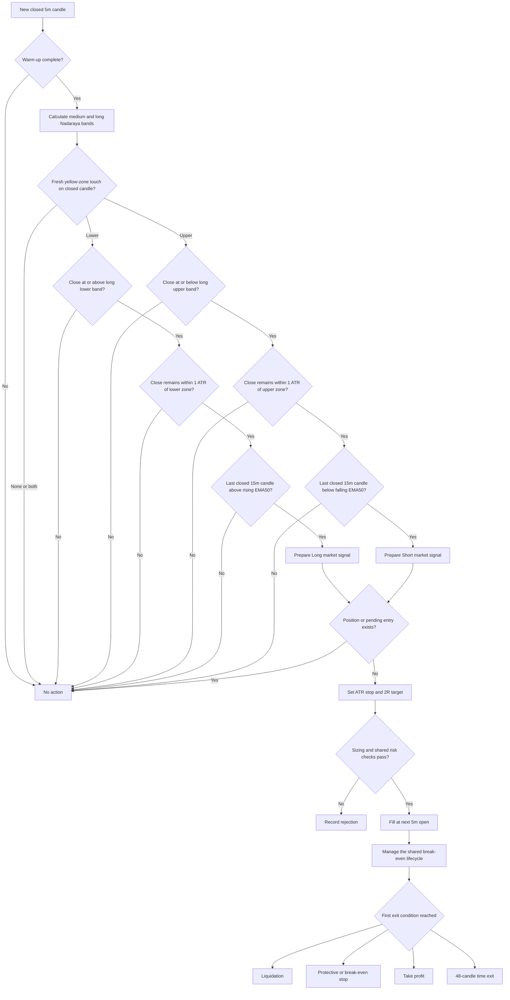

# Plan - Nadaraya Band Mean-Reversion Strategy

## Timeframe portability review (2026-09-16)

The [shared timeframe contract](strategy-timeframe-support.md) supersedes the
fixed `5m/15m` restriction for the proposed extension. Baseline source rules
below are retained; runtime support for other pairs is pending.

Review: trigger/trend schema literals and the strategy dependency array fix
`5m + 15m`. Signal evaluation already receives separate candle series.

Goal: Support valid pairs `T < C` for `nadaraya-band-mean-reversion`.
Out of scope: Repainting smoothing, indicator formula changes or new entries.
Steps:

1. In `src/strategies/nadaraya-band-mean-reversion/parameters.ts`, validate the
   selected trigger and strictly higher trend interval; resolve `[T, C]`.
2. In `signal.ts` and its warm-up calculation, keep the one-sided 500-value
   smoother and band periods in `T` bars. Derive trend EMA requirements from
   `C` and select only context candles closed by the trigger close.
3. Test baseline `5m/15m`, `1h/4h` and `4h/1d` pairs, including yellow-zone
   first touch, rejection beyond the outer band, and bounded/full parity.

Verification: Static trace an hourly lower-zone touch at 11:00 with only the
last completed four-hour EMA available. A forming 08:00-12:00 context cannot
confirm that entry. Missing 500-value smoothing history must not yield a signal.

## Original baseline specification

> Status: draft for review. This plan does not authorize changes to the existing
> Nadaraya Smoothed Bollinger Bands indicator implementation.
>
> Source: https://www.tradingview.com/script/LUoxSDKw-Bollinger-Bands-Nadaraya-Smoothed-Flux-Charts/

## 1. Objective

Add a candle-driven strategy named `nadaraya-band-mean-reversion` that consumes
the existing `calculateNadarayaSmoothedBollingerBands` result and runs through
the repository's current signal, risk, execution and backtest lifecycle.

Version 1 must:

- use closed `5m` candles to detect a fresh touch of the yellow mean-reversion
  zone between the medium and long Nadaraya envelopes;
- use the latest fully closed `15m` candle and EMA50 to confirm the overall
  trend;
- treat a touch of the lower yellow zone as a possible Long pullback and a
  touch of the upper yellow zone as a possible Short rally;
- wait for the touching `5m` candle to close before creating a signal and reject
  a candle that closes beyond the outer long-band boundary;
- fill market entries at the next `5m` candle open;
- hold at most one position for the active symbol;
- use the shared fixed-notional sizing, contract conversion, fee, funding,
  spread, slippage and risk models;
- use an ATR-based protective stop, a reward-to-risk target, maximum holding
  time and break-even protection;
- produce identical decisions from identical closed candles in backtest, paper
  and live paths;
- remain backtest-only until research and paper gates pass.

The existing indicator files are inputs and are not restructured in this build:

```text
src/indicators/nadaraya-smoothed-bollinger-bands.ts
src/indicators/nadaraya-smoothed-bollinger-bands.test.ts
```

## 2. Verified indicator behavior

The source author describes the indicator as a de-noised Bollinger Band tool for
identifying abnormal price movements and consolidation. The author explicitly
states that it is not intended to be used alone.

The strategy-safe TypeScript implementation:

- calculates Bollinger envelopes from HLC3;
- smooths every band with a one-sided Gaussian Nadaraya-Watson estimator;
- uses a fixed 500-value smoothing lookback;
- rejects repaint smoothing;
- calculates short, medium and long envelopes;
- emits its built-in visual events only against the short envelope;
- supports Close, High/Low and confirmed Pivot label sources;
- records both the candle where an event belongs and the candle where it became
  knowable;
- does not repaint earlier values when later candles arrive.

The new entry rule does not use the indicator's short-band event labels. It
reads the non-repainting medium and long envelope values directly to reproduce
the two yellow zones shown in the supplied chart.

The existing indicator suite currently passes 6 tests.

### Local defaults are the implementation contract

The current TradingView source and the existing TypeScript defaults are not
identical. TradingView currently shows smoothing 6, medium period 75 and long
deviation 4.25, while the local implementation intentionally locks the supplied
screenshot profile:

```text
smoothing factor: 9
short envelope:   period 20, deviation 3
medium envelope:  period 80, deviation 4
long envelope:    period 100, deviation 5
label source:     Close
repaint:          false
```

Version 1 uses the tested local defaults. Exact parity with another TradingView
profile requires a separately named parameter profile, not a silent indicator
change during strategy work.

## 3. Strategy interpretation

The yellow boxes in the supplied chart cover the space between the medium and
long envelopes. Version 1 treats those areas as outer mean-reversion zones. The
short envelope and Pine triangle events remain available for display and audit,
but they do not trigger an entry.

For every closed `5m` candle, define:

```text
upper zone inner boundary = medium upper band
upper zone outer boundary = long upper band

lower zone inner boundary = medium lower band
lower zone outer boundary = long lower band
```

The expected nesting must be valid:

```text
long upper > medium upper
long lower < medium lower
```

If either relationship is false or any required band is unavailable, the candle
cannot create a signal.

### Long candidate

The latest `5m` candle must enter the lower yellow zone from above:

```text
previous low > previous medium lower band
current low <= current medium lower band
current high >= current long lower band
```

The current range therefore intersects the yellow zone. Wait until the candle
closes, then require:

```text
current close >= current long lower band
max(0, current close - current medium lower band)
  <= ATR * maximumEntryDistanceAverageTrueRange
```

A close below the long lower band is treated as a downside breakout, not a
mean-reversion Long.

The Long is permitted only when the latest fully closed `15m` candle confirms a
bullish trend:

```text
15m close > current EMA50
current EMA50 > previous EMA50
```

### Short candidate

The latest `5m` candle must enter the upper yellow zone from below:

```text
previous high < previous medium upper band
current high >= current medium upper band
current low <= current long upper band
```

After the candle closes, require:

```text
current close <= current long upper band
max(0, current medium upper band - current close)
  <= ATR * maximumEntryDistanceAverageTrueRange
```

A close above the long upper band is treated as an upside breakout, not a
mean-reversion Short.

The Short is permitted only when the latest fully closed `15m` candle confirms
a bearish trend:

```text
15m close < current EMA50
current EMA50 < previous EMA50
```

Equality in the trend gate is neutral. An upper-zone touch in a bullish `15m`
trend and a lower-zone touch in a bearish `15m` trend are ignored.

The touch deliberately uses the closed candle's High/Low range, not the
indicator's `labelSource = HighLow` event mode. This allows a wick to touch the
yellow zone while preserving one deterministic decision after the candle has
closed. No intrabar order is placed.

The entry-distance gate does not reject a close that remains inside the yellow
zone. It rejects a signal candle that touches the zone and then rebounds more
than one ATR beyond the medium boundary before the strategy can fill at the
next open. This prevents chasing a completed mean-reversion move.

If one unusually large candle touches both yellow zones, the result is
ambiguous and no entry is created. Requiring the previous candle to remain on
the inside of the medium boundary makes this a fresh-touch event and prevents
the same zone from retriggering on every candle that remains inside it.

## 4. Baseline decisions

| Decision | Version 1 baseline | Reason |
|---|---:|---|
| Strategy name | `nadaraya-band-mean-reversion` | Makes the upper/lower mapping explicit |
| Trigger timeframe | `5m` | Reduces `1m` noise while keeping intraday signal frequency |
| Trend timeframe | `15m` | Confirms the broader direction using the existing MTF pattern |
| Trend rule | Close versus rising/falling EMA50 | Requires price location and slope agreement |
| Entry | Market at next `5m` open | Existing causal engine convention |
| Long trigger | Fresh lower yellow-zone touch + valid close + bullish `15m` trend | Buys a deep pullback inside an uptrend |
| Short trigger | Fresh upper yellow-zone touch + valid close + bearish `15m` trend | Sells a deep rally inside a downtrend |
| Yellow zones | Medium-to-long envelope space | Matches the supplied chart markings |
| Breakout rejection | No entry beyond the outer long band | Avoids fading a confirmed outer-band close |
| Maximum entry distance | `1.0 * ATR(14)` from the medium boundary | Avoids chasing a touch after a large rebound candle |
| Initial size | `200 USDT` fixed notional | Reuses cross-symbol contract sizing |
| Leverage | `2x` | Conservative research baseline |
| Stop | `1.5 * ATR(14)` from signal close | Volatility-adjusted protection |
| Target | `2R` from stop distance | Positive payoff asymmetry with simple comparison |
| Maximum hold | `48` trigger candles | Four hours on `5m` |
| Opposite zone touch while open | Ignore | Keeps entry and exit experiments separate |
| Break-even stop | Enabled | Reuses the shared fee-aware protection lifecycle |
| Trailing stop | Disabled | Preserves the fixed stop/target baseline after break-even protection |
| Shared volatility filter | Disabled | The outer-zone touch already represents an extreme move |

These values are a frozen research baseline, not a profitability claim.

## 5. Runtime flow



No Nadaraya signal logic belongs in the engine or backtest runner. Those layers
continue to own position state, exit ordering, cost accounting and execution.

## 6. Strategy parameter contract

Use a strict flat Zod schema consistent with the current directional strategy
folders:

```text
triggerTimeframe: "5m"
trendTimeframe: "15m"
defaultSymbol?: string
defaultLeverage: 2

orderAmountUsd: 200
maximumMarginUsageRate: 0.10

smoothingFactor: 9
shortBandPeriod: 20
shortBandDeviation: 3
mediumBandPeriod: 80
mediumBandDeviation: 4
longBandPeriod: 100
longBandDeviation: 5
labelSource: "close"
repaintSmoothing: false

trendExponentialMovingAveragePeriod: 50
averageTrueRangePeriod: 14
maximumEntryDistanceAverageTrueRange: 1.0
stopLossAverageTrueRangeMultiplier: 1.5
rewardToRiskRatio: 2
maximumHoldingCandleCount: 48

trailingStopEnabled: false
breakEvenStopEnabled: true
volatilityFilterEnabled: false
```

Validation must enforce:

- trigger timeframe is exactly `5m`;
- trend timeframe is exactly `15m`;
- repaint smoothing is exactly `false`;
- label source is exactly `close`;
- smoothing factor, all band periods/deviations, ATR period and exit multipliers
  are positive and bounded;
- maximum entry distance is nonnegative and bounded;
- trend EMA period is at least 2;
- order notional and maximum margin-use rate are valid;
- reward-to-risk and maximum holding count are positive.

The adapter builds `NadarayaSmoothedBollingerBandsParameters` by spreading
`defaultNadarayaSmoothedBollingerBandsParameters` and overriding the short,
medium and long calculation fields. Medium and long envelopes define the entry
zones. The short envelope remains available for indicator parity and chart
diagnostics but does not trigger version 1 entries. Visual fields retain their
tested defaults and never affect a trading decision.

## 7. Repository placement

Add one strategy-owned folder matching the VWAP strategy structure:

```text
src/strategies/nadaraya-band-mean-reversion/
|-- index.ts
|-- parameters.ts
|-- parameters.test.ts
|-- signal.ts
|-- signal.test.ts
|-- strategy.ts
`-- strategy.test.ts
```

Responsibilities:

- `parameters.ts`: strict schema, defaults and conversion to the existing
  indicator parameter type.
- `signal.ts`: bounded Nadaraya calculation, fresh medium-to-long zone-touch
  detection, close and maximum-entry-distance validation, ATR14 and
  closed-`15m` EMA50 confirmation.
- `strategy.ts`: no-entry-while-open guard, fixed-notional margin check and
  standard `Signal` construction.
- tests: parity, causality, trend alignment, barrier math and backtest entry
  timing.

Only these existing integration points should change:

```text
src/strategies/strategy.registry.ts
src/strategies/strategy.registry.test.ts
```

The registry adds the implementation, defaults, parser and fixed-notional
sizing owner.

No changes are planned for:

```text
src/indicators/nadaraya-smoothed-bollinger-bands.ts
src/backtest/backtest-runner.service.ts
src/engine/trading-engine.service.ts
src/strategies/strategy.interface.ts
src/common/types/signal.type.ts
database schemas
exchange adapters
```

No migration is required for command-line backtests. Add an operational seed
only after the strategy passes research and is approved for Telegram paper use.

## 8. Bounded calculation window

The backtest runner evaluates a strategy on every closed trigger candle. Calling
the Nadaraya indicator over the complete growing history each time would turn a
long replay into an avoidable full-history rescan.

The yellow zones use the medium and long envelopes. The long envelope has the
largest requirement, so the exact bounded window is:

```text
max(medium band period, long band period) + smoothing lookback - 1
= max(80, 100) + 500 - 1
= 599 trigger candles
```

`signal.ts` therefore passes only the latest required `5m` window to the
existing indicator. It must not modify the indicator algorithm.

This optimization is accepted only with parity tests proving that, across
flat, trending, volatile and boundary-crossing fixtures:

```text
latest and previous medium upper/lower from bounded window == full history
latest and previous long upper/lower from bounded window   == full history
latest yellow-zone touch decision                          == full history
```

For parameter profiles, calculate the bounded requirement dynamically from the
largest band period used by the signal. Do not reuse 599 after changing the
medium or long period.

## 9. Signal and barrier contract

`signal.ts` evaluates the latest and previous closed `5m` candles against their
own medium and long band values.

```text
fresh lower-zone touch + valid close + bullish 15m trend -> LONG
fresh upper-zone touch + valid close + bearish 15m trend -> SHORT
both zones, invalid nesting, distant/breakout close or mismatch -> NONE
```

An intrabar touch is known only from the final High/Low of the closed candle.
The strategy emits no provisional signal while that candle is forming. Old
touches never retrigger.

Calculate ATR14 on the same bounded trigger-candle window. Barrier formulas:

```text
stopDistance = latest ATR * stopLossAverageTrueRangeMultiplier

Long stop    = signal close - stopDistance
Long target  = signal close + stopDistance * rewardToRiskRatio

Short stop   = signal close + stopDistance
Short target = signal close - stopDistance * rewardToRiskRatio
```

The engine normalizes stop and target prices to the symbol tick. The market
entry fills on the next candle, so realized R can differ after spread, slippage
or an opening gap. Do not rebase barriers inside this strategy because that
would change the shared execution contract.

Set `isCounterTrend: false`. The `5m` outer-zone touch is a local pullback, while
the actual order direction agrees with the confirmed `15m` trend.

The reason string records direction, signal OHLC, medium and long zone
boundaries, close position relative to the outer band, excursion in ATR units,
entry distance from the medium boundary, ATR, smoothing factor, medium/long
periods and deviations, and the `15m` close/EMA readings.

## 10. Warm-up and higher-timeframe causality

Reuse `calculateWarmUpCandleCount` from `src/strategies/warm-up.ts`.

```text
5m Nadaraya long band: 100 + 500 - 1 = 599 candles
5m ATR:                14 candles
15m trend EMA slope:   50 + 1 = 51 candles

calculateWarmUpCandleCount([
  { candleCount: 599, timeframe: "5m" },
  { candleCount: 14, timeframe: "5m" },
  { candleCount: 51, timeframe: "15m" }
], "5m")
```

With the shared 20-candle margin, the default warm-up is `619` closed `5m`
candles.

Higher-timeframe rules:

- calculate the observation time as the latest `5m` candle open timestamp plus
  five minutes;
- use `findLastClosedHigherTimeframeIndex` or `readHigherTimeframeValue`;
- a `15m` candle becomes visible exactly at its close timestamp;
- never read a currently forming `15m` candle;
- a missing current or previous EMA50 value closes the entry gate;
- evaluate touch and close confirmation only after the `5m` candle is closed;
- use each candle's contemporaneous medium/long band values, not current bands
  projected backward;
- appending future candles must not alter historical decisions.

## 11. Cost and position accounting

The strategy does not calculate exchange fees itself. It reuses the shared
backtest and execution layers.

Every completed trade includes:

```text
net PnL = gross PnL
        - entry fee
        - exit fee
        - funding
        - slippage cost
```

Entry behavior includes taker fee, half-spread and configured slippage. The
`200 USDT` parameter is target notional before fees; fees are deducted
separately. Break-even calculation remains fee- and funding-aware through the
existing engine implementation.

## 12. Test plan

### Phase A - Preserve indicator contract

- Run the existing six indicator tests unchanged.
- Do not enable repaint mode.
- Do not refactor indicator calculations during strategy work.
- Handle any discovered Pine/local parity defect as a separate regression
  patch, not inside the strategy adapter.

### Phase B - Parameter tests

Prove:

- defaults parse and unknown fields fail;
- non-`5m` trigger and non-`15m` trend timeframes fail;
- repaint `true` and unsupported label sources fail;
- invalid smoothing, short/medium/long period, deviation, ATR, entry distance,
  R:R, notional and margin fail;
- conversion preserves every strategy-relevant indicator field;
- medium/long defaults are included and visual defaults remain unchanged.

### Phase C - Bounded-window parity tests

Prove the latest and previous medium/long boundaries and the resulting zone
decision match a full-history calculation for multiple histories longer than
599 candles. Include the exact first valid index and one candle before it.

### Phase D - Signal tests

Prove:

- a wick entering the lower yellow zone, closing no lower than the long lower
  band and receiving bullish `15m` confirmation produces LONG;
- a wick entering the upper yellow zone, closing no higher than the long upper
  band and receiving bearish `15m` confirmation produces SHORT;
- every mismatched or neutral trend combination produces NONE;
- a close beyond the lower or upper outer band produces NONE;
- a close exactly one ATR beyond the medium boundary is accepted and a greater
  distance is rejected;
- a candle remaining in a zone after the first touch does not retrigger;
- a candle touching both zones produces NONE;
- invalid medium/long nesting produces NONE;
- High/Low changes on a forming candle cannot create an early signal;
- a forming `15m` candle cannot confirm an entry;
- a `15m` candle becomes available exactly at its close;
- equality to EMA or a flat EMA is neutral;
- latest ATR, OHLC and all zone-boundary readings are returned for audit;
- future candles do not change past decisions.

### Phase E - Strategy tests

Prove:

- LONG/SHORT map to the correct market entry action;
- entry uses signal timestamp, symbol and close reference price;
- long and short stop/target formulas are symmetric;
- `isCounterTrend` is false;
- open positions and excessive margin suppress entry;
- fixed-notional sizing points to `orderAmountUsd`;
- trailing stop is disabled and break-even protection is enabled;
- the reason string contains the required audit readings.

### Phase F - Registry and backtest parity

Prove:

- registry resolves `nadaraya-band-mean-reversion`, defaults and parser;
- required timeframes equal `["5m", "15m"]`;
- default warm-up equals 619 trigger candles;
- backtest entry fills at the next `5m` open, not the signal candle;
- direct strategy evaluation and runner replay create the same barriers;
- existing registry, causality, engine and exit-parity suites remain green.

## 13. Backtest research plan

Do not tune entry and exit dimensions in the same stage.

### Stage 1 - Frozen baseline

Run exact defaults on:

- `BTC/USDT:USDT`;
- `ETH/USDT:USDT`;
- `SOL/USDT:USDT`;
- `AVAX/USDT:USDT`.

Use at least 12 months of verified `5m` and `15m` candles, preferably 24 months.
Both timeframes must cover the same period without gaps. Include fees, funding,
spread and slippage.

Report:

- combined and per-symbol results;
- LONG and SHORT separately;
- yellow-zone touch frequency and rejection counts by close, entry-distance and
  trend gate;
- trade frequency and holding time;
- gross profit versus friction;
- stop, target and time-exit distribution;
- performance by month and volatility regime;
- random-entry and doubled-cost benchmarks.

### Stage 2 - Exit sensitivity

Keep Nadaraya and trend parameters frozen:

```text
stop ATR multiplier: 1.0, 1.5, 2.0
reward-to-risk:      1.0, 1.5, 2.0, 3.0
maximum hold bars:   24, 48, 96
break-even:          enabled and frozen
trailing stop:       disabled and frozen
```

Select a stable neighboring region, never only the highest-return cell.

### Stage 3 - Nadaraya zone sensitivity

Freeze the chosen exit profile, then test a small grid:

```text
smoothing factor:     6, 9, 12
medium band period:   60, 80, 100
medium deviation:     3.0, 4.0
long band period:     80, 100, 120
long deviation:       4.0, 5.0, 6.0
```

Reject any profile where the long envelope does not remain outside the medium
envelope at the evaluated candle. Recalculate the bounded window and warm-up
for every period pair. Keep repaint false, entry distance `1 ATR` and `15m`
EMA50 frozen.

### Stage 4 - Entry-distance sensitivity

Freeze the selected indicator and exit profile, then test:

```text
maximum entry distance: 0.5, 1.0, 1.5, 2.0 ATR
```

Report rejection count, next-open gap and realized R by distance bucket. Select
a stable region rather than the distance producing the highest isolated return.

### Stage 5 - Confirmation ablation

Run one report with the `15m` EMA gate disabled to measure whether confirmation
improves expectancy and drawdown. The disabled variant is diagnostic only and
is not a runtime candidate in version 1.

### Stage 6 - One-way out-of-sample validation

Use a chronological 70/30 split. Tune only on the first 70 percent, freeze the
selected profile, then read the final 30 percent once. Retuning after seeing the
result invalidates the out-of-sample claim.

## 14. Acceptance gates

Use the repository's `5m` to `15m` acceptance profile:

- profit factor greater than `1.5`;
- Sharpe ratio greater than `1.5`;
- maximum drawdown below `12%`;
- at least `250` completed trades in the evaluated period;
- positive expectancy after costs;
- zero liquidations;
- positive result at doubled execution cost;
- above the 90th percentile of random-entry runs;
- out-of-sample decay below `20%`.

Additional strategy gates:

- at least three of four research symbols have positive out-of-sample
  expectancy;
- no one symbol supplies more than 60 percent of aggregate net profit;
- friction consumes less than 50 percent of gross profit;
- LONG and SHORT results are disclosed separately;
- bounded-window parity is exact at the latest candle;
- results remain positive when outer-band breakout closes are excluded exactly
  as specified;
- nearby parameter values remain directionally consistent;
- the EMA confirmation improves expectancy or drawdown versus the diagnostic
  no-confirmation run.

If the frozen signal cannot beat random entry or doubled costs, stop before
adding RSI, volume or another indicator.

## 15. Implementation phases and stop conditions

### Phase 1 - Backtest-capable strategy

1. Add the parameter schema and indicator adapter.
2. Add bounded medium/long zone calculation with parity tests.
3. Add fresh-touch and outer-band close validation.
4. Add ATR and closed-`15m` EMA50 signal evaluation.
5. Add the standard strategy wrapper and protective barriers.
6. Register defaults, parser and fixed-notional sizing.
7. Run focused tests and a short database-backed smoke replay.

Stop when this command resolves and replays the strategy without changes to the
engine or runner:

```bash
npm run backtest -- \
  --strategy nadaraya-band-mean-reversion \
  --symbol "ETH/USDT:USDT" \
  --timeframe 5m \
  --sample all \
  --benchmark false
```

### Phase 2 - Research

Run the staged matrix and write a report containing data periods, costs,
per-symbol metrics, direction splits, exit distribution, sensitivity and
acceptance results.

Stop and reject version 1 if entry does not beat random entry or becomes
negative at doubled cost. Do not rescue it by silently adding filters.

### Phase 3 - Paper promotion, only after approval

If research passes:

1. Add the next operational seed migration as a non-default strategy template.
2. Expose it to Telegram paper accounts only.
3. Run at least 30 days or 100 closed paper trades.
4. Compare paper frequency, fills, costs and drawdown with backtest assumptions.

Live enablement is a separate decision outside this plan.

## 16. Explicit non-goals

- No edit or refactor of the existing Nadaraya indicator.
- No repaint mode.
- No Pivot or built-in High/Low event-source mode in version 1; zone touch reads
  the final OHLC of an already closed candle directly.
- No short-band triangle event as an entry trigger.
- No entry after a candle closes beyond the outer long band.
- No timeframe beyond the `5m` trigger and `15m` confirmation pair.
- No EMA ribbon, RSI, order-book, news or funding-rate entry filter.
- No scale-in, DCA, hedge or simultaneous Long/Short positions.
- No indicator-based exit or opposite-signal reversal.
- No limit-order experiment in the baseline.
- No automatic optimizer.
- No migration, Telegram exposure or live enablement before acceptance.

## 17. Review decisions

Recommended version 1 assumptions:

1. strategy name `nadaraya-band-mean-reversion`;
2. the yellow zones are the spaces between medium and long envelopes;
3. a fresh wick touch is evaluated only after its `5m` candle closes;
4. close beyond the outer long band or more than one ATR beyond the medium
   boundary invalidates the mean-reversion entry;
5. lower zone means Long candidate; upper zone means Short candidate;
6. `5m` trigger with closed-`15m` EMA50 trend confirmation;
7. non-repainting local defaults: smoothing 9, medium 80/4 and long 100/5;
8. ATR stop 1.5, target 2R and maximum hold 48 bars;
9. shared break-even enabled and trailing stop disabled;
10. fixed notional 200 USDT and leverage 2;
11. default warm-up increases to 619 closed `5m` candles;
12. backtest-only registry integration first, with no migration;
13. existing indicator, engine and runner remain structurally unchanged.

Once approved, Phase 1 is narrow enough to implement without core architecture
changes.
