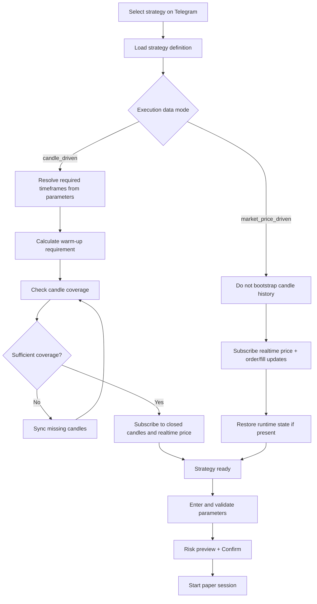
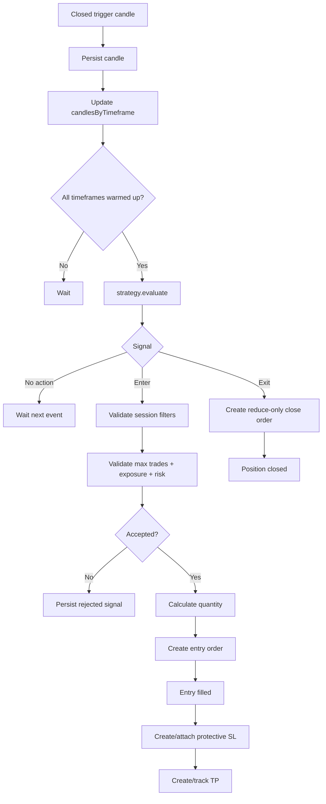
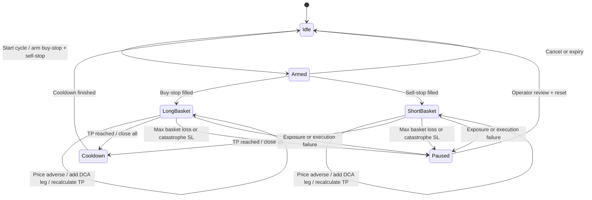
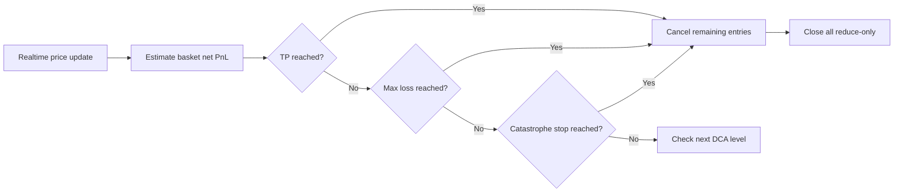
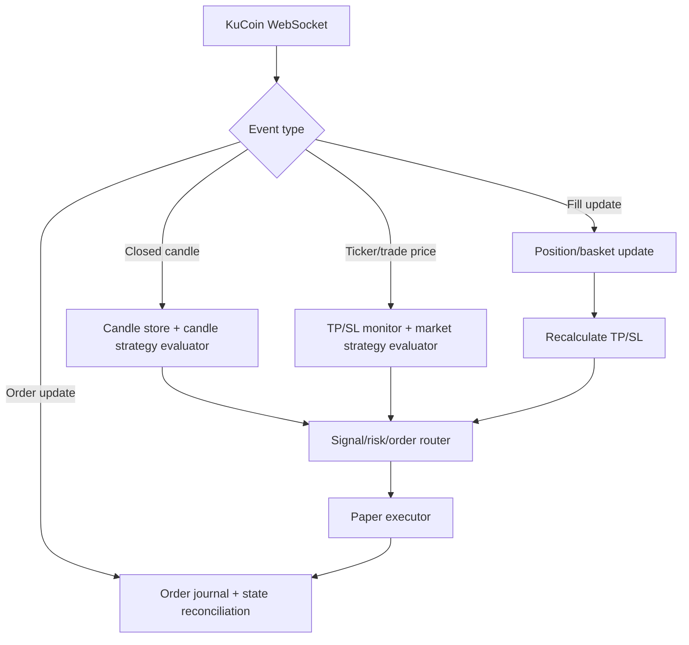

# Plan F - Strategy execution, TP/SL and Telegram parameters

> **Status: draft for review.** This document describes the target flow when selecting a
> strategy for paper trading: determine market-data requirements, configure parameters
> through Telegram, manage entries and exits, set take profit and stop loss, and enforce order limits.
>
> Plan divides strategy into two clear groups:
>
> - `candle_driven`: needs candles of one or more timeframes to calculate signal.
> - `market_price_driven`: decide directly from realtime price, no bootstrap
> candle history. `dca-stop-straddle` belongs to this group.

## 1. Objective

- Each strategy declares the necessary data itself, not letting Telegram or the engine guess.
- Candle-driven strategy automatically syncs to the correct timeframe and warm-up needed.
- A market-price-driven strategy does not load candles when its logic does not require them.
- Necessary parameters are displayed, entered and validated directly on Telegram.
- Entry, exit, TP, SL and trade limits are frozen for each paper session.
- TP must calculate enough fees, slippage and funding so that PnL after costs is still positive.
- DCA must close the entire basket when it reaches TP or reaches the loss threshold.
- Restarting the source does not lose the basket, TP, SL, or next DCA level state.

## 2. Classification of strategies



### 2.1 Strategy definition

Each strategy needs to declare metadata in the code next to the implementation:

```ts
interface StrategyDefinition<Parameters> {
  readonly name: string;
  readonly executionDataMode: "candle_driven" | "market_price_driven";
  readonly requiredMarketStreams: readonly ("ticker" | "trades" | "closed_candle")[];
  resolveRequiredTimeframes(parameters: Parameters): readonly Timeframe[];
  calculateWarmUpRequirements(parameters: Parameters): readonly WarmUpRequirement[];
  readonly parameterDefinition: StrategyParameterDefinition<Parameters>;
  readonly managesItsOwnRisk: boolean;
}
```

Rules:

- `requiredTimeframes` cannot be hard-coded when the timeframe is a parameter;
  resolve it from the session parameter snapshot.
- `candle_driven` must have at least one timeframe.
- `market_price_driven` is allowed to return `[]` and not call the candle downloader.
- Strategy declares the stream that is actually needed. DCA needs ticker/trade price and order/fill
updates; no need for `closed_candle` just to enable evaluate.
- Engine refuses to start if definition, schema and parameters conflict.

## 3. Telegram strategy selection flow

```text
/menu
  -> Paper trade
  -> select Symbol
  -> select Strategy
  -> view strategy requirements
       Data mode
       Required timeframes or realtime streams
       Warm-up estimate
       Risk ownership
  -> Configure parameters
  -> Validate
  -> Risk preview
  -> Confirm
  -> Prepare data/subscriptions
  -> Start paper session
```

### 3.1 Parameter screens

After choosing strategy:

```text
Strategy parameters
  [Use saved profile]
  [Edit parameters]
  [Reset to profile]

Edit parameters
  -> select a parameter
  -> bot displays type, unit, current value, min/max and description
  -> user enters a value
  -> validate immediately
  -> return to the parameter summary
  -> Confirm parameters
```

Telegram does not automatically build the form by reading raw JSON. Each strategy must have parameters
definition for UI:

```ts
interface TelegramParameterField {
  readonly key: string;
  readonly label: string;
  readonly description: string;
  readonly type: "number" | "integer" | "rate" | "bps" | "enum" | "boolean";
  readonly unit: string | null;
  readonly minimum?: number;
  readonly maximum?: number;
  readonly step?: number;
  readonly options?: readonly string[];
  readonly editableInTelegram: boolean;
  readonly riskLevel: "normal" | "high";
}
```

### 3.2 Parameter persistence

```text
strategy_configurations (telegram_account_id IS NULL)
  -> a separate default template for each strategy and version
  -> account selects a strategy
  -> create or read the configuration owned by that account
  -> update only that account's parameters
  -> parse with the strategy-specific schema
  -> create an immutable parameter snapshot for the paper session
  -> reset by copying template parameters into the account configuration
```

- Strategy implementation is shared, but the configuration of each account is independent.
- Each strategy keeps its own JSON parameter shape and is validated by that strategy's own parser.
- Update does not modify the template and does not affect other accounts.
- Reset restores only the currently selected strategy's parameters; it does not reset balance, exchange, or account settings.
- Telegram must not exceed hard caps from environment/risk policy.
- Paper sessions always use immutable snapshots. Saved changes take effect only when the
  configuration is started or applied again, so they cannot silently modify TP/SL for an open position.

## 4. Shared parameters

Strategies can name their logic individually, but Telegram needs to group fields by
unified meaning:

| Group | Parameters | Meaning |
|---|---|---|
| Data | Required timeframe(s) | Candles need to sync for candle-driven strategy |
| Entry | Entry mode/order type | Market, limit, stop or OCO straddle |
| Entry | Entry distance/condition | Condition or distance that triggers entry |
| Size | Initial size | Fixed notional or balance rate |
| Size | Maximum concurrent trades | Number of positions/baskets opened simultaneously |
| Exit | Strategy exit rule | Exit condition emitted by the strategy signal |
| Take profit | Take-profit rule | Fixed price, reward/risk, indicator or basket net target |
| SL | Stop-loss rule | Fixed price, ATR, percentage or basket max loss |
| Cost | Fee/slippage assumptions | Used to calculate target PnL after costs |
| Safety | Maximum exposure/margin | Hard cap before allowing further entry or DCA |

Must clearly separate two concepts:

- `maximumConcurrentTradeCount`: maximum number of positions/baskets running at the same time.
- `maximumEntryCount`: maximum number of legs inside a DCA basket.

A DCA basket with 10 legs is still counted as an open trade/basket.

## 5. Candle-driven strategy flow

Applies to strategies such as moving average, multi-timeframe trend or indicator crossover.



### 5.1 Entry rules

1. Evaluate only after the trigger candle has closed.
2. Higher timeframe only contains closed candles, does not use future values.
3. An entry signal must provide:
- Side.
- Order type.
- Reference/trigger price.
- Stop-loss rule or stop-loss price.
- Take-profit rule or take-profit price.
- Reason and signal timestamp.
4. The risk layer checks before creating an order:
- Session is active.
- `maximumConcurrentTradeCount` has not been exceeded.
- There is no duplicate signal/order for the same event.
- Position size, leverage, exposure, and margin remain within hard caps.
- Stop loss is valid for side and market precision.
5. Order and signal must have an idempotency key.

### 5.2 Stop loss

- Protective SL must be created immediately after the entry fill is confirmed.
- SL is reduce-only and protects the correct position.
- If the exchange or paper executor fails to create SL, transition the session to `paused` and do not open new entries.
- If strategy returns ATR/percentage rule, engine freezes SL price from fill price and
snapshot parameters; Do not recalculate arbitrarily after restart.
- Trailing stop only runs when the strategy definition explicitly enables this feature.

### 5.3 Take profit and exit

Position may exit for one of the following reasons:

```text
protective_stop
take_profit
strategy_exit_signal
maximum_holding_time
session_stop
kill_switch
```

- TP/SL is monitored against realtime price without waiting for candle close.
- The indicator's exit signal is still evaluated on the closed candle.
- Exit order is always reduce-only.
- After fill, you must cancel the remaining protective orders and reconcile position to zero.
- Each position can only be closed once even though the TP and exit signal occur close to each other.

## 6. Market-price-driven DCA flow

`dca-stop-straddle` does not need candle history to decide whether to enter or advance through DCA levels. It operates from realtime price, account state, resting orders, and fill events.



### 6.1 DCA start

1. Read realtime reference price.
2. Calculate buy-stop and sell-stop around the current price.
3. Calculate ladder long/short in advance by spacing, multiplier and exchange precision.
4. Calculate effective maximum entry count according to:
- `maximumEntryCount` user entered.
- Available balance.
- `maximumBasketMarginRate`.
- Exchange minimum/maximum order size.
5. If initial size or ladder is invalid, do not arm cycle.
6. Place two stop entries in the same OCO/order group.
7. For a side fill, cancel sibling immediately.

### 6.2 DCA scale-in

```text
Entry 1 quantity = initial quantity
Entry N quantity = rounded(Entry N-1 quantity * sizeMultiplier)
```

When the price goes in the opposite direction:

1. Realtime price touches the next DCA level.
2. Check that the basket has not exceeded the max loss, margin and entry count.
3. Create the corresponding DCA order for that level using the idempotency key.
4. After fill, update legs, total quantity and weighted average entry.
5. Add entry fees and funding incurred.
6. Recalculate the common TP for the entire basket.
7. Replace the old TP with the new TP; never leave two basket TP orders active.

Do not add multiple legs merely because one tick crosses several levels. Process one fill at a time and recheck risk before each additional leg.

### 6.3 Fee-inclusive basket take profit

TP is not just `averageEntryPrice + takeProfitBps`. It must find the smallest price
after rounding according to tick size so that:

```text
estimatedNetPnl(exitPrice)
  = grossPricePnl
  - totalEntryFees
  - estimatedExitFee
  - slippageBuffer
  - accumulatedFunding

estimatedNetPnl(exitPrice) >= targetNetProfit
```

Where:

```text
targetNetProfit = basketNotional * takeProfitBps / 10_000
estimatedExitFee = exitNotional * worstCaseTakerFeeRate
```

- Long basket: select the smallest price tick above the weighted average that meets the condition.
- Short basket: select the largest price tick below the weighted average that meets the condition.
- Recalculate after each fill, funding update or quantity correction.
- Before setting TP, the calculator must verify that `estimatedNetPnl >= targetNetProfit` still holds after price and quantity rounding.

### 6.4 Basket stop loss and loss threshold

DCA requires two independent layers of protection:

| Class | Function |
|---|---|
| Maximum basket loss | Close the entire basket when the estimated net loss reaches the user input limit |
| Catastrophe stop | Final protective stop if the process or market monitor fails |

Target Parameter:

```text
maximumBasketLossMode: fixed_amount | balance_rate | basket_margin_rate
maximumBasketLossValue: number
catastropheStopBufferRate: number
maximumBasketMarginRate: number
```

Flow:



- `maximumBasketLossValue` must be under the global loss/risk cap.
- On maximum loss: cancel all resting DCA/TP orders, close the full quantity reduce-only,
  record exit reason `maximum_basket_loss`, and move the session/basket to `paused`.
- Do not arm a new basket after stop loss; require cooldown or operator confirmation according to the frozen parameters.
- `maximumBasketMarginRate` blocks additional legs but does not replace stop loss.

### 6.5 Independent of candles

For DCA to really not need candles:

- Entry/DCA/TP/SL is triggered from ticker/trade price event.
- `initialOrderExpiryCandleCount` needs to be converted to `initialOrderExpirySeconds` or `0`
to wait indefinitely.
- `cooldownCandleCount` needs to be converted to `cooldownSeconds`.
- Migration parameters must create a new version; Do not silently change the meaning of the old field.
- Price snapshots can be saved for audit purposes, but there is no need to record candles just for the strategy to run.

## 7. Realtime event routing



Event must be serialized according to `paperSessionId + symbol` to price tick, fill and order
update does not edit a basket at the same time. Duplicate events must be idempotent.

## 8. Runtime state and database

### 8.1 Paper session snapshot

Each confirmation on Telegram needs to be saved:

```text
paper_session
  id
  symbol_id
  strategy_configuration_id
  strategy_name
  strategy_version
  execution_data_mode
  parameter_snapshot JSONB
  maximum_concurrent_trade_count
  status: preparing | running | paused | stopping | stopped | failed
  started_at
  stopped_at
  failure_reason
```

### 8.2 Strategy runtime state

State needs to be persisted for safe restart:

```text
strategy_runtime_state
  paper_session_id
  symbol_id
  state_version
  state JSONB
  updated_at
```

Minimum DCA state includes:

- Cycle ID and status.
- Side, anchor price and order group.
- All filled legs.
- First entry price/quantity.
- Weighted average and total quantity.
- Next DCA level.
- Accumulated fees/funding.
- Current TP and catastrophe stop.
- Maximum loss configuration.
- Effective maximum entry count.

### 8.3 Restart recovery

```text
Start source
  -> load running/paused paper sessions
  -> read open orders, fills and positions from the database/executor
  -> load strategy runtime state
  -> reconcile expected state with actual state
  -> recreate missing protective TP/SL when safe
  -> resume subscriptions
  -> resume running or pause when there is a mismatch
```

Do not resume DCA only from average position. If leg metadata is missing or mismatched
quantity, transition to `paused`, and notify Telegram instead of guessing the next level.

## 9. Telegram parameter examples

### 9.1 DCA strategy

```text
dca-stop-straddle v2 · ETH/USDT:USDT
Data mode: market-price-driven
Required candles: none
Streams: ticker, order updates, fills

Parameters
- Initial order: 100 USDT
- Trigger distance: 10 bps
- Near/Far DCA step: 10 / 14 bps
- Size multiplier: 1.68
- Maximum entries per basket: 5
- Target net profit: 27 bps
- Maximum basket loss: 20 USDT
- Maximum concurrent baskets: 1

[Edit] [Reset] [Risk preview]
```

### 9.3 Risk preview

Before confirming, Telegram must display at least:

```text
Initial notional
Maximum theoretical basket notional
Maximum entry count
Maximum margin usage
Maximum basket loss
Target net profit after estimated costs
Required data/subscriptions
```

If the theoretical ladder is out of balance or hard cap, the bot must reduce the effective entry count and
displays the actual number before confirming.

## 10. Stop session flow

When the user clicks Stop:

```text
No open position/basket
  -> cancel resting entries
  -> stop subscriptions that are no longer used
  -> status stopped

Open position/basket
  -> choose:
       [Stop after current trade closes]
       [Close now and stop]
       [Cancel]
```

- `Stop after current trade closes`: do not open new entry/cycle, still keep TP/SL monitor.
- `Close now and stop`: cancel resting entries, close reduce-only, reconcile zero then stop.
- Do not just turn off the evaluator while position loses TP/SL monitor.

## 11. Implementation phases

### Phase F1 - Strategy contract

- Add `executionDataMode`, realtime stream requirements and dynamic timeframe resolver.
- Separate warm-up requirements from assuming a mandatory timeframe trigger.
- Add parameter definition for Telegram.
- Keeps the schema parser of each strategy as final validation.

### Phase F2 - Telegram parameter state machine

- Add screens: requirements, parameter summary, parameter input, validation error,
risk preview and confirmation.
- Save run draft parameters according to Telegram user/session.
- Supports Back, Cancel, Reset and callback idempotency.
- Freeze immutable snapshot when confirming.

### Phase F3 - Candle-driven preparation

- Resolve timeframes from parameter snapshot.
- Sync missing history and automatic warm-up.
- Subscribe only to the timeframes required by the active strategy.
- Route closed candle to the correct session evaluator.

### Phase F4 - Market-price-driven engine

- Add ticker/trade price stream for DCA evaluation.
- Remove candle bootstrap from DCA start flow.
- Convert expiry/cooldown from candle count to time duration with new parameter version.
- Serialize events by session/symbol.

### Phase F5 - TP/SL and DCA basket risk

- Recalculate fee-inclusive TP after every basket mutation.
- Add maximum basket loss and close-all flow.
- Ensure protective stop, reduce-only close and order cancellation idempotent.
- Persist full basket runtime state.

### Phase F6 - Recovery and observability

- Reconcile session, orders, fills, positions and strategy state on restart.
- Pause when mismatch instead of guessing yourself.
- Telegram shows active parameters, position/basket, TP, SL, PnL and exit reason.
- Record audit log for parameter changes, start, stop and forced close.

### Phase F7 - Tests

- Test strategy data classification and required timeframe resolution.
- Test Telegram input type, min/max, enum, dependency and hard cap validation.
- Test candle strategy does not evaluate before sufficient warm-up.
- Test DCA start does not call candle history downloader.
- Test OCO only one side is filled.
- Test that each crossed level creates only one additional DCA leg.
- Test TP after fee/slippage/funding always gives positive estimated net PnL.
- Test maximum basket loss cancel orders and close all quantities.
- Test max concurrent trades different from max DCA entries.
- Test restart restores next leg, TP and SL.
- Test duplicate tick/fill/callback does not create duplicate order or close twice.

## 12. Acceptance criteria

1. Choose a strategy on Telegram that displays the correct data mode and data requirements.
2. Candle-driven strategy automatically syncs enough timeframe/warm-up before running.
3. Market-price-driven DCA does not bootstrap candle history.
4. Telegram allows you to enter, edit, reset and validate parameters of each strategy.
5. Session snapshot parameters do not change after confirmation.
6. `maximumConcurrentTradeCount` and `maximumEntryCount` are applied correctly.
7. Candle entries are only generated from closed candles; TP/SL is still monitored in realtime.
8. DCA entry, scale-in, TP and max loss run from realtime price/fill events.
9. Basket TP calculates enough entry fee, exit fee, slippage and funding to achieve net PnL target.
10. Touch maximum basket loss to cancel resting orders and close all reduce-only.
11. Restart does not lose basket legs, the next DCA level, TP, SL, or accumulated costs.
12. Every order/close flow is idempotent and has an audit trail.

## 13. Points to consider when reviewing

- DCA uses ticker, trade stream or mark price as standard trigger?
- `maximumBasketLoss` enter USDT, balance percentage or choose all three modes?
- When max loss closes the basket, does the session automatically cool down and then run again or does it always `paused`?
- Is it possible to edit parameters when the session is running but does not have a position yet?
- Does Telegram have a `Save as new profile/version` button in the first phase or just session override?
- Does candle strategy set TP resting order or only monitor TP in paper engine?
- `maximumConcurrentTradeCount` Set each strategy separately or use an additional global ceiling?
