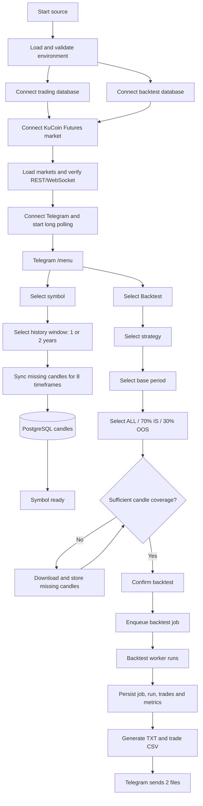
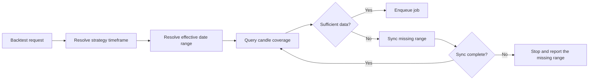

# Plan E - Telegram market data and backtest flow

> **Status: draft for review.** This document describes the target flow from application
> startup through Telegram symbol selection, candle-history synchronization, and backtesting.
> It excludes paper trading, live trading, and changes to strategy logic.

## 1. Objective

- Telegram is the main control point for selecting symbols and running backtests.
- When a symbol is selected, the system prepares one or two years of candle history in PostgreSQL.
- A backtest allows selection of strategy, time period, and dataset split: `ALL / IS / OOS`.
- Each backtest job outputs exactly two files:
  - A `.txt` file containing the summary, configuration, parameters, cost model, and monthly breakdown.
  - An uncompressed `.csv` file containing the trade list.

## 2. Overall flow



## 3. Startup flow

```text
Start source
  -> load environment
  -> connect DATABASE_URL (trading + market data)
  -> connect BACKTEST_DATABASE_URL (jobs + results)
  -> initialize KuCoin Futures
  -> loadMarkets + REST time check
  -> start market WebSocket services
  -> initialize Telegram bot
  -> start long polling
  -> ready for /menu
```

If a required dependency cannot connect, the application must identify the failed dependency and reject new jobs. WebSocket and Telegram reconnection run in the background with backoff and must not create duplicate listeners.

## 4. Symbol and candle history flow

### 4.1 Telegram screens

```text
/menu
  -> Symbol
  -> select an active symbol
  -> select History: [1 year] [2 years]
  -> Confirm sync
  -> download progress by timeframe
  -> Coverage summary
  -> Symbol ready
```

### 4.2 Target timeframe

```text
1m, 3m, 5m, 15m, 1h, 2h, 4h, 1d
```

`30m` is outside this flow's scope. Re-adding it requires an explicit decision during review before implementation.

### 4.3 Synchronization rules

1. Use exchange time to determine the most recent closed candle.
2. Calculate `targetFrom` from the selected one- or two-year window and align it to the timeframe.
3. Read existing coverage from the `candles` table.
4. Fetch only missing ranges; do not redownload the complete range.
5. Download timeframes sequentially to control KuCoin rate-limit usage.
6. Validate OHLCV and save only closed candles.
7. Upsert idempotently by `(symbol_id, timeframe, open_timestamp)`.
8. Update sync progress after each batch so you can resume.
9. Verify boundary, gap and coverage before reporting `ready`.

### 4.4 Incremental update

After the first bootstrap:

```text
latest stored closed candle
  -> fetch from the next candle
  -> discard the still-open candle
  -> upsert the day's new data
  -> update coverage
```

"Only store today's additions" means each synchronization downloads only newly missing data; it does not delete the stored one- or two-year history.

## 5. Backtest flow

### 5.1 Telegram screens

```text
/menu
  -> Backtest
  -> select Symbol
  -> select Strategy
  -> select Base period
       [1 year]
       [2 years]
       [Custom UTC date range]
  -> select Sample
       [ALL]
       [70% IS]
       [30% OOS]
  -> validate candle coverage
  -> Confirm
  -> Queue / Running / Progress
  -> Completed
  -> receive report TXT + trades CSV
```

If an active symbol was previously selected, the Backtest screen uses it as the default while still allowing the user to go back and change it before confirmation.

### 5.2 Base period and IS/OOS

Period and sample are two separate options:

```text
Base period = [startTimestamp, endTimestamp]

ALL     = 100% base period
70% IS  = the first 70% chronologically
30% OOS = the final 30% chronologically
```

For `N` candles sorted by ascending timestamp:

```text
splitIndex = floor(N * 0.70)
IS         = candles[0 .. splitIndex - 1]
OOS        = candles[splitIndex .. N - 1]
```

Do not randomize data or allow IS/OOS overlap. Enter and display custom ranges in UTC; require `start < end`, and do not allow `end` beyond the latest closed candle.

### 5.3 Coverage gate



Do not enqueue a job when coverage is insufficient. Never create or interpolate synthetic candles to fill gaps.

### 5.4 Job execution

```text
Telegram bot
  -> insert backtest_jobs: queued
  -> backtest worker claim job
  -> status: running
  -> load strategy version + frozen parameters
  -> read candles for the effective date range
  -> apply fee/slippage/funding cost model
  -> run strategy bar-by-bar
  -> persist run, trades, and required equity/metrics
  -> generate reports
  -> status: completed or failed
  -> Telegram sends the result
```

The backtest worker runs in a separate process so it cannot block Telegram, the paper engine, or market WebSockets. Each job stores snapshots of strategy parameters and the cost model so its results remain reproducible.

## 6. Output contract

Each successful job outputs exactly two files:

```text
backtest-{jobId}.txt
backtest-{jobId}-trades.csv
```

### 6.1 Combined TXT report

```text
BACKTEST SUMMARY
- Job ID
- Symbol
- Strategy + version
- Base period
- Sample: ALL / IS / OOS
- Effective period
- Initial balance / final balance
- Net PnL / return
- Total trades / win rate
- Profit factor
- Maximum drawdown
- Fees / slippage / funding cost

RUN CONFIGURATION
- Timeframe
- Starting balance
- Position sizing
- Leverage / margin assumptions
- Execution assumptions

STRATEGY PARAMETERS
- Frozen parameter key/value list

COST MODEL
- Maker fee
- Taker fee
- Slippage
- Funding handling

MONTHLY BREAKDOWN
- Month
- Trade count
- Gross PnL
- Fees and costs
- Net PnL
- Return
- Win rate
- Maximum drawdown
```

### 6.2 Trade CSV

Store one completed trade per row, including at minimum:

```text
trade_id,symbol,strategy,side,entry_time,entry_price,exit_time,exit_price,
quantity,gross_pnl,fee,slippage,funding,net_pnl,return_rate,exit_reason
```

Rules:

- File is plain `.csv`, UTF-8, with header.
- Do not gzip, zip or compress in any form.
- Timestamp uses UTC ISO-8601.
- Amount and PnL values must use consistent precision.
- Row order by `entry_time`, then `trade_id`.
- Do not export the default equity curve in this scope.

## 7. Database mapping

| Flow | Read | Write / Update |
|---|---|---|
| Load symbol menu | `trading_symbols` | No |
| History coverage | `candles`, `candle_sync_state` | `candle_sync_state` |
| History sync | Latest/range from `candles` | Upsert `candles`, update `candle_sync_state` |
| Load strategies menu | Enabled strategy/configuration tables | No |
| Create backtest | Symbol, strategy configuration, coverage | Insert `backtest_jobs` |
| Run backtest | Market candles + frozen job config | `backtest_runs`, `backtest_trades`, metrics |
| Report delivery | Completed run + trades | Update report paths/delivery status if available |

## 8. Telegram state mapping

| Screen | Input | Next state |
|---|---|---|
| Main menu | `Symbol` | Symbol list |
| Symbol list | Symbol ID | History window |
| History window | `1y` or `2y` | Sync confirmation |
| Sync confirmation | Confirm | Sync progress |
| Sync progress | Success | Coverage summary |
| Main menu | `Backtest` | Backtest symbols |
| Backtest symbols | Symbol ID | Strategy list |
| Strategy list | Strategy ID/version | Base period |
| Base period | `1y`, `2y`, custom | Sample choice |
| Sample choice | `ALL`, `IS`, `OOS` | Coverage validation |
| Coverage validation | Ready | Backtest confirmation |
| Backtest confirmation | Confirm | Job progress |
| Job progress | Completed | Report delivery |

Every screen must support `Back` and `Cancel`. Stale-menu buttons and repeated callbacks must not create duplicate synchronizations or jobs.

## 9. Implementation phases

### Phase E1 - Telegram state and menu

- Add symbol history window `1y / 2y`.
- Add all 8 timeframes to sync view.
- Separate base period from sample `ALL / IS / OOS`.
- Add custom UTC date-range validation.
- Block old callbacks and double-submit.

### Phase E2 - Candle sync orchestration

- Connect symbol selection to market history sync service.
- Synchronize missing ranges sequentially, idempotently, and resumably.
- Display progress/coverage by timeframe.
- Reuse the same flow for bootstrap and the backtest coverage gate.

### Phase E3 - Backtest request and worker

- Save base range, sample and effective range into job.
- Freeze strategy version, parameters and cost model.
- Claim job safely and update progress.
- Ensure workers only read necessary market data.

### Phase E4 - Report contract

- Collect summary, configuration, parameters, cost model and monthly breakdown into TXT.
- Export an uncompressed trade CSV.
- Send exactly two documents via Telegram.
- Standardize file names, timestamps, precision and trade order.

### Phase E5 - Tests and verification

- Test Telegram state transitions, Back/Cancel and callback idempotency.
- Test that synchronization fetches only missing ranges and does not save open candles.
- Test one-year, two-year, and custom UTC range boundaries.
- Test split `70% IS / 30% OOS` does not overlap or remove candles.
- Test that insufficient data triggers synchronization before enqueueing.
- Test the two exact filenames and all required sections and columns.
- Run an end-to-end job and compare the DB with the two received Telegram files.

## 10. Acceptance criteria

1. The application starts and connects to the databases, KuCoin market data, and Telegram.
2. Selecting a symbol can bootstrap or resume one or two years of history for all eight timeframes.
3. Re-sync only loads missing candles and keeps existing historical data intact.
4. Backtest flow supports selecting a strategy, `1y / 2y / custom`, then `ALL / IS / OOS`.
5. IS is the first 70% and OOS is the last 30% of the same base period in chronological order.
6. Job does not run when candle coverage is not enough or there is an unresolved gap.
7. Backtest does not block Telegram, WebSocket or paper engine.
8. Results are saved in the backtest database and can be reproduced from the config snapshot.
9. Telegram receives exactly one combined TXT report and one uncompressed trade CSV.
10. Retried callbacks, synchronization, or report delivery do not create duplicate jobs, candles, or logical files.

## 11. Points to consider when reviewing

- Keep exactly eight timeframes, or re-add `30m`?
- Select a history window every time the symbol changes, or default to two years while allowing overrides?
- Should `1y / 2y` count backward from now or from a user-selected `end date`?
- If KuCoin lacks the full history, allow a partial range or fail the request?
- Should monthly breakdowns use UTC months and include beginning/end-of-month balances?
- Persist report files permanently, or regenerate them from the database after a retention period?
