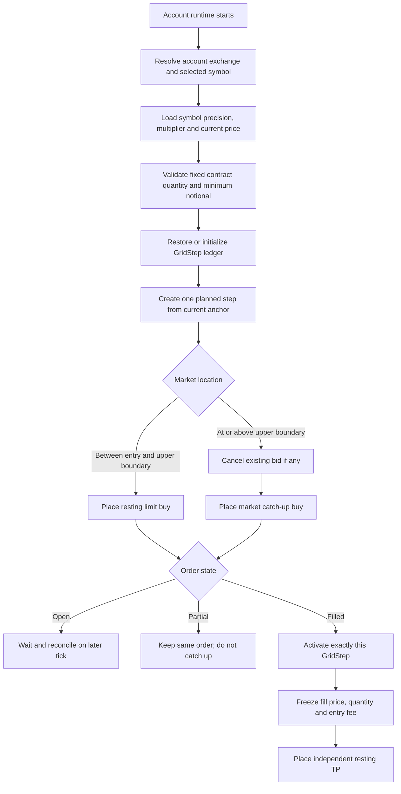
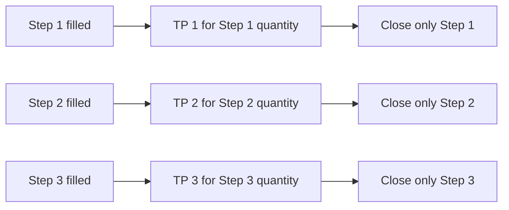

# Plan - Trailing Geometric Grid Strategy

## Timeframe portability review (2026-09-16)

Apply the [shared timeframe contract](strategy-timeframe-support.md). Existing
deployed defaults and ledger decisions below are preserved. Broader replay
selection is pending validation through all entry points.

Review: this is a ticker/order-driven stateful strategy, not a candle indicator.
Registry defaults select `1m`, but the dedicated backtest runner already reads
`configuration.triggerTimeframe` and its duration. Its accounting requires 1x.

Goal: Select any data-supported replay interval `E` without changing grid rules.
Out of scope: Introducing 10x futures accounting, changing contract sizing or
converting independent GridSteps into aggregate signal-engine positions.
Steps:

1. Resolve the runtime-owned replay interval through the shared enum and
   selected run snapshot in the registry/CLI/worker selection path. Do not add
   candle timing fields to the grid geometry or change its ticker cadence.
2. In `src/backtest/trailing-geometric-grid-backtest-runner.ts`, retain the
   existing order-before-bar eligibility and once-at-close strategy update.
   Audit expiry/end-of-data timestamps at `1h`, `4h`, `1d` and aligned `1w`.
3. Extend runner tests with an hourly range touching both an entry and its
   prospective TP, gaps, catch-up and rotation. Compare deterministic repeated
   runs at each interval, not equality of PnL across different resolutions.

Verification: Static trace a buy filled from a pre-existing order during one
hour: a TP first created at that hour's close cannot fill from its earlier
high. It becomes eligible only in a later replay candle.

Reports must call `E=1h` an hourly OHLC grid simulation and disclose its
existing unmodeled funding/spread/slippage/latency. Coarse replay can miss grid
cycles seen by realtime paper; timeframe selection does not establish parity
with an unknown intrabar tick path. Keep current 1x eligibility explicit.

## Original baseline and implementation record

> **Status: implemented and deployed for account-isolated Telegram Paper trading and dedicated historical backtesting.**
>
> Origin: https://www.botcamp.xyz/strategies/cohort-3-trailing-geometric-grid
>
> The public Botcamp description defines the strategy intent but does not expose
> every formula and execution transition. The decisions used by this repository
> are recorded in `docs/trailing-geometric-grid-decisions.md`. This document is
> the build and verification plan aligned with the current implementation.

## 1. Objective

Provide a stateful strategy named `trailing-geometric-grid` that:

- runs independently for each Telegram paper account;
- uses the symbol selected by that account rather than a hard-coded pair;
- supports the active BTC, ETH, SOL and AVAX USDT perpetual markets on Binance
  USD-M and KuCoin Futures;
- creates an open-ended geometric grid without fixed minimum and maximum prices;
- tracks every entry as an independent `GridStep` ledger row;
- keeps the take-profit quantity and target attached to the step that created it;
- closes exactly one step at a time instead of using the aggregate average
  position to choose an exit;
- uses a fixed exchange-contract amount for every new step;
- applies the selected account exchange's maker and taker fee assumptions to
  paper balances and PnL;
- replays the same stateful `GridStep` lifecycle against historical candles
  without passing through the aggregate-position signal engine;
- persists the strategy ledger and simulated exchange book across restarts;
- fails closed when order state, precision, balance or reconciliation is
  ambiguous.

The current version is long-only and supports Telegram Paper plus historical
backtesting. It must not be routed through the legacy signal engine, which
represents one aggregate position per symbol and cannot safely own independent
per-step exits. Live order placement remains outside the authorized scope.

## 2. Evidence from the origin

The public strategy material establishes these behaviors:

1. The grid follows price and does not require a fixed configured range.
2. Grid spacing is percentage based, producing geometric rather than arithmetic
   price levels.
3. The strategy can start with quote asset and place bids around the current
   market.
4. A bid is placed around the middle of a grid step.
5. The strategy may catch up with a market order when price rises by one step.
6. Each filled step has its own percentage take-profit.
7. The default take-profit equals the grid interval.
8. Active exposure is bounded by a derived `max_steps` value.
9. When capacity must rotate, one uppermost step is removed rather than closing
   the complete basket.
10. Status includes active steps, closed steps, quote profit and realized
    performance.

The public source does not fully define the geometric formulas, exact anchor
transition, race handling, fee treatment, retry policy, precision rules or
restart reconciliation. Those repository decisions are explicitly frozen in
`docs/trailing-geometric-grid-decisions.md` and are not presented as recovered
private source code.

## 3. Repository placement and boundaries

### Strategy module

```text
src/strategies/trailing-geometric-grid/
├── calculations.ts
├── calculations.test.ts
├── models.ts
├── parameters.ts
├── exchange-adapter.ts
├── fake-exchange.ts
├── persistent-paper-exchange.ts
├── persistent-paper-exchange.test.ts
├── state-store.ts
├── state-store.test.ts
├── database-state-store.ts
├── status.ts
├── strategy.ts
├── strategy.test.ts
├── simulation.ts
├── simulation.test.ts
├── ccxt-spot-adapter.ts
└── ccxt-spot-adapter.test.ts
```

Responsibilities:

- `calculations.ts`: pure grid geometry, TP, capacity, rounding, minimum-order
  validation, step selection and realized PnL.
- `models.ts`: grid ledger, order, pending-action and lifecycle contracts.
- `parameters.ts`: strict parameter parsing, defaults, fingerprinting and fixed
  contract sizing ownership.
- `strategy.ts`: state transitions, orchestration, idempotency, retries and
  reconciliation.
- `fake-exchange.ts`: deterministic paper order matching, balance accounting
  and maker/taker fees.
- `persistent-paper-exchange.ts`: persists the simulated exchange mutation
  before the strategy records its consequence.
- `database-state-store.ts`: isolates snapshots by account, version, symbol and
  strategy instance.
- `status.ts`: active trade, closed trade, balance and PnL reporting.
- `simulation.ts`: executable near-TP proof without a real order submission.

### Shared integration files

The strategy uses only the minimum shared integration points:

- `src/strategies/strategy.registry.ts`: registration, defaults, parsing and
  stateful-engine exclusion.
- `src/strategies/initial-position-sizing.ts`: shared fixed-contract sizing.
- `src/execution/contract-size.ts`: exchange contract/base conversion.
- `src/risk/execution-cost.ts`: fee profile selected by exchange name.
- `src/backtest/trailing-geometric-grid-backtest-runner.ts`: stateful candle
  replay, per-step trades, equity curve and end-of-data close.
- `src/notification/telegram-trailing-grid-runtime.ts`: account-specific
  symbol, exchange, market data, status and lifecycle routing.
- `src/notification/telegram-paper-runtime.ts`: constructs each isolated
  account runtime from `paperExchangeName`.
- `src/control/control-state.ts`: Telegram editing of leverage and initial
  contract amount.
- `src/database/schema/control.schema.ts`: durable strategy and exchange
  snapshots.

### Database migrations

- `migrations/operational/0045_seed_trailing_geometric_grid_v1.sql`: registers
  the version-1 template and provisions account-owned configurations.
- `migrations/operational/0047_telegram_trailing_grid_state.sql`: creates the
  durable per-account ledger and paper exchange state table.
- `migrations/operational/0048_trailing_grid_fixed_initial_contracts.sql`:
  adds fixed initial contract sizing compatibly to existing configurations.

No additional migration is required for multi-symbol routing or exchange fee
selection because both are resolved when an account runtime starts.

### Required capability boundary

The signal engine may retain an aggregate position by symbol for ordinary
strategies, but it must not decide this strategy's entry, TP or realized PnL.
`GridStep` is the authoritative execution ledger because several entries on the
same symbol can have different fill prices, TP prices, fees and close times.

## 4. Implemented model

### 4.1 Grid geometry

For reference price `R` and grid interval percentage `g`:

```text
upper = R * (1 + g / 100)
lower = R / (1 + g / 100)
entry = sqrt(lower * R)
```

`upper` is the market catch-up boundary. The resting bid sits at the geometric
midpoint of the downward step between `lower` and the current reference `R`.
The upward and downward grid boundaries remain symmetric in logarithmic space.
The first reference price is exchange mid-price when bid and ask are available,
otherwise the positive last price.

Prices are normalized using the selected symbol rules:

- limit buy price rounds down;
- TP and other sell prices round up;
- base quantity rounds down;
- minimum quantity and minimum notional are checked before submission.

### 4.2 Fixed contract sizing

Every new step freezes the configured contract count and its converted base
quantity:

```text
base quantity = initialOrderContractCount * contractMultiplier
```

The value must already match the exchange contract step. The runtime never
silently increases a quantity to satisfy an exchange minimum.

Examples of valid tested sizes under the current symbol specifications include:

| Exchange | BTC | ETH | SOL | AVAX |
|---|---:|---:|---:|---:|
| KuCoin Futures | `1` contract | `1` contract | `1` contract | `7` contracts |
| Binance USD-M | `0.001` contract | `0.003` contract | `0.05` contract | `1` contract |

These are examples that meet the simulated minimum notional near the prices
used during verification, not permanent recommendations. The configured value
must be validated again at the current market price when the runtime starts.

### 4.3 Entry lifecycle



Only one entry action is pending at a time. A transport failure is treated as
unknown order state and blocks further side effects until reconciliation.

### 4.4 Anchor movement

Price movement by itself does not mutate the anchor.

- Completed limit entry: anchor becomes the filled step's lower boundary.
- Completed market catch-up: anchor becomes the filled step's upper boundary.
- Planned, cancelled or unfilled orders do not advance the anchor.

This prevents repeatedly generating new steps from every observed market tick.

### 4.5 Take-profit lifecycle

After an entry completely fills:

```text
gross TP target = average entry fill * (1 + take_profit / 100)
```

The target is rounded upward and remains attached to that exact `GridStep`.
Later entries do not recalculate it from the aggregate exchange position.



A missing or cancelled TP is restored on a later tick. A partial entry does not
create TP until its original entry order completes. A partial exit stays on the
same order and is not automatically cancelled and replaced.

### 4.6 Capacity and rotation

For grid percentage `g` and stop-loss percentage `s`:

```text
max_steps = max(
  1,
  floor(ln(1 / (1 - s / 100)) / ln(1 + g / 100))
)
```

When active step count reaches capacity and the next planned entry becomes
executable:

1. Select the active step with the highest average entry price.
2. Break ties by smallest step index and then step ID.
3. Cancel only that step's resting TP.
4. Market-close only the remaining quantity of that step.
5. Record the close and realized loss including fees.
6. Allow the next entry on a later strategy action.

Exit work always has priority over new exposure. One tick performs at most one
create or cancel side effect.

### 4.7 Fee and PnL model

The account's `paperExchangeName` selects its paper fee profile:

| Account exchange | Maker | Taker |
|---|---:|---:|
| Binance USD-M | `0.02%` | `0.05%` |
| KuCoin Futures | `0.02%` | `0.06%` |

- resting limit entries and TP fills use maker fee;
- market catch-up entries, rotations and manual closes use taker fee;
- quote balance is debited at every fill;
- entry fee is included in floating PnL;
- entry and exit fees are accumulated in the step;
- realized PnL is calculated as:

```text
realized PnL
  = exit filled quote
    - entry filled quote
    - entry fee quote equivalent
    - exit fee quote equivalent
```

The TP percentage remains a gross price target. It is not increased to guarantee
the same percentage after fees. Current standard-tier paper assumptions exclude
VIP discounts, token discounts, funding, spread and slippage.

### 4.8 Multi-symbol and account isolation

The strategy code does not choose a production symbol. Runtime selection owns
that decision:

- account exchange comes from `TelegramPaperProfile.paperExchangeName`;
- symbol comes from the account's active run configuration;
- connector and trading pair are derived from that selected market;
- symbol specification supplies contract multiplier, quantity step, minimum
  quantity, tick size and leverage metadata;
- state identity includes account ID, strategy name/version, symbol and grid
  geometry fingerprint.

Supported and verified combinations:

```text
BTC/USDT:USDT  x binanceusdm / kucoinfutures
ETH/USDT:USDT  x binanceusdm / kucoinfutures
SOL/USDT:USDT  x binanceusdm / kucoinfutures
AVAX/USDT:USDT x binanceusdm / kucoinfutures
```

Changing account, exchange, symbol or grid geometry cannot accidentally reuse
another runtime's ledger.

### 4.9 Persistence and restart

The strategy persists both sides of the operation:

- `strategy_snapshot`: logical `GridStep` ledger and pending action;
- `exchange_snapshot`: simulated resting orders, fills and balances.

Venue mutation is persisted before the strategy records its consequence. On
restart, tracked non-terminal orders are queried and applied idempotently.
Orphan orders carrying this strategy instance prefix are cancelled; unrelated
orders are ignored.

### 4.10 Historical backtest replay

Backtesting uses `TrailingGeometricGridBacktestRunner`, the production
`TrailingGeometricGridStrategy`, `FakeTrailingGridExchange` and the same
independent `GridStep` ledger. It does not translate the grid into aggregate
entry/exit signals.

The candle replay policy is intentionally conservative because OHLC data does
not reveal the order in which the high and low occurred:

1. The first candle open initializes price, precision, balance and anchor only.
2. The strategy evaluates the market once at each candle close.
3. Before that close evaluation, only limit orders that already existed before
   the candle may fill from its OHLC range.
4. A resting buy fills when `low <= limit`; a resting sell fills when
   `high >= limit`. A gap through the order receives the better of candle open
   and limit price.
5. A limit entry or TP created at the current candle close becomes eligible
   from the next candle. The runner never invents an entry and its TP fill from
   the same candle range.
6. Market catch-up, capacity rotation and end-of-data exits execute at the
   sampled candle close because no intrabar tick path is available.
7. Each completed `GridStep` becomes one `BacktestTrade`; later entries do not
   alter an earlier trade's entry, TP, quantity, fees or realized PnL.
8. Active steps remaining after the last candle are market-closed at the final
   close and reported with `EndOfData` as the close reason.

Maker fees apply to historical resting-limit fills. Taker fees apply to market
catch-up, rotation and final liquidation of open steps. The fee profile and
market-data exchange are frozen from the Telegram account/job execution
snapshot; legacy queued jobs without an exchange snapshot fall back to the
worker exchange.

If another account/process is already syncing the same symbol and timeframe,
backtest preparation waits and rechecks for up to 15 minutes. Once that sync
finishes, an acceptable partial coverage continues to the queue automatically;
the user does not need to press `Run` a second time.

The first adapter deliberately does not model funding, spread, slippage or
execution latency. Those values are reported as not modeled rather than being
silently presented as applied costs. MFE and MAE begin after a step is known to
be open; the entry candle's unknown post-fill path is not reconstructed.

## 5. Parameter plan

### Strategy parameters

| Parameter | Meaning | Current default |
|---|---|---:|
| `connector_name` | Legacy connector default; runtime overrides it from account exchange | `binance` |
| `trading_pair` | Legacy pair default; runtime overrides it from selected symbol | `ETH/USDT` |
| `step_interval` | Percentage distance between geometric grid levels | `0.5` |
| `stop_loss` | Percentage capacity input; must be below `100` | `3` |
| `initialOrderContractCount` | Fixed exchange contracts for every new step | `1` |
| `order_amount_in_quote` | Legacy field retained for old stored ledgers | `100` |
| `take_profit` | Gross percentage target for each step | `0.5` |

`take_profit` defaults to `step_interval` when omitted.

### Runtime-owned values

These values must not become hard-coded strategy parameters:

- Telegram account ID;
- selected unified symbol;
- selected paper exchange;
- current ticker price;
- price and quantity precision;
- contract multiplier and exchange minimums;
- starting paper balance;
- maker/taker fee profile.

### Configuration editing rules

- Positive integer or fractional contract amounts are accepted.
- KuCoin whole-contract rules and Binance fractional steps are validated from
  the selected symbol specification.
- A configuration change is rejected while filled steps remain open.
- Changing fixed contract amount does not alter already planned or filled
  steps; their requested quantity is frozen in the ledger.

## 6. Implementation phases and current status

### Phase A - Freeze the specification

- Public source behavior classified.
- Missing formulas resolved through TG-C01 to TG-C16.
- Gross TP, geometric midpoint, capacity and rotation rules approved.

**Status:** complete. See `docs/trailing-geometric-grid-decisions.md`.

### Phase B - Pure calculations and domain state

- Geometry, TP, max-step and PnL calculations implemented.
- Decimal arithmetic and exchange normalization implemented.
- `GridStep`, pending action and lifecycle models implemented.

**Status:** complete.

### Phase C - Stateful paper execution

- Deterministic fake exchange implemented.
- Independent entry/TP order lifecycle implemented.
- Market retry and idempotency implemented.
- Maker/taker paper fee accounting implemented.

**Status:** complete.

### Phase D - Persistence and reconciliation

- Per-account database state added.
- Strategy and simulated exchange snapshots restored after restart.
- Tracked and orphan order reconciliation implemented.

**Status:** complete.

### Phase E - Telegram integration

- Strategy registered and provisioned to Telegram accounts.
- Contract quantity can be edited from Telegram.
- Symbol and exchange derive from each account.
- Status exposes size, grid, TP, fee profile, balance and PnL.

**Status:** complete.

### Phase F - Multi-symbol verification and deployment

- BTC, ETH, SOL and AVAX validated on Binance USD-M and KuCoin Futures.
- Focused strategy, sizing, fee and runtime tests pass.
- Typecheck and production build pass.
- Docker bot rebuilt and health endpoint returned `ok`.

**Status:** complete for Telegram Paper.

### Phase G - Dedicated historical backtest

- Dedicated stateful runner reuses the production strategy and `GridStep`
  ledger.
- CLI and queued worker dispatch stateful grid runs without the signal engine.
- Telegram exposes Trailing Geometric Grid in the backtest strategy menu.
- Job snapshots preserve the account exchange for candle loading, symbol
  routing and maker/taker fee selection.
- Four supported symbols are exercised against both Binance USD-M and KuCoin
  Futures parameter/precision profiles.
- Stateful backtests require leverage `1`; generic random-entry benchmark runs
  remain disabled because they do not share this execution model.

**Status:** complete and deployed to the bot and backtest worker.

### Phase H - Live execution and higher-fidelity costs

- Build a futures live adapter with exchange fill reconciliation before enabling
  real orders.
- Add funding, spread, slippage and latency modeling when suitable historical
  inputs and deterministic fill rules are approved.

**Status:** not implemented and not authorized by the current version.

## 7. Acceptance criteria

### Correctness

- [x] Every completed entry owns exactly one independent ledger step.
- [x] Every active step owns its own TP price and remaining quantity.
- [x] Later entries do not modify an earlier step's TP.
- [x] Closing one step does not close the aggregate symbol position.
- [x] Duplicate completion events do not duplicate balance or PnL changes.
- [x] A partial entry is not replaced by a market catch-up order.
- [x] Quantity and price follow selected exchange precision.
- [x] Realized PnL subtracts entry and exit fees.
- [x] Runtime supports all eight symbol/exchange combinations in scope.
- [x] Backtest emits one trade per completed `GridStep` instead of one aggregate
  symbol position.
- [x] Orders created at a candle close cannot fill from that same candle's OHLC.
- [x] End-of-data cleanup closes each active step independently.

### Risk and execution safety

- [x] Invalid quantity or minimum notional blocks startup/order submission.
- [x] Available balance reserves the expected entry fee.
- [x] Insufficient balance rejects the order without silent resizing.
- [x] Rotation closes exactly one deterministic uppermost step.
- [x] Exit action has priority over a new entry.
- [x] Unknown order state fails closed.
- [x] Restart does not duplicate a tracked order.
- [x] Account and symbol state remain isolated.
- [ ] Funding is modeled for long-held futures positions.
- [ ] Spread, slippage and execution latency are modeled in this stateful paper
  adapter.

### Product scope

- [x] Telegram Paper users can select and run the strategy.
- [x] Existing and future Telegram accounts receive account-owned configuration.
- [x] Status shows the exchange fee assumptions currently applied.
- [x] Backtest is available through Telegram, CLI and the queued worker using a
  dedicated stateful adapter.
- [ ] Live trading is enabled.

## 8. Verification matrix

| Area | Required proof | Current evidence |
|---|---|---|
| Geometry | Exact upper/lower/midpoint and boundary tests | `calculations.test.ts` |
| Capacity | Formula and minimum-step cases | `calculations.test.ts` |
| Step lifecycle | Bid fill through independent TP close | `strategy.test.ts` |
| Rotation | One uppermost step closed at capacity | `strategy.test.ts` |
| Retry | Market failure retries without duplicate order | `strategy.test.ts` |
| Partial fills | No cancel/catch-up duplication | `strategy.test.ts` |
| Persistence | Fill, balance and client ID survive restart | `persistent-paper-exchange.test.ts` |
| Fees | Maker/taker fill fees debit balance and realized PnL | fee and strategy tests |
| Sizing | Integer/fractional contracts and multipliers | `initial-position-sizing.test.ts` |
| Multi-symbol | Four symbols across two account exchanges | `telegram-trailing-grid-runtime.test.ts` |
| Registry | Stateful strategy cannot enter signal engine | registry tests |
| Backtest lifecycle | Resting entry, delayed TP eligibility, market catch-up and end-of-data close | `trailing-geometric-grid-backtest-runner.test.ts` |
| Backtest markets | BTC, ETH, SOL and AVAX on Binance USD-M and KuCoin Futures | `trailing-geometric-grid-backtest-runner.test.ts` |
| Backtest routing | Telegram enables the strategy and captures account exchange | `control-handler.test.ts`, `backtest-execution-configuration.test.ts` |
| Stateful regression | Existing amount-scaler runner remains green | `grid-amount-scaler-backtest-runner.test.ts` |
| Build | TypeScript typecheck and production compilation | current build gate |
| Deployment | Container starts and health returns `ok` | current Docker verification |

Backtest verification passed the focused strategy and integration suite plus
the neighboring stateful runner regression, followed by typecheck, formatter
validation and a production build. The broader worktree contains unrelated
concurrent strategy changes and must not be cleaned up as part of this plan.

## 9. Decisions and future review

The following choices are intentionally still open:

1. Should paper TP remain gross, or should an optional net-profit target adjust
   the sell price for expected entry and exit fees?
2. Should fee rates remain standard public tiers or become editable per account
   for VIP and token-discount profiles?
3. Should funding be replayed from historical funding-rate data or estimated by
   a configured conservative rate?
4. Which futures adapter and reconciliation contract are required before live
   trading is authorized?
5. Should spread and slippage apply only to market orders, while resting limit
   orders retain exact target fills?
6. How should an exchange-reported fee in a non-quote currency be converted for
   futures live execution?

Changes to TG-C01 through TG-C16 require an update to the decision record and
focused regression tests before changing production behavior.

## 10. Explicit non-goals for the current version

- Short grids or hedged long/short books.
- Combining all grid steps into one average-entry TP decision.
- Automatically increasing order size to pass exchange minimums.
- Dynamic martingale sizing or amount scaling.
- Indicator, trend or volatility filters not present in the approved strategy.
- Cross-account balance allocation.
- Multiple symbols inside one strategy instance.
- Live order placement.
- Reconstructing an unknown intrabar tick path from OHLC candles.
- Historical funding, spread, slippage or latency modeling in the first
  stateful backtest adapter.
- Claiming exact parity with private Botcamp source code.
- Applying VIP discounts without account-specific configuration.
- Charging historical fees retroactively without preserved exchange evidence.
- Refactoring unrelated strategies or the general signal engine.
