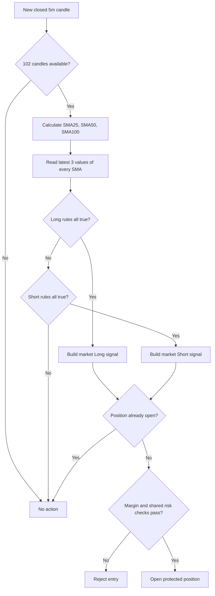

# Plan - Triple SMA Directional Strategy

## Timeframe portability review (2026-09-16)

The [shared timeframe contract](strategy-timeframe-support.md) governs this
extension. The `5m` restrictions below describe the original baseline, not the
new target. Runtime portability is pending implementation.

Review: `parameters.ts` locks `triggerTimeframe` to `5m` and `strategy.ts`
declares `requiredTimeframes: ["5m"]`, although evaluation already reads the
parameter-owned candle series.

Goal: Run `triple-sma-directional` on any valid supported trigger `T`.
Out of scope: Changing SMA25/50/100, slope rules, sizing or current defaults.
Steps:

1. In `src/strategies/triple-sma-directional/parameters.ts`, validate `T` against
   the shared enum; resolve `[T]` through the registry for every run path.
2. In `strategy.ts`, preserve 102-bar warm-up and three-value monotonic slope
   semantics on `T`. Holding and trailing updates use their existing candle
   rules at `T`; disclose the resulting elapsed duration.
3. Extend the strategy/registry tests with `1m`, `1h`, `1d` and venue-aligned
   `1w` profiles and baseline parity. Gate intervals on actual data support.

Verification: Static trace at an hourly close must read 102 closed hourly
bars and fill no earlier than the next open. With only 101 bars, emit no entry.
Append future bars and confirm historical SMA signals remain unchanged.

## Original baseline and implementation record

> **Status: version 1 implemented and verified in backtest/paper mode.**
>
> Origin: https://www.botcamp.xyz/strategies/cohort-5-ai-assistant-directional-strategy
>
> This document records the source rules, the repository mapping, the behavior
> that is currently implemented, and the remaining validation gates. It is the
> durable repository version of the original Triple SMA build plan.

## 1. Objective

Provide a candle-driven strategy named `triple-sma-directional` that:

- evaluates the active runtime symbol without branching on a hard-coded market;
- uses closed 5-minute candles and SMA periods 25, 50 and 100;
- emits Long, Short or no-entry decisions using the original directional rules;
- opens at most one position for the active symbol;
- sizes the first entry from a fixed quote notional;
- protects the position with stop loss and take profit orders;
- can use the shared maximum-holding and trailing-stop lifecycle;
- applies the active exchange's fee, spread and slippage assumptions in paper
  trading and backtests;
- restores an open position's candle-based lifecycle before trading resumes
  after a restart;
- runs through the same strategy and execution boundaries in backtest and paper
  mode.

Version 1 is a parity implementation. Extra indicators and optimization are
outside its acceptance boundary.

## 2. Evidence from the origin

The public source defines the following Triple SMA conditions.

### Long

All conditions must be true:

```text
SMA25 > SMA50 > SMA100
close > SMA25
the latest 3 SMA25 values are non-decreasing
the latest 3 SMA50 values are non-decreasing
the latest 3 SMA100 values are non-decreasing
```

### Short

All conditions must be true:

```text
SMA100 > SMA50 > SMA25
close < SMA25
the latest 3 SMA25 values are non-increasing
the latest 3 SMA50 values are non-increasing
the latest 3 SMA100 values are non-increasing
```

### No entry

If either complete condition set is not satisfied, the result is `NONE`. Partial
alignment is not an entry signal.

The non-strict slope comparisons are intentional. They match Pandas monotonic
semantics, so `[1, 1, 2]` is ascending and `[3, 3, 2]` is descending.

The source also exposes these execution inputs:

- exchange and trading pair;
- quote order amount;
- leverage;
- stop loss;
- take profit;
- optional time limit;
- optional trailing-stop activation and distance.

The public demo uses ETH-USDT on 5-minute candles with a 2.5 percent stop loss
and a 5 percent take profit. The source does not define exchange precision,
restart reconciliation, account isolation or fill simulation; those concerns
are owned by the existing repository services.

## 3. Repository placement and boundaries

### Strategy-owned files

```text
src/strategies/triple-sma-directional/
|-- parameters.ts
|-- signal.ts
|-- strategy.ts
|-- index.ts
|-- signal.test.ts
`-- strategy.test.ts
```

Responsibilities:

- `parameters.ts`: strict Zod schema, defaults and cross-field SMA validation.
- `signal.ts`: pure SMA and monotonic-direction evaluation.
- `strategy.ts`: map the pure result to the shared `Signal` contract and apply
  the strategy-level margin ceiling.
- `index.ts`: public exports.
- tests: lock signal parity, warm-up behavior, barriers and margin rejection.

### Shared integration files

- `src/strategies/strategy.interface.ts`: generic fixed-notional sizing
  capability.
- `src/strategies/initial-position-sizing.ts`: convert quote notional to whole
  exchange contracts.
- `src/strategies/strategy.registry.ts`: strategy registration, parsing and
  default parameter resolution.
- `src/engine/trading-engine.service.ts`: risk checks, protected entry, take
  profit, time exit, trailing stop and close notifications.
- `src/backtest/backtest-runner.service.ts`: deterministic fills, fees, funding
  and net PnL.
- `src/execution/paper-executor.service.ts`: paper fills, maker/taker fees,
  balance and persisted positions.
- `src/execution/position-lifecycle.ts`: restore holding count and price extrema
  after restart.
- `src/engine/engine-supervisor.service.ts`: restore lifecycle after history is
  loaded and before the engine is marked warm.
- `src/risk/execution-cost.ts`: exchange-specific public fee assumptions plus
  spread and slippage.
- `migrations/operational/0051_seed_triple_sma_directional_v1.sql`: template and
  account-owned version 1 parameter snapshots.

The strategy must not own exchange API calls, contract conversion, fee booking,
order persistence or restart reconciliation.

## 4. Implemented model

### 4.1 Candle and warm-up contract

- Required timeframe: `5m`.
- Input: closed candles from the active symbol's candle store.
- Price source: candle close.
- Warm-up requirement:

```text
slowSmaPeriod + slopeLookback - 1
= 100 + 3 - 1
= 102 closed candles
```

- A signal is evaluated only after enough data exists.
- SMA values are not rounded before comparisons.
- The signal timestamp is the latest evaluated candle timestamp.

### 4.2 Entry decision



The strategy returns no new entry while `context.openPosition` is non-null.
Order retries and duplicate candle protection remain engine responsibilities.

### 4.3 Sizing and margin

The configured quote notional is converted to a base quantity through the
active symbol specification:

```text
raw contracts = orderAmountUsd / (referencePrice * contractMultiplier)
contracts      = round down to quantityStepSize
base quantity  = contracts * contractMultiplier
required margin = orderAmountUsd / leverage
```

An entry is rejected when:

- the rounded contract count is below the exchange minimum;
- the strategy margin exceeds `accountBalance * maximumMarginUsageRate`;
- the shared risk guard rejects leverage, margin, exposure or account state;
- a protective stop cannot be supplied.

The default `orderAmountUsd` is 200 USDT. It provides enough notional headroom
for the minimum contracts of the currently enabled BTC, ETH, SOL and AVAX
futures markets, subject to the current market price and exchange rules.

Leverage changes required margin. It does not multiply the configured 200 USDT
target notional.

### 4.4 Stop loss and take profit

Version 1 creates fixed percentage barriers from the signal candle close:

```text
Long SL  = signal close * (1 - stopLossRate)
Long TP  = signal close * (1 + takeProfitRate)
Short SL = signal close * (1 + stopLossRate)
Short TP = signal close * (1 - takeProfitRate)
```

Defaults:

- stop loss: 2.5 percent;
- take profit: 5 percent.

The engine normalizes both prices to the symbol tick size. It opens the position
with a protective stop and then places a reduce-only take-profit order.

Current implementation note: the percentages are anchored to the signal close,
not recalculated from the final market fill. Spread, slippage and next-candle
movement can therefore make the realized return differ slightly from exactly
-2.5 percent or +5 percent. Re-basing barriers to the confirmed fill requires
an explicit versioned behavior change and parity backtest.

### 4.5 Fees and execution costs

Paper and backtest fills use the venue selected by each runtime account:

| Exchange | Maker fee per fill | Taker fee per fill |
|---|---:|---:|
| KuCoin Futures | 0.020% | 0.060% |
| Binance USD-M Futures | 0.020% | 0.050% |

Triple SMA entries are market orders and protective exits are treated as taker
fills. A normal round trip therefore books taker fees on both entry and exit.

```text
fee amount = fill price * filled base quantity * fee rate
net PnL = gross PnL - entry fees - exit fee - funding
```

Backtests additionally move simulated market fills against the strategy by the
configured half-spread and slippage ticks. `orderAmountUsd` is the position
notional before fees; fees are debited separately.

These are public standard-tier assumptions, not queried VIP or referral rates.
Telegram paper accounts contain an exchange selector but no private exchange
credentials or account-specific fee tier. If exact account fees are required,
they must be added as validated per-account settings or read from an
authenticated exchange API.

### 4.6 Multi-symbol behavior

The strategy has no symbol-specific branch. It reads `context.symbol`, while
the runtime resolves candles and market rules for that symbol.

The current supported universe is:

- `BTC/USDT:USDT`;
- `ETH/USDT:USDT`;
- `SOL/USDT:USDT`;
- `AVAX/USDT:USDT`.

For every symbol, contract multiplier, price tick, quantity step, minimum
quantity, maximum leverage and maintenance margin are read from the selected
exchange market specification. `defaultSymbol` is only a configuration default;
it is not a restriction inside the signal implementation.

### 4.7 Open-position lifecycle and restart

An open Triple SMA position can close through:

- stop loss;
- take profit;
- maximum holding candle count when the configured value is greater than zero;
- the shared trailing stop when enabled;
- manual stop or kill switch.

Version 1 does not close merely because the SMA entry condition disappears or
reverses. This preserves the original MVP rule: entries come from Triple SMA;
position exits come from the configured lifecycle.

On restart, the supervisor performs this order:

```text
restore persisted order and position state
-> load closed candle history
-> reconstruct held candle count and high/low since entry
-> mark the engine warm
-> open realtime streams
```

The reconstruction prevents restart from resetting a time exit or moving a
trailing-stop lifecycle backwards. The entry candle's high and low are excluded
because they may have occurred before the actual fill.

## 5. Version 1 parameters

| Parameter | Default | Meaning |
|---|---:|---|
| `triggerTimeframe` | `5m` | Closed-candle evaluation timeframe |
| `defaultSymbol` | `ETH/USDT:USDT` | Initial runtime selection only |
| `defaultLeverage` | `2` | Default configured leverage |
| `fastSmaPeriod` | `25` | Fast SMA window |
| `middleSmaPeriod` | `50` | Middle SMA window |
| `slowSmaPeriod` | `100` | Slow SMA window |
| `slopeLookback` | `3` | Recent SMA values used for direction |
| `orderAmountUsd` | `200` | Fixed target position notional |
| `stopLossRate` | `0.025` | 2.5 percent stop distance |
| `takeProfitRate` | `0.05` | 5 percent target distance |
| `maximumMarginUsageRate` | `0.1` | Strategy margin ceiling |
| `maximumHoldingCandleCount` | `0` | Disabled when zero |
| `trailingStopEnabled` | `false` | Use shared trailing stop when true |
| `volatilityFilterEnabled` | `false` | Use shared volatility filter when true |

Schema invariants:

- `fastSmaPeriod < middleSmaPeriod < slowSmaPeriod`;
- all SMA periods and slope lookback are positive integers;
- order amount is positive;
- stop-loss and take-profit rates are between zero and one;
- margin usage is greater than zero and no more than one;
- maximum holding count is a non-negative integer;
- unknown fields are rejected.

The operational migration creates one global template and one account-owned
copy for every Telegram account. Account-owned parameter changes do not mutate
another account's strategy snapshot.

## 6. Implementation and verification phases

### Phase A - Signal parity - complete

- Reused the repository SMA utility.
- Implemented non-decreasing and non-increasing slope helpers.
- Added pure Long, Short and None evaluation.
- Added exact warm-up handling for 102 candles.

### Phase B - Strategy and sizing integration - complete

- Registered `triple-sma-directional` version 1.
- Added strict parameter parsing and defaults.
- Added fixed-notional initial sizing through the shared strategy interface.
- Applied contract conversion and minimum-order validation.
- Applied strategy and shared margin/risk checks.

### Phase C - Protected execution - complete

- Added market entry signals for Long and Short.
- Added normalized protective stop and reduce-only take profit.
- Added fee booking and net-PnL reporting in paper/backtest execution.
- Preserved one-position behavior and existing idempotency boundaries.

### Phase D - Telegram and multi-symbol integration - complete

- Seeded account-owned strategy configurations.
- Made the strategy selectable for all current Telegram accounts.
- Confirmed BTC, ETH, SOL and AVAX market specifications and history coverage.
- Resolved paper fee assumptions from each account's selected exchange.

### Phase E - Restart hardening - complete

- Restored elapsed holding candles from entry time and closed history.
- Restored high/low extrema used by trailing lifecycle.
- Performed restoration before warm-up and realtime subscriptions.
- Made deliberate WebSocket shutdown exit without a false reconnect warning.

### Phase F - Remaining research gates

- Run longer in-sample and out-of-sample periods across trend and range regimes.
- Compare fee tiers and doubled-cost sensitivity.
- Decide whether version 2 should anchor SL/TP to confirmed fill price.
- Decide whether opposite SMA signals should become an early-exit rule.
- Validate optional trailing stop and volatility filter before enabling defaults.

## 7. Acceptance criteria

### Correctness

- Long and Short decisions match the complete Triple SMA rule sets.
- Equal adjacent SMA values preserve Pandas monotonic behavior.
- Exactly 102 closed candles are sufficient for default warm-up.
- No candle after the evaluated candle is visible to the strategy.
- A `NONE` result creates no order.
- An existing position creates no second Triple SMA entry.
- Duplicate delivery of a closed candle cannot create duplicate exposure.

### Execution and risk

- Fixed notional is converted through the active symbol contract rules.
- Required margin remains inside both strategy and shared account limits.
- Every opened position has a protective stop.
- Take profit and close orders are reduce-only.
- Entry and exit fees are included in net PnL.
- Funding is included when a funding event occurs during the holding period.
- Backtest market fills include the configured spread and slippage assumptions.

### Multi-account and restart

- Every Telegram account owns an isolated parameter snapshot and paper book.
- Paper fee assumptions follow that account's configured exchange.
- The strategy can run on every enabled symbol with no source-code symbol branch.
- Restart restores open positions before new candle processing.
- Holding count and trailing extrema never move backwards after restart.

### Operational safety

- Paper mode remains the default verification target.
- Live enablement requires explicit operator action and authenticated exchange
  configuration.
- A failed close remains tracked as open and is reported as a failure.
- A failed protective stop prevents an apparently safe open-position state.

## 8. Verification matrix

| Area | Evidence | Status |
|---|---|---|
| Long/Short/None signal | `signal.test.ts` | Passed |
| Pandas-compatible slopes | `signal.test.ts` | Passed |
| Warm-up boundary | `signal.test.ts` | Passed |
| Fixed-notional barriers | `strategy.test.ts` | Passed |
| Margin ceiling | `strategy.test.ts` | Passed |
| Entry and exit fee arithmetic | backtest engine verification | Passed |
| Maker/taker paper fills | paper resting-book tests | Passed |
| Holding limit disabled at zero | exit parity tests | Passed |
| Restart lifecycle reconstruction | `position-lifecycle.test.ts` | Passed |
| Restore-before-stream ordering | engine supervisor tests | Passed |
| Graceful WebSocket shutdown | WebSocket shutdown tests | Passed |
| Typecheck and production build | repository gates | Passed |
| Complete test suite | 708 tests passed; 14 database tests skipped | Passed |

Baseline smoke results recorded for 2026-08-16 through 2026-09-05:

| Symbol | Net PnL | Trades |
|---|---:|---:|
| BTC | +6.92 USDT | 11 |
| ETH | -2.56 USDT | 18 |
| SOL | +10.91 USDT | 22 |
| AVAX | +8.87 USDT | 17 |

These runs prove executable behavior, not future profitability. The sample is
too short to approve production risk or claim robustness.

## 9. Decisions and known limitations

1. **Barrier anchor:** current SL/TP uses the signal close. Confirm whether a
   future version should recalculate both from the confirmed entry fill.
2. **Actual account fees:** paper mode uses public venue rates. Decide whether
   Telegram accounts need editable or authenticated fee tiers.
3. **Signal-based exits:** version 1 holds until a lifecycle exit. Adding exit or
   reversal on an opposite Triple SMA signal changes trade distribution and
   requires a separate backtest comparison.
4. **Trailing defaults:** the capability exists but is disabled in the seeded
   baseline. Activation and distance come from shared engine configuration.
5. **Volatility filter:** the parameter can opt into the shared filter but the
   baseline keeps it disabled to preserve source parity.
6. **Live restored fee state:** exchange-reported open positions do not by
   themselves contain the historical entry fee. Accurate live restart PnL must
   continue to reconcile against persisted fills or an authenticated trade
   ledger.
7. **Backtest depth:** the recorded smoke period is a technical gate only. A
   longer walk-forward and cost-sensitivity study remains required.

## 10. Explicit non-goals for version 1

- ADX, RSI, MACD, EMA200, Supertrend or volume confirmation.
- ATR-based dynamic barriers.
- DCA, grid, martingale or same-direction stacking.
- Partial take profit.
- Pair trading, correlation, cointegration or portfolio allocation.
- Machine learning or automatic parameter optimization.
- Symbol-specific signal branches.
- Automatic live-trading enablement.
- A profitability guarantee.

Version 1 stops at this complete path:

```text
closed 5m candle
-> SMA25/SMA50/SMA100 and slope evaluation
-> Long, Short or None
-> fixed-notional contract sizing
-> account and exchange risk validation
-> one protected position
-> SL, TP, trailing, time or manual exit
-> fee/funding-aware net PnL
-> persisted and restart-safe lifecycle
```
