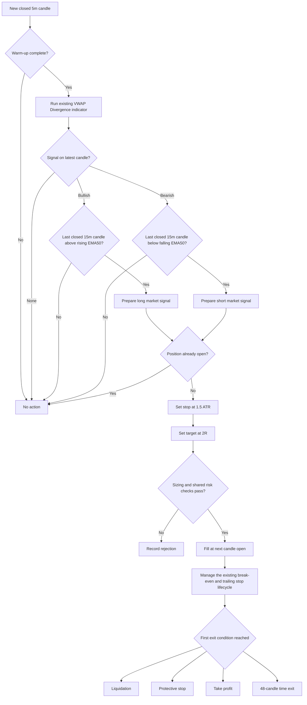

# Plan - VWAP Divergence Directional Strategy

## Timeframe portability review (2026-09-16)

Apply the [shared timeframe contract](strategy-timeframe-support.md). The
fixed `5m/15m` session-anchor profile below remains the baseline; extension is
pending implementation and per-profile validation.

Review: trigger/trend and `anchorPeriod` are literals in the strategy schema.
The existing indicator already exposes calendar anchors. Using the daily
session anchor on daily bars resets VWAP every bar and changes the intended
within-anchor divergence mechanism.

Goal: Support valid `T < C` profiles with an explicit compatible anchor.
Out of scope: Changing divergence direction, ATR filters or the indicator port.
Steps:

1. In `src/strategies/vwap-divergence-directional/parameters.ts`, accept enum
   trigger/trend values and existing indicator anchor choices. Keep Session
   as the default; validate the chosen anchor provides enough same-anchor
   trigger observations for the divergence lookback and slope comparison.
2. In `signal.ts`, resolve `[T, C]`, load the anchor's start plus recursive
   pre-roll, and evaluate only complete same-anchor comparisons. Keep spacing
   and lookbacks as `T` bars; use closed context EMA values.
3. Test hourly `1h/4h` with Session and daily `1d/1w` with an explicit Month
   anchor. Reject a trigger candle that straddles a required anchor boundary
   unless exact finer-source reconstruction has been specified and verified.

Verification: Static trace the first bar after an anchor reset: a slope or
divergence comparison must not bridge the old anchor. A later hourly signal
uses only context closed by that hour; future bars cannot change the result.

Weekly triggers remain blocked by the lack of a strictly higher context in
the current enum. Longer anchors alone do not resolve that missing dependency.

## Original baseline specification

> Status: draft for review. This plan does not authorize changes to the existing
> VWAP Divergence indicator implementation.
>
> Source: https://www.tradingview.com/script/bcLxWaDF-VWAP-Divergence-Flux-Charts/

## 1. Objective

Add a candle-driven strategy named `vwap-divergence-directional` that consumes
the existing `calculateVwapDivergence` result and can run through the repository's
current backtest engine without changing its core architecture.

The first version must:

- use closed `5m` candles for VWAP Divergence entry triggers;
- use the latest fully closed `15m` candle and its EMA50 to confirm the overall
  trend;
- enter long on the indicator's bullish divergence and short on its bearish
  divergence;
- fill market entries at the next candle open, following the existing backtest
  convention;
- hold at most one position for the active symbol;
- use the shared fixed-notional sizing, contract conversion, risk checks, fees,
  funding, spread and slippage models;
- place a mandatory ATR-based protective stop and a reward-to-risk target;
- produce the same decision from the same closed candles in backtest, paper and
  live evaluation paths;
- remain backtest-only until out-of-sample and paper gates pass.

The existing files below are inputs to this strategy and are not to be
restructured as part of the strategy build:

```text
src/indicators/vwap-divergence.ts
src/indicators/vwap-divergence.test.ts
```

## 2. What the source indicator actually detects

This is not classical pivot-to-pivot divergence. It compares the direction of
the latest price close with the latest slope of an anchored VWAP.

### Bullish event

All conditions are true on the latest closed candle:

```text
close[0] > close[1]
VWAP[0] < VWAP[1]
high[0] - low[lookback] > ATR(14) * ATR multiplier
cooldown has elapsed
no open-to-previous-close gap in the lookback is larger than ATR(14)
```

### Bearish event

All conditions are symmetric:

```text
close[0] < close[1]
VWAP[0] > VWAP[1]
high[lookback] - low[0] > ATR(14) * ATR multiplier
cooldown has elapsed
no open-to-previous-close gap in the lookback is larger than ATR(14)
```

The normal cooldown is more than 15 bars. It can fall to more than 10 bars when
the range of the latest 20 bars exceeds two ATR. Pine defaults are a lookback of
5 and an ATR multiplier of 3.

For crypto, the initial profile keeps the session anchor. In this repository a
session resets at UTC midnight, matching the candle timestamp contract and the
24/7 market-data model.

## 3. Decisions added by the strategy

The TradingView script is an indicator, not a complete trading system. It does
not specify order sizing, protective exits, maximum holding time or execution
costs. Version 1 therefore makes these explicit baseline decisions:

| Decision | Version 1 baseline | Reason |
|---|---:|---|
| Trigger timeframe | `5m` | Keeps Pine defaults usable while avoiding most `1m` microstructure noise |
| Trend timeframe | `15m` | Confirms the broader direction without adding a distant swing timeframe |
| Trend rule | Close relative to a rising/falling EMA50 | Requires both location and slope agreement |
| Entry | Market on next candle open | Existing causal backtest and live convention |
| Long trigger | Bullish divergence | Matches the source label and green signal |
| Short trigger | Bearish divergence | Matches the source label and red signal |
| Initial size | `200 USDT` fixed notional | Reuses existing cross-symbol sizing seam |
| Leverage | `2x` | Conservative research baseline |
| Stop | `1.5 * signal ATR` | Adapts to the volatility already used by the indicator |
| Target | `2R` from the stop distance | Tests positive payoff asymmetry without adding exit complexity |
| Maximum hold | `48` candles | Four hours on `5m`; prevents stale divergence positions |
| Opposite event while open | Ignore | Keeps entry edge separate from exit experiments |
| Trailing stop | Enabled | Reuses the engine's existing ATR trailing lifecycle |
| Break-even stop | Enabled | Protects open profit through the existing shared lifecycle |
| Shared volatility filter | Disabled | The divergence already contains an ATR movement filter |

These defaults are a research baseline, not a claim of profitability. They are
frozen before the first comparison run and changed only through named parameter
profiles.

## 4. Runtime flow



No signal calculation belongs in the engine or backtest runner. They continue
to own execution ordering, cost simulation, position persistence and risk.

## 5. Strategy parameter contract

Use one strict, flat Zod schema, consistent with the current strategy folders.
Only calculation and trading parameters belong in it.

```text
triggerTimeframe: "5m"
trendTimeframe: "15m"
defaultSymbol?: string
defaultLeverage: 2

orderAmountUsd: 200
maximumMarginUsageRate: 0.10

divergenceLookback: 5
divergenceAverageTrueRangeMultiplier: 3
averageTrueRangePeriod: 14
minimumDivergenceSpacingBars: 15
volatileMarketMinimumSpacingBars: 10
volatileMarketLookback: 20
volatileMarketRangeAverageTrueRangeMultiplier: 2
anchorPeriod: "session"
priceSource: "hlc3"
trendExponentialMovingAveragePeriod: 50

stopLossAverageTrueRangeMultiplier: 1.5
rewardToRiskRatio: 2
maximumHoldingCandleCount: 48

trailingStopEnabled: true
breakEvenStopEnabled: true
volatilityFilterEnabled: false
```

These switches enable the repository's existing shared implementations. Their
activation thresholds, buffers and trailing distances remain owned by the
runtime/backtest execution configuration and are recorded in each run. The
strategy must not duplicate those calculations or create strategy-specific
versions of them.

Validation must enforce:

- all periods and multipliers are positive;
- volatile-market spacing does not exceed normal spacing;
- reward-to-risk is positive and bounded to a safe research range;
- the ATR stop multiplier is positive and bounded;
- notional and margin-use rate are valid;
- trigger timeframe is exactly `5m` for version 1;
- trend timeframe is exactly `15m` for version 1;
- trend EMA period is at least 2;
- only session anchoring is enabled in version 1.

The strategy adapter builds `VwapDivergenceParameters` by spreading
`defaultVwapDivergenceParameters` and overriding calculation fields. Display
settings, plot offset and alert toggles stay at their current defaults and never
affect trading decisions.

## 6. Repository placement

Add one strategy-owned folder following the existing directional strategies:

```text
src/strategies/vwap-divergence-directional/
|-- index.ts
|-- parameters.ts
|-- parameters.test.ts
|-- signal.ts
|-- signal.test.ts
|-- strategy.ts
`-- strategy.test.ts
```

Responsibilities:

- `parameters.ts`: schema, baseline defaults and conversion into the existing
  indicator parameter type.
- `signal.ts`: call `calculateVwapDivergence` on `5m`, calculate EMA50 on `15m`,
  read only the latest fully closed higher-timeframe candle, and return an
  auditable neutral/long/short evaluation with VWAP, ATR and trend readings.
- `strategy.ts`: enforce no-entry-while-open, fixed-notional margin guard and
  build the repository's standard `Signal` object.
- tests: lock causality, long/short symmetry, stop/target math and integration
  behavior.

Only these existing integration points should change:

```text
src/strategies/strategy.registry.ts
src/strategies/strategy.registry.test.ts
```

The registry adds:

- the `vwap-divergence-directional` implementation;
- its default parameter resolver;
- its parameter parser;
- its fixed-notional sizing owner.

No changes are planned for:

```text
src/backtest/backtest-runner.service.ts
src/engine/trading-engine.service.ts
src/strategies/strategy.interface.ts
src/common/types/signal.type.ts
database schemas
exchange adapters
```

No operational migration is needed to run command-line backtests. A new seed
migration should be added only after the strategy passes research gates and is
approved for Telegram paper accounts.

## 7. Signal and barrier formulas

`signal.ts` evaluates the latest element only:

```text
latest bullish divergence -> LONG
latest bearish divergence -> SHORT
neither                    -> NONE
```

The divergence direction is permitted only when the latest fully closed `15m`
candle confirms it:

```text
Bullish trend confirmation:
15m close > current EMA50
current EMA50 > previous EMA50

Bearish trend confirmation:
15m close < current EMA50
current EMA50 < previous EMA50

Otherwise -> NONE
```

Price location and EMA slope must both agree. Equality is neutral. Calculate
the EMA from `15m` closes with the existing
`calculateExponentialMovingAverage` implementation.

If both flags are false, data is unavailable, volume is invalid or warm-up is
incomplete, return no evaluation. Both directions being true on one candle is
treated as invalid and produces no trade with an explicit test.

Barrier prices are calculated from the signal candle close and its ATR:

```text
stopDistance = ATR * stopLossAverageTrueRangeMultiplier

Long stop    = signalClose - stopDistance
Long target  = signalClose + stopDistance * rewardToRiskRatio

Short stop   = signalClose + stopDistance
Short target = signalClose - stopDistance * rewardToRiskRatio
```

The engine normalizes these prices to the symbol tick. Backtests fill market
entries at the next candle open, so realized risk and reward can differ from the
signal-candle calculation after gaps, spread and slippage. This behavior is
already shared with existing strategies and must not be changed here.

Set `isCounterTrend: false`: although the `5m` trigger contains price/VWAP
disagreement, the actual order direction must agree with the confirmed `15m`
trend. The EMA50 gate is strategy-owned; no new engine-level regime filter is
added.

## 8. Warm-up and causality

Reuse `src/strategies/warm-up.ts` so higher-timeframe requirements are converted
into trigger-timeframe candles consistently.

Warm-up requirements:

```text
5m VWAP Divergence: max(ATR period, divergence lookback + 1, 2)
15m trend:          EMA period + 1, because slope needs two EMA values

calculateWarmUpCandleCount([
  { candleCount: max(14, 6, 2), timeframe: "5m" },
  { candleCount: 51, timeframe: "15m" }
], "5m")
```

With the shared default margin of 20, this is `173` closed `5m` candles. The
indicator's own cooldown continues to suppress early events, preserving its
Pine behavior.

Causality requirements:

- use closed candles only;
- inspect only the final divergence flag from the available candle slice;
- use `readHigherTimeframeValue` or `findLastClosedHigherTimeframeIndex` to read
  the `15m` EMA and candle;
- pass the `5m` candle close time as the higher-timeframe observation time, so a
  `15m` candle becomes visible exactly when it has closed;
- never read the currently forming `15m` candle;
- never use `plotOffset` in signal logic;
- timestamp the signal with the latest candle's open timestamp, consistent with
  the repository contract;
- enter on the next candle, never on the candle whose close created the signal;
- appending a future candle must not change earlier signals;
- backtest and realtime evaluation must share the same strategy object.

## 9. Test plan

### Phase A - Preserve indicator contract

Run the existing indicator suite unchanged. Before strategy work begins it must
remain green.

Add no indicator refactor. If later fixtures prove a Pine-parity bug, handle it
as a separate reviewed patch with a failing regression test first.

Important known data constraint: the current TypeScript implementation rejects
the entire input if any candle has non-positive volume. The strategy plan treats
positive volume as a dataset precondition instead of changing that behavior.

### Phase B - Parameter tests

Prove:

- baseline defaults parse;
- unknown fields fail;
- invalid periods, multipliers, spacing and margin fail;
- non-`5m` trigger timeframes fail;
- non-`15m` trend timeframes fail;
- invalid trend EMA periods fail;
- unsupported anchors and price sources fail or are excluded from the schema;
- conversion to `VwapDivergenceParameters` preserves every calculation field.

### Phase C - Signal tests

Prove:

- bullish fixture produces LONG on the latest candle;
- bearish fixture produces SHORT;
- bullish divergence is blocked by neutral or bearish `15m` trend;
- bearish divergence is blocked by neutral or bullish `15m` trend;
- bullish divergence plus a closed `15m` candle above a rising EMA50 produces LONG;
- bearish divergence plus a closed `15m` candle below a falling EMA50 produces SHORT;
- a forming `15m` candle never confirms an entry;
- confirmation switches to the new `15m` value exactly at its close timestamp;
- no divergence produces NONE;
- a divergence on an older candle does not retrigger;
- the gap filter prevents entry;
- normal and volatile cooldowns are preserved;
- strict `>` comparisons at the ATR threshold match Pine;
- ATR and VWAP values included in the evaluation match the indicator output;
- adding a future closed candle does not mutate historical evaluations.

### Phase D - Strategy tests

Prove:

- LONG maps to `EnterLong` and SHORT maps to `EnterShort`;
- market order, symbol and candle timestamp are correct;
- long and short stop/target formulas are symmetric;
- `isCounterTrend` is false because the order agrees with the `15m` trend;
- an open position suppresses new entries;
- excessive required margin suppresses entry;
- fixed-notional sizing metadata points to `orderAmountUsd`;
- trailing-stop and break-even switches are enabled in the baseline while the
  shared engine remains their sole calculation owner;
- the reason string records direction, close, VWAP, ATR, lookback and multiplier.

### Phase E - Registry and engine parity

Prove:

- the registry resolves the new name, defaults and parser;
- required timeframes equal `["5m", "15m"]`;
- warm-up is calculated from parameters;
- the same fixture produces the same entry and barriers through direct strategy
  evaluation and the backtest runner;
- the backtest enters on the next candle rather than the signal candle;
- existing engine, registry and exit-parity suites remain green.

## 10. Backtest research plan

Do not optimize indicator and exit parameters together. That makes it impossible
to know whether the signal or the exit curve-fit the sample.

### Stage 1 - Frozen baseline

Run the exact version 1 defaults on:

- `BTC/USDT:USDT`;
- `ETH/USDT:USDT`;
- `SOL/USDT:USDT`;
- `AVAX/USDT:USDT`.

Use at least 12 months of verified `5m` and `15m` candles, preferably 24 months
when available. Verify both series cover the same period without gaps. Include
funding and the repository's normal taker fee, spread and slippage assumptions.

The first run answers only:

- does the entry signal beat random entries using the same exit model;
- does the frozen baseline reach at least `250` completed trades over the
  evaluated period;
- are costs consuming the gross edge;
- does either direction carry most of the result;
- does performance survive across symbols and market regimes.

### Stage 2 - Exit sensitivity

Keep indicator defaults frozen and test a small grid:

```text
stop ATR multiplier: 1.0, 1.5, 2.0
reward-to-risk:      1.0, 1.5, 2.0, 3.0
maximum hold bars:   24, 48, 96
baseline lifecycle:  break-even enabled, trailing enabled
```

For each selected neighboring exit region, run four named lifecycle diagnostics:

```text
break-even on,  trailing on   # version 1 baseline
break-even on,  trailing off
break-even off, trailing on
break-even off, trailing off
```

This ablation measures whether the combined lifecycle adds value or merely
hides a weak fixed stop/target profile. Keep both enabled as the runtime
candidate unless evidence rejects the baseline; do not optimize activation
thresholds in this stage. Select a broad stable region, not the single highest
return cell, and reject a candidate whose result collapses at one neighboring
value.

### Stage 3 - Indicator sensitivity

Freeze the selected exit profile, then test only:

```text
divergence lookback:     3, 5, 7
divergence ATR multiple: 2.0, 2.5, 3.0, 3.5
```

Keep ATR period, cooldowns, volatile-range rules, session anchor and HLC3 source
unchanged in version 1. More dimensions are deferred until evidence shows which
failure they are meant to solve.

Keep the `15m` EMA period frozen at 50 during the exit and divergence parameter
searches. Run one final ablation report with the trend gate disabled only to
measure whether confirmation adds value; it is not a candidate runtime profile.

### Stage 4 - Direction and regime audit

Report LONG and SHORT separately. Also break results down by month and by simple
realized-volatility buckets. A combined result does not pass if one direction
or one short market episode supplies nearly all profit.

### Stage 5 - One-way out-of-sample check

Use a chronological 70/30 split:

```text
first 70 percent -> research and parameter selection
last 30 percent  -> one final untouched validation
```

After reading the out-of-sample result, do not retune and call the same period
out-of-sample again.

## 11. Acceptance gates

Use the repository's existing `5m` to `15m` profile as the minimum gate:

- net profit factor greater than `1.5`;
- Sharpe ratio greater than `1.5`;
- maximum drawdown below `12%`;
- at least `250` completed trades for the evaluated period;
- positive expectancy after costs;
- zero liquidations;
- positive return when modeled execution cost is doubled;
- above the 90th percentile of random-entry runs;
- out-of-sample decay below `20%` when a paired sample is reported.

Additional VWAP-specific gates:

- no symbol contributes more than 60 percent of aggregate net profit;
- both LONG and SHORT results are shown even if only one side is retained later;
- at least three of the four research symbols have positive out-of-sample
  expectancy;
- friction consumes less than 50 percent of gross profit;
- the enabled break-even plus trailing baseline is reported against each
  lifecycle ablation so its incremental contribution is visible;
- neighboring parameter values remain directionally consistent.

Failure is a valid result. If the frozen signal cannot beat random entries or
double-cost execution, stop before adding more filters.

## 12. Implementation phases and stop conditions

### Phase 1 - Backtest-capable strategy

1. Add the strategy parameter schema and defaults.
2. Add the latest-candle signal adapter using the existing indicator.
3. Add the closed-`15m` EMA50 trend-confirmation gate with higher-timeframe
   no-lookahead alignment.
4. Add the standard strategy wrapper and ATR/R:R barriers.
5. Register the strategy and parser.
6. Run focused unit, registry, causality and backtest parity tests.

Stop when this command can resolve and replay the new strategy without changes
to the engine or runner:

```bash
npm run backtest -- \
  --strategy vwap-divergence-directional \
  --symbol "ETH/USDT:USDT" \
  --timeframe 5m \
  --sample in
```

### Phase 2 - Research

Run the staged matrix, store reports and write one strategy report containing
defaults, data periods, costs, per-symbol metrics, direction splits, sensitivity
and acceptance results.

Stop and reject version 1 when the signal fails the random-entry or doubled-cost
gate. Do not rescue it by adding unrelated indicators in the same version.

### Phase 3 - Paper promotion, only after approval

If research passes:

1. Add the next operational seed migration for a non-default strategy template.
2. Expose it to Telegram paper accounts only.
3. Run paper trading for at least 30 days or 100 closed trades.
4. Compare paper fill quality, frequency and drawdown with backtest assumptions.

Live enablement is a separate decision and is outside this build plan.

## 13. Explicit non-goals

- No edit or refactor of the existing VWAP Divergence indicator.
- No change to engine, backtest runner, strategy interface or signal type.
- No automatic optimizer.
- No timeframe beyond the `5m` trigger and `15m` confirmation pair.
- No trend model beyond the single `15m` EMA50 location-and-slope gate.
- No EMA ribbon, RSI, order-book, funding-rate or news filters.
- No scale-in, DCA, hedging or simultaneous long and short positions.
- No limit-entry experiment in the baseline.
- No Telegram/database migration before backtest acceptance.
- No live trading enablement.

## 14. Review decisions

The recommended version 1 assumptions are:

1. strategy name `vwap-divergence-directional`;
2. fixed `5m` trigger and `15m` trend-confirmation timeframes;
3. `15m` trend confirmation uses close versus a rising/falling EMA50;
4. ATR stop `1.5`, target `2R`, maximum hold `48` bars;
5. enable the existing shared break-even and trailing-stop lifecycle;
6. long bullish events only in bullish `15m` trend and short bearish events only
   in bearish `15m` trend;
7. backtest-only registration first, with no migration;
8. preserve the indicator implementation unchanged.

Once these are approved, Phase 1 is narrow enough to implement without any
core architectural change.
