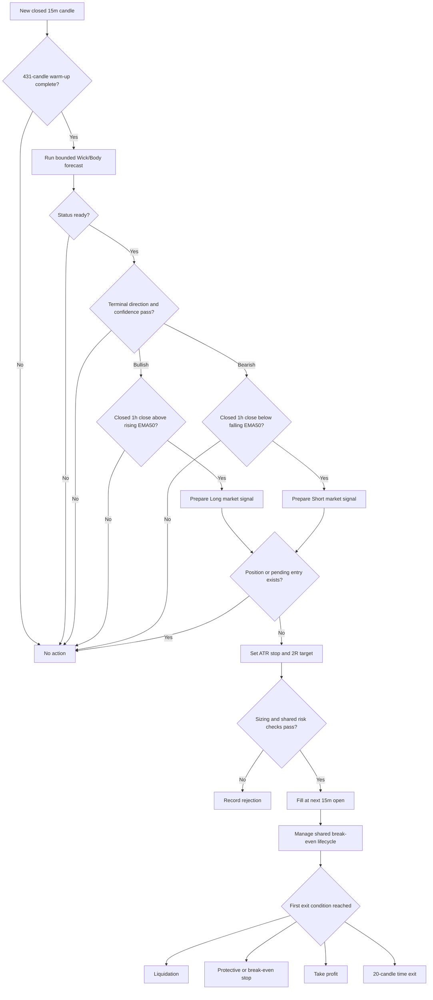

# Plan - Wick-to-Body Ratio Trend Forecast Strategy

## Timeframe portability review (2026-09-16)

Apply the [shared timeframe contract](strategy-timeframe-support.md). Fixed
`15m/1h` validation and tests below are baseline-only; the new target is pending.

Review: schema literals and the static dependency list lock `15m + 1h`.
Changing the trigger also changes the elapsed duration of each matched path.

Goal: Support valid `T < C` profiles for `wick-body-ratio-trend-forecast`.
Out of scope: Changing ratio matching, forecast statistics or indicator code.
Steps:

1. In `src/strategies/wick-body-ratio-trend-forecast/parameters.ts`, accept
   shared-enum trigger/trend values and require `C > T`; resolve `[T, C]`.
2. In `signal.ts`, derive warm-up from the actual profile, including history,
   forecast length, ATR and closed-context EMA stabilization. Keep
   `forecastLength` and holding counts as trigger bars. Ten forecast bars
   become ten hours at `1h`; do not label them as the baseline 2.5 hours.
3. Update schema, bounded/full and registry tests for `15m/1h`, `1h/4h`,
   `4h/1d`, plus invalid context order and missing-history tests.

Verification: Static trace hourly matched paths: every sampled path must end
at or before the decision candle, non-overlap remains enforced, and appending
future hourly bars cannot change an earlier forecast or next-open entry.

## Original baseline specification

> Status: draft for review. This plan does not authorize changes to the existing
> Wick-to-Body Ratio Trend Forecast indicator implementation.
>
> Source: https://www.tradingview.com/script/FGmvwby5-Wick-to-Body-Ratio-Trend-Forecast-Flux-Charts/

## 1. Objective

Add a candle-driven strategy named `wick-body-ratio-trend-forecast` that
consumes the existing `calculateWickBodyRatioForecast` result and runs through
the repository's current signal, risk, execution and backtest lifecycle.

Version 1 must:

- use closed `15m` candles to produce the Wick-to-Body forecast and trigger an
  entry candidate;
- use the latest fully closed `1h` candle and EMA50 to confirm the overall
  trend;
- enter Long only when a sufficiently strong bullish forecast agrees with the
  bullish `1h` trend;
- enter Short only when a sufficiently strong bearish forecast agrees with the
  bearish `1h` trend;
- fill market entries at the next `15m` candle open;
- hold at most one position for the active symbol;
- use shared fixed-notional sizing, contract conversion, margin checks, fees,
  funding, spread, slippage and position management;
- use an ATR-based protective stop, reward-to-risk target, maximum holding time
  and break-even protection;
- produce identical decisions from identical closed candles in backtest, paper
  and live evaluation paths;
- remain backtest-only until research and paper acceptance gates pass.

The existing indicator files are inputs and are not restructured in this build:

```text
src/indicators/wick-body-ratio-forecast.ts
src/indicators/wick-body-ratio-forecast.test.ts
```

## 2. Verified indicator behavior

The source indicator forecasts price movement after the latest closed candle by
finding historical candles with a similar wick-to-body ratio and averaging the
price paths that followed those candles. It is a forecasting visualization, not
a complete entry, sizing or exit system.

The existing TypeScript implementation preserves these core behaviors:

- the latest closed candle is the forecast price basis;
- the ratio used for matching comes from the candle immediately before the
  basis candle, matching Pine's `ratio[1]` behavior;
- matching uses the absolute difference between the magnitudes of the target
  ratio and historical ratio;
- when directional bias is enabled, a historical candle must have the same
  bullish or bearish sign as the target-ratio candle;
- a matched historical path contains the next `forecastLength` close-price
  displacements from that historical candle;
- matched historical paths cannot overlap, preventing one price move from
  being counted repeatedly;
- every reference path ends no later than the current basis candle, preventing
  future leakage;
- each forecast point contains average displacement, projected price and
  standard deviation across all accepted historical paths;
- forecast direction is the sign of the terminal average displacement;
- doji or zero-range ratios are invalid and cannot produce a forecast.

The existing indicator suite passes 6 tests and must remain unchanged during
strategy implementation.

### Pine and local defaults

The public Pine source and local TypeScript contract agree on the primary
defaults:

```text
lookback period:          400
forecast length:          10
ratio type:               General Ratio
direction bias:           true
default accuracy:         Medium
minimum references:       5
maximum references:       15
previous pattern lines:   false
regressed pattern lines:  false
trend squares:            true
trend-square labels:      true
warning display:          true
```

The adaptive acceptable range starts at `0.02` for Medium accuracy. It widens by
`0.01` when fewer than five references are available and narrows by `0.005`
when more than fifteen are available, bounded between `0` and `0.06` in the
local implementation.

Only `status = ready` is tradeable. `insufficient_history`,
`invalid_target_ratio`, `no_references`, `too_few_references` and
`too_many_references` all close the entry gate.

## 3. Strategy interpretation

The indicator's bullish or bearish direction alone is not a sufficient entry
signal. A terminal displacement barely above or below zero would otherwise
create a trade even when the historical paths have no meaningful edge.

Version 1 therefore adds two strategy-owned confidence gates. These do not
modify the indicator or claim to be part of the Pine algorithm.

```text
terminalAverageDisplacement = forecast[forecastLength - 1].averageDisplacement
terminalStandardDeviation   = forecast[forecastLength - 1].standardDeviation

terminalReturnRate = terminalAverageDisplacement / basisPrice

terminalSignalToNoise =
  terminalStandardDeviation == 0
    ? null
    : abs(terminalAverageDisplacement) / terminalStandardDeviation

terminalDispersionPass =
  terminalStandardDeviation == 0
    ? abs(terminalAverageDisplacement) > 0
    : abs(terminalAverageDisplacement)
        >= minimumSignalToNoiseRatio * terminalStandardDeviation
```

The zero-deviation case represents complete agreement among the accepted
historical terminal paths. If both displacement and deviation are zero, the
forecast is Flat and no trade is allowed. `null` is stored for the undefined
numeric ratio instead of serializing positive infinity; the explicit
`terminalDispersionPass` boolean owns the trading decision.

Baseline confidence rules:

```text
abs(terminalReturnRate) >= 0.002
terminalDispersionPass == true
```

The `0.002` threshold requires an average terminal move of at least 0.2 percent
over the default ten-bar forecast horizon. The signal-to-noise gate requires
the average terminal move to be at least as large as the terminal cross-pattern
dispersion. Both are frozen research defaults, not Pine-parity settings.

### Long candidate

At the close of a `15m` basis candle, all conditions must be true:

```text
forecast status == ready
forecast direction == bullish
terminalReturnRate >= minimumForecastReturnRate
terminalDispersionPass == true
latest fully closed 1h close > current 1h EMA50
current 1h EMA50 > previous 1h EMA50
no open position or pending entry exists
```

### Short candidate

The symmetric conditions must be true:

```text
forecast status == ready
forecast direction == bearish
terminalReturnRate <= -minimumForecastReturnRate
terminalDispersionPass == true
latest fully closed 1h close < current 1h EMA50
current 1h EMA50 < previous 1h EMA50
no open position or pending entry exists
```

Equality in the EMA location or slope gate is neutral. A Flat forecast, weak
forecast, high-uncertainty forecast or direction/trend mismatch produces no
trade.

## 4. Exact trigger timing

For a basis candle with timestamp `t`:

1. Wait until the `15m` candle at `t` is fully closed.
2. Run the indicator using candles available through that close only.
3. The indicator uses candle `t` as `basisPrice` and candle `t - 1` as the
   wick/body target ratio.
4. Read only historical reference paths that end at or before candle `t`.
5. Evaluate the terminal forecast direction, return and dispersion.
6. At the `15m` close observation time, select the latest fully closed `1h`
   candle and its current and previous EMA50 values.
7. If every entry gate passes, emit a market-entry signal timestamped with the
   basis candle.
8. Fill the order at the next `15m` candle open through the shared engine.

The strategy never enters at the close price that created the signal. That
close remains the reference price used to calculate initial barriers, while
the actual fill includes the next-open gap, half-spread and configured
slippage.

### Signal lifetime

The forecast belongs only to its current basis candle:

- if every gate passes, emit one market signal for the next `15m` open;
- if trend, confidence, position or margin validation fails, discard the
  forecast rather than arming a delayed setup;
- do not wait for price to touch `projectedPrice`;
- do not reuse an older bullish or bearish forecast on a later candle;
- calculate a completely new forecast after each subsequent `15m` close.

This differs intentionally from the Nadaraya yellow-zone strategy. Wick-to-Body
predicts a future path; it does not publish a stable price zone that can own a
resting trigger order.

## 5. Baseline decisions

| Decision | Version 1 baseline | Reason |
|---|---:|---|
| Strategy name | `wick-body-ratio-trend-forecast` | Matches the indicator and directional use |
| Trigger timeframe | `15m` | Reduces wick/body noise while retaining intraday entries |
| Trend timeframe | `1h` | Preserves a 4:1 higher-timeframe confirmation relationship |
| Trend rule | Close versus rising/falling EMA50 | Requires price location and slope agreement |
| Entry | Market at next `15m` open | Shared causal execution convention |
| Long trigger | Ready, strong bullish forecast + bullish trend | Trades only forecast/trend agreement |
| Short trigger | Ready, strong bearish forecast + bearish trend | Symmetric directional mapping |
| Minimum forecast return | `0.002` | Rejects near-zero terminal forecasts |
| Minimum signal-to-noise | `1.0` | Rejects forecasts dominated by path dispersion |
| Initial size | `200 USDT` fixed notional | Reuses cross-symbol contract sizing |
| Leverage | `2x` | Conservative research baseline |
| Stop | `1.5 * ATR(14)` from signal close | Volatility-adjusted protection |
| Target | `2R` from stop distance | Simple positive payoff asymmetry |
| Maximum hold | `20` trigger candles | Five hours on `15m`, twice the default forecast horizon |
| Opposite forecast while open | Ignore | Keeps entry and exit experiments separate |
| Break-even stop | Enabled | Uses the shared fee-aware protection lifecycle |
| Trailing stop | Disabled | Preserves a controlled stop/target baseline |
| Shared volatility filter | Disabled | Avoids stacking an unrelated entry filter initially |

These values are frozen before the first comparison run and changed only via
named research profiles.

The default forecast horizon is ten `15m` candles, or 2.5 hours. The baseline
maximum hold is 20 candles, or five hours, so a position cannot remain open for
many multiples of the forecast horizon. Stage 2 must still compare the exact
forecast-horizon exit against longer 20-, 32- and 48-bar variants. The forecast
terminal price itself is not a take-profit order.

### Timeframe impact analysis

Moving the trigger from `5m` to `15m` changes the interpretation of the same
indicator parameters without changing the indicator algorithm:

- each wick/body observation represents three times more market time, which
  should reduce microstructure noise and isolated wick spikes;
- the default ten-bar forecast now describes 2.5 hours rather than 50 minutes;
- lookback 400 now spans about 4.2 days instead of about 33 hours;
- signal frequency will fall, so acceptance must emphasize sufficient trades
  and per-regime stability rather than assume the old `5m` sample count;
- `1h` trend confirmation keeps the original 4:1 trigger-to-trend ratio; using
  `15m` for both trigger and confirmation would not be a true MTF filter;
- entry remains causal at the next trigger-candle open, so maximum detection-to-
  fill latency increases from at most five minutes to at most 15 minutes.

## 6. Runtime flow



No Wick-to-Body signal logic belongs in the engine or backtest runner. Those
layers remain responsible for position state, exit ordering, cost accounting
and execution.

## 7. Strategy parameter contract

Use a strict flat Zod schema consistent with the current directional strategy
folders:

```text
triggerTimeframe: "15m"
trendTimeframe: "1h"
defaultSymbol?: string
defaultLeverage: 2

orderAmountUsd: 200
maximumMarginUsageRate: 0.10

lookbackPeriod: 400
forecastLength: 10
ratioType: "general"
directionBias: true
defaultAccuracy: "medium"
minimumReferenceCount: 5
maximumReferenceCount: 15

minimumForecastReturnRate: 0.002
minimumSignalToNoiseRatio: 1.0

trendExponentialMovingAveragePeriod: 50
averageTrueRangePeriod: 14
stopLossAverageTrueRangeMultiplier: 1.5
rewardToRiskRatio: 2
maximumHoldingCandleCount: 20

trailingStopEnabled: false
breakEvenStopEnabled: true
volatilityFilterEnabled: false
```

Validation must enforce:

- trigger timeframe is exactly `15m`;
- trend timeframe is exactly `1h`;
- lookback is between 35 and 700;
- forecast length is between 5 and 32;
- minimum references are positive and do not exceed maximum references;
- ratio type and accuracy are supported enum values;
- minimum forecast return is positive and bounded to a safe research range;
- minimum signal-to-noise is nonnegative and bounded;
- trend EMA period is at least 2;
- ATR period, stop multiplier, reward-to-risk and maximum hold are positive;
- order notional and maximum margin-use rate are valid;
- visual-only indicator settings are not exposed as strategy parameters.

The adapter builds `WickBodyRatioForecastParameters` by spreading
`defaultWickBodyRatioForecastParameters` and overriding only the calculation
fields. `patternLines`, `regressedPatternLines`, `trendSquares`,
`trendSquareLabels` and `displayWarnings` remain indicator display defaults and
never affect a trading decision.

## 8. Repository placement

Add one strategy-owned folder matching the current strategy structure:

```text
src/strategies/wick-body-ratio-trend-forecast/
|-- index.ts
|-- parameters.ts
|-- parameters.test.ts
|-- signal.ts
|-- signal.test.ts
|-- strategy.ts
`-- strategy.test.ts
```

Responsibilities:

- `parameters.ts`: strict schema, defaults and conversion to the existing
  indicator parameter type;
- `signal.ts`: bounded indicator calculation, terminal confidence readings,
  ATR14 and closed-`1h` EMA50 confirmation;
- `strategy.ts`: no-entry-while-open guard, fixed-notional margin check and
  construction of the repository's standard `Signal` object;
- tests: indicator parity, causality, confidence gates, trend alignment,
  barrier math and backtest entry timing.

`signal.ts` should expose one auditable evaluation object containing at least:

```text
direction: "LONG" | "SHORT" | "NONE"
candleTimestamp
basisPrice
targetRatio
acceptableRange
referenceCount
terminalAverageDisplacement
terminalStandardDeviation
terminalReturnRate
terminalSignalToNoise: number | null
terminalDispersionPass
averageTrueRange
trendClosePrice
currentTrendExponentialMovingAverage
previousTrendExponentialMovingAverage
bullishTrend
bearishTrend
```

The strategy wrapper consumes this object but does not recalculate indicator or
trend values. That keeps signal selection testable separately from order
construction.

Only these existing integration points should change:

```text
src/strategies/strategy.registry.ts
src/strategies/strategy.registry.test.ts
```

The registry adds the implementation, defaults, parser and fixed-notional
sizing owner.

No changes are planned for:

```text
src/indicators/wick-body-ratio-forecast.ts
src/backtest/backtest-runner.service.ts
src/engine/trading-engine.service.ts
src/strategies/strategy.interface.ts
src/common/types/signal.type.ts
database schemas
exchange adapters
```

No migration is required for command-line backtests. Add an operational seed
only after research passes and the strategy is approved for Telegram paper
accounts.

## 9. Bounded calculation window

The backtest runner evaluates the strategy on every closed `15m` candle. Running
the indicator over the complete growing history on every evaluation would
create an unnecessary full-history rescan.

The exact latest-forecast requirement is:

```text
lookbackPeriod + forecastLength + 1
= 400 + 10 + 1
= 411 trigger candles
```

The extra candle is required because the latest basis candle uses the previous
candle's ratio. The oldest candidate then needs its complete ten-candle future
path through the basis window.

`signal.ts` passes only the latest required `15m` slice to the existing
indicator. The optimization is accepted only if tests prove that bounded and
full-history calculations have identical latest:

```text
status
direction
basis timestamp and price
ratio timestamp and target ratio
acceptable range
reference timestamps, ratios and future displacements
forecast average displacements, projected prices and standard deviations
```

Raw `candleIndex` values are slice-relative and are not compared directly;
reference timestamps identify the same source candles. The indicator algorithm
itself must not be edited to achieve bounded execution.

For non-default profiles, calculate the window dynamically as
`lookbackPeriod + forecastLength + 1`.

Use a strategy-owned helper such as
`calculateWickBodyRatioForecastCalculationWindowCandleCount(parameters)` for
both bounded selection and warm-up requirements. Do not duplicate the formula
in the wrapper and tests.

## 10. Signal and barrier contract

`signal.ts` evaluates only the latest forecast result:

```text
Ready bullish + strength pass + bullish 1h trend -> LONG
Ready bearish + strength pass + bearish 1h trend -> SHORT
all other combinations                              -> NONE
```

Barrier prices use ATR14 on the trigger timeframe and the signal candle close:

```text
stopDistance = latest ATR * stopLossAverageTrueRangeMultiplier

Long stop    = signal close - stopDistance
Long target  = signal close + stopDistance * rewardToRiskRatio

Short stop   = signal close + stopDistance
Short target = signal close - stopDistance * rewardToRiskRatio
```

The engine normalizes stop and target prices to the symbol tick. Since market
entry fills at the next candle open, realized R can differ after a gap, spread
or slippage. Do not rebase barriers inside this strategy because that would
change the shared execution contract.

Set `isCounterTrend: false`: the order direction agrees with the confirmed
`1h` trend.

The reason string records direction, basis price, target ratio, ratio type,
reference count, acceptable range, terminal displacement, terminal return,
terminal standard deviation, nullable signal-to-noise value, dispersion-pass
result, ATR and current/previous `1h` EMA readings.

## 11. Warm-up and higher-timeframe causality

Reuse `calculateWarmUpCandleCount` from `src/strategies/warm-up.ts`.

```text
15m Wick/Body forecast: 400 + 10 + 1 = 411 candles
15m ATR:                14 candles
1h trend EMA slope:     50 + 1 = 51 candles

calculateWarmUpCandleCount([
  { candleCount: 411, timeframe: "15m" },
  { candleCount: 14, timeframe: "15m" },
  { candleCount: 51, timeframe: "1h" }
], "15m")
```

The `1h` requirement converts to 204 `15m` candles. The 411-candle forecast
requirement is larger, so with the shared 20-candle margin the default warm-up
remains `431`, now measured in closed `15m` candles. This represents about 4.5
days of trigger history rather than roughly 36 hours under the former `5m`
profile.

Higher-timeframe and forecast causality rules:

- observation time is the latest `15m` candle open timestamp plus 15 minutes;
- use `findLastClosedHigherTimeframeIndex` or `readHigherTimeframeValue`;
- a `1h` candle becomes visible exactly at its close timestamp;
- never read a currently forming `1h` candle;
- a missing current or previous EMA50 value closes the entry gate;
- the target ratio is always taken from the candle before the forecast basis;
- every selected reference path must finish no later than the basis candle;
- appending future candles must not alter a previously evaluated decision.

## 12. Cost and position accounting

The strategy does not calculate exchange fees itself. It reuses the shared
backtest and execution layers.

Every completed trade includes:

```text
net PnL = gross PnL
        - entry fee
        - exit fee
        - funding
        - slippage cost
```

Entry simulation includes taker fee, half-spread and configured slippage. The
`200 USDT` parameter is target position notional before fees; fees are deducted
separately and do not silently enlarge the position. Exit orders include their
own fees and execution friction.

Break-even protection remains fee- and funding-aware through the existing
engine implementation. `breakEvenStopEnabled` is `true` and
`trailingStopEnabled` is `false`; the strategy must not duplicate either
lifecycle.

## 13. Test plan

### Phase A - Preserve indicator contract

- Keep all six existing indicator tests green.
- Lock Pine defaults and all four signed ratio formulas.
- Preserve direction bias, adaptive range and non-overlapping reference paths.
- Preserve the rule that references cannot extend beyond the basis candle.
- Preserve invalid handling for doji and zero-range target candles.
- Treat any discovered Pine/local parity defect as a separate regression patch,
  not as part of the strategy adapter.

### Phase B - Parameter tests

Prove:

- baseline defaults parse and unknown fields fail;
- non-`15m` trigger and non-`1h` trend timeframes fail;
- invalid lookback, forecast length, reference bounds, ratio type and accuracy
  fail;
- invalid confidence, EMA, ATR, R:R, notional, margin and holding limits fail;
- conversion preserves every strategy-relevant indicator field;
- visual indicator fields remain unchanged and are not accepted as trading
  parameters;
- trailing defaults to false, break-even to true and the volatility filter to
  false.

### Phase C - Bounded-window parity tests

For histories longer than the dynamic required window, prove bounded and
full-history calculations match at the latest basis candle across:

- bullish, bearish and flat forecasts;
- high, medium and low accuracy profiles;
- all four ratio types;
- direction bias enabled and disabled;
- widening, narrowing and exact reference-count boundaries;
- exactly the first valid candle and one candle before it.

### Phase D - Signal and causality tests

Prove:

- ready bullish forecast above both confidence thresholds plus bullish `1h`
  confirmation produces LONG;
- ready bearish forecast above both confidence thresholds plus bearish `1h`
  confirmation produces SHORT;
- Flat and every non-ready status produce NONE;
- return exactly at the minimum threshold is accepted;
- nonzero-deviation signal-to-noise exactly at the minimum threshold is
  accepted;
- zero standard deviation with nonzero displacement stores a null numeric ratio
  and passes the explicit dispersion gate;
- zero displacement never enters;
- direction/trend mismatch, EMA equality and flat EMA produce NONE;
- a forming `1h` candle cannot confirm an entry;
- a `1h` candle becomes available exactly at its close;
- target ratio comes from the candle before the basis candle;
- no reference path crosses the observation boundary;
- a rejected forecast is not reused by a later candle;
- projected price never creates a resting or delayed entry;
- future candles do not change past decisions;
- audit readings match the raw indicator output and serialize without non-finite
  numbers.

### Phase E - Strategy tests

Prove:

- LONG maps to `EnterLong` and SHORT maps to `EnterShort`;
- market order, symbol, signal timestamp and reference price are correct;
- long and short stop/target formulas are symmetric;
- `isCounterTrend` is false;
- open positions, pending entries and excessive margin suppress entry;
- fixed-notional sizing metadata points to `orderAmountUsd`;
- break-even is enabled, trailing is disabled and shared engine ownership is
  preserved;
- reason text contains every required forecast and trend reading.

### Phase F - Registry and backtest parity

Prove:

- registry resolves `wick-body-ratio-trend-forecast`, defaults and parser;
- required timeframes equal `["15m", "1h"]`;
- default warm-up equals 431 trigger candles;
- backtest entry fills at the next `15m` open, never the signal candle;
- direct strategy evaluation and runner replay create the same barriers;
- entry, exit and net-PnL accounting include configured costs;
- existing registry, causality, engine and exit-parity suites remain green.

## 14. Backtest research plan

Do not tune entry, indicator and exit dimensions in the same stage.

### Stage 1 - Frozen baseline

Run the exact defaults on:

- `BTC/USDT:USDT`;
- `ETH/USDT:USDT`;
- `SOL/USDT:USDT`;
- `AVAX/USDT:USDT`.

Use at least 12 months of verified `15m` and `1h` candles, preferably 24 months.
Both timeframes must cover the same period without gaps. Include fees, funding,
spread and slippage.

Report:

- combined and per-symbol results;
- LONG and SHORT separately;
- ready-forecast frequency and rejection counts by gate;
- reference-count, acceptable-range, terminal-return and dispersion
  distributions;
- trade frequency and holding time;
- gross profit versus execution friction;
- stop, target and time-exit distribution;
- performance by month and volatility regime;
- random-entry and doubled-cost benchmarks.

### Stage 2 - Exit sensitivity

Keep the indicator, confidence and trend parameters frozen:

```text
stop ATR multiplier: 1.0, 1.5, 2.0
reward-to-risk:      1.0, 1.5, 2.0, 3.0
maximum hold bars:   10, 20, 32, 48
break-even:          enabled and frozen
trailing stop:       disabled and frozen
```

The ten-bar variant exits at the default forecast horizon. Select a stable
neighboring region, never only the highest-return cell.

### Stage 3 - Forecast confidence sensitivity

Freeze the selected exit profile and indicator settings:

```text
minimum terminal return: 0.001, 0.002, 0.003, 0.005
minimum signal-to-noise: 0.5, 1.0, 1.5, 2.0
```

Report the trade-frequency loss at each threshold. Reject profiles whose
performance depends on one isolated confidence cell.

### Stage 4 - Indicator sensitivity

Freeze the chosen confidence and exit profile, then use a small grid:

```text
lookback period: 200, 400, 700
forecast length: 5, 10, 20
accuracy:        high, medium, low
direction bias:  true, false
```

Keep General Ratio as the version 1 runtime candidate. Run Top Wick, Bottom
Wick and Body Ratio only as separately reported diagnostics so their different
semantics are not mixed into one optimization surface.

Recalculate the bounded window and warm-up for every lookback/forecast pair.

### Stage 5 - Confirmation ablation

Run one diagnostic report with the `1h` EMA gate disabled. This measures
whether higher-timeframe confirmation improves expectancy or drawdown. The
disabled variant is not a version 1 runtime candidate.

### Stage 6 - One-way out-of-sample validation

Use a chronological 70/30 split. Tune only on the first 70 percent, freeze the
selected profile, then read the final 30 percent once. Retuning after seeing the
result invalidates the out-of-sample claim.

## 15. Acceptance gates

Use the repository's directional acceptance thresholds for the `15m` to `1h`
profile:

- profit factor greater than `1.5`;
- Sharpe ratio greater than `1.5`;
- maximum drawdown below `12%`;
- at least `250` completed trades in the evaluated period;
- positive expectancy after all costs;
- zero liquidations;
- positive result at doubled execution cost;
- above the 90th percentile of random-entry runs;
- out-of-sample decay below `20%`.

Additional strategy gates:

- at least three of four research symbols have positive out-of-sample
  expectancy;
- no one symbol supplies more than 60 percent of aggregate net profit;
- friction consumes less than 50 percent of gross profit;
- LONG and SHORT results are disclosed separately;
- bounded-window parity is exact at the latest forecast basis;
- nearby confidence and indicator parameters remain directionally consistent;
- the selected maximum hold is justified against the configured forecast
  horizon rather than inherited without measurement;
- the EMA confirmation improves expectancy or drawdown versus the diagnostic
  no-confirmation run;
- results are not concentrated only in forecasts with very few references or
  at the maximum acceptable range.

If the frozen signal cannot beat random entry or doubled costs, stop before
adding RSI, volume, order-book or another indicator filter.

## 16. Implementation phases and stop conditions

### Phase 1 - Backtest-capable strategy

1. Add the parameter schema and indicator adapter.
2. Add bounded latest-forecast calculation with exact parity tests.
3. Add terminal return and finite, serializable dispersion gates.
4. Add ATR14 and closed-`1h` EMA50 signal evaluation.
5. Add the standard strategy wrapper and protective barriers.
6. Register defaults, parser and fixed-notional sizing.
7. Run focused tests and a short database-backed smoke replay.

Stop when this command resolves and replays the strategy without changes to the
engine or runner:

```bash
npm run backtest -- \
  --strategy wick-body-ratio-trend-forecast \
  --symbol "ETH/USDT:USDT" \
  --timeframe 15m \
  --sample all \
  --benchmark false
```

### Phase 2 - Research

Run the staged matrix and write a report containing data periods, costs,
per-symbol metrics, direction splits, forecast-quality distributions, exit
distribution, sensitivity and acceptance results.

Stop and reject version 1 if entry does not beat random entry or becomes
negative at doubled cost. Do not rescue it by silently adding filters.

### Phase 3 - Paper promotion, only after approval

If research passes:

1. Add the next operational seed migration as a non-default strategy template.
2. Expose it to Telegram paper accounts only.
3. Run at least 30 days or 100 closed paper trades.
4. Compare forecast frequency, fills, costs and drawdown with backtest
   assumptions.

Live enablement is a separate decision outside this plan.

## 17. Explicit non-goals

- No edit or refactor of the existing Wick-to-Body indicator.
- No use of a forming `15m` or `1h` candle.
- No replacement of the indicator's matching or adaptive-range algorithm.
- No regression-line or visual trend-square logic in trading decisions.
- No timeframe beyond the `15m` trigger and `1h` confirmation pair in the
  version 1 runtime profile.
- No RSI, volume, order-book, news or funding-rate entry filter.
- No scale-in, DCA, hedge or simultaneous Long/Short positions.
- No forecast-based dynamic position size in version 1.
- No delayed entry, projected-price touch order or reuse of an older forecast.
- No indicator-based exit or opposite-forecast reversal.
- No trailing stop in the baseline.
- No limit-order experiment or automatic optimizer.
- No migration, Telegram exposure or live enablement before acceptance.

## 18. Review decisions

Recommended version 1 assumptions:

1. strategy name `wick-body-ratio-trend-forecast`;
2. closed `15m` candles produce the forecast and entry trigger;
3. closed `1h` EMA50 location and slope confirm the overall trend;
4. only `status = ready` forecasts can trade;
5. default General Ratio, lookback 400, forecast 10, Medium accuracy and
   directional bias remain unchanged;
6. terminal return of at least 0.2 percent and signal-to-noise of at least 1.0
   are explicit strategy-owned research gates;
7. each forecast can emit only one market signal for the next `15m` open and is
   never reused as a delayed setup;
8. ATR stop 1.5, target 2R and maximum hold 20 bars, with forecast-horizon exits
   measured during sensitivity testing;
9. shared break-even enabled and trailing stop disabled;
10. fixed notional 200 USDT and leverage 2;
11. default warm-up of 431 closed `15m` candles;
12. fees at entry and exit, funding, spread and slippage remain shared engine
    responsibilities;
13. backtest-only registry integration first, with no migration;
14. existing indicator, engine and runner remain structurally unchanged.

Once approved, Phase 1 is narrow enough to implement without modifying the
repository's core strategy or backtest architecture.
