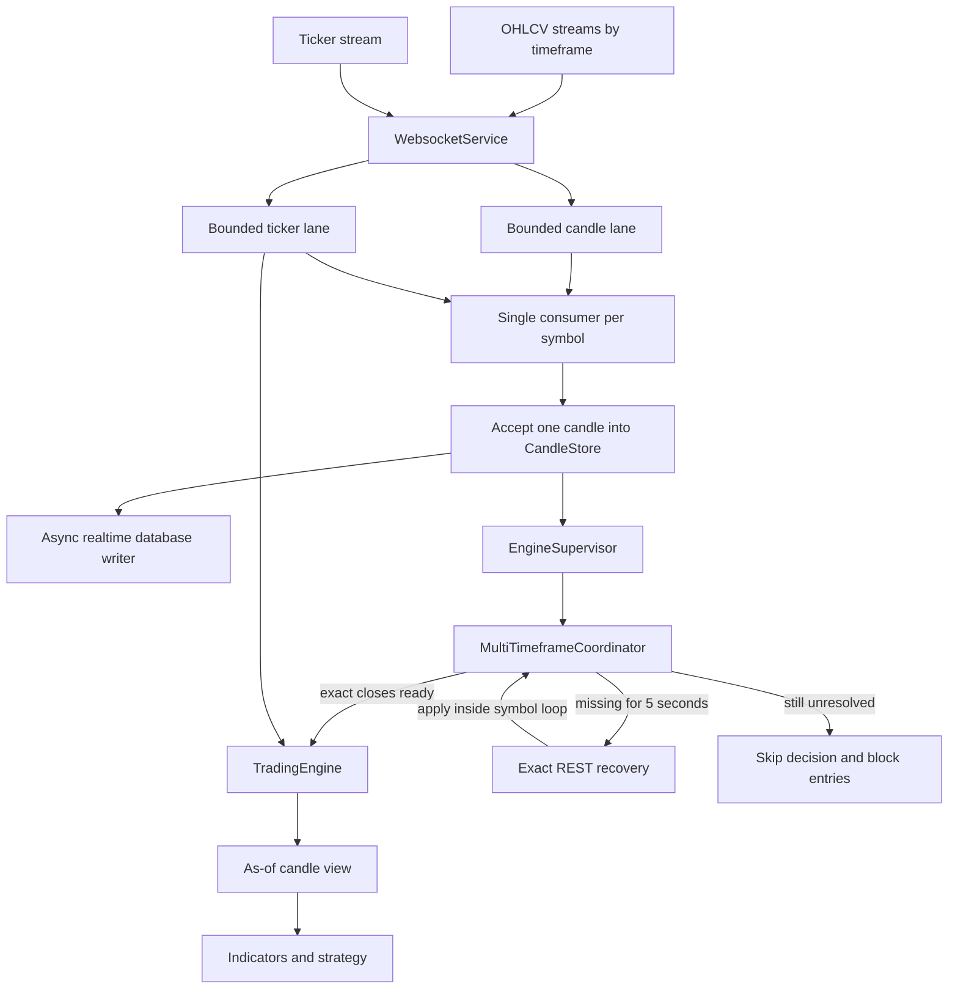

# Realtime market-data causality and backpressure

> **Status: implementation snapshot, pending final review (2026-09-08).**
> This document describes the realtime lookahead/backpressure change set in the
> current working tree. It is a design and review aid, not a statement that all
> findings in [Open review findings](#10-open-review-findings) are resolved.

## 1. Problem

The previous WebSocket path accepted a complete OHLCV batch into the candle
store before invoking closed-candle callbacks one by one. If one batch contained
two closed candles, the callback for `t1` could read both `t1` and `t2` from the
store. Indicators calculated during the `t1` callback therefore had access to a
future candle.

The same path also used one effectively unbounded sequence for candle and ticker
work. A slow strategy, exchange call, or recovery batch could produce:

- Unbounded pending work and memory growth.
- Tickers delaying a newly closed strategy candle.
- Different results depending on the arrival order of independently watched
  timeframes.
- Large reconnect batches evaluating stale entry signals one by one.
- A failed handler advancing market data without an explicit entry-safety gate.

## 2. Safety invariants

The implementation is built around these rules:

1. A strategy decision at `decisionTimestamp` may only read candles whose close
   timestamp is less than or equal to that timestamp.
2. The first accepted version of a closed candle is immutable for the lifetime
   of the realtime run.
3. Market events for one symbol never execute concurrently.
4. Candle and ticker backlogs are bounded independently.
5. A trigger waits for the exact eligible close of every required timeframe.
6. Missing timeframe data is recovered by REST after five seconds.
7. A decision older than thirty seconds may manage existing exposure but may
   not create new exposure.
8. Handler failures are not retried blindly because the failed attempt may
   already have submitted an exchange order.
9. Operational entry blocks are independent. Clearing one incident must not
   clear a manual pause, circuit-breaker halt, or another active incident.
10. Paper and backtest paths use the same candle close-time visibility rule as
    realtime.

## 3. Architecture



The important ordering boundary is the per-symbol consumer. A candle is added
to the store only when its own task starts. The callback for `t1` therefore
cannot see `t2` merely because both arrived in the same exchange batch.

## 4. Component changes

| Component | Responsibility after this change |
|---|---|
| `src/market-data/market-event-dispatcher.ts` | Owns bounded per-symbol candle/ticker queues, single-consumer execution, candle priority, producer backpressure, task health, watermarks, failure isolation, and slow-handler warnings. |
| `src/market-data/websocket.service.ts` | Converts exchange batches into serialized tasks, reserves pending close timestamps, coalesces forming candles, attaches generation/batch metadata, performs reconnect recovery, and drains on shutdown. |
| `src/market-data/candle-store.service.ts` | Keeps the first closed version immutable, inserts exact recovered candles into recent gaps, and exposes close-time as-of reads. |
| `src/market-data/market-view.ts` | Implements the shared binary-search cutoff used by live execution and backtests. |
| `src/market-data/multi-timeframe-coordinator.ts` | Holds trigger decisions until every required exact close is present, preserves decision-time order, reports pending state, and rejects old generations. |
| `src/engine/engine-supervisor.service.ts` | Coordinates timeframe readiness, bounds pending triggers, performs REST recovery, handles recovery batches, queue-pressure incidents, stale decisions, handler failures, persistence, and execution reconciliation. |
| `src/engine/trading-engine.service.ts` | Reads as-of candle windows, maintains independent realtime entry-block reasons, replays paper recovery risk state, and restores live position lifecycle as of a decision. |
| `src/backtest/backtest-runner.service.ts` | Uses the same close-time visibility rule rather than exposing a higher-timeframe candle that is still forming. |
| `src/market-data/realtime-candle-writer.service.ts` | Drains queued database writes during application shutdown. |
| Module and runtime factories | Pass queue capacities, timing policies, and reconciliation dependencies into the main and isolated paper runtimes. |

## 5. Event flows

### 5.1 Normal closed-candle batch

For each OHLCV response, `WebsocketService`:

1. Converts valid rows into `Candle` values.
2. Deduplicates and sorts rows by `openTimestamp`.
3. Uses exchange time to split closed candles from the newest forming candle.
4. Filters timestamps already stored or already reserved by an in-flight task.
5. Assigns batch metadata after filtering, so the final accepted callback has
   `isLastInBatch=true`.
6. Enqueues each closed candle without adding later candles to the store early.
7. When the task executes, accepts exactly that candle, then invokes the
   supervisor callback.
8. Coalesces queued forming-candle updates by symbol/timeframe.

The pending timestamp reservation prevents an overlapping reconnect backfill
from replacing the first stream payload admitted for a closed candle.

### 5.2 Multi-timeframe decision barrier

For a trigger decision at timestamp `D`, each required timeframe must contain
the exact candle whose close is:

```text
requiredClose = alignTimestampToTimeframe(D, timeframe)
```

The coordinator records both a monotonic watermark and recently observed exact
close timestamps. A later watermark alone is insufficient; the exact required
close must be present in the coordinator or candle store.

Ready triggers drain only from the oldest prefix. A newer trigger cannot pass an
older unresolved trigger and change state out of event-time order.

### 5.3 Barrier recovery

If the oldest trigger remains unresolved for
`MARKET_TIMEFRAME_BARRIER_TIMEOUT_MS`:

1. Determine the exact missing timeframe closes.
2. Fetch those candles over REST outside the serialized symbol queue.
3. Re-enter the symbol queue with a serialized control task.
4. Insert each recovered candle without replacing an existing first close.
5. Record the recovered exact close and retry ready triggers.
6. If the trigger is still unresolved, discard that decision and keep new
   entries blocked by the degraded-market-data gate.

Generation checks are repeated before applying recovered data, so a late REST
response from a previous symbol/configuration cannot affect its replacement.

### 5.4 Reconnect backfill

After a candle stream failure, recovery performs:

1. A candle-lane barrier for tasks admitted before the outage.
2. Internal gap repair against the current store window.
3. An explicit tail fetch from the candle after the latest stored close through
   the latest exchange-closed candle.
4. Deduplication and ordered admission through the normal dispatcher path.

A multi-candle trigger batch contributes one current strategy decision at its
newest accepted candle. Earlier paper candles are replayed through fill, stop,
position-extreme, and time-exit handling instead of opening stale entries.

### 5.5 Ticker path

Ticker events use a separate bounded lane. The dispatcher still executes only
one event at a time for a symbol, but chooses a queued candle before a queued
ticker. Ticker producers wait at capacity rather than dropping an event already
accepted by the application.

This preserves state serialization between candle-driven strategy work and
ticker-driven fills, ladders, or exits.

## 6. Failure and degradation behavior

| Condition | Behavior |
|---|---|
| Candle queue reaches capacity | Producer waits, overflow health increments, and the supervisor installs an operational entry block when it observes the incident. |
| Ticker queue reaches capacity | Producer waits; accepted ticker work is not intentionally dropped by the dispatcher. |
| Handler exceeds warning threshold | Emit a warning while the handler is still running. Do not cancel it because it may have submitted an order. |
| Candle handler throws | Isolate the failure so the symbol loop continues, block new entries, notify once, and reconcile execution state. Do not retry the candle blindly. |
| Stateful ticker handler throws | Keep entries blocked until the stateful runtime completes a later clean reconciliation tick. |
| Timeframe remains missing | Skip the unresolved trigger, raise a degraded-data incident, and keep new entries blocked. |
| Decision is older than maximum delay | Apply a temporary entry block during that event; existing-position management still executes. |
| Runtime generation changes | Reject queued or late callbacks belonging to the old generation. |
| Process shuts down | Drain market-event work and then drain realtime candle database writes. |

## 7. Entry gates

`TradingEngineService` stores operational block reasons in a `Set<string>`.
Entry signals require both:

```text
no operational block reasons
AND
circuit breaker allows new entries
```

The realtime change introduces these independent reasons:

- `market data is degraded`
- `market data recovery`
- `market event queue overflow`
- `handler failure`
- `stale market decision`

Exit signals, protective stops, time exits, and existing-position handling are
not rejected by this entry-only gate.

The current working tree also adds `market anomaly`; see
[Concurrent worktree changes](#11-concurrent-worktree-changes).

## 8. Configuration

| Environment variable | Default | Meaning |
|---|---:|---|
| `MARKET_CANDLE_QUEUE_CAPACITY` | `512` | Maximum queued candle tasks per symbol before producer backpressure. |
| `MARKET_TICKER_QUEUE_CAPACITY` | `128` | Maximum queued ticker tasks per symbol before producer backpressure. |
| `MARKET_TIMEFRAME_BARRIER_TIMEOUT_MS` | `5000` | Wait before exact REST recovery for a missing timeframe close. |
| `MARKET_MAXIMUM_DECISION_DELAY_MS` | `30000` | Maximum decision age allowed to create new exposure. |
| `MARKET_HANDLER_WARNING_MS` | `1000` | Runtime after which an in-flight handler is reported as slow. |

The values are validated in `src/configuration/environment.schema.ts` and wired
through `src/market-data/market-data.module.ts`, `src/engine/engine.module.ts`,
and `src/notification/telegram-paper-runtime.ts`.

## 9. Test coverage

| Test file | Main guarantees |
|---|---|
| `src/market-data/websocket-ordering.test.ts` | No same-batch lookahead, no overlapping handlers, forming-candle coalescing, immutable pending closes, batch metadata, reconnect tail recovery, and generation races. |
| `src/market-data/market-event-dispatcher.test.ts` | Single consumer, lane priority, bounded producer backpressure, deduplication, failure isolation, health watermarks, and live slow-handler warning. |
| `src/market-data/multi-timeframe-coordinator.test.ts` | Exact boundary readiness, arrival-order determinism, ordered pending triggers, timeout discard, retention, and generation guards. |
| `src/engine/engine-supervisor.test.ts` | Arrival-order parity, REST barrier recovery, unresolved skips, stale gates, queue incidents, handler reconciliation, recovery batching, and old-generation rejection. |
| `src/engine/entry-trigger.test.ts` | Live as-of indicator visibility, ticker timestamp cutoffs, protective-indicator causality, and operational entry blocks. |
| `src/backtest/edge-cases.test.ts` | Higher-timeframe candles become visible only at their close. |
| `src/market-data/candle-store.test.ts` | Immutable first close, exact recovered insertion, bounded windows, and inclusive close-time views. |
| `src/market-data/websocket-shutdown.test.ts` | Dispatcher shutdown and pending work behavior. |
| `src/market-data/realtime-candle-writer.test.ts` | Retry behavior and shutdown drain. |

Validation completed before the concurrent worktree changes appeared:

- TypeScript typecheck passed.
- Focused realtime/supervisor suite: `104 passed`.
- Full Vitest suite: `830 passed`, `15 skipped`.
- Biome passed for the 23 realtime change-set files.

The repository-wide Biome command already has unrelated diagnostics under
`scripts/diagnostics` and other support scripts. Review should distinguish that
baseline from lint results for the files in this change set.

## 10. Open review findings

These findings were identified after the validation snapshot and should be
resolved or explicitly accepted before treating the PR as complete.

### High

1. **Queue-overflow entry blocking is not immediate.** The supervisor samples
   dispatcher health at handler entry. A producer can reach capacity while that
   handler awaits balance, strategy, or order I/O, allowing the same handler to
   submit an entry before a later event observes the overflow.
2. **A skipped unresolved trigger can leave lifecycle state behind.** The
   trigger is discarded without replaying/restoring its mechanical fill, stop,
   position-extreme, and time-exit effects. A later exact candle can clear the
   degraded gate while local position lifecycle is still missing that bar.
3. **Paper recovery does not replay strategy exit signals.** Earlier recovered
   candles replay fills, protective stops, and time exits, but an indicator exit
   that was true only on an earlier recovered candle can be missed.
4. **Weekly alignment uses the Unix-epoch Thursday anchor.** The generic
   `alignTimestampToTimeframe()` implementation does not match exchanges whose
   weekly candles start on Monday, so an exact `1w` barrier can request a close
   that never exists.

### Medium

1. **Backtest exact-gap behavior differs from realtime.** The as-of view falls
   back to the latest older higher-timeframe candle when an exact expected close
   is missing; realtime recovers or skips that decision.
2. **The as-of binary search assumes ascending input.** Current database and
   REST readers sort data, but `replaceClosedCandles()` and the backtest dataset
   contract do not enforce or validate the invariant.
3. **Backtest and realtime retain different history lengths.** Backtest uses an
   unbounded historical prefix while realtime uses a bounded rolling window.
   Recursive EMA/Wilder/SuperTrend values can diverge after the live window
   starts rolling.
4. **Strict candle priority can increase ticker latency during a large candle
   recovery.** Tickers remain queued, but time-sensitive ticker exits may execute
   late while candle work continuously occupies the symbol loop.
5. **The multi-MA EMA89 branch has a warm-up mismatch.** Its declared warm-up is
   based on the Quantum Edge EMA50 requirement, while the branch requires 89
   four-hour candles. Backtest and realtime can enable that branch at different
   points.

## 11. Concurrent worktree changes

The working tree currently contains another, broader change set that appeared
after the realtime validation snapshot. It is related to market-data safety but
was not part of the original lookahead/backpressure scope:

- `src/risk/market-anomaly-guard.ts` adds a causal rolling-median true-range
  guard with hysteresis and an entry-only `market anomaly` block.
- The supervisor, engine modules, environment schema, backtest runners, reports,
  and CLI scripts integrate anomaly periods into live and backtest behavior.
- Market-data sync adds closed-range normalization and targeted repair of
  leading, internal, and trailing candle gaps.
- REST history pagination changes its terminal boundary from exclusive to
  inclusive.

Before opening one PR, confirm whether these changes belong in the same scope.
If they do, they need a separate correctness review and a fresh full validation
run. If they do not, keep them in a separate branch or PR so the realtime fix is
reviewable on its own.

## 12. Suggested PR structure

The work can remain one PR while being split into reviewable commits:

1. Shared as-of market view and immutable candle-store behavior.
2. Bounded dispatcher and WebSocket event admission.
3. Exact multi-timeframe coordinator and supervisor recovery policy.
4. Trading-engine entry gates, recovery handling, and backtest parity.
5. Runtime configuration, shutdown drain, observability, and tests.
6. Market anomaly and historical gap repair only if explicitly included in the
   same approved scope.

## 13. Reviewer checklist

- Reproduce the original `[t1, t2]` batch probe and verify the `t1` callback sees
  only `t1`.
- Run the same-boundary arrival permutations for trigger, `1h`, and `4h`.
- Verify exact REST recovery uses the expected open timestamp and cannot apply
  after a generation switch.
- Saturate each queue while a handler is in flight and inspect entry-gate timing.
- Inject failures before and after an order submission; verify no blind retry.
- Replay a recovery batch with an open paper position and transient indicator
  exit.
- Test the oldest supported weekly boundary against the configured exchange.
- Compare a long rolling-window live simulation with the same backtest segment.
- Confirm shutdown persists every closed candle admitted before teardown.
